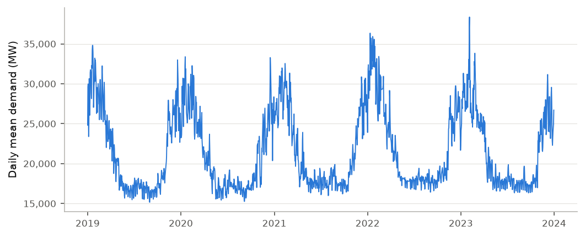
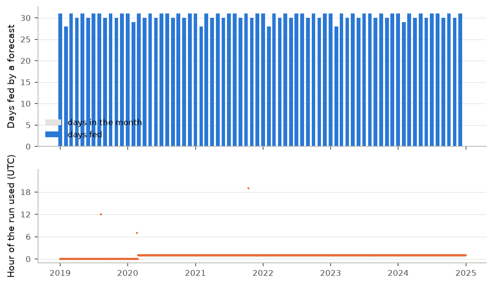
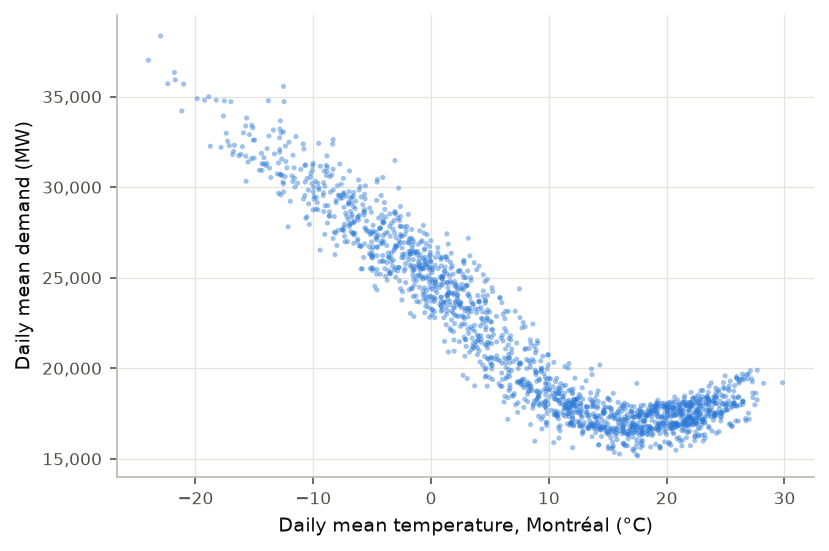
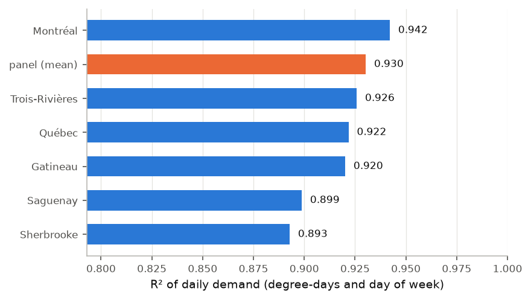
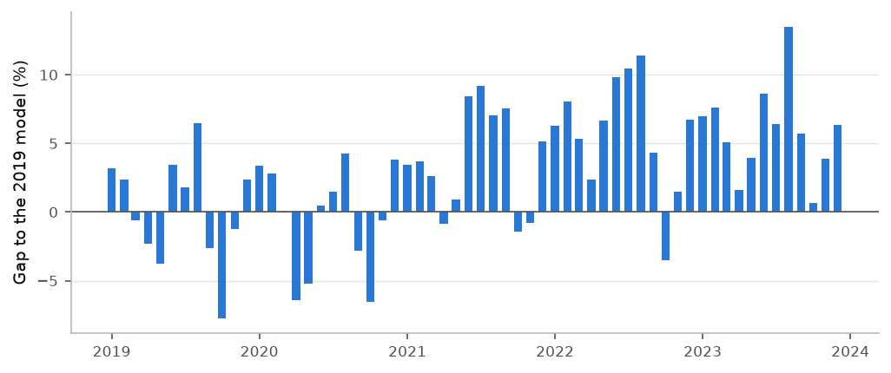

# Data quality and representativeness

_Generated from MLflow run `718b9c3a51ad46009cf33e04db045e46` (2026-10-18 07:20 UTC), code `c9d98aaa957b`. Every measured value in this report comes from that run; none is typed by hand. This English version is derived from the French one, which is the reference._

> Demand data: Hydro-Québec, "Historique de la demande d'électricité au Québec" (https://donnees.hydroquebec.com/explore/dataset/historique-demande-electricite-quebec/), licensed CC BY-NC 4.0 (https://creativecommons.org/licenses/by-nc/4.0/). Hydro-Québec offers this data for information only, without warranty of quality; it is not official data. This project checked it, masked or corrected a few hours (each case documented) and aggregated it; it does not redistribute the dataset, and the reports quote only a few hourly values from it, as evidence.
>
> Weather data: Environment and Climate Change Canada, used under the Open Government Licence – Canada (https://open.canada.ca/en/open-government-licence-canada).
>
> Extracted from the Environment and Climate Change Canada Historical Climate Data web site ( https://climate.weather.gc.ca/index_e.html ) on 2026-10-14.
>
> Weather forecasts: NOAA National Blend of Models NBS guidance for station CYUL (Montréal-Trudeau), downloaded from the Iowa Environmental Mesonet archive of Iowa State University (https://mesonet.agron.iastate.edu/). This project interpolated these three-hourly forecasts to hourly values and converted them to degrees Celsius: the values it uses are modified and are not original NOAA data.
>
> Neither Hydro-Québec, Environment and Climate Change Canada, NOAA nor the Iowa Environmental Mesonet produced, reviewed or endorsed this work, and the project is affiliated with neither NOAA nor the Iowa Environmental Mesonet.
>
> Built with Claude Code under the repository owner's direction.

## In brief

- **52,608 hours** of demand, from 2019-01-01 06:00 UTC to 2025-01-01 05:00 UTC; **99.89%** are usable.
- When clocks go back in the fall, two values arrive under the same UTC hour and the hour before is missing. The order of the two values is not recorded, so these **12 hours** (6 nights) are masked, never guessed.
- **One record** carries a timestamp 365 days off; it is moved back, with its evidence (section 3.2).
- **45 hours** are blank at the source, in 2 runs (the longest: 41 hours). They stay blank.
- Each of the 6 weather stations has a temperature for at least 99.2% of the hours.
- v2's temperature forecast fed **100.00%** of the window's 2,192 days; none of its points is 75 hours or more after its issue (section 4.1).
- Over 2019–2023, Montréal's degree-days and the day of the week reproduce **94.2%** of the variation in daily demand; with the mean of the 6 stations, **93.0%**.
- The busiest hour of 2019–2023 is the hour ending 2023-02-03 18:00 EST: **42,473 MW**, at −26.1 °C in Montréal.

## 1. Sources

| Source | Licence | Read on | Rows | SHA-256 |
|---|---|---|---|---|
| Hydro-Québec, `historique-demande-electricite-quebec` | CC BY-NC 4.0 | 2026-10-14T02:21:14Z | 52,608 | `74c406d3068c` |
| ECCC, MONTREAL INTL A (7025251) | see `docs/data-licences.md` | 2026-10-14 | 73 months | manifest |
| ECCC, QUEBEC INTL A (7016293) | see `docs/data-licences.md` | 2026-10-14 | 73 months | manifest |
| ECCC, OTTAWA GATINEAU A (7032685) | see `docs/data-licences.md` | 2026-10-14 | 73 months | manifest |
| ECCC, SHERBROOKE (7028123) | see `docs/data-licences.md` | 2026-10-14 | 73 months | manifest |
| ECCC, BAGOTVILLE A (7060400) | see `docs/data-licences.md` | 2026-10-14 | 73 months | manifest |
| ECCC, TROIS RIVIERES A (7018561) | see `docs/data-licences.md` | 2026-10-14 | 73 months | manifest |
| NOAA, NBM forecasts (NBS, station CYUL), Iowa Environmental Mesonet archive | see `docs/data-licences.md` | 2026-10-17 | 6 yearly files | manifest |

Data never enters the repository: `valiwatt fetch` downloads it, and every file is checked against its hash before use. Hydro-Québec gives the dataset a modification date of 2026-06-05.

**The stations.** One station per major population centre; Montréal is the primary station. Their coverage is measured in section 4.

| Centre | Station | Climate ID | Why this one |
|---|---|---|---|
| Montréal | MONTREAL INTL A | 7025251 | Primary station named in the brief; the largest population centre. |
| Québec | QUEBEC INTL A | 7016293 | Québec City airport station. |
| Gatineau | OTTAWA GATINEAU A | 7032685 | Gatineau airport station. |
| Sherbrooke | SHERBROOKE | 7028123 | Sherbrooke station, for Estrie. |
| Saguenay | BAGOTVILLE A | 7060400 | Bagotville airport station, for Saguenay–Lac-Saint-Jean. |
| Trois-Rivières | TROIS RIVIERES A | 7018561 | Trois-Rivières airport station, for Mauricie. |

## 2. Time conventions

- **Demand.** Each value is the mean demand over the hour that **ends** at the timestamp, in UTC. The first hour of the series is stamped 2019-01-01 06:00 UTC: midnight to 1 a.m. Eastern Standard Time.
- **Weather.** The temperature at a UTC hour is the observation made at that instant; it is requested from ECCC in UTC. Without an explicit time zone the service returns rows with no values, so the download refuses any response whose header is not in UTC.
- **Days.** For daily aggregates, an hour belongs to the day (Eastern Standard Time, UTC−5) in which it **starts**.
- **Daylight saving.** Everything is kept in UTC, where each hour exists once. Outside the cases in sections 3.1 and 3.2, no UTC hour is absent from the export (blank values are in section 3.3): the spring change leaves no gap in it.

## 3. Demand: checks and anomalies

_Daily mean demand, 2019–2023 (complete days only). Hours after 2023 are not plotted: they belong to the 2024 replay, seen by the developers. The checks in sections 3 and 4 cover the whole window._

### Gates

A gate that fails stops the chain: no canonical data is written and the command exits with an error. Each one has a test that injects the fault it must catch.

| Check | Result | Measure | Threshold |
|---|---|---|---|
| Expected window, no record outside it | passed | 0 outside | 0 |
| Every duplicate matches a known shape | passed | 0 unresolved | 0 |
| Values within loose physical bounds (2019–2024) | passed | 13,294 to 42,473 MW | 5,000 to 60,000 MW |
| Share of usable hours | passed | 99.89% | ≥ 99% |

### 3.1 Clocks going back: masked hours

On the night clocks go back, local 1 a.m. happens twice. In the data, both values arrive under the UTC stamp of the second one, and the UTC hour before is missing. Nothing says which came first.

To judge whether continuity could order them, we compare the length of the path previous hour → first → second → next hour in both orders. When both orders give almost the same path, a guess would be arbitrary. Both hours are therefore masked every time, the same way.

| Night (repeated local hour) | Missing UTC hour | Values received (MW) | Path, better order (MW) | Path, other order (MW) | Margin (MW) |
|---|---|---|---|---|---|
| 2019-11-03 01:00 | 2019-11-03 05:00 UTC | 18,301.79; 17,963.20 | 898 | 1,575 | 677 |
| 2020-11-01 01:00 | 2020-11-01 05:00 UTC | 20,001.77; 19,884.29 | 516 | 664 | 148 |
| 2021-11-07 01:00 | 2021-11-07 05:00 UTC | 18,793.52; 18,685.38 | 550 | 566 | 16 |
| 2022-11-06 01:00 | 2022-11-06 05:00 UTC | 14,788.72; 14,447.54 | 994 | 1,676 | 682 |
| 2023-11-05 01:00 | 2023-11-05 05:00 UTC | 18,857.18; 18,821.29 | 553 | 553 | 0 |
| 2024-11-03 01:00 | 2024-11-03 05:00 UTC | 19,883.02; 19,764.86 | 502 | 655 | 153 |

The margin ranges from 0 to 682 MW. A rule that ordered some nights and not others would be fragile.

### 3.2 Misplaced record: repair with evidence

The timestamp 2023-01-01 05:00 UTC carries two values while 2022-01-01 05:00 UTC has none. The value 22,945.84 MW fits naturally between the neighbours of 2022-01-01 05:00 UTC, and 20,516.80 MW between those of 2023-01-01 05:00 UTC. The total path is 2,145 MW in this assignment against 9,864 MW the other way round: a ratio of 4.6. 2022-01-01 05:00 UTC is the only hour without a record whose two neighbours are known: no other destination is possible. The rule moves a value only if both values are inside the physical bounds (5,000 to 60,000 MW), if the ratio between the two assignments is at least 2.0, and if the destination is unambiguous: the next best hour without a record whose neighbours are known costs at least 2.0 times the chosen destination's cost, or there is none. Otherwise nothing moves, the hour stays an unresolved duplicate, and the gate fails; the duplicate's evidence gives the reason and, when the hour holds exactly two values, both inside the bounds, and a destination was found, names the best destination and the next best if there is one (both, when the destination is ambiguous). The value is therefore moved, and the hour is labelled "repaired" in the canonical series. Finally, no hour whose value lies outside those bounds is returned as usable, whatever the path (the check over the whole window or the series the replay rebuilds at its clock): a last pass marks it out of bounds.

### 3.3 Missing values

| Start (UTC) | End (UTC) | Hours |
|---|---|---|
| 2019-06-21 19:00 UTC | 2019-06-23 11:00 UTC | 41 |
| 2019-11-11 19:00 UTC | 2019-11-11 22:00 UTC | 4 |

These hours stay blank in the canonical series; nothing is interpolated.

### 3.4 Flagged spikes

For each hour, we measure its distance from the midpoint of its two neighbours, then divide by the typical size of that measure over 2019–2023 (median absolute deviation × 1.4826, a scale that a handful of extreme values cannot inflate). Beyond 10 times the typical size, the hour is flagged; over 2019–2023, 99.9% of hours stay below 6.4. A flagged hour **keeps its value**: this check does not tell a measurement error from a real event.

| Hour (UTC) | Previous hour (MW) | Value (MW) | Next hour (MW) | Score |
|---|---|---|---|---|
| 2019-05-08 06:00 UTC | 18,054 | 21,395 | 15,716 | +24.9 |
| 2019-05-08 07:00 UTC | 21,395 | 15,716 | 15,762 | −15.6 |
| 2019-10-04 02:00 UTC | 20,031 | 21,815 | 18,182 | +15.0 |
| 2019-11-12 00:00 UTC | 24,583 | 28,622 | 28,361 | +12.0 |
| 2022-10-26 02:00 UTC | 18,761 | 20,774 | 16,870 | +16.4 |

_A very strong spike also gets its neighbour flagged: 1 pair of consecutive hours above._

## 4. Weather: coverage by station

| Station | Complete index | Bounds, whole window (−60 to 45 °C) | Hours with a temperature (threshold 95%) | Missing hours | Longest gap | Flagged spikes |
|---|---|---|---|---|---|---|
| Montréal | passed | passed (−29.3 to 35.8) | passed (99.89%) | 60 | 21 h | 13 |
| Québec | passed | passed (−32.2 to 33.9) | passed (99.84%) | 83 | 9 h | 32 |
| Gatineau | passed | passed (−34.3 to 35.5) | passed (99.44%) | 292 | 120 h | 25 |
| Sherbrooke | passed | passed (−32.2 to 33.6) | passed (99.23%) | 406 | 103 h | 34 |
| Saguenay | passed | passed (−35.1 to 36.0) | passed (99.65%) | 183 | 26 h | 50 |
| Trois-Rivières | passed | passed (−34.2 to 35.2) | passed (99.80%) | 106 | 44 h | 57 |

**Panel.** The mean of the stations is computed only at hours where at least 4 of the 6 stations report: 99.96% of hours (gate: passed, threshold 99%).

**Shared gaps.** For 23 hours, half the stations or more were silent at the same time, including 9 hours with no station at all. The longest such run goes from 2022-04-22 04:00 UTC to 2022-04-23 00:00 UTC (21 hours). During those 9 hours, none of the 6 configured stations reported; other stations were not checked.

Temperature spikes are flagged with the same rule as demand (score beyond 10, scale estimated on 2019–2023). They are not removed: no check here separates a sensor error from a real change in the weather.

### 4.1 The temperature forecast

The temperature forecast v2 uses is NOAA's National Blend of Models NBS guidance for station CYUL (Montréal-Trudeau), archived by the Iowa Environmental Mesonet: 8,747 forecasts, 197,879 points every three hours, in degrees Fahrenheit, converted to degrees Celsius. 136 identical duplicate points, where the yearly files meet, are dropped; two different values for one forecast and one hour would refuse the load. Each day is fed by the freshest forecast whose own points bracket its 24 hours, among the 12 freshest available at the day's origin; the full rule is in the validation report (section 2).

| Check | Result | Measure |
|---|---|---|
| Bounds, the whole window (−60 to 45 °C) | passed | 0 points outside the bounds out of 197,879; from −28.3 to 35.0 °C; 0 blank points |
| Days fed, the whole window (threshold 98%) | passed | 2,192 days out of 2,192 (100.00%) |

**The days no forecast fed**: none. Such a day fails the replay's day data-quality check ("investigate the data"). 0 days were fed by the same forecast as the day before.

**Ranks of the forecast used** (0: the freshest): rank 0, 2,192 days. **Age of the forecast at the day's origin**: 4 h, 1,770 days; 5 h, 419 days; 10 h, 1 days; 17 h, 1 days; 22 h, 1 days. **Hour of the forecast used, by year**: 2019: 0 h UTC (364 days), 12 h UTC (1 days); 2020: 0 h UTC (55 days), 1 h UTC (310 days), 7 h UTC (1 days); 2021: 1 h UTC (364 days), 19 h UTC (1 days); 2022: 1 h UTC (365 days); 2023: 1 h UTC (365 days); 2024: 1 h UTC (366 days).

**The leads.** The longest lead of a forecast point, from its issue to the hour it targets, by issue year: 2019, 66 h; 2020, 72 h; 2021, 71 h; 2022, 71 h; 2023, 71 h; 2024, 71 h. The argument of plan section 9.2 (a bad forecast spoils at most two consecutive days) holds as long as no point reaches 75 hours. No year reaches it.

**The forecast's error against the observation** (forecast minus observed temperature at Montréal at the target hour, up to 2024-01-01):

| Year | Season | Mean gap | Mean absolute gap | Hours |
|---|---|---|---|---|
| 2019 | fall | +0.09 °C | 0.95 °C | 2,184 |
| 2019 | spring | +0.15 °C | 1.26 °C | 2,208 |
| 2019 | summer | +0.07 °C | 0.92 °C | 2,207 |
| 2019 | winter | +0.04 °C | 1.40 °C | 2,160 |
| 2020 | fall | +0.16 °C | 1.08 °C | 2,184 |
| 2020 | spring | +0.02 °C | 1.15 °C | 2,208 |
| 2020 | summer | +0.30 °C | 0.94 °C | 2,206 |
| 2020 | winter | −0.18 °C | 1.26 °C | 2,184 |
| 2021 | fall | +0.22 °C | 0.86 °C | 2,184 |
| 2021 | spring | −0.08 °C | 1.18 °C | 2,208 |
| 2021 | summer | +0.16 °C | 0.84 °C | 2,208 |
| 2021 | winter | −0.12 °C | 1.18 °C | 2,160 |
| 2022 | fall | +0.13 °C | 0.95 °C | 2,183 |
| 2022 | spring | −0.23 °C | 1.13 °C | 2,187 |
| 2022 | summer | +0.06 °C | 0.86 °C | 2,208 |
| 2022 | winter | −0.01 °C | 1.29 °C | 2,159 |
| 2023 | fall | +0.10 °C | 0.78 °C | 2,178 |
| 2023 | spring | +0.05 °C | 1.19 °C | 2,206 |
| 2023 | summer | +0.14 °C | 0.91 °C | 2,203 |
| 2023 | winter | −0.09 °C | 1.35 °C | 2,159 |

_Days fed by a forecast, by month, and the hour of the forecast used, over the whole window._

## 5. Station representativeness (2019–2023 only)

**Why only 2019–2023.** The following year is replayed hour by hour as if it were production, with a model frozen at the end of 2023 (validation report). No outcome from that year enters this analysis. The gates, on the other hand, check data availability and validity (bounds, duplicates) over the whole window, as a production pipeline would; no value from that year enters this analysis.

**Method.** For each temperature source, each day's mean demand is explained by heating degree-days (how far the day's mean temperature is below 18 °C), cooling degree-days (above 18 °C) and the day of the week, by least squares. R² is the share of the variation in daily demand that this model reproduces. All sources are compared on the same 1,752 days (439 winter days, December to February).

_Daily demand against the day's mean temperature in Montréal, 2019–2023._

| Temperature source | R², whole year | RMSE (MW) | R², winter | RMSE, winter (MW) | Heating slope (MW per °C) |
|---|---|---|---|---|---|
| Montréal | 0.942 | 1,185 | 0.856 | 1,154 | 506 |
| Panel (mean of the stations) | 0.930 | 1,301 | 0.862 | 1,131 | 473 |
| Trois-Rivières | 0.926 | 1,342 | 0.851 | 1,174 | 466 |
| Québec | 0.922 | 1,378 | 0.846 | 1,191 | 468 |
| Gatineau | 0.920 | 1,392 | 0.801 | 1,357 | 473 |
| Saguenay | 0.899 | 1,568 | 0.779 | 1,430 | 413 |
| Sherbrooke | 0.893 | 1,613 | 0.781 | 1,423 | 476 |

**What the numbers show.** To tell whether a gap in R² exceeds sampling chance, whole weeks are resampled 1,000 times (neighbouring days resemble each other; drawing single days would understate the uncertainty) and both models are refitted on every draw.

| Comparison | R² gap (mean − Montréal) | 95% interval | Weeks |
|---|---|---|---|
| Whole year | −0.012 | −0.016 to −0.008 | 261 |
| Winter | +0.006 | −0.010 to +0.022 | 68 |

Over the whole year, Montréal alone does better than the mean of the stations, and the interval excludes zero.
In winter, Montréal alone and the mean of the stations cannot be told apart: the interval contains zero.
The mean gives every station the same weight, whatever population it stands for; this report does not test a population weighting. v1's temperature source was fixed in its plan: the Montréal station, the station mean being only a sensitivity run there; the plan fixed it after this comparison, made on years that include the validation years. v2 forecasts from the forecast of section 4.1; the Montréal station serves data quality, v1 as shipped's model and the optimistic bound.

## 6. Landmarks to confirm in validation

**The busiest hours.** The 5 busiest hours of 2019–2023:

| Hour ending | Demand (MW) | Temperature in Montréal (°C) |
|---|---|---|
| 2023-02-03 18:00 EST | 42,472.83 | −26.1 |
| 2023-02-03 19:00 EST | 42,253.95 | −26.2 |
| 2023-02-03 20:00 EST | 41,799.12 | −26.3 |
| 2023-02-03 21:00 EST | 41,141.36 | −26.4 |
| 2023-02-03 17:00 EST | 40,585.14 | −26.1 |

The busiest falls in 2023-02, the month of the cold peak the founding brief names as a test case: that case is confirmed in the data.
These are hourly means of informational data, not an official peak.

**2020 and after.** The model of section 5 (mean of the stations) is fitted on 2019 only, then applied to every day of 2019–2023. For each month, we take the mean gap between demand and what the model expects, then subtract the gap of the same month in 2019, which cancels the model's seasonal misfit.

_Mean monthly gap to a weather model fitted on 2019, in % of expected demand (mean of the stations)._

| Month | Gap to the model | Gap to the same month of 2019 (points) |
|---|---|---|
| 2020-03 | 0.0% | +0.6 |
| 2020-04 | −6.4% | −4.1 |
| 2020-05 | −5.2% | −1.5 |
| 2020-06 | +0.4% | −3.0 |

| Year | Mean gap to the same month of 2019 (points) | Months above 2019 |
|---|---|---|
| 2019 (fit year) | 0.0 | 0 of 12 |
| 2020 | −0.6 | 6 of 12 |
| 2021 | +3.6 | 12 of 12 |
| 2022 | +5.6 | 12 of 12 |
| 2023 | +5.8 | 12 of 12 |

Among the tabulated months, the lowest is 2020-04, −4.1 points from the same month of 2019 once weather is accounted for. In 2023, the mean gap to the same month of 2019 is +5.8 points (12 of 12 months above).

A persistent gap says demand moved for reasons this weather model does not carry. It does not say which: economic activity, load growth, new uses. If a drift of this kind continues during the replay, a frozen model carries it; that is what monitoring has to detect (validation report).

## 7. What this report does not show

- It measures no demand forecast's quality: the validation report does. Of the temperature forecast, it measures only the gap to the observation (section 4.1).
- The associations in section 5 use **observed** weather. A forecast made in advance has only forecast weather; the validation report says so of its results.
- The intervals in section 5 are about how well the models fit the years studied, not about a forecast error.
- It does not say why demand departs from the 2019 model.
- It does not sort flagged spikes into errors and real events.
- It does not check the data against the official data filed with the Régie de l'énergie; Hydro-Québec's series is offered for information only.
- It tests no other stations and no population weighting.
