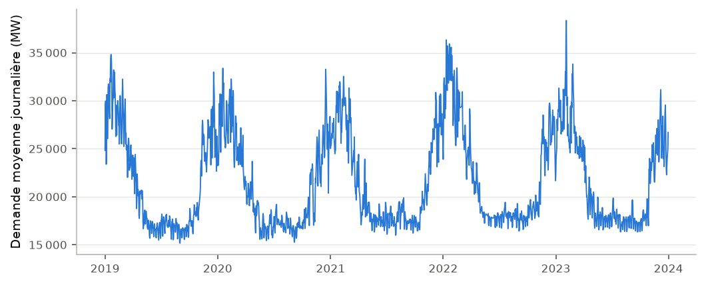
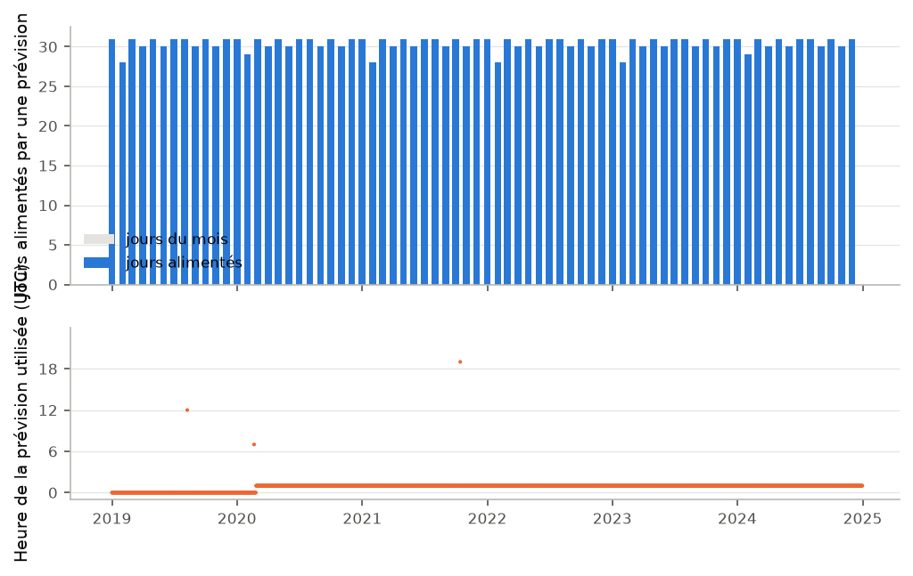
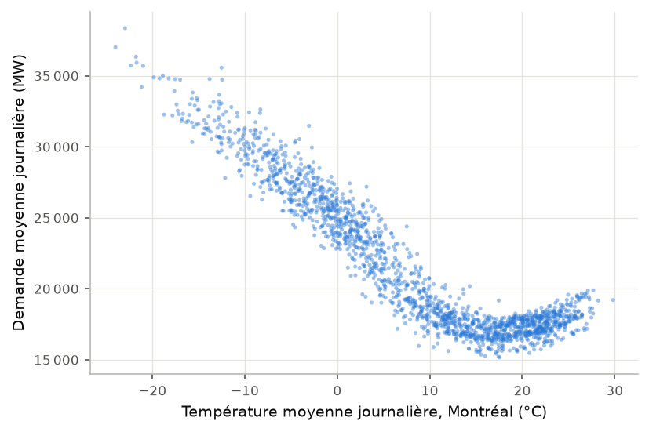
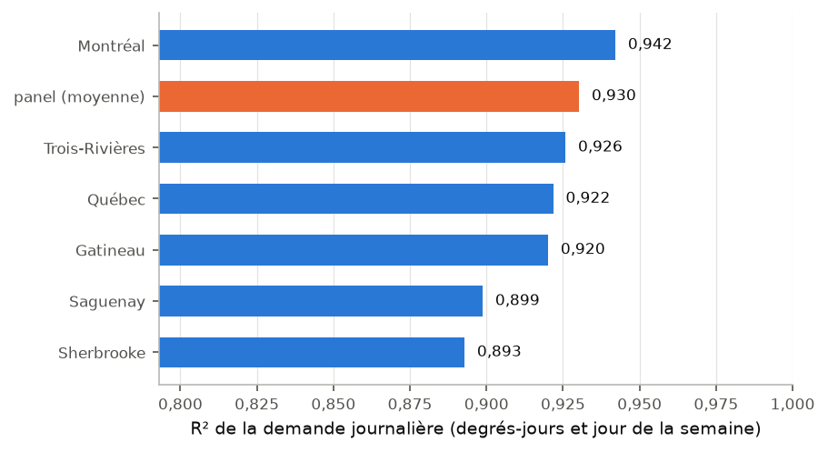
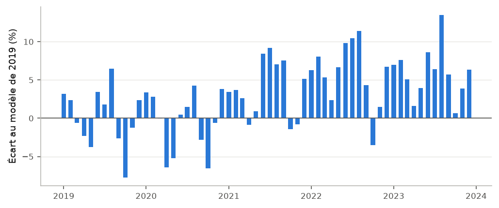

# Qualité et représentativité des données

_Rapport généré à partir de l'exécution MLflow `f3cddb2e81164f20bea8603c409a7aea` (2026-10-19 04:27 UTC), code `93552854e9b5`. Chaque valeur mesurée de ce rapport vient de cette exécution ; aucune n'est saisie à la main. La version anglaise est dérivée de celle-ci._

> Données de demande : Hydro-Québec, « Historique de la demande d'électricité au Québec » (https://donnees.hydroquebec.com/explore/dataset/historique-demande-electricite-quebec/), sous licence CC BY-NC 4.0 (https://creativecommons.org/licenses/by-nc/4.0/). Hydro-Québec offre ces données à titre informatif et sans garantie de qualité ; ce ne sont pas des données officielles. Ce projet les a contrôlées, en a masqué ou corrigé quelques heures (chaque cas est documenté) et les a agrégées ; il ne redistribue pas le jeu de données, et les rapports n'en citent que quelques valeurs horaires, comme preuves.
>
> Données météorologiques : Environnement et Changement climatique Canada, utilisées sous la Licence du gouvernement ouvert – Canada (https://ouvert.canada.ca/fr/licence-du-gouvernement-ouvert-canada).
>
> Données extraites du site Web « Données climatiques historiques » d’Environnement et Changement climatique Canada ( https://climat.meteo.gc.ca/index_f.html ) le 2026-10-14.
>
> Prévisions météorologiques : guidance NBS du National Blend of Models de la NOAA pour la station CYUL (Montréal-Trudeau), téléchargée des archives de l'Iowa Environmental Mesonet de l'Université d'État de l'Iowa (https://mesonet.agron.iastate.edu/). Ce projet a interpolé à l'heure ces prévisions trihoraires et les a converties en degrés Celsius : les valeurs qu'il utilise sont modifiées et ne sont pas des données originales de la NOAA.
>
> Ni Hydro-Québec, ni Environnement et Changement climatique Canada, ni la NOAA, ni l'Iowa Environmental Mesonet n'ont produit, revu ou approuvé ce travail, et ce projet n'est affilié ni à la NOAA ni à l'Iowa Environmental Mesonet.
>
> Construit avec Claude Code sous la direction du propriétaire du dépôt.

## En bref

- **52 608 heures** de demande, de 2019-01-01 06:00 UTC à 2025-01-01 05:00 UTC ; **99,89 %** sont utilisables.
- Au retour à l'heure normale, deux valeurs arrivent sous la même heure UTC et l'heure précédente manque. L'ordre des deux valeurs n'est pas enregistré : ces **12 heures** (6 nuits) sont masquées, jamais devinées.
- **Un enregistrement** porte un horodatage décalé de 365 jours ; il est replacé, avec sa preuve (section 3.2).
- **45 heures** sont vides à la source, en 2 plages (la plus longue : 41 heures). Elles restent vides.
- Les 6 stations météo ont chacune une température pour au moins 99,2 % des heures.
- La prévision de température de v2 a alimenté **100,00 %** des 2 192 jours de la fenêtre ; aucun de ses points n'est à 75 heures ou plus de son émission (section 4.1).
- Sur 2019–2023, les degrés-jours de Montréal et le jour de la semaine reproduisent **94,2 %** de la variation de la demande journalière ; avec la moyenne des 6 stations, **93,0 %**.
- L'heure la plus chargée de 2019–2023 est l'heure finissant à 2023-02-03 18:00 HNE : **42 473 MW**, par −26,1 °C à Montréal.

## 1. Sources

| Source | Licence | Lue le | Lignes | SHA-256 |
|---|---|---|---|---|
| Hydro-Québec, `historique-demande-electricite-quebec` | CC BY-NC 4.0 | 2026-10-14T02:21:14Z | 52 608 | `74c406d3068c` |
| ECCC, MONTREAL INTL A (7025251) | voir `docs/data-licences.md` | 2026-10-14 | 73 mois | manifeste |
| ECCC, QUEBEC INTL A (7016293) | voir `docs/data-licences.md` | 2026-10-14 | 73 mois | manifeste |
| ECCC, OTTAWA GATINEAU A (7032685) | voir `docs/data-licences.md` | 2026-10-14 | 73 mois | manifeste |
| ECCC, SHERBROOKE (7028123) | voir `docs/data-licences.md` | 2026-10-14 | 73 mois | manifeste |
| ECCC, BAGOTVILLE A (7060400) | voir `docs/data-licences.md` | 2026-10-14 | 73 mois | manifeste |
| ECCC, TROIS RIVIERES A (7018561) | voir `docs/data-licences.md` | 2026-10-14 | 73 mois | manifeste |
| NOAA, prévisions NBM (NBS, station CYUL), archive de l'Iowa Environmental Mesonet | voir `docs/data-licences.md` | 2026-10-17 | 6 fichiers annuels | manifeste |

Les données ne sont jamais versées dans le dépôt : `valiwatt fetch` les télécharge et chaque fichier est vérifié contre son empreinte avant usage. Hydro-Québec indique une date de modification du jeu de données au 2026-06-05.

**Les stations.** Une station par grand centre de population ; Montréal est la station principale. Leur couverture est mesurée à la section 4.

| Centre | Station | Identifiant climatologique | Pourquoi celle-ci |
|---|---|---|---|
| Montréal | MONTREAL INTL A | 7025251 | Station principale nommée au dossier de départ ; le plus grand centre de population. |
| Québec | QUEBEC INTL A | 7016293 | Station de l'aéroport de Québec. |
| Gatineau | OTTAWA GATINEAU A | 7032685 | Station de l'aéroport de Gatineau. |
| Sherbrooke | SHERBROOKE | 7028123 | Station de Sherbrooke, pour l'Estrie. |
| Saguenay | BAGOTVILLE A | 7060400 | Station de l'aéroport de Bagotville, pour le Saguenay–Lac-Saint-Jean. |
| Trois-Rivières | TROIS RIVIERES A | 7018561 | Station de l'aéroport de Trois-Rivières, pour la Mauricie. |

## 2. Conventions de temps

- **Demande.** Chaque valeur est la demande moyenne de l'heure qui **se termine** à l'horodatage, en UTC. La première heure de la série porte l'horodatage 2019-01-01 06:00 UTC, soit l'heure de minuit à 1 h, heure normale de l'Est.
- **Météo.** La température d'une heure UTC est l'observation faite à cet instant ; elle est demandée en UTC à ECCC. Sans fuseau explicite, le service renvoie des lignes sans valeurs : le téléchargement refuse toute réponse dont l'en-tête n'est pas en UTC.
- **Jours.** Pour les agrégats journaliers, une heure appartient au jour (heure normale de l'Est, UTC−5) où elle **commence**.
- **Heure avancée.** Tout est tenu en UTC, où chaque heure existe une seule fois. Hors des cas des sections 3.1 et 3.2, aucune heure UTC n'est absente de l'export (les valeurs vides sont à la section 3.3) : le passage à l'heure avancée, au printemps, n'y laisse pas de trou.

## 3. Demande : contrôles et anomalies

_Demande moyenne journalière, 2019–2023 (jours complets seulement). Les heures après 2023 ne sont pas tracées : elles appartiennent au rejeu de 2024, vu par les développeurs. Les contrôles des sections 3 et 4 couvrent toute la fenêtre._

### Contrôles bloquants

Un contrôle bloquant qui échoue arrête la chaîne : aucune donnée canonique n'est écrite et la commande se termine en erreur. Chacun a un test qui injecte la panne qu'il doit attraper.

| Contrôle | Résultat | Mesure | Seuil |
|---|---|---|---|
| Fenêtre attendue, aucun enregistrement hors fenêtre | réussi | 0 hors fenêtre | un seul enregistrement le fait échouer |
| Chaque doublon correspond à une forme connue | réussi | 0 non résolu | un seul doublon non résolu le fait échouer |
| Valeurs dans des bornes physiques larges (2019–2024) | réussi | 13 294 à 42 473 MW | 5 000 à 60 000 MW |
| Part des heures utilisables | réussi | 99,89 % | ≥ 99 % |

### 3.1 Retour à l'heure normale : heures masquées

La nuit du retour à l'heure normale, l'heure locale 1 h se produit deux fois. Dans les données, les deux valeurs arrivent sous l'horodatage UTC de la seconde, et l'heure UTC précédente manque. Rien n'indique laquelle vient en premier.

Pour juger si la continuité suffirait à les ordonner, on compare la longueur du trajet heure précédente → première → seconde → heure suivante dans les deux ordres. Quand les deux ordres donnent presque le même trajet, deviner serait arbitraire. Les deux heures sont donc masquées chaque fois, de la même façon.

| Nuit (heure locale répétée) | Heure UTC manquante | Valeurs reçues (MW) | Trajet, meilleur ordre (MW) | Trajet, autre ordre (MW) | Écart (MW) |
|---|---|---|---|---|---|
| 2019-11-03 01:00 | 2019-11-03 05:00 UTC | 18 301,79 ; 17 963,20 | 898 | 1 575 | 677 |
| 2020-11-01 01:00 | 2020-11-01 05:00 UTC | 20 001,77 ; 19 884,29 | 516 | 664 | 148 |
| 2021-11-07 01:00 | 2021-11-07 05:00 UTC | 18 793,52 ; 18 685,38 | 550 | 566 | 16 |
| 2022-11-06 01:00 | 2022-11-06 05:00 UTC | 14 788,72 ; 14 447,54 | 994 | 1 676 | 682 |
| 2023-11-05 01:00 | 2023-11-05 05:00 UTC | 18 857,18 ; 18 821,29 | 553 | 553 | 0 |
| 2024-11-03 01:00 | 2024-11-03 05:00 UTC | 19 883,02 ; 19 764,86 | 502 | 655 | 153 |

L'écart va de 0 à 682 MW. Une règle qui ordonnerait certaines nuits et pas d'autres serait fragile.

### 3.2 Enregistrement déplacé : réparation avec preuve

L'horodatage 2023-01-01 05:00 UTC porte deux valeurs, alors que 2022-01-01 05:00 UTC n'en a aucune. La valeur 22 945,84 MW s'insère naturellement entre les voisines de 2022-01-01 05:00 UTC, et 20 516,80 MW entre celles de 2023-01-01 05:00 UTC. Le trajet total vaut 2 145 MW dans cette affectation, contre 9 864 MW dans l'affectation inverse : un rapport de 4,6. 2022-01-01 05:00 UTC est la seule heure sans enregistrement dont les deux voisines sont connues : aucune autre destination n'est possible. La règle ne déplace une valeur que si les deux valeurs sont dans les bornes physiques (5 000 à 60 000 MW), si le rapport entre les deux affectations est d'au moins 2,0, et si la destination est sans ambiguïté : la suivante en coût parmi les heures sans enregistrement dont les voisines sont connues coûte au moins 2,0 fois le coût de la destination choisie, ou il n'y en a aucune. Sinon rien n'est déplacé, l'heure reste un doublon non résolu et le contrôle bloquant échoue ; la preuve de ce doublon donne la raison et, quand l'heure porte exactement deux valeurs, toutes deux dans les bornes, et qu'une destination a été trouvée, nomme la meilleure destination et la suivante en coût s'il y en a une (les deux quand la destination est ambiguë). La valeur est donc replacée et l'heure porte l'étiquette « réparée » dans la série canonique. Enfin, aucune heure dont la valeur sort de ces bornes n'est rendue utilisable, quelle que soit la voie (le contrôle sur toute la fenêtre ou la série que le rejeu reconstruit à son horloge) : une dernière passe la marque hors bornes.

### 3.3 Valeurs manquantes

| Début (UTC) | Fin (UTC) | Heures |
|---|---|---|
| 2019-06-21 19:00 UTC | 2019-06-23 11:00 UTC | 41 |
| 2019-11-11 19:00 UTC | 2019-11-11 22:00 UTC | 4 |

Ces heures restent vides dans la série canonique ; aucune interpolation.

### 3.4 Pics signalés

Pour chaque heure, on mesure son écart au milieu de ses deux voisines, puis on le divise par l'écart typique de cette mesure sur 2019–2023 (écart absolu médian × 1,4826, une échelle qu'une poignée de valeurs extrêmes ne peut pas gonfler). Au-delà de 10 fois l'écart typique, l'heure est signalée ; sur 2019–2023, 99,9 % des heures restent sous 6,4. Une heure signalée **garde sa valeur** : ce contrôle ne distingue pas une erreur de mesure d'un événement réel.

| Heure (UTC) | Heure précédente (MW) | Valeur (MW) | Heure suivante (MW) | Score |
|---|---|---|---|---|
| 2019-05-08 06:00 UTC | 18 054 | 21 395 | 15 716 | +24,9 |
| 2019-05-08 07:00 UTC | 21 395 | 15 716 | 15 762 | −15,6 |
| 2019-10-04 02:00 UTC | 20 031 | 21 815 | 18 182 | +15,0 |
| 2019-11-12 00:00 UTC | 24 583 | 28 622 | 28 361 | +12,0 |
| 2022-10-26 02:00 UTC | 18 761 | 20 774 | 16 870 | +16,4 |

_Un pic très fort fait aussi signaler sa voisine : 1 paire d'heures consécutives ci-dessus._

## 4. Météo : couverture par station

| Station | Index complet | Bornes, toute la fenêtre (−60 à 45 °C) | Heures avec température (seuil 95 %) | Heures manquantes | Plus longue lacune | Pics signalés |
|---|---|---|---|---|---|---|
| Montréal | réussi | réussi (−29,3 à 35,8) | réussi (99,89 %) | 60 | 21 h | 13 |
| Québec | réussi | réussi (−32,2 à 33,9) | réussi (99,84 %) | 83 | 9 h | 32 |
| Gatineau | réussi | réussi (−34,3 à 35,5) | réussi (99,44 %) | 292 | 120 h | 25 |
| Sherbrooke | réussi | réussi (−32,2 à 33,6) | réussi (99,23 %) | 406 | 103 h | 34 |
| Saguenay | réussi | réussi (−35,1 à 36,0) | réussi (99,65 %) | 183 | 26 h | 50 |
| Trois-Rivières | réussi | réussi (−34,2 à 35,2) | réussi (99,80 %) | 106 | 44 h | 57 |

**Panel.** La moyenne des stations n'est calculée qu'aux heures où au moins 4 stations sur 6 répondent : 99,96 % des heures (contrôle bloquant : réussi, seuil 99 %).

**Lacunes partagées.** Pendant 23 heures, la moitié des stations ou plus étaient muettes en même temps, dont 9 heures sans aucune station. La plus longue de ces plages va de 2022-04-22 04:00 UTC à 2022-04-23 00:00 UTC (21 heures). Pendant ces 9 heures, aucune des 6 stations retenues ne répondait ; d'autres stations n'ont pas été vérifiées.

Les pics de température sont signalés avec la même règle que la demande (score au-delà de 10, échelle estimée sur 2019–2023). Ils ne sont pas retirés : aucun contrôle ici ne sépare une erreur de capteur d'un vrai changement de temps.

### 4.1 La prévision de température

La prévision de température que v2 utilise est la guidance NBS du National Blend of Models de la NOAA pour la station CYUL (Montréal-Trudeau), archivée par l'Iowa Environmental Mesonet : 8 747 prévisions, 197 879 points toutes les trois heures, en degrés Fahrenheit, convertis en degrés Celsius. 136 points identiques en double, à la jonction des fichiers annuels, sont écartés ; deux valeurs différentes pour une même prévision et une même heure feraient refuser le chargement. Chaque jour est alimenté par la plus fraîche des prévisions dont les propres points encadrent ses 24 heures, parmi les 12 plus fraîches disponibles à l'origine du jour ; la règle complète est dans le rapport de validation (section 2).

| Contrôle | Résultat | Mesure |
|---|---|---|
| Bornes, toute la fenêtre (−60 à 45 °C) | réussi | 0 points hors bornes sur 197 879 ; de −28,3 à 35,0 °C ; 0 points vides |
| Jours alimentés, toute la fenêtre (seuil 98 %) | réussi | 2 192 jours sur 2 192 (100,00 %) |

Le seuil de 98 % a été fixé après que les décomptes de jours de l'archive pour 2019–2024 eurent été vus (section 3.4 du plan) : sur ces années, sa porte n'est pas un test.

**Les jours qu'aucune prévision n'a alimentés** : aucun. Un tel jour échoue au contrôle de qualité du jour dans le rejeu (« examiner les données »). 0 jours ont été alimentés par la même prévision que la veille.

**Rangs de la prévision utilisée** (0 : la plus fraîche) : rang 0, 2 192 jours. **Âge de la prévision à l'origine du jour** : 4 h, 1 770 jours ; 5 h, 419 jours ; 10 h, 1 jours ; 17 h, 1 jours ; 22 h, 1 jours. **Heure de la prévision utilisée, par année** : 2019 : 0 h UTC (364 jours), 12 h UTC (1 jours) ; 2020 : 0 h UTC (55 jours), 1 h UTC (310 jours), 7 h UTC (1 jours) ; 2021 : 1 h UTC (364 jours), 19 h UTC (1 jours) ; 2022 : 1 h UTC (365 jours) ; 2023 : 1 h UTC (365 jours) ; 2024 : 1 h UTC (366 jours).

**Les délais.** Le plus long délai d'un point de prévision, de son émission à l'heure qu'il vise, par année d'émission : 2019, 66 h ; 2020, 72 h ; 2021, 71 h ; 2022, 71 h ; 2023, 71 h ; 2024, 71 h. L'argument de la section 9.2 du plan (une mauvaise prévision gâte au plus deux jours consécutifs) tient tant qu'aucun point n'atteint 75 heures. Aucune année ne l'atteint.

**L'erreur de la prévision contre l'observation** (prévision moins température observée à Montréal à l'heure visée, jusqu'au 2024-01-01) :

| Année | Saison | Écart moyen | Écart absolu moyen | Heures |
|---|---|---|---|---|
| 2019 | automne | +0,09 °C | 0,95 °C | 2 184 |
| 2019 | printemps | +0,15 °C | 1,26 °C | 2 208 |
| 2019 | été | +0,07 °C | 0,92 °C | 2 207 |
| 2019 | hiver | +0,04 °C | 1,40 °C | 2 160 |
| 2020 | automne | +0,16 °C | 1,08 °C | 2 184 |
| 2020 | printemps | +0,02 °C | 1,15 °C | 2 208 |
| 2020 | été | +0,30 °C | 0,94 °C | 2 206 |
| 2020 | hiver | −0,18 °C | 1,26 °C | 2 184 |
| 2021 | automne | +0,22 °C | 0,86 °C | 2 184 |
| 2021 | printemps | −0,08 °C | 1,18 °C | 2 208 |
| 2021 | été | +0,16 °C | 0,84 °C | 2 208 |
| 2021 | hiver | −0,12 °C | 1,18 °C | 2 160 |
| 2022 | automne | +0,13 °C | 0,95 °C | 2 183 |
| 2022 | printemps | −0,23 °C | 1,13 °C | 2 187 |
| 2022 | été | +0,06 °C | 0,86 °C | 2 208 |
| 2022 | hiver | −0,01 °C | 1,29 °C | 2 159 |
| 2023 | automne | +0,10 °C | 0,78 °C | 2 178 |
| 2023 | printemps | +0,05 °C | 1,19 °C | 2 206 |
| 2023 | été | +0,14 °C | 0,91 °C | 2 203 |
| 2023 | hiver | −0,09 °C | 1,35 °C | 2 159 |

_Jours alimentés par une prévision, par mois, et l'heure de la prévision utilisée, sur toute la fenêtre._

## 5. Représentativité des stations (2019–2023 seulement)

**Pourquoi seulement 2019–2023.** L'année suivante est rejouée heure par heure comme si elle était la production, avec un modèle figé à la fin de 2023 (rapport de validation). Aucun résultat de cette année-là n'entre dans cette analyse. Les contrôles bloquants, eux, vérifient la disponibilité et la validité des données (bornes, doublons) sur toute la fenêtre, comme le ferait une chaîne de production ; aucune valeur de cette année-là n'entre dans la présente analyse.

**Méthode.** Pour chaque source de température, la demande moyenne de chaque jour est expliquée par les degrés-jours de chauffage (de combien la température moyenne du jour est sous 18 °C), les degrés-jours de climatisation (au-dessus de 18 °C) et le jour de la semaine, par moindres carrés. Le R² est la part de la variation de la demande journalière que ce modèle reproduit. Toutes les sources sont comparées sur les mêmes 1 752 jours (439 jours d'hiver, de décembre à février).

_La demande journalière selon la température moyenne du jour à Montréal, 2019–2023._

| Source de température | R², toute l'année | Écart quadratique moyen (MW) | R², hiver | Écart quadratique moyen, hiver (MW) | Pente chauffage (MW par °C) |
|---|---|---|---|---|---|
| Montréal | 0,942 | 1 185 | 0,856 | 1 154 | 506 |
| Panel (moyenne des stations) | 0,930 | 1 301 | 0,862 | 1 131 | 473 |
| Trois-Rivières | 0,926 | 1 342 | 0,851 | 1 174 | 466 |
| Québec | 0,922 | 1 378 | 0,846 | 1 191 | 468 |
| Gatineau | 0,920 | 1 392 | 0,801 | 1 357 | 473 |
| Saguenay | 0,899 | 1 568 | 0,779 | 1 430 | 413 |
| Sherbrooke | 0,893 | 1 613 | 0,781 | 1 423 | 476 |

**Ce que les chiffres montrent.** Pour savoir si un écart de R² dépasse le hasard de l'échantillon, on rééchantillonne 1 000 fois les semaines complètes (des jours voisins se ressemblent ; tirer des jours isolés sous-estimerait l'incertitude) et on réajuste les deux modèles à chaque tirage.

| Comparaison | Écart de R² (moyenne − Montréal) | Intervalle à 95 % | Semaines |
|---|---|---|---|
| Toute l'année | −0,012 | −0,016 à −0,008 | 261 |
| Hiver | +0,006 | −0,010 à +0,022 | 68 |

Sur l'année, Montréal seule fait mieux que la moyenne des stations, et l'intervalle exclut zéro.
En hiver, Montréal seule et la moyenne des stations ne se distinguent pas : l'intervalle contient zéro.
La moyenne donne le même poids à chaque station, quelle que soit la population qu'elle représente ; ce rapport ne teste pas de pondération par la population. La source de température de v1 était fixée dans son plan : la station de Montréal, la moyenne des stations n'y étant qu'une analyse de sensibilité ; le plan l'a fixée après cette comparaison, faite sur des années qui couvrent celles de la validation. v2 prévoit à partir de la prévision de la section 4.1 ; la station de Montréal sert au contrôle de qualité, au modèle de v1 tel que livré et à la borne optimiste.

## 6. Repères à confirmer en validation

**Les heures les plus chargées.** Les 5 heures les plus chargées de 2019–2023 :

| Heure finissant à | Demande (MW) | Température à Montréal (°C) |
|---|---|---|
| 2023-02-03 18:00 HNE | 42 472,83 | −26,1 |
| 2023-02-03 19:00 HNE | 42 253,95 | −26,2 |
| 2023-02-03 20:00 HNE | 41 799,12 | −26,3 |
| 2023-02-03 21:00 HNE | 41 141,36 | −26,4 |
| 2023-02-03 17:00 HNE | 40 585,14 | −26,1 |

La plus chargée tombe en 2023-02, le mois de la pointe de froid que le dossier de départ nomme comme cas test : ce cas est confirmé dans les données.
Ce sont des moyennes horaires de données à titre informatif, pas une pointe officielle.

**2020 et la suite.** Le modèle de la section 5 (moyenne des stations) est ajusté sur 2019 seulement, puis appliqué à chaque jour de 2019–2023. Pour chaque mois, on calcule l'écart moyen entre la demande et ce que le modèle attend, puis on retire l'écart du même mois de 2019, ce qui annule les défauts saisonniers du modèle.

_Écart mensuel moyen à un modèle météo ajusté sur 2019, en % de la demande attendue (moyenne des stations)._

| Mois | Écart au modèle | Écart au même mois de 2019 (points) |
|---|---|---|
| 2020-03 | 0,0 % | +0,6 |
| 2020-04 | −6,4 % | −4,1 |
| 2020-05 | −5,2 % | −1,5 |
| 2020-06 | +0,4 % | −3,0 |

| Année | Écart moyen au même mois de 2019 (points) | Mois au-dessus de 2019 |
|---|---|---|
| 2019 (année d'ajustement) | 0,0 | 0 sur 12 |
| 2020 | −0,6 | 6 sur 12 |
| 2021 | +3,6 | 12 sur 12 |
| 2022 | +5,6 | 12 sur 12 |
| 2023 | +5,8 | 12 sur 12 |

Parmi les mois tabulés, le plus bas est 2020-04, à −4,1 points du même mois de 2019 une fois la météo prise en compte. En 2023, l'écart moyen au même mois de 2019 est de +5,8 points (12 mois sur 12 au-dessus).

Un écart persistant dit que la demande a bougé pour des raisons que ce modèle météo ne porte pas. Il ne dit pas lesquelles : activité économique, croissance de la charge, nouveaux usages. Si une dérive de ce genre se poursuit pendant le rejeu, un modèle figé la subit ; c'est ce que la surveillance doit détecter (rapport de validation).

## 7. Ce que ce rapport ne montre pas

- Il ne mesure la qualité d'aucune prévision de la demande : c'est le rapport de validation qui la mesure. De la prévision de température, il ne mesure que l'écart à l'observation (section 4.1).
- Les associations de la section 5 utilisent la météo **observée**. Une prévision faite à l'avance n'a qu'une météo prévue ; le rapport de validation le dit de ses résultats.
- Les intervalles de la section 5 portent sur l'ajustement des modèles aux années étudiées, pas sur une erreur de prévision.
- Il ne dit pas pourquoi la demande s'écarte du modèle de 2019.
- Il ne classe pas les pics signalés en erreurs ou en événements réels.
- Il ne vérifie pas les données contre les données officielles transmises à la Régie de l'énergie ; la série d'Hydro-Québec est offerte à titre informatif.
- Il ne teste pas d'autres stations, ni de pondération par la population.
