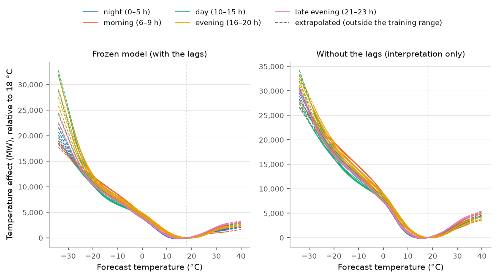

# Validating and monitoring a forecast of Québec's electricity demand, v2

_Report generated from a chain of MLflow runs followed from the 2024 replay (section 8), code `c778e08fc0b5`, code hash `521febded2db`, rules frozen at commit `825b7bd134a8` (tag `rules-frozen-v2`). Every measured value comes from these runs, and every design constant from the runs or from the code that produced them; none is typed by hand. Every result carries its evaluation label, read from the runs: _in sample for the choice of family and input_ for 2020–2023, _rehearsal on a design year_ for 2023, _seen by the developers_ for 2024, and for 2025 _held-out data_ only when its test of record is clean. This English version is derived from the French one._

> Demand data: Hydro-Québec, "Historique de la demande d'électricité au Québec" (https://donnees.hydroquebec.com/explore/dataset/historique-demande-electricite-quebec/), licensed CC BY-NC 4.0 (https://creativecommons.org/licenses/by-nc/4.0/). Hydro-Québec offers this data for information only, without warranty of quality; it is not official data. This project checked it, masked or corrected a few hours (each case documented) and aggregated it; it does not redistribute the dataset, and the reports quote only a few hourly values from it, as evidence.
>
> Weather data: Environment and Climate Change Canada, used under the Open Government Licence – Canada (https://open.canada.ca/en/open-government-licence-canada).
>
> Extracted from the Environment and Climate Change Canada Historical Climate Data web site ( https://climate.weather.gc.ca/index_e.html ) on 2026-10-14.
>
> Weather forecasts: NOAA National Blend of Models NBS guidance for station CYUL (Montréal-Trudeau), downloaded from the Iowa Environmental Mesonet archive of Iowa State University (https://mesonet.agron.iastate.edu/). This project interpolated these three-hourly forecasts to hourly values and converted them to degrees Celsius: the values it uses are modified and are not original NOAA data.
>
> Neither Hydro-Québec, Environment and Climate Change Canada, NOAA nor the Iowa Environmental Mesonet produced, reviewed or endorsed this work, and the project is affiliated with neither NOAA nor the Iowa Environmental Mesonet.
>
> Built with Claude Code under the repository owner's direction.

## In brief

- **Status: candidate.** Chosen on 2020–2023 (in sample for the choice), shown on 2024 seen by the developers; the test on held-out data, 2025, is pending.
- Over the 34,997 common hours of 2020–2023 (_in sample for the choice of family and input_), the mean absolute percentage error is 2.83% for v2, 3.48% for v1's form on the same forecast and 4.42% for v1 as shipped. These years served to choose the family and the input: v2's advantage there is biased upward by that choice, and it does not prove v2 better (section 3).
- Its 90% intervals held demand 90.3% of the time from 2021-01 to 2023-12, and the 95% CI of that coverage contains the nominal. They hold it less often than promised in these groups: winter; hour block day (10–15 h); forecast-load deciles 7, 8, 9 and 10 (section 5). These are v2's intervals; coverage is never a criterion of the decision rule.
- At the 5 busiest hours of 2019–2023, all in 2023-02, demand fell outside the interval 3 times out of 5, always above it. Reported, never judged.
- 2024 (_seen by the developers_): MAPE 2.58%, coverage 92.2%, no recommendation; verdicts: v2 against v1 as shipped, "better"; v2 against v1's form, "better". A success on a year already seen is weak evidence: it supports no claim; v2 goes to 2025 as frozen (section 8).
- 2025: pending; the test of record will be the first 2025 replay started under `rules-frozen-v2` (section 9).
- The report also measures what the monitor could miss: on 2023, a sustained 10% rise in demand yielded "retrain" within 10 weeks at 4 of 4 starts, and on 2024 (seen by the developers), at 4 of 4; on 2024, a sustained gap of ±2% between demand and forecast did within 8 weeks at 4 of 8 cases (sections 7, 8 and 10).

## Model card

| | |
|---|---|
| **Status** | **Status: candidate.** Chosen on 2020–2023 (in sample for the choice), shown on 2024 seen by the developers; the test on held-out data, 2025, is pending. Interval coverage and the busiest hours: beside the status (sections 5 and 9), never in it. |
| **What it forecasts** | Québec's hourly electricity demand as published by Hydro-Québec, for the 24 hours of day D, issued at the end of day D−1 (Eastern Standard Time), with a 90% prediction interval. |
| **Intended use** | To show, on a real forecast, validation and monitoring of the kind a model-risk team does. |
| **Out of scope** | Any operational dispatch, any trading or pricing, any decision. Hydro-Québec publishes this data for information; it is not official data. |
| **Data** | Hydro-Québec hourly demand; NOAA NBM temperature forecast for station CYUL, the Montréal airport, archived by the Iowa Environmental Mesonet (section 2); observed hourly temperature at Montréal (ECCC) for data quality, v1 as shipped and the optimistic bound, and at 5 other stations (Québec, Gatineau, Sherbrooke, Saguenay and Trois-Rivières) for a sensitivity analysis only. Designed on 2019–2023. |
| **Model** | An additive model of the GAM family, fitted by penalized least squares: one temperature curve per local hour (splines, 10 knots at the quantiles of the training rows, degree 3, continued as a straight line outside the training range), v1's 72 constants per hour and day type, the demand of the day before and of the week before; standardized, then ridge, alpha 1.0. Frozen on the data up to 2023-12-24; hash `7aadbc5866c6`, that of this chain's frozen model, from which this date, the interval below and the curves of section 3 come. Compared with v1 as shipped and with v1's form on the same forecast, which never recommend anything. |
| **Interval** | Forecast × (1 ± 6.22%). The half-width is a quantile of the 8,729 out-of-sample relative errors from 2023-01 to 2023-12 already scored when the frozen model is fitted: the form of a split conformal interval, without its finite-sample guarantee. The measured coverage is the evidence (sections 5 and 8). |
| **Validation error** | MAPE 2.83% [2.69%, 2.95%] over its hours of 2020–2023 (_in sample for the choice of family and input_), against 7.81% for the naive baseline (section 3). |
| **2024 replay** | _seen by the developers_: MAPE 2.58%, coverage 92.2%; no recommendation; verdicts "better" against v1 as shipped and "better" against v1's form (section 8). |
| **2025** | Pending (section 9). |
| **Weather caveat** | The temperature forecast is available, by assumption, 2 hours after its issue time; every result that depends on it rests on that assumption (section 2). The observed temperature of the target hour is only an optimistic bound; it issues no recommendation. |
| **Limitations** | Section 10. |
| **Author** | Built with Claude Code under the repository owner's direction. |

## 1. The methods, in plain words

- **Walk-forward validation.** Each month from 2020 to 2023 is forecast by models refitted on the hours before it only, less the last 7 days (the embargo). The three models compared are fitted on the same folds: v2, v1's form on the same forecast and v1 as shipped, rebuilt in v2's harness.
- **The error.** The mean absolute percentage error (MAPE): on average, by how much the forecast misses actual demand. The signed bias says in which direction: bias = (demand − forecast) / demand, positive when the forecast is too low.
- **The uncertainty of a mean.** Neighbouring hours share the weather; so whole weeks are resampled, 1,000 times, to get a 95% interval around each mean.
- **The decision rule, fixed before any v2 replay.** On the common hours (those where demand and the three forecasts exist), v2's error is compared with each other model's, hour by hour, with a 95% interval over whole weeks. A comparison is **better** when the upper bound of its interval is below zero, **worse** when the lower bound is above it, **not separated** otherwise; the bounds are judged as printed, to a hundredth of a point. The comparisons are made again on the cold hours, those whose temperature forecast is below the 5th percentile of those of 2019–2023 (−12.0 °C): chosen on the input known at issue, never on the outcome. The verdict of each comparison: *better* (the comparison is better and its cold tail is not worse); *better on average, the cold tail untestable* (fewer than 120 cold hours or fewer than 4 weeks); *not shown better*; *worse*. "v2 is better than v1" is said only of the verdict against v1 as shipped, and only on held-out data; "the GAM earns its place" only of the verdict against v1's form. The input's comparison (v1's form on the forecast against v1 as shipped) is reported, never judged.
- **Beside, never judged.** The 5 busiest hours of each year judged (by actual demand, among all the hours that have one): each model's signed error, or why it has no forecast. The coverage of v2's intervals, with the sentence on its 90% (section 5).
- **The prediction interval.** Its half-width is a quantile of the relative errors |demand − forecast| / forecast. For each validation month, it is the quantile of rank ⌈(n + 1) × 0.90⌉ of the n out-of-sample errors of the 12 months before, already scored when that month's model is fitted; for the frozen model, the same quantile over the errors of the 12 months before the replayed year, already scored when it is fitted. It is the form of a split conformal interval, without its finite-sample coverage guarantee: these hourly errors are autocorrelated and come from other models. The only evidence is the coverage measured out of sample.
- **The frozen model.** In production the model is not refitted: it is fitted once, frozen with its hash, then replayed hour by hour.
- **The thresholds.** For each season, the weekly thresholds are quantiles of v2's validation weeks: MAPE above the 95th percentile, bias outside the 2.5th–97.5th percentile range, coverage below the 5th percentile.
- **Drift.** Each week, the distribution of the issued temperature forecasts and that of v2's demand forecasts are compared with the same weeks (± 2) of earlier years, with Evidently's normed Wasserstein distance. The alarm level is the 95th percentile of that distance over the validation weeks.
- **The decision table.** Each week, at most one recommendation, with its evidence: (1) a data-quality failure, a day no temperature forecast fed included → investigate the data; (2) the same failure 2 weeks in a row, broad across the week, or the bias on the same side of its band 3 weeks in a row → retrain; (3) coverage below its threshold 2 weeks in a row, broad, the bias inside its band → recalibrate the intervals; (4) the same input drifting 2 weeks in a row, performance within its thresholds → investigate the data. "Broad": the week stays beyond its threshold when its 2 most extreme days are set aside. A bad demand day spoils, through the 24 h and 168 h lags, only itself, the next day and the same day the next week; a bad temperature forecast spoils at most two consecutive days (section 2). The monitor recommends; it never acts.

## 2. The forecast input

**The source.** The temperature is the NOAA National Blend of Models (NBM), its NBS product for station CYUL (Montréal-Trudeau, the airport of v1's primary station), as archived by the Iowa Environmental Mesonet: points every three hours, in degrees Fahrenheit, which this project interpolates to the hour and converts to degrees Celsius. The files are downloaded by script, never committed.

**The feeding rule.** A forecast is **available** 2 hours after its issue time: this is an **assumption**, since the archive records no arrival time, and every result that depends on the forecast rests on it. For day D, among the 12 freshest forecasts available at D's origin (D 05:00 UTC), the freshest whose own points bracket each of D's 24 hours is taken, each of those points finite and inside the data-quality bounds. Interpolation is linear in time, inside a single forecast; two forecasts are never mixed. Each training day carries the forecast issued for it by the same rule, never an observation.

**On 2019–2023.** 1,826 days fed out of 1,826; no day was left without a forecast. Ranks of the forecast used (0: the freshest): rank 0, 1,826 days. Hour of the forecast used, by year: 2019: 0 h UTC (364 days), 12 h UTC (1 days); 2020: 0 h UTC (55 days), 1 h UTC (310 days), 7 h UTC (1 days); 2021: 1 h UTC (364 days), 19 h UTC (1 days); 2022: 1 h UTC (365 days); 2023: 1 h UTC (365 days).

**The forecast's error against the observation** (forecast minus observed temperature at Montréal at the target hour, by year and season):

| Year | Season | Mean gap | Mean absolute gap | Hours |
|---|---|---|---|---|
| 2019 | fall | +0.09 °C | 0.95 °C | 2,184 |
| 2019 | spring | +0.15 °C | 1.26 °C | 2,208 |
| 2019 | summer | +0.07 °C | 0.92 °C | 2,207 |
| 2019 | winter | +0.04 °C | 1.40 °C | 2,160 |
| 2020 | fall | +0.16 °C | 1.08 °C | 2,184 |
| 2020 | spring | +0.02 °C | 1.15 °C | 2,208 |
| 2020 | summer | +0.30 °C | 0.94 °C | 2,206 |
| 2020 | winter | −0.18 °C | 1.26 °C | 2,184 |
| 2021 | fall | +0.22 °C | 0.86 °C | 2,184 |
| 2021 | spring | −0.08 °C | 1.18 °C | 2,208 |
| 2021 | summer | +0.16 °C | 0.84 °C | 2,208 |
| 2021 | winter | −0.12 °C | 1.18 °C | 2,160 |
| 2022 | fall | +0.13 °C | 0.95 °C | 2,183 |
| 2022 | spring | −0.23 °C | 1.13 °C | 2,187 |
| 2022 | summer | +0.06 °C | 0.86 °C | 2,208 |
| 2022 | winter | −0.01 °C | 1.29 °C | 2,159 |
| 2023 | fall | +0.10 °C | 0.78 °C | 2,178 |
| 2023 | spring | +0.05 °C | 1.19 °C | 2,206 |
| 2023 | summer | +0.14 °C | 0.91 °C | 2,203 |
| 2023 | winter | −0.09 °C | 1.35 °C | 2,159 |

**The sensitivity to the availability margin.** Validated also with forecasts available 6 hours after their issue, which takes from each day its own early-morning forecast, the GAM changes its MAPE by +0.02 pt [+0.01 pt, +0.02 pt] (6 hours minus 2, over 35,036 hours): this is what, at most, the availability assumption is worth. This variant is labelled and chooses nothing.

**31 December 2023.** Its last two hours need the 2024-01-01 06:00 UTC point of a forecast issued on 31 December and available before that day's origin: the information is 2023's, and that day is forecast like every other. The preliminary trial that served the choice cut on valid time and left that day out: v2's hours of 2020–2023 hold 24 more than the trial's.

**The forecast leads.** The longest lead of a forecast point, by issue year: 2019, 66 h; 2020, 72 h; 2021, 71 h; 2022, 71 h; 2023, 71 h; 2024, 71 h. The argument of plan section 9.2 (a bad forecast spoils at most two consecutive days) holds as long as no point reaches 75 hours. No year reaches it. The NBM's model changes over the years are not tracked: the forecast series is not homogeneous, and the drift monitor watches it.

## 3. Validation on 2020–2023, _in sample for the choice of family and input_

**The choice, said plainly.** v2's family and input were chosen by the owner on 2026-10-15, on a preliminary trial outside the tracked runs, run on the monthly folds of 2020–2023: six model families, each with three temperature inputs. The GAM did not have the lowest overall error on the forecast; it was chosen for its smaller gap at the busiest and coldest hours, and because it stays explainable, one temperature curve per hour. That trial is not a tracked run: its figures are not repeated here. The tracked values below come from the validation run, which anyone can rerun; they are measured on the years that served the choice, among eighteen family-input pairs: v2's advantage there is biased upward by that choice, and it does not prove v2 better. They are shown, labelled, and never used to say v2 is better.

48 monthly folds, from 2020-01 to 2023-12, a 7-day embargo. Each model on its own hours:

| Forecast (_in sample for the choice of family and input_) | MAPE | 95% CI | Signed bias | Hours |
|---|---|---|---|---|
| v2, the GAM on the forecast (production) | 2.83% | [2.69%, 2.95%] | +1.17% | 35,036 |
| v1's form on the forecast | 3.48% | [3.36%, 3.59%] | +1.17% | 35,036 |
| v1 as shipped (the day before's weather) | 4.42% | [4.14%, 4.68%] | +0.22% | 34,997 |
| the GAM on observed weather (optimistic bound) | 2.70% | [2.59%, 2.81%] | +1.22% | 34,997 |
| v1's form on observed weather (optimistic bound) | 3.40% | [3.29%, 3.51%] | +1.22% | 34,997 |
| same hour, one week earlier (naive baseline) | 7.81% | [7.14%, 8.44%] | −0.60% | 35,046 |
| v1 as shipped, mean of the 6 stations (sensitivity) | 4.45% | [4.17%, 4.73%] | −0.01% | 35,013 |

**The choice's tracked values**, on the 34,997 common hours (209 weeks; _in sample for the choice of family and input_): MAPE 2.83% for v2, 3.48% for v1's form on the forecast, 4.42% for v1 as shipped. Signed error at the 5 busiest of these hours (demand minus forecast, over demand; positive when the forecast is too low): v2, the GAM on the forecast (production), +5.7% on average; v1's form on the forecast, +12.8% on average; v1 as shipped (the day before's weather), +27.0% on average. The hours each model lacks, by reason: v2, the GAM on the forecast (production): the week before's demand unavailable (9), the day before's demand unavailable (10); v1's form on the forecast: the week before's demand unavailable (9), the day before's demand unavailable (10); v1 as shipped (the day before's weather): the week before's demand unavailable (9), the day before's demand unavailable (10), the day before's temperature missing (39); without usable demand: 9.

| Comparison (_in sample for the choice of family and input_) | MAPE difference | 95% CI | State |
|---|---|---|---|
| v2 against v1 as shipped | −1.59 pt | [−1.78 pt, −1.41 pt] | better |
| v2 against v1's form on the same forecast | −0.65 pt | [−0.76 pt, −0.55 pt] | better |
| v1's form on the forecast against v1 as shipped (reported, never judged) | −0.94 pt | [−1.17 pt, −0.69 pt] | better |

On one set of hours the three comparisons add up: v2 against v1 as shipped = v2 against v1's form + the input. Verdicts (_in sample for the choice of family and input_): v2 against v1 as shipped, "better"; v2 against v1's form, "better". They are in sample for the choice: they decide nothing.

Cold tail (_in sample for the choice of family and input_): 1,468 common hours below the threshold of −12.0 °C, spread over 37 Monday-to-Sunday weeks; it is testable (at least 120 hours and 4 weeks): v2 against v1 as shipped, −5.32 pt [−6.38 pt, −4.43 pt] (better); v2 against v1's form, −0.77 pt [−1.14 pt, −0.42 pt] (better).

| Hour ending (UTC) (_in sample for the choice of family and input_) | Demand | Forecast temperature | v2 | v1's form on the forecast | v1 as shipped |
|---|---|---|---|---|---|
| 2023-02-03 23:00 UTC | 42,473 MW | −25.2 °C | +4.4% | +13.4% | +27.0% | 
| 2023-02-04 00:00 UTC | 42,254 MW | −25.6 °C | +6.5% | +12.9% | +26.7% | 
| 2023-02-04 01:00 UTC | 41,799 MW | −25.7 °C | +8.2% | +12.9% | +27.2% | 
| 2023-02-04 02:00 UTC | 41,141 MW | −25.9 °C | +9.3% | +13.1% | +27.9% | 
| 2023-02-03 22:00 UTC | 40,585 MW | −24.8 °C | +0.4% | +11.8% | +26.3% | 

- Mean of the 6 stations against the primary station, on v1 as shipped's model (a sensitivity analysis, never used to choose): +0.04 pt [+0.01 pt, +0.07 pt].

**v2 by season and by year** (_in sample for the choice of family and input_):

| Group | MAPE | 95% CI | Bias | Bias 95% CI |
|---|---|---|---|---|
| fall | 2.42% | [2.21%, 2.63%] | +1.18% | [+0.90%, +1.48%] |
| spring | 3.21% | [2.97%, 3.43%] | +0.69% | [+0.17%, +1.15%] |
| summer | 2.13% | [1.98%, 2.28%] | +1.33% | [+0.99%, +1.62%] |
| winter | 3.56% | [3.31%, 3.80%] | +1.47% | [+1.03%, +1.88%] |
| 2020 | 2.87% | [2.57%, 3.17%] | +0.10% | [−0.34%, +0.57%] |
| 2021 | 2.80% | [2.58%, 3.07%] | +1.46% | [+1.08%, +1.81%] |
| 2022 | 2.91% | [2.66%, 3.14%] | +1.75% | [+1.45%, +2.06%] |
| 2023 | 2.72% | [2.44%, 3.04%] | +1.35% | [+1.06%, +1.67%] |

**By decile of the load v2 forecasts** (the deciles are taken on the forecast, never on actual demand):

| Decile | MAPE | 95% CI | Bias | Bias 95% CI |
|---|---|---|---|---|
| 1 | 1.98% | [1.82%, 2.15%] | +1.23% | [+0.88%, +1.55%] |
| 2 | 2.16% | [2.03%, 2.30%] | +1.07% | [+0.79%, +1.34%] |
| 3 | 2.21% | [2.09%, 2.34%] | +1.06% | [+0.82%, +1.32%] |
| 4 | 2.23% | [2.11%, 2.37%] | +1.12% | [+0.89%, +1.35%] |
| 5 | 2.45% | [2.29%, 2.64%] | +1.13% | [+0.88%, +1.40%] |
| 6 | 3.03% | [2.79%, 3.29%] | +1.24% | [+0.77%, +1.65%] |
| 7 | 3.54% | [3.33%, 3.75%] | +1.37% | [+0.86%, +1.88%] |
| 8 | 3.62% | [3.39%, 3.85%] | +1.15% | [+0.70%, +1.54%] |
| 9 | 3.72% | [3.46%, 4.01%] | +1.35% | [+0.90%, +1.83%] |
| 10 | 3.32% | [3.00%, 3.63%] | +0.94% | [+0.44%, +1.42%] |

**By hour of the day** (the local hour at which the demand hour begins):

| Hour | MAPE | 95% CI | Bias | Bias 95% CI |
|---|---|---|---|---|
| 0 h | 2.61% | [2.46%, 2.76%] | +1.27% | [+1.04%, +1.49%] |
| 1 h | 2.61% | [2.46%, 2.75%] | +1.28% | [+1.04%, +1.50%] |
| 2 h | 2.63% | [2.48%, 2.77%] | +1.30% | [+1.06%, +1.53%] |
| 3 h | 2.64% | [2.49%, 2.78%] | +1.31% | [+1.07%, +1.53%] |
| 4 h | 2.68% | [2.52%, 2.82%] | +1.30% | [+1.05%, +1.53%] |
| 5 h | 2.66% | [2.52%, 2.80%] | +1.27% | [+1.04%, +1.51%] |
| 6 h | 2.78% | [2.65%, 2.90%] | +1.13% | [+0.87%, +1.39%] |
| 7 h | 2.79% | [2.66%, 2.92%] | +1.14% | [+0.88%, +1.40%] |
| 8 h | 2.70% | [2.56%, 2.84%] | +1.15% | [+0.90%, +1.39%] |
| 9 h | 2.72% | [2.55%, 2.89%] | +1.09% | [+0.87%, +1.31%] |
| 10 h | 2.84% | [2.65%, 3.04%] | +1.06% | [+0.84%, +1.27%] |
| 11 h | 2.99% | [2.78%, 3.20%] | +1.07% | [+0.85%, +1.28%] |
| 12 h | 3.14% | [2.91%, 3.37%] | +1.15% | [+0.94%, +1.36%] |
| 13 h | 3.26% | [3.03%, 3.50%] | +1.13% | [+0.89%, +1.34%] |
| 14 h | 3.35% | [3.11%, 3.58%] | +1.13% | [+0.90%, +1.36%] |
| 15 h | 3.35% | [3.12%, 3.57%] | +1.16% | [+0.91%, +1.41%] |
| 16 h | 3.25% | [3.05%, 3.45%] | +1.20% | [+0.94%, +1.46%] |
| 17 h | 3.06% | [2.89%, 3.22%] | +1.25% | [+1.02%, +1.48%] |
| 18 h | 2.88% | [2.73%, 3.02%] | +1.21% | [+1.00%, +1.42%] |
| 19 h | 2.75% | [2.62%, 2.89%] | +1.11% | [+0.91%, +1.32%] |
| 20 h | 2.62% | [2.50%, 2.75%] | +1.01% | [+0.80%, +1.23%] |
| 21 h | 2.54% | [2.41%, 2.67%] | +0.97% | [+0.75%, +1.20%] |
| 22 h | 2.48% | [2.34%, 2.62%] | +1.06% | [+0.84%, +1.29%] |
| 23 h | 2.51% | [2.36%, 2.65%] | +1.22% | [+1.00%, +1.43%] |

**Outside the training range.** Beyond each fold's training temperatures, each curve continues as a straight line. Over the 48 folds, 88 hours v2 forecast had a temperature forecast outside their fold's range (73 below, 15 above).

**The curves of the GAM frozen for 2024**, this chain's (hash `7aadbc5866c6`). Each curve says what the temperature forecast adds to its hour *given* the demand of the day before and of the week before, relative to its value at 18 °C: solid over the training range, dashed where it is extrapolated. Beside them, the same curves of a GAM fitted without the lags, for interpretation only. These curves replace v1's coefficient table. The two lag coefficients, in MW per MW, of the model of the 2024 replay whose numbers section 8 shows: the day before's demand 0.389, the week before's demand 0.065; both are positive, which the echo rule assumes and the freeze checks. No standard error is given: the errors are autocorrelated and the fit is penalized.

| Hour | Coldest training temperature | Effect (frozen model) | Effect (without the lags) |
|---|---|---|---|
| 0 h | −28 °C | +16,191 MW | +23,578 MW |
| 1 h | −28 °C | +15,989 MW | +23,736 MW |
| 2 h | −28 °C | +15,716 MW | +23,693 MW |
| 3 h | −28 °C | +15,468 MW | +23,590 MW |
| 4 h | −28 °C | +15,072 MW | +23,263 MW |
| 5 h | −28 °C | +15,027 MW | +23,286 MW |
| 6 h | −28 °C | +14,954 MW | +23,359 MW |
| 7 h | −28 °C | +15,523 MW | +24,039 MW |
| 8 h | −28 °C | +15,365 MW | +23,600 MW |
| 9 h | −28 °C | +14,746 MW | +22,240 MW |
| 10 h | −28 °C | +14,980 MW | +21,787 MW |
| 11 h | −28 °C | +15,840 MW | +21,924 MW |
| 12 h | −28 °C | +17,212 MW | +22,675 MW |
| 13 h | −28 °C | +19,205 MW | +24,143 MW |
| 14 h | −28 °C | +20,887 MW | +25,564 MW |
| 15 h | −28 °C | +21,690 MW | +25,852 MW |
| 16 h | −28 °C | +21,416 MW | +26,068 MW |
| 17 h | −28 °C | +21,464 MW | +26,725 MW |
| 18 h | −28 °C | +19,978 MW | +25,849 MW |
| 19 h | −28 °C | +18,996 MW | +25,089 MW |
| 20 h | −28 °C | +18,048 MW | +24,381 MW |
| 21 h | −28 °C | +17,029 MW | +23,803 MW |
| 22 h | −28 °C | +16,237 MW | +23,214 MW |
| 23 h | −28 °C | +16,137 MW | +23,318 MW |

## 4. Test cases

Neither test case has an acceptance criterion that could fail: they are measurements, on years that served the choice (_in sample for the choice of family and input_).

**Spring 2020.** The months of March, April, May and June, for v2: bias −1.16% [−1.79%, −0.43%] in 2020, against +1.53% [+1.20%, +1.84%] in the other years; a gap confirmed by disjoint intervals; the interval of the difference confirms the gap. The interval of the difference gives −2.68 pt [−3.41 pt, −1.89 pt]: under section 1's rule, the gap is confirmed (400,000 draws per side, in 20 independent batches of 20,000; Monte Carlo standard error of the bounds, measured by their spread from one batch to the next: 0.0015 pt and 0.0015 pt; bounds at this precision: −3.4126 pt and −1.8868 pt, each more than 3 of its standard errors from zero). For v1 as shipped: −1.86% [−3.06%, −0.71%] against −0.60% [−1.12%, −0.11%]; difference −1.27 pt [−2.51 pt, −0.02 pt]: under section 1's rule, the gap is confirmed (400,000 draws per side, in 20 independent batches of 20,000; Monte Carlo standard error of the bounds, measured by their spread from one batch to the next: 0.0026 pt and 0.0032 pt; bounds at this precision: −2.5092 pt and −0.0188 pt, each more than 3 of its standard errors from zero). With the observed weather (v1's form): −1.39% against +1.28%; difference −2.66 pt [−3.71 pt, −1.59 pt]: under section 1's rule, the gap is confirmed (400,000 draws per side, in 20 independent batches of 20,000; Monte Carlo standard error of the bounds, measured by their spread from one batch to the next: 0.0020 pt and 0.0025 pt; bounds at this precision: −3.7121 pt and −1.5938 pt, each more than 3 of its standard errors from zero). The prediction intervals do not cover 2020: they need 12 months of calibration.

| Month (v2) | MAPE | Bias |
|---|---|---|
| 2020-03 | 4.17% | +0.02% |
| 2020-04 | 3.71% | −2.31% |
| 2020-05 | 2.64% | −1.73% |
| 2020-06 | 2.00% | −0.63% |
| 2021-03 | 3.97% | +0.85% |
| 2021-04 | 2.88% | +1.40% |
| 2021-05 | 2.31% | +1.76% |
| 2021-06 | 2.84% | +2.55% |
| 2022-03 | 4.07% | +1.45% |
| 2022-04 | 3.00% | +1.74% |
| 2022-05 | 2.47% | +1.85% |
| 2022-06 | 2.69% | +2.59% |
| 2023-03 | 3.42% | +0.50% |
| 2023-04 | 3.59% | +1.45% |
| 2023-05 | 2.23% | +1.23% |
| 2023-06 | 1.99% | +0.98% |

**The 2023-02 cold peak.** The 5 busiest hours of 2019–2023 all fall in 2023-02. 2 of 5 are inside v2's 90% interval. Only one peak is studied here.

| Hour ending (UTC) | Demand | Forecast temperature | v2 | v2's interval | v1's form on the forecast | v1 as shipped |
|---|---|---|---|---|---|---|
| 2023-02-03 23:00 UTC | 42,473 MW | −25.2 °C | 40,618 MW | 38,003–43,234 | 36,761 MW | 31,016 MW |
| 2023-02-04 00:00 UTC | 42,254 MW | −25.6 °C | 39,505 MW | 36,961–42,049 | 36,807 MW | 30,964 MW |
| 2023-02-04 01:00 UTC | 41,799 MW | −25.7 °C | 38,388 MW | 35,916–40,860 | 36,392 MW | 30,435 MW |
| 2023-02-04 02:00 UTC | 41,141 MW | −25.9 °C | 37,328 MW | 34,924–39,732 | 35,760 MW | 29,650 MW |
| 2023-02-03 22:00 UTC | 40,585 MW | −24.8 °C | 40,409 MW | 37,806–43,011 | 35,788 MW | 29,910 MW |

—: no forecast for that hour.

## 5. Prediction intervals

Nominal 90%, from 2021-01 to 2023-12 (_in sample for the choice of family and input_). Only v2's intervals feed the monitor; v1 as shipped's are shown for comparison.

| Form | Coverage | 95% CI | Mean half-width |
|---|---|---|---|
| v2, relative, one quantile (production) | 90.3% | [88.6%, 92.0%] | 6.35% |
| v2, relative, one quantile per season (sensitivity) | 89.7% | [88.2%, 91.2%] | 6.19% |
| v2, absolute (sensitivity) | 90.2% | [88.1%, 92.3%] | 7.49% |
| v1 as shipped, relative | 90.6% | [88.7%, 92.5%] | 9.99% |

The 95% CI of v2's overall coverage contains the 90% nominal. Coverage is reported, never judged by the decision rule. Conditional coverage is read on the 95% CIs of the tables below, as printed. Under-covered, their 95% CI wholly below the 90% nominal: winter; hour block day (10–15 h); forecast-load deciles 7, 8, 9 and 10. Over-covered, the CI wholly above: summer and fall; hour blocks night (0–5 h) and late evening (21–23 h); forecast-load deciles 1, 2, 3, 4 and 5. One quantile per season is a sensitivity analysis. With one quantile per season, the 95% CI of coverage contains the 90% nominal in every season. The CIs of the two forms do not overlap in winter and summer; they overlap in spring and fall. No interval is computed on the difference between the two forms: the comparison goes no further than whether the CIs overlap.

| Season | One quantile | 95% CI | One quantile per season | 95% CI |
|---|---|---|---|---|
| winter | 81.7% | [78.3%, 84.8%] | 88.9% | [86.0%, 91.4%] |
| spring | 87.5% | [83.8%, 90.4%] | 89.6% | [86.2%, 92.2%] |
| summer | 97.4% | [96.4%, 98.3%] | 89.6% | [87.0%, 91.9%] |
| fall | 94.6% | [92.1%, 96.7%] | 90.8% | [87.1%, 93.8%] |

| Hour block | Coverage (one quantile) | 95% CI |
|---|---|---|
| night (0–5 h) | 92.5% | [90.5%, 94.3%] |
| morning (6–9 h) | 90.4% | [88.7%, 92.1%] |
| day (10–15 h) | 86.9% | [84.4%, 89.5%] |
| evening (16–20 h) | 90.3% | [88.5%, 92.1%] |
| late evening (21–23 h) | 92.9% | [91.0%, 94.5%] |

| Forecast-load decile | Coverage (one quantile) | 95% CI | One quantile per season | 95% CI |
|---|---|---|---|---|
| 1 | 98.6% | [97.7%, 99.4%] | 95.6% | [93.8%, 97.2%] |
| 2 | 96.5% | [95.0%, 97.7%] | 94.1% | [92.2%, 95.5%] |
| 3 | 96.5% | [95.3%, 97.7%] | 93.2% | [91.3%, 95.0%] |
| 4 | 97.3% | [96.1%, 98.3%] | 92.4% | [90.4%, 94.4%] |
| 5 | 94.2% | [92.0%, 96.2%] | 89.4% | [86.6%, 92.0%] |
| 6 | 88.4% | [84.5%, 91.8%] | 85.5% | [81.5%, 88.8%] |
| 7 | 83.1% | [79.8%, 86.5%] | 84.0% | [80.8%, 87.3%] |
| 8 | 83.2% | [79.7%, 86.6%] | 86.0% | [82.1%, 89.7%] |
| 9 | 81.1% | [76.9%, 85.0%] | 86.5% | [83.0%, 89.6%] |
| 10 | 84.6% | [80.8%, 88.1%] | 90.2% | [87.4%, 92.8%] |

## 6. Monitoring thresholds

Drawn from v2's validation weeks, 2021–2023 (the 2023 replay uses 2021–2022 only). Seasons: winter from December to February, spring from March to May, summer from June to August, fall from September to November. Weeks run Monday to Sunday, standard time. A week is judged by the replay, and enters the thresholds, only if its 7 days are all in the period, none fails the replay's day data-quality check and it holds at least 120 scored hours: both apply the same test. On these grounds 4 weeks of 2021–2023 were set aside (4 of 2021–2022 for the 2023 replay); the validation run lists each with its reason.

| Season | MAPE above | Bias outside | Coverage below | Weeks |
|---|---|---|---|---|
| winter | 4.75% | −1.03% to +4.01% | 66.1% | 36 |
| spring | 4.70% | −0.79% to +3.37% | 69.9% | 38 |
| summer | 3.01% | +0.19% to +2.87% | 91.0% | 40 |
| fall | 3.77% | −0.19% to +3.44% | 76.6% | 39 |

Drift: alarm above 1.280 for the temperature forecast and 1.071 for the demand forecast.

**The 2023 replay's thresholds**, drawn from the weeks of 2021–2022:

| Season | MAPE above | Bias outside | Coverage below | Weeks |
|---|---|---|---|---|
| winter | 4.90% | −1.15% to +3.90% | 64.6% | 24 |
| spring | 4.30% | −0.88% to +3.48% | 74.5% | 25 |
| summer | 3.06% | +0.60% to +2.92% | 89.7% | 26 |
| fall | 3.63% | −0.48% to +3.29% | 82.4% | 26 |

Each threshold is an extreme quantile of a season's weeks (the "Weeks" column): with so few weeks, it rests on a few extreme weeks and it moves when a year is added. The real rate of weeks flagged wrongly is therefore uncertain.

## 7. The frozen model, rehearsed on 2023 (_rehearsal on a design year_)

Before replaying 2024, the same procedure is rehearsed on the design years: the model frozen on the data up to 2022-12-24, thresholds drawn from 2021–2022, 2023 replayed hour by hour. 2023 is a validation year: nothing in this rehearsal counts for the choice. The temperature forecasts the replay issues equal validation's at each of the 8,760 hours (largest gap 0.0 °C), and each of the 365 days was fed by the same forecast or left without one for the same reason (0 differences): design and replay read the same input.

| | Frozen model | Folds refitted each month |
|---|---|---|
| MAPE | 2.76% | 2.72% |
| Bias | +1.48% | +1.35% |
| Coverage | 90.5% | 90.6% |
| Weeks MAPE above its threshold | 4 | 3 |
| Weeks bias above its band | 2 | 2 |
| Weeks bias below its band | 5 | 6 |
| Weeks coverage low | 4 | 4 |
| Recommendations | 0 | 0 |

MAPE difference (frozen minus refitted), on the same 8,753 hours: +0.04 pt [+0.03 pt, +0.06 pt], a gap confirmed.

| Comparison (_rehearsal on a design year_) | MAPE difference | 95% CI | State |
|---|---|---|---|
| v2 against v1 as shipped | −1.41 pt | [−1.73 pt, −1.12 pt] | better |
| v2 against v1's form on the same forecast | −0.59 pt | [−0.82 pt, −0.36 pt] | better |
| v1's form on the forecast against v1 as shipped (reported, never judged) | −0.83 pt | [−1.27 pt, −0.40 pt] | better |

Verdicts (_rehearsal on a design year_): "better" against v1 as shipped, "better" against v1's form; they decide nothing.

**Rule 2 on 2023.** Its first wording (MAPE or bias beyond its threshold 2 weeks in a row, in any combination) says "retrain" in the week of 2023-06-26 (the week before: MAPE 2.52%, bias +0.41% outside its band; that week: MAPE 1.83%, bias +0.52% outside its band), then in the week of 2023-07-31 (the week before: MAPE 1.34%, bias −0.07% outside its band; that week: MAPE 1.40%, bias +0.31% outside its band). Week of 2023-06-26: the bias, low side is beyond its threshold in both weeks, but without each week's 2 most extreme days it is +1.84% then +1.43% against a threshold of +0.60%: neither week is broadly beyond it; so the rule kept sees nothing. Week of 2023-07-31: the bias, low side is beyond its threshold in both weeks, but without each week's 2 most extreme days it is +0.34% then +0.82% against a threshold of +0.60%: one of the two weeks is not broadly beyond it; so the rule kept sees nothing.

**The rules' power on 2023.** From the first judged week of January, April, July and October, a sustained change is imposed and the weekly rules are replayed: a gap between demand and forecast (from ±2% to ±8%), counted in weeks before "retrain", or narrowed intervals (half-width × 0.9 to × 0.5), counted in weeks before "recalibrate" (—: nothing within 8 weeks). A measurement, never a recommendation.

| Start | −8% | −6% | −4% | −2% | +2% | +4% | +6% | +8% | 
|---|---|---|---|---|---|---|---|---|
| 2023-01-02 (winter) | 2 | 3 | 4 | — | — | 2 | 2 | 2 | 
| 2023-04-03 (spring) | 2 | 2 | 2 | — | 5 | 3 | 2 | 2 | 
| 2023-07-03 (summer) | 1 | 1 | 1 | 1 | — | 2 | 2 | 2 | 
| 2023-10-02 (fall) | 2 | 2 | 2 | 2 | 6 | 2 | 2 | 2 | 

| Start | × 0.9 | × 0.8 | × 0.7 | × 0.6 | × 0.5 | 
|---|---|---|---|---|---|
| 2023-01-02 (winter) | — | — | — | — | 8 | 
| 2023-04-03 (spring) | — | — | — | — | — | 
| 2023-07-03 (summer) | — | — | — | — | — | 
| 2023-10-02 (fall) | — | — | 7 | 6 | 5 | 

On 2023, a sustained gap of ±4% or more between demand and forecast yielded "retrain" within 8 weeks at each of the 4 starts; a gap of +2% did at 2 of 4 starts, and of −2% at 2 of 4. On 2023, intervals cut to × 0.5 of their half-width yielded "recalibrate" at 2 of 4 starts; milder cuts (up to × 0.9) at most at 1 of 4 starts.

**False alarms, level shifts and the echo's cost on 2023**, measured in the replay's diagnostic run, after it. An episode is not a model failure: demand is multiplied by a factor for 1, 3, 5 or 7 days, from each day of the year (from 2023-01-02 on, as long as the episode ends at least 14 days before the year's last judged day, so that its echo is judged), and each case is replayed hour by hour by the real monitor. Every "retrain" or "recalibrate" that comes out is a false alarm; it is *clean* when none of the weeks it rests on had already crossed one of its performance thresholds in the year as it was. The last column counts the starts the echo exclusion keeps from "retrain". The level shifts multiply demand for 10 weeks; the echo exclusion is measured with a random daily error.

| Length | Factor | Starts | "Retrain" | of which clean | "Recalibrate" | Kept by the echo exclusion |
|---|---|---|---|---|---|---|
| 1 d | × 0.70 | 350 | 20 (5.7%) | 0 | 0 | 0 |
| 1 d | × 0.85 | 350 | 20 (5.7%) | 0 | 0 | 0 |
| 1 d | × 1.15 | 350 | 1 (0.3%) | 0 | 0 | 0 |
| 1 d | × 1.30 | 350 | 2 (0.6%) | 0 | 0 | 0 |
| 3 d | × 0.70 | 348 | 31 (8.9%) | 2 | 0 | 8 |
| 3 d | × 0.85 | 348 | 30 (8.6%) | 0 | 0 | 4 |
| 3 d | × 1.15 | 348 | 2 (0.6%) | 0 | 0 | 1 |
| 3 d | × 1.30 | 348 | 10 (2.9%) | 0 | 0 | 3 |
| 5 d | × 0.70 | 346 | 102 (29.5%) | 46 | 0 | 18 |
| 5 d | × 0.85 | 346 | 48 (13.9%) | 9 | 0 | 7 |
| 5 d | × 1.15 | 346 | 17 (4.9%) | 2 | 0 | 2 |
| 5 d | × 1.30 | 346 | 47 (13.6%) | 14 | 0 | 5 |
| 7 d | × 0.70 | 344 | 195 (56.7%) | 110 | 0 | 18 |
| 7 d | × 0.85 | 344 | 120 (34.9%) | 57 | 0 | 6 |
| 7 d | × 1.15 | 344 | 81 (23.5%) | 32 | 0 | 1 |
| 7 d | × 1.30 | 344 | 153 (44.5%) | 83 | 0 | 5 |

**Alarms from one-day shocks**: on 2023, 43 "retrain" (0 of them clean) and 0 "recalibrate", out of 1,400 cases (starts × factors). One bad day can give one only by completing failing days the weeks already held, which the trim had been setting aside; the clean share is measured for "retrain" only, and the weeks involved are in the run. An episode of several days does more: through the one-day lag it spoils one day more than its length, and through the one-week lag as many days the next week; from 3 days on, both weeks can be broadly beyond their threshold, on the same failure, without a single failing day of their own. When the bias of one of the two stays inside its band (a band wide on that side, or a week that also holds days of the episode, as when it straddles a Monday), the echo exclusion does not apply. The weekly statistics do not tell such an episode from two weeks of model failure; the rules stay as they are, and these tables give the price.

**A level shift in demand**, from the first judged week of January, April, July and October, for 10 weeks (weeks before "retrain"; —: nothing within 10 weeks). The forecast follows demand through its lags: a level shift leaves between forecast and demand only a gap much smaller than itself. The power table measures that gap; this one measures the level shift.

| Start | −10% | −5% | +5% | +10% | 
|---|---|---|---|---|
| 2023-01-02 (winter) | 3 | 10 | — | 2 | 
| 2023-04-03 (spring) | 2 | 7 | 5 | 2 | 
| 2023-07-03 (summer) | 1 | 1 | 3 | 2 | 
| 2023-10-02 (fall) | 2 | 2 | 5 | 2 | 

**What the echo exclusion costs** (a random daily error over 8 weeks):

| Daily standard deviation | Trials | "Retrain" with the exclusion | without it | Suppressed by the exclusion | Delayed |
|---|---|---|---|---|---|
| 6% | 80 | 53 | 57 | 4 | 3 |
| 10% | 80 | 78 | 79 | 1 | 11 |
| 15% | 80 | 80 | 80 | 0 | 18 |

**One forecast feeding two days** (plan section 9.2; labelled, it chooses nothing). In each season, a forecast whose own points cover two consecutive days is shifted inside the bounds and made to feed both, inside one week and across a week boundary. Each affected week's statistics, its 2 most extreme days set aside, are set against the mean of its untouched days; the argument says none lies beyond it (counted by week and by failure: MAPE high, bias high or low, coverage low).

| Season | Placement | Days | Shift | Statistics beyond the untouched days' mean | Decisions changed | Rule 4 |
|---|---|---|---|---|---|---|
| winter | inside one week | 2023-01-02 and 2023-01-03 | +5 °C | 0 | 0 | did not fire |
| winter | inside one week | 2023-01-02 and 2023-01-03 | −5 °C | 0 | 0 | did not fire |
| winter | across two weeks | 2023-01-08 and 2023-01-09 | +5 °C | 0 | 0 | did not fire |
| winter | across two weeks | 2023-01-08 and 2023-01-09 | −5 °C | 0 | 0 | did not fire |
| spring | inside one week | 2023-04-03 and 2023-04-04 | +5 °C | 0 | 0 | did not fire |
| spring | inside one week | 2023-04-03 and 2023-04-04 | −5 °C | 0 | 0 | did not fire |
| spring | across two weeks | 2023-04-09 and 2023-04-10 | +5 °C | 0 | 0 | did not fire |
| spring | across two weeks | 2023-04-09 and 2023-04-10 | −5 °C | 0 | 0 | did not fire |
| summer | inside one week | 2023-07-03 and 2023-07-04 | +5 °C | 0 | 0 | did not fire |
| summer | inside one week | 2023-07-03 and 2023-07-04 | −5 °C | 0 | 0 | did not fire |
| summer | across two weeks | 2023-07-09 and 2023-07-10 | +5 °C | 0 | 0 | did not fire |
| summer | across two weeks | 2023-07-09 and 2023-07-10 | −5 °C | 0 | 0 | did not fire |
| fall | inside one week | 2023-10-02 and 2023-10-03 | +5 °C | 0 | 0 | did not fire |
| fall | inside one week | 2023-10-02 and 2023-10-03 | −5 °C | 0 | 0 | did not fire |
| fall | across two weeks | 2023-10-08 and 2023-10-09 | +5 °C | 0 | 0 | did not fire |
| fall | across two weeks | 2023-10-08 and 2023-10-09 | −5 °C | 0 | 0 | did not fire |

No statistic of a touched week lies beyond the mean of its untouched days, as the argument says. The longest lead of a forecast point in 2023: 71 h.

## 8. 2024 replayed, _seen by the developers_

_Every number in this section is of 2024, seen by the developers: seen through v1 and its departure before v2 was chosen, it proves nothing. A success there is weak evidence; a verdict that is not "better" there is a finding against v2. Whatever it shows, v2 goes to 2025 as frozen._

**2024 side by side.** v1's replays come from their entries in the replay ledger: recorded, not re-run here.

| Replay | Label | MAPE | Coverage | Recommendations |
|---|---|---|---|---|
| v1, `91f7e3faecee4a899381edd47b4ffc3f` (frozen first), recorded in the ledger | — | 4.23% | 89.4% | none |
| v1, `9f87c124e34344a8a65e4a7679c3c458` (after its departure), recorded in the ledger | — | 4.23% | 89.4% | none |
| v2, `18daf1fc40a24300aeaba5e4f14d4107` | _seen by the developers_ | 2.58% | 92.2% | none |

**v1's model in v2's harness**, reconciled with v1's latest replay in the ledger, `9f87c124e34344a8a65e4a7679c3c458`: MAPE 4.23% against 4.23% (relative gap 0.0e+00), coverage 89.4% against 89.4%, which the eve fix of the replayed year moves (plan section 6.3).

| Model (_seen by the developers_) | MAPE | 95% CI | Coverage | Hours |
|---|---|---|---|---|
| v2, the GAM on the forecast (production) | 2.58% | [2.33%, 2.85%] | 92.2% | 8,778 |
| v1's form on the forecast (comparison, issues nothing) | 3.19% | [3.02%, 3.38%] | 91.1% | 8,778 |
| v1 as shipped (the day before's weather) (comparison, issues nothing) | 4.23% | [3.70%, 4.84%] | 89.4% | 8,758 |

| Comparison (_seen by the developers_) | MAPE difference | 95% CI | State |
|---|---|---|---|
| v2 against v1 as shipped | −1.65 pt | [−2.13 pt, −1.22 pt] | better |
| v2 against v1's form on the same forecast | −0.61 pt | [−0.83 pt, −0.40 pt] | better |
| v1's form on the forecast against v1 as shipped (reported, never judged) | −1.04 pt | [−1.59 pt, −0.52 pt] | better |

Verdicts (_seen by the developers_): v2 against v1 as shipped, "better"; v2 against v1's form, "better". Cold tail (_seen by the developers_): 139 common hours below the threshold of −12.0 °C, spread over 5 Monday-to-Sunday weeks; it is testable (at least 120 hours and 4 weeks): v2 against v1 as shipped, −4.10 pt [−5.63 pt, −3.51 pt] (better); v2 against v1's form, −0.68 pt [−1.20 pt, −0.38 pt] (better).

| Hour ending (UTC) (_seen by the developers_) | Demand | Forecast temperature | v2 | v1's form on the forecast | v1 as shipped |
|---|---|---|---|---|---|
| 2024-01-19 13:00 UTC | 36,348 MW | −17.8 °C | −0.5% | +1.5% | +7.7% | 
| 2024-01-19 14:00 UTC | 35,967 MW | −17.2 °C | +0.3% | +1.2% | +7.6% | 
| 2024-01-19 23:00 UTC | 35,717 MW | −14.6 °C | +2.1% | +3.3% | +8.2% | 
| 2024-12-23 14:00 UTC | 35,711 MW | −12.6 °C | +3.1% | +3.5% | +3.6% | 
| 2024-01-20 00:00 UTC | 35,668 MW | −15.0 °C | +2.3% | +3.2% | +8.7% | 

**The temperature forecast's error in 2024** (forecast minus observation at the scored hours; _seen by the developers_), by season: winter, −0.02 °C on average and 1.19 °C in absolute terms (2,178 hours); spring, +0.07 °C on average and 1.06 °C in absolute terms (2,202 hours); summer, +0.13 °C on average and 0.87 °C in absolute terms (2,201 hours); fall, +0.11 °C on average and 0.82 °C in absolute terms (2,183 hours). Evidence attached to the replay, without a threshold.

The clock steps hour by hour from 2024-01-01 to 2024-12-31; every read, temperature forecasts included, goes through an accessor that refuses any data past the clock, each forecast visible only from its availability on. The model and the two comparison models are checked by hash before and after, unchanged: v2 `7aadbc5866c6`, v1's form on the forecast `4e9433077a9a`, v1 as shipped `7469cd232977`.

| | |
|---|---|
| MAPE | 2.58% [2.33%, 2.85%] |
| Bias | +1.50% [+1.20%, +1.82%] |
| Coverage (nominal 90%) | 92.2% [89.8%, 94.3%] |
| Hours of the year / forecast / scored | 8,784 / 8,780 / 8,778 |
| Days failing data quality | 0 of 366 |
| Weeks judged | 52 of 53 |

Hours not forecast, by missing input (an hour can lack several): the week before's demand unavailable (2), the day before's demand unavailable (2).

**Recommendations.**

No week of 2024 triggered a recommendation.

**With rule 2's first wording.** No further recommendation.

**The rules' power on 2024**, measured the same way (weeks before "retrain", then before "recalibrate"; —: nothing within 8 weeks):

| Start | −8% | −6% | −4% | −2% | +2% | +4% | +6% | +8% | 
|---|---|---|---|---|---|---|---|---|
| 2024-01-01 (winter) | 2 | 3 | 4 | — | 3 | 2 | 2 | 2 | 
| 2024-04-01 (spring) | 2 | 2 | 2 | — | — | 2 | 2 | 2 | 
| 2024-07-01 (summer) | 2 | 2 | 2 | 4 | 2 | 2 | 2 | 2 | 
| 2024-10-07 (fall) | 2 | 2 | 2 | 2 | — | 4 | 2 | 2 | 

| Start | × 0.9 | × 0.8 | × 0.7 | × 0.6 | × 0.5 | 
|---|---|---|---|---|---|
| 2024-01-01 (winter) | — | — | — | — | 7 | 
| 2024-04-01 (spring) | — | — | — | — | 5 | 
| 2024-07-01 (summer) | — | — | — | — | — | 
| 2024-10-07 (fall) | — | — | — | 7 | 5 | 

On 2024, a sustained gap of ±4% or more between demand and forecast yielded "retrain" within 8 weeks at each of the 4 starts; a gap of +2% did at 2 of 4 starts, and of −2% at 2 of 4. On 2024, intervals cut to × 0.5 of their half-width yielded "recalibrate" at 3 of 4 starts; milder cuts (up to × 0.9) at most at 1 of 4 starts.

**False alarms, level shifts and the echo's cost on 2024**, from the replay's diagnostic run, after it. The same episodes and the same shifts as in section 7.

| Length | Factor | Starts | "Retrain" | of which clean | "Recalibrate" | Kept by the echo exclusion |
|---|---|---|---|---|---|---|
| 1 d | × 0.70 | 350 | 0 (0.0%) | 0 | 0 | 0 |
| 1 d | × 0.85 | 350 | 0 (0.0%) | 0 | 0 | 0 |
| 1 d | × 1.15 | 350 | 0 (0.0%) | 0 | 0 | 0 |
| 1 d | × 1.30 | 350 | 0 (0.0%) | 0 | 0 | 0 |
| 3 d | × 0.70 | 348 | 9 (2.6%) | 0 | 0 | 9 |
| 3 d | × 0.85 | 348 | 8 (2.3%) | 0 | 0 | 0 |
| 3 d | × 1.15 | 348 | 1 (0.3%) | 0 | 0 | 0 |
| 3 d | × 1.30 | 348 | 3 (0.9%) | 0 | 0 | 0 |
| 5 d | × 0.70 | 346 | 72 (20.8%) | 50 | 0 | 18 |
| 5 d | × 0.85 | 346 | 19 (5.5%) | 3 | 0 | 2 |
| 5 d | × 1.15 | 346 | 6 (1.7%) | 0 | 0 | 0 |
| 5 d | × 1.30 | 346 | 26 (7.5%) | 14 | 0 | 0 |
| 7 d | × 0.70 | 344 | 176 (51.2%) | 136 | 0 | 23 |
| 7 d | × 0.85 | 344 | 96 (27.9%) | 67 | 0 | 4 |
| 7 d | × 1.15 | 344 | 55 (16.0%) | 31 | 0 | 0 |
| 7 d | × 1.30 | 344 | 136 (39.5%) | 99 | 0 | 0 |

No one-day shock gave an alarm on 2024: a bad day spoils at most two days of a week, which the trim sets aside; it can only complete failing days the weeks already held.

| Start | −10% | −5% | +5% | +10% | 
|---|---|---|---|---|
| 2024-01-01 (winter) | 3 | 6 | 3 | 2 | 
| 2024-04-01 (spring) | 2 | 5 | 3 | 2 | 
| 2024-07-01 (summer) | 2 | 2 | 2 | 2 | 
| 2024-10-07 (fall) | 2 | 2 | 8 | 2 | 

| Daily standard deviation | Trials | "Retrain" with the exclusion | without it | Suppressed by the exclusion | Delayed |
|---|---|---|---|---|---|
| 6% | 80 | 48 | 50 | 2 | 2 |
| 10% | 80 | 74 | 76 | 2 | 11 |
| 15% | 80 | 80 | 80 | 0 | 17 |

**One forecast feeding two days** (plan section 9.2; labelled, it chooses nothing). In each season, a forecast whose own points cover two consecutive days is shifted inside the bounds and made to feed both, inside one week and across a week boundary. Each affected week's statistics, its 2 most extreme days set aside, are set against the mean of its untouched days; the argument says none lies beyond it (counted by week and by failure: MAPE high, bias high or low, coverage low).

| Season | Placement | Days | Shift | Statistics beyond the untouched days' mean | Decisions changed | Rule 4 |
|---|---|---|---|---|---|---|
| winter | inside one week | 2024-01-01 and 2024-01-02 | +5 °C | 0 | 0 | did not fire |
| winter | inside one week | 2024-01-01 and 2024-01-02 | −5 °C | 0 | 0 | did not fire |
| winter | across two weeks | 2024-01-07 and 2024-01-08 | +5 °C | 0 | 0 | did not fire |
| winter | across two weeks | 2024-01-07 and 2024-01-08 | −5 °C | 0 | 0 | did not fire |
| spring | inside one week | 2024-04-01 and 2024-04-02 | +5 °C | 0 | 0 | did not fire |
| spring | inside one week | 2024-04-01 and 2024-04-02 | −5 °C | 0 | 0 | did not fire |
| spring | across two weeks | 2024-04-07 and 2024-04-08 | +5 °C | 0 | 0 | did not fire |
| spring | across two weeks | 2024-04-07 and 2024-04-08 | −5 °C | 0 | 0 | did not fire |
| summer | inside one week | 2024-07-01 and 2024-07-02 | +5 °C | 0 | 0 | did not fire |
| summer | inside one week | 2024-07-01 and 2024-07-02 | −5 °C | 0 | 0 | did not fire |
| summer | across two weeks | 2024-07-07 and 2024-07-08 | +5 °C | 0 | 0 | did not fire |
| summer | across two weeks | 2024-07-07 and 2024-07-08 | −5 °C | 0 | 0 | did not fire |
| fall | inside one week | 2024-10-07 and 2024-10-08 | +5 °C | 0 | 0 | did not fire |
| fall | inside one week | 2024-10-07 and 2024-10-08 | −5 °C | 0 | 0 | did not fire |
| fall | across two weeks | 2024-10-13 and 2024-10-14 | +5 °C | 0 | 0 | did not fire |
| fall | across two weeks | 2024-10-13 and 2024-10-14 | −5 °C | 0 | 0 | did not fire |

No statistic of a touched week lies beyond the mean of its untouched days, as the argument says. The longest lead of a forecast point in 2024: 71 h.

For each week in drift alarm, the Evidently report is kept in the run, and Evidently's value is compared with the monitor's: 4 comparisons, all equal.

## 9. 2025, the test of record

**Pending.** No 2025 replay has started. The test of record will be the first 2025 replay started under `rules-frozen-v2`, on exactly the artifacts frozen for v2's first 2024 replay, behind a gate that finds it clean or refuses it; only a dated ruling of the owner lifts a refusal (plan section 11.3). What 2025 will judge: section 1's verdicts against v1 as shipped and against v1's form on the same forecast; these are the criteria that could still show v2 wrong. Nothing of the year 2025 is rendered before that first start.

## 10. Limitations

- **The choice and 2024.** v2's family and input were chosen on 2020–2023; 2024 had been seen through v1. Neither proves v2 better: only a clean 2025 test of record can (section 9).
- **The availability assumption.** The archive records no arrival time for the forecasts: their availability is assumed (2 hours after issue), and the 6-hour sensitivity bounds what it is worth (section 2). The NBM's model changes over the years without being tracked.
- **One forecast for a province.** A single forecast point stands for Québec's weather, as a single station did in v1.
- **Conditional coverage.** v2's interval under-covers winter; hour block day (10–15 h); forecast-load deciles 7, 8, 9 and 10 (section 5). The coverage thresholds of winter are drawn from weeks that already had this under-coverage: the monitor does not flag it as a degradation. Conversely, the coverage threshold of summer (91.0%) exceeds the 90% nominal: a week covered beyond nominal can be flagged low there.
- **Extrapolation.** Below the training range, the curves are straight lines; the decision rule's cold tail and section 3's count of hours outside the range measure what that costs.
- **Episodes of several days** (measured on 2023, the rehearsal year, and on 2024, seen by the developers). An episode of several days can give a false alarm with nothing wrong in the model: on 2023, "retrain" at up to 56.7% of starts (7 days at × 0.70) and at most 34.9% for an episode of ±15%, no "recalibrate"; on 2024, "retrain" at up to 51.2% of starts (7 days at × 0.70) and at most 27.9% for an episode of ±15%, no "recalibrate" (sections 7 and 8).
- **Level shift** (measured on 2023, the rehearsal year, and on 2024, seen by the developers). On 2023, a sustained 10% rise in demand yielded "retrain" within 10 weeks at every start. On 2024, a sustained 10% rise in demand yielded "retrain" within 10 weeks at every start. The power tables measure a gap between forecast and demand, not a level shift.
- **The echo exclusion** (measured on 2023, the rehearsal year, and on 2024, seen by the developers). On a degraded model whose bias changes side, it suppresses "retrain" on 2023 in 5 trials out of 240 and delays it in 32, and on 2024 in 4 trials out of 240 and delays it in 30; that is the price of avoiding the false alarms of an episode followed by its echo.
- **Drift false alarms in 2024.** The alarm levels are the 95th percentile of the validation weeks of 2021–2023, whose references spanned 2 to 4 earlier years for the temperature forecast and 1 to 3 for the demand forecast; in 2024, they span 5 and 4. The drift false-alarm rate in 2024 is not measured.
- **Rule 4 and a real change in temperature.** A real, sustained drift in the temperature forecast, which the model follows, performance within its thresholds, can give "investigate the data": the rule does not tell a real change in the weather from a data error. The rule stays as it is.
- **Real-time data.** The values are those downloaded on 2026-10-14 (demand) and from 2026-10-14 on (observed weather); no revision is modelled, and a forecast's arrival is deduced from its issue time.
- **Independence.** The model, the checks and this report come from AI agents working under the direction of a single owner, without independent human review of the code. Reviews were made by fresh-context agents and by another vendor's AI model, which is not independent validation in SR 11-7's sense.

## 11. The breaks, on synthetic data

Each gate and each monitor has a test that injects the fault it must catch; a control injects nothing and must stay quiet. The `breaks` run runs them all; the report refuses to be generated if any failed. No break reads the real data: the quality gates, the guards and the render are tested on small fabricated data, and the clock and the monitors in a synthetic world (`tests/replay_world.py`), with a drift alarm level set by hand at 1.0. That a break fires in that world shows the check can fire, not that it would see the same fault in real demand.

| Control | Break | Result |
|---|---|---|
| Data-quality gates | A duplicate of no known shape fails the gate | fired |
| Data-quality gates | An ambiguous misplaced record is not moved and fails the gate | fired |
| Data-quality gates | A record outside the window fails the gate | fired |
| Data-quality gates | A demand value out of bounds fails the gate | fired |
| Data-quality gates | Coverage below its threshold fails the gate | fired |
| Data-quality gates | Duplicate weather rows fail the index gate | fired |
| Data-quality gates | An impossible temperature fails the bounds gate | fired |
| Data-quality gates | A sensor outage fails the coverage gate | fired |
| Data-quality gates | An outage shared by several stations fails the panel gate | fired |
| Data-quality gates | A failing gate stops the chain: no canonical data is written | fired |
| Data-quality gates | Raw files that no longer match their manifest are refused | fired |
| Data-quality gates | A window month missing from a station's manifest is refused before any of that station's files is hashed | fired |
| Data-quality gates | Control: a manifest listing every month of the window passes, and its months outside the window are dropped | stayed quiet |
| Data-quality gates | A record off the hourly grid fails the window gate, with its timestamp | fired |
| Data-quality gates | An out-of-bounds value inside a fall-back pair still fails the bounds gate | fired |
| Data-quality gates | An out-of-bounds value is set aside before a repair reads it | fired |
| Data-quality gates | A misplaced record that fits two empty hours equally well is not moved and fails the gate | fired |
| Data-quality gates | An out-of-bounds duplicate is never moved into a usable hour, nor through the replay | fired |
| Data-quality gates | An out-of-bounds value that reaches a usable hour is marked out of bounds | fired |
| Data-quality gates | An out-of-bounds value makes no spike next to it | fired |
| No lookahead | An input read after the forecast's origin is refused | fired |
| No lookahead | A training row inside the embargo is refused | fired |
| No lookahead | A 2024 row is refused by design code | fired |
| No lookahead | Validation refuses a 2024 row | fired |
| No lookahead | A drift reference holding replayed days is refused | fired |
| No lookahead | Thresholds built on the replayed year are refused | fired |
| No lookahead | A replay's drift thresholds ignore the replayed year | fired |
| No lookahead | The frozen model refuses training rows inside its embargo | fired |
| No lookahead | The day-level data-quality verdict used for calibration reads no record after the last day | fired |
| No lookahead | An origin moved earlier than the 24-hour lag allows is refused | fired |
| No lookahead | A value repaired from a later record reaches no lag and no training before that record arrives | fired |
| No lookahead | A half-width fixed when its model is fitted is calibrated only on the days already scored then, not on a value repaired an hour later | fired |
| No lookahead | Out-of-sample rows that do not say when they were scored calibrate no half-width | fired |
| Replay clock | Records corrupted after a cut change nothing judged before it | fired |
| Replay clock | A record that arrives a week late is not used before it arrives | fired |
| Replay clock | Reading past the clock, or turning it back, is refused | fired |
| Replay clock | A forecast issued after its origin is refused | fired |
| Replay clock | A day scored before the hour after its last hour is refused | fired |
| Replay clock | A forecast built on a row of another origin is refused | fired |
| Replay clock | A forecast built on a row of another day is refused | fired |
| Monitors and decision table | Control: clean data yield no recommendation | stayed quiet |
| Monitors and decision table | The seasonal reference stays quiet on clean data and fires on a shift | fired |
| Monitors and decision table | Temperature drift with performance inside its thresholds: investigate the data | fired |
| Monitors and decision table | A sensor gap fails the day's data quality and suspends the performance rules | fired |
| Monitors and decision table | A missing and a duplicated demand record fail their day | fired |
| Monitors and decision table | A low week (−30%) and its echo through the one-week lag do not yield retrain | fired |
| Monitors and decision table | A high week (+30%) and its echo, MAPE high in both weeks, do not yield retrain | fired |
| Monitors and decision table | MAPE high two weeks with bias on opposite sides is an echo; without the flip it fires | fired |
| Monitors and decision table | Bias beyond the same side three weeks running yields retrain; an echo or an unjudged week breaks it | fired |
| Monitors and decision table | The power measure finds a sustained 8% gap or intervals cut to 20%, and nothing without a change | fired |
| Monitors and decision table | The level-shift measure finds a 12% rise in demand, and nothing without a change | fired |
| Monitors and decision table | The episode measure: a one-day shock brings no false alarm, and every start is counted | fired |
| Monitors and decision table | The episode measure finds the false alarm of five days across a Monday, and the echo the exclusion keeps out | fired |
| Monitors and decision table | A false alarm resting on a week already out of band is called assisted; an alarm the year already had is not counted | fired |
| Monitors and decision table | The echo exclusion only ever removes or delays retrain | fired |
| Monitors and decision table | Two altered days never lift the trimmed statistic past the untouched days (2,000 draws) | fired |
| Monitors and decision table | Partial weeks have no drift statistic | fired |
| Monitors and decision table | The last day is judged at the end of the data, and says so | fired |
| Monitors and decision table | Duplicated temperatures and an off-grid demand record fail their day | fired |
| Monitors and decision table | A shift in the demand level: retrain | fired |
| Monitors and decision table | Intervals made too narrow: recalibrate | fired |
| Monitors and decision table | Two rules at once: one recommendation with both pieces of evidence | fired |
| Monitors and decision table | A one-day shock (Saturday) does not yield retrain | fired |
| Monitors and decision table | A one-day shock (Sunday) does not yield retrain | fired |
| Monitors and decision table | A week with too few scored hours is not judged | fired |
| Monitors and decision table | A week with too few full days has no trimmed statistic and is never broadly out of band | fired |
| Monitors and decision table | A partial week, a week with a failed day and a week with too few hours are not judged, each condition alone | fired |
| Monitors and decision table | A week cut by the end of the period is not judged, even with enough hours | fired |
| Monitors and decision table | The day-level data-quality verdict the calibration reads is, day by day, the replay's own, on seven injected faults and the clean days | fired |
| Monitors and decision table | A week holding a day the replay would fail does not calibrate the thresholds, and why is logged | fired |
| Monitors and decision table | A week cut by the calibration years is set aside; a day without a data-quality verdict makes the thresholds refuse | fired |
| The monitor never acts | A replay that changes the model or its intervals fails | fired |
| Frozen rules | Without the freeze tag, the 2024 replay is refused | fired |
| Frozen rules | A rule file edited after the freeze is refused and named | fired |
| Frozen rules | A rule file added after the freeze is refused | fired |
| Frozen rules | A moved freeze tag is refused unless recorded as a departure | fired |
| Frozen rules | The replay called directly on the held-out year passes the freeze gate: without the tag, with an edited rule file or under a moved tag, it is refused | fired |
| Frozen rules | The committed replay ledger shows a moved tag even with no MLflow store: refused unless a departure is recorded | fired |
| Frozen rules | A replay ledger that cannot be parsed is refused | fired |
| Frozen rules | A replay ledger with no list of replays is refused | fired |
| Frozen rules | A ledger entry without a freeze commit is refused | fired |
| Frozen rules | Earlier replays are found even when deleted | fired |
| Frozen rules | Raw files other than the ones checked are refused | fired |
| Frozen rules | Design code refuses a raw demand file other than the one checked | fired |
| Frozen rules | A registered model that changed during the replay fails it | fired |
| Frozen rules | A frozen model from another validation run, year or rule set is refused | fired |
| Frozen rules | A validation or data-quality run made on other data or other rules is refused | fired |
| Frozen rules | A frozen model file that no longer matches its hash is refused | fired |
| Frozen rules | The registered model is refused when its run records another hash | fired |
| Frozen rules | Without the freeze tag, the 2024 replay stops before reading any input | fired |
| Frozen rules | Under a moved freeze tag, the 2024 replay stops before reading any input, even with --departure and no recorded departure | fired |
| Frozen rules | The 2024 replay refuses a frozen model built on another validation run | fired |
| Frozen rules | The 2024 replay fails when the registered model changes while it runs | fired |
| Frozen rules | An alias pointing at another year's frozen model is refused | fired |
| Report rendering | A report whose code changed since its run is refused | fired |
| Report rendering | The public-safety scan fires on private content | fired |
| Report rendering | A figure whose metadata carries a private path, or with bytes hidden after its end, is refused | fired |
| Report rendering | A file removed from the tree later, a forbidden path or a leftover ref is still caught in the history | fired |
| Report rendering | An annotated tag message carrying a private path is caught | fired |
| Report rendering | The home-directory shorthands fire; ordinary prose does not | fired |
| Report rendering | A figure with a chunk outside the allowlist or a bad checksum is refused | fired |
| Report rendering | A figure whose structure breaks the PNG rules is refused: bytes in the end chunk, an oversized fixed-length chunk, a missing header, a chunk twice, image data missing, split, or not inflating to exactly the size the header states | fired |
| Report rendering | A private path hidden in a fixed-length chunk of a figure is caught | fired |
| Report rendering | Control: an intact run chain is followed to its end | stayed quiet |
| Report rendering | A breaks run marked failed breaks the report's run chain | fired |
| Report rendering | A run made from other code breaks the report's run chain | fired |
| Report rendering | A model frozen for another year breaks the report's run chain | fired |
| Report rendering | A replay made under another freeze commit breaks the report's run chain | fired |
| Report rendering | A validation naming another data-quality run breaks the report's run chain | fired |
| Report rendering | A replay after a departure brings the replays it departs from; one that names none is refused | fired |
| Report rendering | A departure recorded in `AGENTS.md` that the 2024 replay does not carry breaks the report's run chain, and so does a departure replay whose freeze commit `AGENTS.md` does not name | fired |
| Report rendering | Control: with no departure recorded, an intact chain passes; with one, the replay that carries it passes | stayed quiet |
| Report rendering | A departure recorded by a hash shorter than 12 characters breaks the report's run chain | fired |
| Report rendering | A departures section that cannot be found in `AGENTS.md` breaks the report's run chain | fired |
| Report rendering | An hour block missing from the validation run's coverage, or one too many, makes the report refuse | fired |
| Report rendering | A season missing from the validation run's coverage makes the report refuse | fired |
| Report rendering | A week of rule 2's first wording missing from the replay's judged weeks makes the report refuse | fired |
| Report rendering | A failure broad in both weeks with no retrain in the replay makes the report refuse | fired |
| Report rendering | A breaks run that does not mark its controls makes the report refuse | fired |
| Report rendering | A spring 2020 case with no spring hours makes the report refuse | fired |
| Report rendering | An empty power table makes the report refuse | fired |
| Report rendering | A power table without narrowed-interval rows makes the report refuse | fired |
| Report rendering | A spring 2020 interval of the difference with two draws sharing a seed, or made of one batch, makes the report refuse | fired |
| Report rendering | A bound of the interval of the difference that Monte Carlo error or rounding cannot separate from zero leaves the verdict undetermined | fired |
| Report rendering | An agent session's address in a commit message, a tag message or a staged file is caught | fired |
| Report rendering | A replay-ledger entry rewritten by hand makes the ledger update refuse | fired |
| Report rendering | A replay ledger carrying a private name, or a field outside its fixed shape, is not written | fired |
| Report rendering | A 2024 replay that disagrees with its ledger entry breaks the report's run chain | fired |
| Report rendering | A replay from before a departure that is in neither the store nor the ledger, or is recorded as incomplete, breaks the report's run chain | fired |
| Report rendering | Control: a replay from before a departure that the store lacks is shown from the ledger, labelled "recorded in the ledger, not re-run here" | stayed quiet |
| Report rendering | A replay from before a departure that disagrees with its ledger entry breaks the report's run chain | fired |
| Report rendering | A replay ledger edited or removed after the render fails the report's stamp test | fired |
| Report rendering | A break that did not fire marks the breaks run failed | fired |
| Report rendering | A bound of the interval of the difference printed no more than k printed standard errors from zero leaves the verdict undetermined, and a bound printed farther out never does: the verdict never contradicts its numbers, French report | fired |
| Report rendering | A bound of the interval of the difference printed no more than k printed standard errors from zero leaves the verdict undetermined, and a bound printed farther out never does: the verdict never contradicts its numbers, English report | fired |
| No lookahead | A row scored an hour after the fit clock does not calibrate the half-width and one scored at the fit clock itself does; the last day of the data, scored at the end of the data, does not calibrate a half-width fixed then | fired |
| Report rendering | A 2024 replay without its false-alarm and blind-spot measures makes the report refuse | fired |
| Report rendering | 2024 measures made with other lengths, factors, level shifts or noise than 2023's make the report refuse | fired |
| Report rendering | A 2024 replay departing from replays made under two freeze commits, a departure the report does not describe, makes the report refuse | fired |
| Data-quality gates | A forecast response for another station or model is refused | fired |
| Data-quality gates | A forecast temperature that is neither a number nor blank is refused | fired |
| Data-quality gates | An empty forecast response is refused | fired |
| Data-quality gates | A forecast run outside the requested year is refused | fired |
| Data-quality gates | A refused forecast response writes nothing | fired |
| Data-quality gates | Control: a clean year of forecasts verifies, and the next year's first run is inside its request | stayed quiet |
| Data-quality gates | A forecast point without its run time or its valid time is refused at verification and at load, naming its lines | fired |
| Data-quality gates | Two values for one forecast point refuse the load | fired |
| Data-quality gates | Control: identical duplicate forecast points are dropped and counted, with no refusal | stayed quiet |
| Data-quality gates | A primary station other than Montréal-Trudeau's refuses the forecast's pairing | fired |
| Data-quality gates | A forecast file that no longer matches its manifest is refused | fired |
| Data-quality gates | Control: a clean forecast passes its gates | stayed quiet |
| Data-quality gates | An impossible forecast temperature fails the forecast's bounds gate | fired |
| Data-quality gates | Too few days fed by a forecast fail the forecast's coverage gate; a day without runs of its own, fed by the eve's run, does not | fired |
| Data-quality gates | 49 of 50 days fed (98%) pass the forecast's coverage gate; 48 of 50, or 48 of 49, fail it | fired |
| Data-quality gates | The station and the forecast share one bounds filter | fired |
| Data-quality gates | The forecast's error against the station reads only the design window's hours, never an observation outside the bounds | fired |
| Data-quality gates | A run missing one bracketing point gives way to the next | fired |
| Data-quality gates | A run with a bracketing point outside the bounds does not cover the day | fired |
| Data-quality gates | A run with a blank bracketing point does not cover the day | fired |
| Data-quality gates | With no covering run among the twelve freshest, the day has no forecast and says why | fired |
| Data-quality gates | Control: hourly values are linear in time between one run's points, in degrees Celsius | stayed quiet |
| Data-quality gates | Points of two runs are never mixed | fired |
| Data-quality gates | A failing forecast gate stops the chain | fired |
| Data-quality gates | Data quality checks exactly the forecast rows the loader hands on, and refuses a point without its run time instead of dropping it silently | fired |
| Data-quality gates | Forecast files other than those the data-quality run checked are refused | fired |
| Data-quality gates | Control: Hydro-Québec records after the window are set aside at load and counted | stayed quiet |
| Data-quality gates | Control: the revised 2019-2024 records are listed by the through-2025 data-quality run | stayed quiet |
| Data-quality gates | Control: the through-2025 data-quality run logs its list of revisions, empty or not | stayed quiet |
| Data-quality gates | Control: a lead of 75 hours or more is reported against the two-day argument | stayed quiet |
| Data-quality gates | Every Hydro-Québec request, through 2024 or 2025, is bounded by the portal at the end of its window's year and its count is asked under that same bound | fired |
| Data-quality gates | A response holding a record past its bound is refused and nothing is written | fired |
| Data-quality gates | Control: each request's bound is the window's last hour | stayed quiet |
| Data-quality gates | Control: a 2024 export ending at the window's last hour is written | stayed quiet |
| Data-quality gates | Control: a plain fetch never asks the portal again for a verified file | stayed quiet |
| Data-quality gates | A forced 2025 fetch of the weather files is refused before any request | fired |
| Data-quality gates | The fetch command through 2025 goes through each source's gate before any request, and refuses, before any source runs, to force a source other than Hydro-Québec | fired |
| Data-quality gates | A day no forecast run fed is not predicted and fails as forecast missing: investigate the data | fired |
| Data-quality gates | A design temperature outside the bounds is blank, as in the replay | fired |
| No lookahead | Only the forecast files of the listed years are read | fired |
| No lookahead | Control: the freshest run available by the origin feeds the day | stayed quiet |
| No lookahead | A run available after the origin is never used, even with absurd values, and the next-freshest is | fired |
| No lookahead | The run rule refuses a forecast run without its run time: its availability cannot be established | fired |
| No lookahead | Control: 31 December 2023 is forecast from its own 01 UTC run, which reads that run's 1 January 2024 06 UTC point | stayed quiet |
| No lookahead | Control: without a forecast, the v1 table keeps every column and every value | stayed quiet |
| No lookahead | The feature table refuses a finite weather forecast whose run has no availability time, or one after its row's origin | fired |
| No lookahead | A row whose forecast became available after its origin is refused | fired |
| No lookahead | Control: a forecast available at the origin itself passes | stayed quiet |
| No lookahead | A row whose weather forecast has no availability time is refused | fired |
| No lookahead | A row without its origin is refused, even with a forecast available 24 hours after its target hour, and even with no forecast input at all | fired |
| No lookahead | Walk-forward refuses, before any fit, a fold's training row, even one supplied separately, whose forecast has no availability or became available after its origin, or that has no origin | fired |
| No lookahead | Walk-forward refuses, before any fit, a fold's test row whose forecast has no availability or became available after its origin, or that has no origin: it never reaches the interval calibration | fired |
| No lookahead | A fit on the weather forecast, the GAM or least squares, refuses before placing its knots a row whose forecast has no availability or became available after its origin, or that has no origin | fired |
| No lookahead | Spline knots placed on test hours as well are refused by the fit, even for a single test hour that moves no knot by a hundredth of a degree; knots 1.1e-12 °C off the rule are refused | fired |
| No lookahead | Control: a fit on its own usable hours passes the knot check, to its 1e-12 °C tolerance, and still forecasts the hours without a target | stayed quiet |
| No lookahead | A freeze whose knots are not the rule on its own training rows is refused | fired |
| No lookahead | The eve of the replayed year never calibrates a half-width, in the 2024 freeze or the 2023 one | fired |
| No lookahead | Out-of-sample rows that do not say their day calibrate no half-width | fired |
| No lookahead | The 2024 freeze's half-width leaves out the eve of the replayed year | fired |
| No lookahead | A design feed holding a forecast run available after the design window is refused | fired |
| No lookahead | Design code reads only the design years' forecast run files | fired |
| No lookahead | Control: the 1 January 2024 01 UTC run in the 2023 file, available in time, is kept | stayed quiet |
| No lookahead | The cold threshold comes from the design forecast temperatures only | fired |
| No lookahead | Validation binds every input it prepares and asks the loader for the design years only | fired |
| No lookahead | Control: the forecast record is logged for every design day | stayed quiet |
| No lookahead | Each design origin's forecast temperature uses only the runs available by then | fired |
| No lookahead | On a sparse archive, the replay and validation feed each day from the same run | fired |
| No lookahead | A temperature-drift reference holding replayed days is refused | fired |
| No lookahead | The comparison models are scored on the inputs recorded at issue | fired |
| No lookahead | A rehearsal whose issued forecast differs from validation's is refused | fired |
| No lookahead | The 2023 rehearsal runs end to end and refuses an input validation did not issue | fired |
| No lookahead | The 2024 replay reads no record of 2025 | fired |
| No lookahead | The evidence's replay receives no record of 2025 | fired |
| Replay clock | The replay sees a forecast run only once it is available, and so does the day verdict | fired |
| Monitors and decision table | The temperature drift thresholds read the issued forecast, not the observation | fired |
| Monitors and decision table | A day no forecast fed fails the forecast-missing criterion in the day verdicts validation's calibration reads, as in the replay | fired |
| Monitors and decision table | Drift of the forecast temperature input, with performance inside, yields investigate the data | fired |
| Monitors and decision table | Control: the reuse measure feeds one corrupted run to two days | stayed quiet |
| Monitors and decision table | The reuse measure never reports two days from a run that misses one | fired |
| Monitors and decision table | Control: without forecast runs, the replay is v1's | stayed quiet |
| Monitors and decision table | Control: the decision rule runs on the replayed year, with its evaluation label | stayed quiet |
| Monitors and decision table | Control: v2's sensitivity measures run with the forecast feed | stayed quiet |
| Monitors and decision table | A contrast whose interval lies below zero is better | fired |
| Monitors and decision table | A contrast whose interval lies above zero is worse | fired |
| Monitors and decision table | A contrast whose interval holds zero is not separated | fired |
| Monitors and decision table | A bound that prints as 0.00 points does not separate and one that prints as 0.01 points does, on both sides: the state follows the printed bounds | fired |
| Monitors and decision table | A better contrast whose cold tail is not worse gets the verdict better, against v1 as shipped | fired |
| Monitors and decision table | A better contrast whose cold tail is not worse gets the verdict better, against v1's form on the forecast | fired |
| Monitors and decision table | A better contrast whose cold tail is not testable gets the verdict better on average, the cold tail not testable, against v1 as shipped | fired |
| Monitors and decision table | A better contrast whose cold tail is not testable gets the verdict better on average, the cold tail not testable, against v1's form on the forecast | fired |
| Monitors and decision table | A contrast not separated, or better with a worse cold tail, gets the verdict not shown better, against v1 as shipped | fired |
| Monitors and decision table | A contrast not separated, or better with a worse cold tail, gets the verdict not shown better, against v1's form on the forecast | fired |
| Monitors and decision table | A worse contrast gets the verdict worse, against v1 as shipped | fired |
| Monitors and decision table | A worse contrast gets the verdict worse, against v1's form on the forecast | fired |
| Monitors and decision table | A verdict on an unknown state is refused | fired |
| Monitors and decision table | Control: a v2 closer on every hour is better on both comparisons | stayed quiet |
| Monitors and decision table | Hours where one model has a forecast and another has none, far off and cold, change neither the contrasts nor the cold tail: everything is scored on the common hours | fired |
| Monitors and decision table | The contrasts that decide the verdicts, the cold tail's included, are the paired difference in hourly absolute error over the observed demand, on the common hours, at a thousand week-block resamples and seed 0: another metric, seed or number of resamples fails | fired |
| Monitors and decision table | On one set of hours the three contrasts add up: the whole change = family + input | fired |
| Monitors and decision table | The five busiest hours are taken over the whole year by demand, a missing forecast kept with its reason, and quieter hours never replace them | fired |
| Monitors and decision table | The cold tail is not testable at 119 hours in 6 weeks, at 120 hours in 3 weeks, or at 119 hours below the threshold plus one at it; it is at 120 hours in 4 weeks | fired |
| Monitors and decision table | The cold tail is not testable at 119 cold hours and is at 120, and the verdict says so | fired |
| Monitors and decision table | A v2 better on average but worse on the cold hours is not shown better | fired |
| Monitors and decision table | The cold threshold reads the forecast temperatures only: changing every demand value leaves it unchanged | fired |
| Monitors and decision table | The model card's status follows the test of record: candidate with no 2025 start, unfinished until it finishes whatever its standing, even before its standing is logged, post hoc when it is, a held-out status only on a finished clean 2025; a finished test whose standing is neither clean nor post hoc is refused | fired |
| Monitors and decision table | Only a clean test of record is labelled held out: a post-hoc one is labelled post hoc, a start after a finished one is seen by the developers, and a start after a stopped one without the owner's ruling naming it is refused | fired |
| The monitor never acts | Control: comparison models crossing their thresholds yield no recommendation | stayed quiet |
| The monitor never acts | A comparison model changed during the replay fails it | fired |
| Frozen rules | The GAM forecasts what the scikit-learn pipeline the owner ruled forecasts, with the same columns, scaler and ridge, extrapolation below and above the training range included | fired |
| Frozen rules | Control: without v2's models, the walk-forward is exactly v1's | stayed quiet |
| Frozen rules | Control: without the v2 models, validation is exactly v1's | stayed quiet |
| Frozen rules | Control: the frozen GAM, read back from its file, forecasts what the fitted GAM and the ruled scikit-learn pipeline, built independently, forecast, past the training range included | stayed quiet |
| Frozen rules | A frozen GAM whose knot, scale, coefficient or any other hashed field changed is refused | fired |
| Frozen rules | A frozen GAM with another degree, extrapolation or bias setting is refused, and each setting changes the hash | fired |
| Frozen rules | A frozen GAM whose knots are not ten finite, strictly increasing values is refused | fired |
| Frozen rules | The frozen GAM forecasts from its file alone: the module's extrapolation changed after the freeze changes neither its forecast nor its curves, and its file read again is refused | fired |
| Frozen rules | The frozen GAM forecasts from its file alone: the module's spline degree changed after the freeze changes neither its forecast nor its curves, and its file read again is refused | fired |
| Frozen rules | The frozen GAM forecasts from its file alone: the module's bias setting changed after the freeze changes neither its forecast nor its curves, and its file read again is refused | fired |
| Frozen rules | The frozen GAM forecasts from its file alone: the module's number of knots changed after the freeze changes neither its forecast nor its curves, and its file read again is refused | fired |
| Frozen rules | The frozen GAM forecasts from its file alone: with the module's day types reordered after the freeze, its file reads back under the same hash and forecasts exactly the same | fired |
| Frozen rules | The frozen GAM forecasts from its file alone: with a day type added to the module after the freeze, its file reads back under the same hash and forecasts exactly the same | fired |
| Frozen rules | Frozen least squares forecast from their file alone: the module's hour blocks changed after the freeze (hour 6 moved from the morning to the night) change neither their forecast nor their curves | fired |
| Frozen rules | Frozen least squares forecast from their file alone: the module's base temperature changed after the freeze, and the table's degree-hours computed with it, change neither their forecast nor their curves | fired |
| Frozen rules | Frozen least squares' hour blocks and base temperature are in their file and their hash: another forecast comes with another hash, and an edited file is refused | fired |
| Frozen rules | Frozen least squares whose blocks do not partition the hours 0 to 23, whose base is not a finite number, or whose columns are not those their blocks generate, are refused | fired |
| Frozen rules | A row without a day type or with an hour outside 0 to 23 is never forecast, and a day type the stored cells do not cover is refused, for both families | fired |
| Frozen rules | An hour given as text ("6") is hour 6 everywhere: its cells, blocks and curves are those of the whole hour, never a row counted as known and forecast from its lags alone, for both families | fired |
| Frozen rules | Control: on the rows the pipeline produces, frozen least squares forecast exactly what the previous formula forecast (0 MW apart) | stayed quiet |
| Frozen rules | Control: the comparison models score every replayed hour exactly as the previous formula did (0 MW apart) | stayed quiet |
| Frozen rules | A frozen GAM whose columns are not those its knots, settings and day types generate, name for name and in order, is refused when it forecasts; written with its day types in another order, it forecasts the same | fired |
| Frozen rules | A production model with a lag coefficient that is not positive is refused | fired |
| Frozen rules | The freeze refuses, before logging anything, a production model whose lag coefficient is not positive | fired |
| Frozen rules | Control: the frozen least squares keep v1's forecast | stayed quiet |
| Frozen rules | A comparison model that was edited, replaced by another model, frozen for another year or missing is refused | fired |
| Frozen rules | A real-data run from a commit that does not descend from the v2-first-run tag is refused | fired |
| Frozen rules | Control: a real-data run from a descendant of the v2-first-run tag passes | stayed quiet |
| Frozen rules | A 2025 fetch before the freeze is refused | fired |
| Frozen rules | A 2025 fetch from a tree with uncommitted changes is refused | fired |
| Frozen rules | A partial 2025 export is refused and nothing is written | fired |
| Frozen rules | A dependency changed after the v2 freeze tag is refused and named | fired |
| Frozen rules | Control: v1's replays never count as a moved v2 freeze tag | stayed quiet |
| Frozen rules | A v2 replay under a moved v2 freeze tag is refused unless the departure is recorded | fired |
| Frozen rules | A 2025 replay run on its own sees a tag moved since v2's 2024 replay: the check is scoped by freeze, not by year | fired |
| Frozen rules | An unfinished start counts for the moved-tag check | fired |
| Frozen rules | A stored replay without a freeze tag counts as v1's | fired |
| Frozen rules | A tag named like a freeze that the configuration does not list is refused | fired |
| Frozen rules | Control: recorded departures are read from the section of their freeze tag | stayed quiet |
| Frozen rules | A v2 departure entry naming only the new freeze commit is refused: neither the commit the tag moved from nor the rule change between them is recorded | fired |
| Frozen rules | A v2 departure entry that does not name the freeze commit the tag moved from, an earlier replay's, is refused | fired |
| Frozen rules | A v2 departure entry that leaves out a rule commit between its two freeze commits, read commit by commit, is refused and the commit named | fired |
| Frozen rules | A v2 departure entry naming a commit of its move that touches no rule file or dependency is refused | fired |
| Frozen rules | A v2 departure record whose second move does not start at the commit the first moved the tag to is refused | fired |
| Frozen rules | A v2 freeze tag moved back to an earlier moved-to commit, with no entry recording that move, is refused; on the last moved-to commit it passes | fired |
| Frozen rules | The 2025 gate refuses an incomplete departure record before the run opens, and nothing opens | fired |
| Frozen rules | Before the v2 freeze tag, a ledger entry under it, a v2 section naming a commit, a missing section or a head that does not descend from v1 fails the history check | fired |
| Frozen rules | Control: a v2 departure naming the freeze commit it moved from passes v2's history check | stayed quiet |
| Frozen rules | Control: a dependency change recorded as a departure passes v2's history check | stayed quiet |
| Frozen rules | A rule commit after the v2 freeze tag, not recorded, fails the history check | fired |
| Frozen rules | A pyproject.toml change after the v2 freeze tag, not recorded, fails the history check | fired |
| Frozen rules | A uv.lock change after the v2 freeze tag, not recorded, fails the history check | fired |
| Frozen rules | A rule change reverted later, the tag left in place, fails the history read commit by commit | fired |
| Frozen rules | A v2 departure that does not name a change commit of its move fails the history check | fired |
| Frozen rules | A v2 departure naming a commit that is neither a change of its move nor a freeze commit fails the history check | fired |
| Frozen rules | A v2 departure that does not name the commit the tag moved from, or the one it moved to, fails the history check | fired |
| Frozen rules | A move of the v2 freeze tag without its departure entry, or an entry with no move, fails the history check | fired |
| Frozen rules | A v2 section entry naming a commit that is neither a departure nor the owner's ruling on 2025 with its outcome fails the history check | fired |
| Frozen rules | A v2 freeze tag moved without its pin committed fails the history check from the next commit on | fired |
| Frozen rules | A tag moved off its pinned commit fails the tags test | fired |
| Frozen rules | A rule-file change after v2-first-run that the plan's section 18 does not name fails the plan's history check | fired |
| Frozen rules | A pyproject.toml change after v2-first-run that the plan's section 18 does not name fails the plan's history check | fired |
| Frozen rules | A uv.lock change after v2-first-run that the plan's section 18 does not name fails the plan's history check | fired |
| Frozen rules | An edit of v2's plan after plan-v2, outside its section 18 and not named there, fails the plan's history check | fired |
| Frozen rules | A section 18 entry of the plan rewritten without being named fails the plan's history check | fired |
| Frozen rules | Control: a clean 2025 start with nothing changed passes the gate | stayed quiet |
| Frozen rules | The 2025 gate walks every commit after the first freeze commit and refuses a rule or dependency change, even one reverted later, naming the commits and files; an empty commit passes | fired |
| Frozen rules | The 2025 gate refuses a merge, a shallow clone and a head that does not descend from the freeze commit | fired |
| Frozen rules | A fix after a failed first 2024 start refuses the 2025 gate, which names it | fired |
| Frozen rules | The owner's ruling entry, with its evidence, lifts a refusal with its outcome: clean, labelled held out | fired |
| Frozen rules | The owner's ruling entry, with its evidence, lifts a refusal with its outcome: post hoc, labelled post hoc | fired |
| Frozen rules | An owner's ruling that does not apply leaves the refusal: followed by a rule change, on a commit an earlier start descends past, unresolved, or without a finished evidence run made from a clean tree | fired |
| Frozen rules | A 2025 start one of whose frozen artifacts differs from v2's first 2024 entry is refused | fired |
| Frozen rules | A 2025 start whose runs are missing from the store, as in a fresh clone, is refused | fired |
| Frozen rules | The 2025 gate refuses a data-quality run that is not a passing through-2025 run | fired |
| Frozen rules | The 2025 gate refuses a raw file the data-quality run did not check, reading no demand record | fired |
| Frozen rules | A 2025 start while another is running is refused | fired |
| Frozen rules | Two simultaneous 2025 starts open one run; the other is refused | fired |
| Frozen rules | A 2025 diagnostic run without its finished, complete replay refuses the gate | fired |
| Frozen rules | A 2025 replay without a v2 2024 entry in the replay ledger is refused | fired |
| Frozen rules | After an unfinished test of record, a later start refuses, saying whether the stopped run holds any result, until an owner's ruling names the stopped start | fired |
| Frozen rules | A 2025 start after a finished test of record is tagged seen by the developers | fired |
| Frozen rules | The replay function, called on its own, refuses 2025 | fired |
| Frozen rules | The 2025 replay is refused until the data window reaches the end of 2025 | fired |
| Frozen rules | The 2025 replay refuses a working tree with uncommitted changes | fired |
| Frozen rules | The 2025 replay reads the artifacts frozen for 2024, never the latest | fired |
| Frozen rules | A 2025 replay stopped midway leaves its started run, with the step it reached and its error's class; one stopped by a check holds no metric and no result | fired |
| Frozen rules | A 2025 start stopped while its gate record is logged keeps its error's class, and the next start's refusal names it | fired |
| Frozen rules | A 2025 run exists only with its tags: their computation failing creates none, and a stop right after its creation leaves a stopped start the next gate sees | fired |
| Frozen rules | A 2025 start under an MLflow environment variable not allowed (MLFLOW_RUN_ID) is refused before any run exists: it is no start | fired |
| Frozen rules | A 2025 start under an MLflow environment variable not allowed (MLFLOW_RUN_CONTEXT) is refused before any run exists: it is no start | fired |
| Frozen rules | A 2025 start under an MLflow environment variable not allowed (MLFLOW_EXPERIMENT_NAME) is refused before any run exists: it is no start | fired |
| Frozen rules | A 2025 start under an MLflow environment variable not allowed (MLFLOW_ENABLE_SYSTEM_METRICS_LOGGING) is refused before any run exists: it is no start | fired |
| Frozen rules | A 2025 start is always a fresh run of the monitoring experiment, even when the environment names an older run of another experiment (MLFLOW_RUN_ID): the next gate sees it | fired |
| Frozen rules | A run that could not be entered (another already active, another experiment selected) is refused before it exists; should entering fail all the same, it ends failed with its error's class, never running: a 2025 start so stopped is a stopped start | fired |
| Frozen rules | Control: a gate refusal opens no run | stayed quiet |
| Frozen rules | The replay function refuses 2025 without its open, started run, of this code and of this kind | fired |
| Frozen rules | The diagnostics run after the replay has finished, in a run of their own; their failure leaves the replay finished | fired |
| Frozen rules | Two worker processes replay 2025 under the diagnostic run, each looking it up in the store; a run ID the store does not hold is refused inside a worker | fired |
| Frozen rules | The evidence compares every column of every hour and decides nothing | fired |
| Frozen rules | The evidence refuses a working tree with uncommitted changes | fired |
| Frozen rules | The evidence refuses a data-quality run that is not a passing through-2025 run | fired |
| Frozen rules | The all command never replays 2025 nor runs the evidence, whatever its flags, and refuses --through | fired |
| Frozen rules | No flag but --departure reaches the 2025 replay | fired |
| Frozen rules | The freeze command refuses 2025: 2025 is judged by the artifacts frozen for 2024 | fired |
| Report rendering | A v1 replay-ledger entry changed since tag v1 is caught | fired |
| Report rendering | A v2 entry of a year its freeze does not replay is refused | fired |
| Report rendering | A ledger entry under an unknown freeze tag is refused | fired |
| Report rendering | A v1 entry carrying v2's fields is refused | fired |
| Report rendering | A v2 entry without its evaluation label is refused | fired |
| Report rendering | An evaluation label other than the one the 2025 starts give is refused | fired |
| Report rendering | A post-hoc test of record labelled held out is refused | fired |
| Report rendering | Control: after a stopped start, the start the owner's ruling names becomes the test of record, clean and labelled held out | stayed quiet |
| Report rendering | Control: after a stopped start, the start the owner's ruling names becomes the test of record, post hoc and labelled post hoc | stayed quiet |
| Report rendering | Control: a later 2025 rerun labelled seen by the developers passes | stayed quiet |
| Report rendering | A 2024 entry with a standing, or a 2025 entry without one, is refused | fired |
| Report rendering | A v2 entry that is no departure, under another freeze commit than v2's first 2024 entry, is refused | fired |
| Report rendering | A 2025 entry before any v2 2024 entry is refused | fired |
| Report rendering | A stored replay differing from its v2 entry in its evaluation label is refused | fired |
| Report rendering | A stored replay differing from its v2 entry in the production model's hash is refused | fired |
| Report rendering | A stored replay differing from its v2 entry in the decision rule's verdicts is refused | fired |
| Report rendering | A stored replay differing from its v2 entry in the frozen artifacts' hash is refused | fired |
| Report rendering | A stored replay differing from its v2 entry in its standing is refused | fired |
| Report rendering | A later 2025 start offered as the test of record is refused | fired |
| Report rendering | After a stopped start, a start without the owner's ruling naming it does not become the test of record | fired |
| Report rendering | A replay MLflow calls finished that never marked itself complete stays out of the replay ledger | fired |
| Report rendering | Control: the chain follows v2's 2024 replay, not a v1 replay nor a 2025 one | stayed quiet |
| Report rendering | Control: a clean 2025 with nothing changed renders beside the 2024 replay of record, the rerun beside it, French report | stayed quiet |
| Report rendering | Control: a clean 2025 with nothing changed renders beside the 2024 replay of record, the rerun beside it, English report | stayed quiet |
| Report rendering | A 2025 replay judged by frozen artifacts with other hashes than the 2024 replay of record's breaks the report's run chain | fired |
| Report rendering | A 2025 rerun judged by frozen artifacts one of whose hashes differs from the 2024 replay of record's breaks the report's run chain | fired |
| Report rendering | A 2025 replay, the test of record or a rerun, whose data-quality run does not reach the end of 2025 breaks the report's run chain | fired |
| Report rendering | An unfinished 2025 test of record whose gate's record names other frozen artifacts than the 2024 replay of record's breaks the report's run chain | fired |
| Report rendering | A 2024 replay tagged with another evaluation label than seen by the developers, or with none, makes the report refuse | fired |
| Report rendering | Control: a record made on older code renders with its code stated, not refused, French report | stayed quiet |
| Report rendering | Control: a record made on older code renders with its code stated, not refused, English report | stayed quiet |
| Report rendering | A comparison model whose hash differs from the one the replay logged breaks the report's run chain | fired |
| Report rendering | A v2 departure from a replay in neither the store nor the ledger, or from a freeze commit no departure entry names, breaks the chain; an unfinished start is shown as unfinished, French report | fired |
| Report rendering | A v2 departure from a replay in neither the store nor the ledger, or from a freeze commit no departure entry names, breaks the chain; an unfinished start is shown as unfinished, English report | fired |
| Report rendering | v1's history comes only from its rules-frozen entries; without its plain entry the chain breaks | fired |
| Report rendering | A freeze tag moved back to an earlier commit, or onto a named change commit, is refused; an owner's ruling on 2025 is no departure | fired |
| Report rendering | The report refuses an incomplete v2 departure record, by the replay gate's own rule | fired |
| Report rendering | A replay from before a departure made under a change commit the entry names, neither a commit the tag moved from nor one it moved to, breaks the report's run chain | fired |
| Report rendering | A standing the gate's record did not log, or a status drawn from anything but the test of record, makes the report refuse | fired |
| Report rendering | A finished 2025 replay without its standing or its gate's record breaks the report's run chain | fired |
| Report rendering | Control: the owner's ruling the gate read is printed, with the stopped start it names, French report | stayed quiet |
| Report rendering | Control: the owner's ruling the gate read is printed, with the stopped start it names, English report | stayed quiet |
| Report rendering | A report or story that does not open with its status sentence, whatever the status, is refused, French report | fired |
| Report rendering | A report or story that does not open with its status sentence, whatever the status, is refused, English report | fired |
| Report rendering | A v2 number on 2024 without its evaluation label makes the report refuse | fired |
| Report rendering | A better claim without the held-out label, in the sentence or on the page, makes the report refuse, French report | fired |
| Report rendering | A better claim without the held-out label, in the sentence or on the page, makes the report refuse, English report | fired |
| Report rendering | A better claim from a 2025 that is not clean makes the report refuse, French report | fired |
| Report rendering | A better claim from a 2025 that is not clean makes the report refuse, English report | fired |
| Report rendering | A 2025 verdict without a 2025 replay makes the report refuse, French report | fired |
| Report rendering | A 2025 verdict without a 2025 replay makes the report refuse, English report | fired |
| Report rendering | A v1 number on 2024 taken from anywhere but its ledger entries makes the report refuse, French report | fired |
| Report rendering | A v1 number on 2024 taken from anywhere but its ledger entries makes the report refuse, English report | fired |
| Report rendering | An unfinished 2025 start not listed in section 9 makes the report refuse, French report | fired |
| Report rendering | An unfinished 2025 start not listed in section 9 makes the report refuse, English report | fired |
| Report rendering | A later passing 2025 rerun never overrides the test of record: the status, the withdrawn claims and the recommendation stay its own, French report | fired |
| Report rendering | A later passing 2025 rerun never overrides the test of record: the status, the withdrawn claims and the recommendation stay its own, English report | fired |
| Report rendering | A clean 2025 that does not confirm v2, without its recommendation or without opening the In brief and the story, makes the report refuse (not confirmed), French report | fired |
| Report rendering | A clean 2025 that does not confirm v2, without its recommendation or without opening the In brief and the story, makes the report refuse (not confirmed), English report | fired |
| Report rendering | A clean 2025 that does not confirm v2, without its recommendation or without opening the In brief and the story, makes the report refuse (better than v1 as shipped only), French report | fired |
| Report rendering | A clean 2025 that does not confirm v2, without its recommendation or without opening the In brief and the story, makes the report refuse (better than v1 as shipped only), English report | fired |
| Report rendering | An unfinished test of record rendered with a 2025 claim, or with another start's verdict, makes the report refuse, French report | fired |
| Report rendering | An unfinished test of record rendered with a 2025 claim, or with another start's verdict, makes the report refuse, English report | fired |
| Report rendering | A stopped start left out, or listed after the test of record, makes the report refuse; listed first, the report renders, French report | fired |
| Report rendering | A stopped start left out, or listed after the test of record, makes the report refuse; listed first, the report renders, English report | fired |
| Report rendering | A 2025 lead of 75 hours or more in the test of record's data-quality run not stated in section 9 makes the report refuse, even when section 2 states another year's; and the reverse, French report | fired |
| Report rendering | A 2025 lead of 75 hours or more in the test of record's data-quality run not stated in section 9 makes the report refuse, even when section 2 states another year's; and the reverse, English report | fired |
| Report rendering | A 2024 day without a forecast, listed by the through-2025 data-quality run, is not counted among 2025's days | fired |
| Report rendering | The 2019–2024 records revised are listed in section 9, each with its values (two records of one hour both shown), whatever 2025's standing; a page that drops one, prints another value or lists it elsewhere is refused (2025 clean), French report | fired |
| Report rendering | The 2019–2024 records revised are listed in section 9, each with its values (two records of one hour both shown), whatever 2025's standing; a page that drops one, prints another value or lists it elsewhere is refused (2025 clean), English report | fired |
| Report rendering | The 2019–2024 records revised are listed in section 9, each with its values (two records of one hour both shown), whatever 2025's standing; a page that drops one, prints another value or lists it elsewhere is refused (2025 post hoc), French report | fired |
| Report rendering | The 2019–2024 records revised are listed in section 9, each with its values (two records of one hour both shown), whatever 2025's standing; a page that drops one, prints another value or lists it elsewhere is refused (2025 post hoc), English report | fired |
| Report rendering | The standards table says held-out data done only of a clean, finished 2025 test of record; post hoc, it says it is no back-test on held-out data, French report | fired |
| Report rendering | The standards table says held-out data done only of a clean, finished 2025 test of record; post hoc, it says it is no back-test on held-out data, English report | fired |
| Report rendering | The 2025 coverage is given with its 95% interval and whether it holds the 90% nominal, judged on the bounds as printed, French report | fired |
| Report rendering | The 2025 coverage is given with its 95% interval and whether it holds the 90% nominal, judged on the bounds as printed, English report | fired |
| Report rendering | The run-reuse paragraph follows its placements: one week past its untouched days, at a single offset, is a finding against the two-day argument; with no placement constructible, the argument is not put to the test, French report | fired |
| Report rendering | The run-reuse paragraph follows its placements: one week past its untouched days, at a single offset, is a finding against the two-day argument; with no placement constructible, the argument is not put to the test, English report | fired |
| Report rendering | A lead of 75 hours or more in 2019-2024 not stated as a finding against the two-day argument makes the report refuse, French report | fired |
| Report rendering | A lead of 75 hours or more in 2019-2024 not stated as a finding against the two-day argument makes the report refuse, English report | fired |
| Report rendering | A lead of 75 hours or more not stated in section 4.1 of the data-quality report makes it refuse, even when In brief states it | fired |
| Report rendering | The data-quality report of a through-2025 run lists no 2025 day without a forecast, no 2025 hour of the forecast and no 2025 lead of 75 hours or more, and says which counts include 2025 | fired |
| Report rendering | Before any 2025 start, a data-quality run that reaches 2025, named or the latest, makes the render refuse, naming that run | fired |
| Report rendering | Through the command, before any 2025 start, the report on a through-2025 data-quality run named by its ID is refused, naming the run, and the report folder stays empty | fired |
| Report rendering | A fresh clone shows each record from the ledger, labelled; without the label or the sentence on the store, the report refuses, French report | fired |
| Report rendering | A fresh clone shows each record from the ledger, labelled; without the label or the sentence on the store, the report refuses, English report | fired |
| Report rendering | Control: a store without the 2025 test of record shows it from its entry, with the stopped start it departs from, French report | stayed quiet |
| Report rendering | Control: a store without the 2025 test of record shows it from its entry, with the stopped start it departs from, English report | stayed quiet |
| Report rendering | Control: with everything in the store, each record renders from its run, with no ledger label, French report | stayed quiet |
| Report rendering | Control: with everything in the store, each record renders from its run, with no ledger label, English report | stayed quiet |
| Report rendering | A report, validation or data quality, without the NOAA and IEM line, or without the widened no-endorsement line, is refused, French report | fired |
| Report rendering | A report, validation or data quality, without the NOAA and IEM line, or without the widened no-endorsement line, is refused, English report | fired |
| Report rendering | Attribution lines that differ from the wording the owner ruled in `AGENTS.md` fail the test | fired |
| Report rendering | One word changed in `attribution.py` fails the comparison with `AGENTS.md` | fired |
| Report rendering | Control: diagnostics that did not finish are said so, in place of their measures, French report | stayed quiet |
| Report rendering | Control: diagnostics that did not finish are said so, in place of their measures, English report | stayed quiet |
| Report rendering | 2025 measures made with another design than 2023's and 2024's make the report refuse | fired |
| Report rendering | A replay whose lag coefficients are not both positive makes the report, which says they are, refuse | fired |
| Report rendering | A diagnostic longest lead unlike the data-quality run's makes the report refuse | fired |
| Report rendering | Selection values that disagree with the validation run make the report refuse | fired |
| Report rendering | Control: both pages, in both languages, render from what the replay, its diagnostics, the 2025 gate and the ledger write, and the report's episode rows have the keys of the rows the measure builds | stayed quiet |
| Report rendering | Control: the stamp carries the test of record's 2025 standing, never a rerun's | stayed quiet |
| Report rendering | Control: v2's figures and templates pass the public-safety scan | stayed quiet |

The break "A shift in the demand level: retrain" multiplies the synthetic world's demand by 1.12, a 12% rise. On the real 2023 hours, a 10% rise yielded "retrain" within 10 weeks at every start (section 10). On the real 2024 hours (seen by the developers), the same rise yielded "retrain" within 10 weeks at every start (section 10).

## 12. Mapping to SR 11-7 and the NIST AI RMF

The quotations, with their sections and pages, are in `docs/standards.md`. The table says what the controls cover, nothing more.

| Expectation | What valiwatt does | Where it is checked |
|---|---|---|
| SR 11-7, conceptual soundness, including sensitivity analysis | Model, input and decision rule fixed in the plan before any v2 replay; the GAM's curves shown beside a fit without the lags. Alternative specifications: v1's form on the forecast, the observed-weather bound, a 6-hour availability margin, the mean of the 6 stations, an absolute interval, one quantile per season. These are not the small changes to inputs and parameters SR 11-7 calls sensitivity analysis; those are not made. | v2's plan, sections 4 and 8; the validation and frozen-model runs |
| SR 11-7, data quality and relevance | 25 quality gates over the whole window, every repair documented; in production, a daily quality monitor on the raw records, a day without a forecast included. | Data-quality report; replays |
| SR 11-7, third-party data and models: NOAA's forecast input | Covered: its quality gates, its availability rule, its error against the observations, its drift and the sensitivity to availability. Not covered: the soundness and change management of NOAA's model itself. | Sections 2 and 8; data-quality report |
| SR 11-7, ongoing monitoring: process verification | Lookahead guards; a clock that refuses later data, forecasts included; the three models' hashes checked before and after; the replay refuses to run if the rules or the dependencies differ from tag `rules-frozen-v2`. Each guard has its break. | Section 11 |
| SR 11-7, ongoing monitoring: benchmarking | Two comparison models (v1 as shipped and v1's form on the same forecast), a naive baseline, the observed-weather bound; frozen model against refitted folds on 2023. | Sections 3, 7 and 8 |
| SR 11-7, outcomes analysis and back-testing, with intervals | Monthly folds with an embargo; intervals of conformal form whose coverage is measured. The back-test in SR 11-7's sense is 2025, held-out data: pending. 2020–2023 served the choice, 2024 was seen by the developers. | Sections 3, 5, 8 and 9 |
| SR 11-7, acceptability thresholds, then recalibration or redevelopment | Seasonal thresholds drawn from earlier weeks; an ordered decision table, with evidence; v2's decision rule against v1 fixed in advance; recommends without acting. | Sections 1, 6, 8 and 9 |
| SR 11-7, documentation and validation reports | This report and its model card, generated from the runs and stamped with their identifiers and the code hash. | This report |
| NIST MAP 2.2, 2.3 | Intended use, out of scope, weather caveat, limitations; validation plan and data-quality findings documented. | Model card; plan |
| NIST MEASURE 1.1, 2.1, 2.3, 2.5, 2.13 | MLflow runs (test sets, metrics, parameters, versions); replays under production conditions; breaks; the "not covered" list below. | Runs; section 11 |
| NIST MANAGE 2.2 | Weekly recommendations with evidence; who acts, and how, is out of scope. | Section 8 |

**Not covered.** Independent validation and effective challenge (SR 11-7, V; NIST MEASURE 1.3); governance, policies and controls, internal audit, model inventory (SR 11-7, VI; NIST GOVERN for the most part); periodic review; analysis of overrides of the model's outputs; use in decisions and materiality; independent review of a recalibration; sensitivity analysis in SR 11-7's sense; the soundness and change management of NOAA's model; NIST MANAGE 2.4 (who supersedes, disengages or deactivates the model); NIST MANAGE 4.1 and 1.4 beyond the card's limitations; NIST MEASURE 2.4 (monitoring in production: simulated by the replay only); real-time data.

## 13. Provenance

| Run | Identifier | Date |
|---|---|---|
| data quality | `10c78de051d54785b94d58ffba6eea15` | 2026-10-17 22:46 UTC |
| validation | `8ed71f1375c64f13a62d2e9a3652bd2d` | 2026-10-17 22:48 UTC |
| models frozen for 2023 | `fcec1b39ce164e6999cec7fb0cb3b1d4` | 2026-10-17 22:49 UTC |
| models frozen for 2024 | `6c53b6d7eef4446dacadd66312c9c1f1` | 2026-10-17 23:11 UTC |
| 2023 rehearsal | `a3ad248e1cc9427985161fca18fe1b26` | 2026-10-17 22:49 UTC |
| this chain's 2024 replay | `18daf1fc40a24300aeaba5e4f14d4107` | 2026-10-17 23:11 UTC |
| breaks | `a009868785af446ba0205cea36a9d4c5` | 2026-10-17 23:52 UTC |

Code hash: `521febded2db62c9f9241debd7daf14706a18ca91fd2d37995ab023308d1085c`. Rules hash: `998b1e492ebc12674ce192bf0e7c43fc3916b918b20faac8064e304b7a697e38`. `tests/test_report_stamp.py` fails if the repository's code no longer matches this hash. v1's report as published stays in the history, at tag `v1`.
