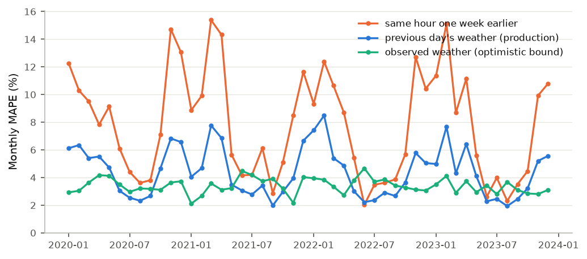
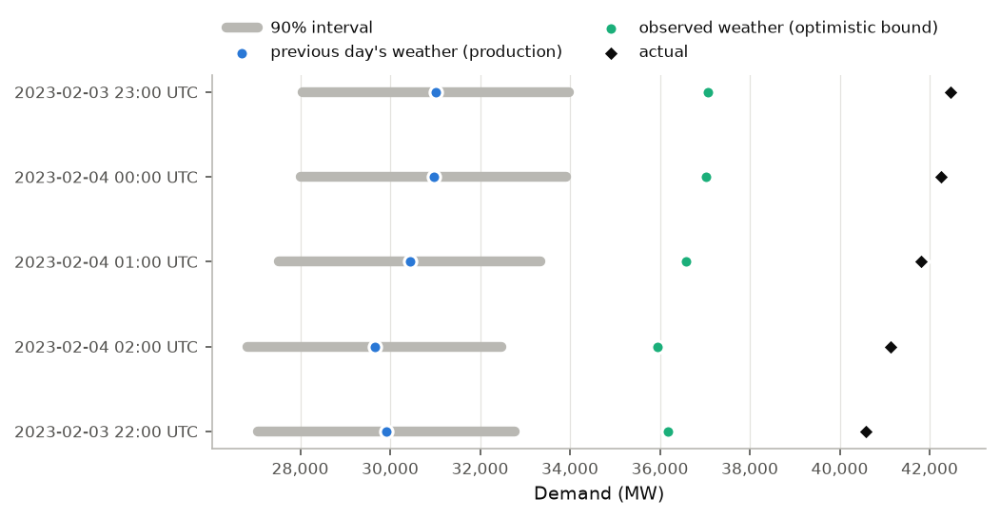
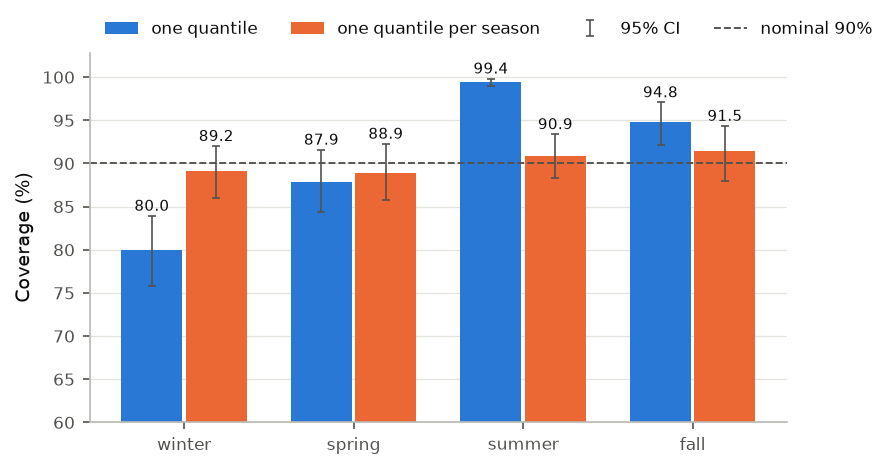
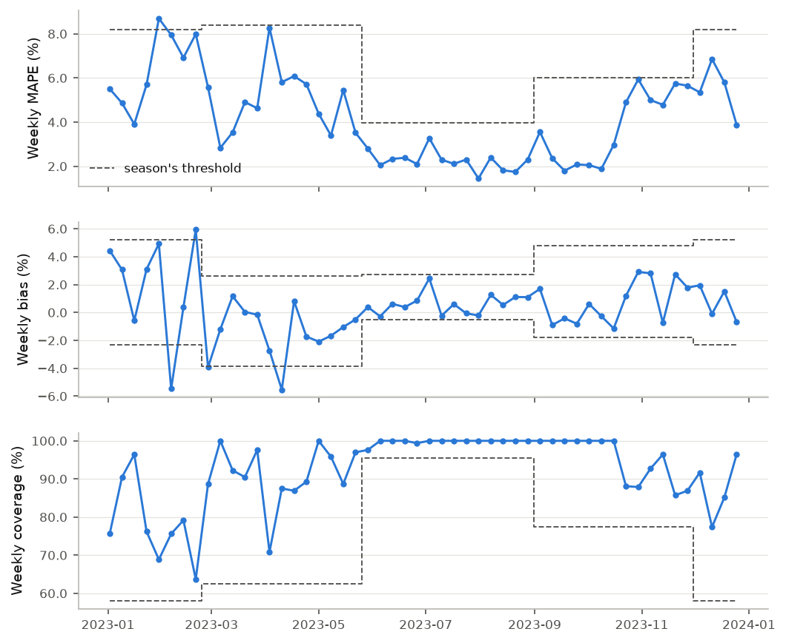
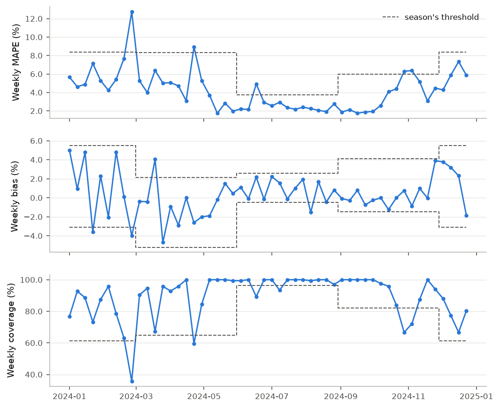
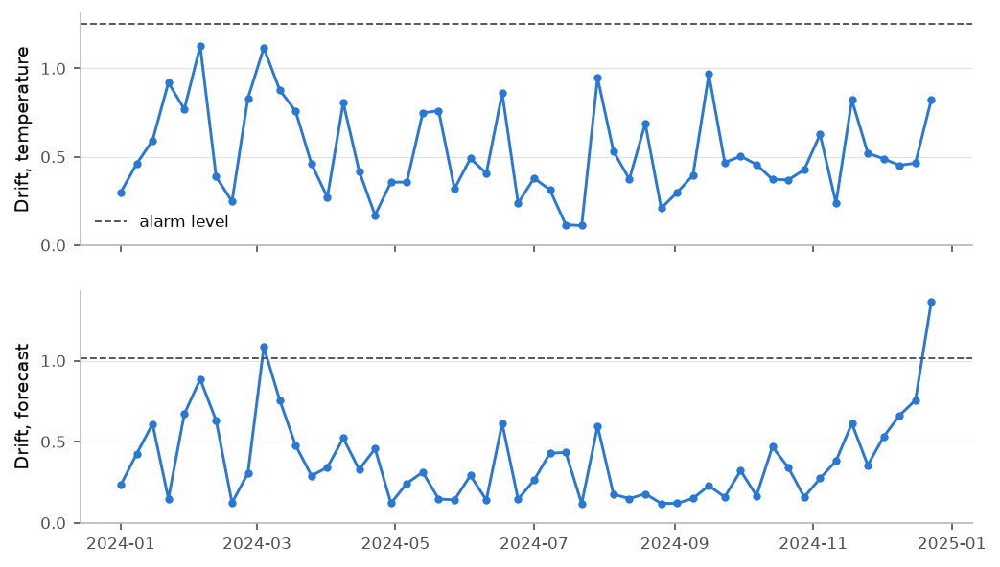

# Validating and monitoring a forecast of Québec's electricity demand

_Report generated from a chain of MLflow runs followed back from the 2024 replay (section 11), code `9ab28e51a1ec`, code hash `6894ad412fe0`, monitoring rules frozen at commit `affe089f6ed0` (tag `rules-frozen`), **after a departure from the rules as first frozen: the 2024 replay is post hoc (section 7)**. Every measured value comes from those runs, and every design constant (embargo, resamples, quantiles, horizons, factors, years) from the runs or from the code that made them; none is typed by hand. Written in the text are: the numbers of sections, rules and the standards cited, the units of the calendar (24 hours, weeks from Monday to Sunday), the 95% level of the confidence intervals, the formulas, the counts in a line of reasoning (a day and its echo) and the description of the breaks in section 9. This English version is derived from the French one, which is the reference._

> Demand data: Hydro-Québec, "Historique de la demande d'électricité au Québec" (https://donnees.hydroquebec.com/explore/dataset/historique-demande-electricite-quebec/), licensed CC BY-NC 4.0 (https://creativecommons.org/licenses/by-nc/4.0/). Hydro-Québec offers this data for information only, without warranty of quality; it is not official data. This project checked it, masked or corrected a few hours (each case documented) and aggregated it; it does not redistribute the dataset, and the reports quote only a few hourly values from it, as evidence.
>
> Weather data: Environment and Climate Change Canada, used under the Open Government Licence – Canada (https://open.canada.ca/en/open-government-licence-canada).
>
> Extracted from the Environment and Climate Change Canada Historical Climate Data web site ( https://climate.weather.gc.ca/index_e.html ) on 2026-10-14.
>
> Neither Hydro-Québec nor Environment and Climate Change Canada produced, reviewed or endorsed this work.
>
> Built with Claude Code under the repository owner's direction.

## In brief

- Over 2020–2023, the forecast is off by 4.42% of hourly demand on average, against 7.81% for a naive forecast (the same hour one week earlier): it does better, and the gap is confirmed.
- Its 90% intervals held demand 90.6% of the time from 2021-01 on, and the 95% CI of that coverage contains the nominal. They hold it less often than promised in these groups: winter; forecast-load deciles 7, 8, 9 and 10 (section 4).
- At the 5 busiest hours of 2019–2023, all in 2023-02, demand fell outside the interval 5 times out of 5, always above it.
- Replayed as production, with the model and the rules frozen, 2024 triggered no recommendation (MAPE 4.23%, coverage 89.4%), **post hoc**, after a departure from the frozen rules.
- The report also measures what the monitor could miss: on 2023, a sustained 10% rise in demand yielded "retrain" within 10 weeks at 0 of 4 starts, and on 2024 (out of sample, a measurement added after the results), at 1 of 4; on 2024, a sustained gap of ±2% between demand and forecast did at 1 of 8 cases (sections 6 to 8).

## Model card

| | |
|---|---|
| **What it forecasts** | Québec's hourly electricity demand as published by Hydro-Québec, for the 24 hours of day D, issued at the end of day D−1 (Eastern Standard Time), with a 90% prediction interval. |
| **Intended use** | To show, on a real forecast, validation and monitoring of the kind a model-risk team does. |
| **Out of scope** | Any operational dispatch, any trading or pricing, any decision. Hydro-Québec publishes this data for information; it is not official data. |
| **Data** | Hydro-Québec hourly demand; hourly temperature at one primary station, Montréal (ECCC), the only one the model uses, and at 5 others (Québec, Gatineau, Sherbrooke, Saguenay and Trois-Rivières) for a sensitivity run only. Designed on 2019–2023; 2024 replayed as production. |
| **Model** | Ordinary least squares on named features: one constant per hour and day type, heating and cooling (degree-hours, base 18 °C) per time-of-day block, and demand one day and one week earlier. Frozen on data up to 2023-12-24; hash of its coefficients and half-width `c8e1725aad77` (registered model `valiwatt-demand-persistence`, alias `replay-2024`). |
| **Interval** | Forecast × (1 ± 9.26%). The half-width is a quantile of the 8,739 relative out-of-sample errors of 2023-01 to 2023-12, made by the 12 models validation refitted each month and already scored when the frozen model is fitted (section 8), then applied to that model: the shape of a split-conformal interval, without its finite-sample coverage guarantee (section 1). The measured coverage is the evidence (sections 4 and 7). |
| **Validation error** | MAPE 4.42% [4.14%, 4.68%] over 2020–2023, against 7.81% for the naive baseline. |
| **2024 replay** | MAPE 4.23%, coverage 89.4%; no recommendation (section 7); **post hoc**: replayed again after a departure from the frozen rules, decided after the 2024 results had been seen and recorded in `AGENTS.md` (section "Departures from the frozen monitoring rules", which lists it); the earlier replay is shown beside it (section 7). On 2024, a sustained gap of ±6% or more between demand and forecast yielded "retrain" within 8 weeks at each of the 4 starts; a gap of +2% did at 0 of 4 starts, and of −2% at 1 of 4. On 2024, intervals cut to × 0.5 of their half-width yielded "recalibrate" at 3 of 4 starts; milder cuts (up to × 0.9) at most at 1 of 4 starts. |
| **Test cases** | March to June 2020: bias −1.86% against −0.60% in the same months of other years; a gap not confirmed by disjoint intervals; the interval of the difference, added after the results, confirms the gap (section 3). Cold peak of 2023-02: 0 of the 5 busiest hours inside the interval. Neither case had an acceptance criterion that could fail. |
| **Weather caveat** | Production uses the previous day's temperature, the only one known at issue time. The observed temperature of the target hour, which stands in for a perfectly forecast Montréal temperature, is only an optimistic bound; it issues no recommendation. |
| **Limitations** | Section 8. |
| **Author** | Built with Claude Code under the repository owner's direction. |

## 1. The methods, in plain words

- **Walk-forward validation.** Each month from 2020 to 2023 is forecast by a model refitted on the hours before it only, minus the last 7 days (the embargo). Nothing from the tested month helps fit it.
- **The error.** Mean absolute percentage error (MAPE): on average, how far the forecast is from actual demand. The signed bias says in which direction: bias = (demand − forecast) / demand, positive when the forecast is too low.
- **The uncertainty of a mean.** Neighbouring hours share the weather, so whole weeks are resampled, 1,000 times, to get a 95% interval around each mean. "A beats B" is written only when the interval of the difference excludes zero.
- **The prediction interval.** Its half-width is a quantile of the relative errors |demand − forecast| / forecast. For each validation month, it is the quantile of rank ⌈(n + 1) × 0.90⌉ of the n out-of-sample errors of the previous 12 months that were already scored when the month's model is fitted (section 8), each of those months forecast by its own refitted model; for the frozen model, the same quantile over the errors of the 12 months before the replayed year that were already scored when it is fitted, applied to a model that made none of those errors. That is the shape of a split-conformal interval, but its finite-sample coverage guarantee does not hold here: it assumes exchangeable errors, and these hourly errors are autocorrelated and come from other models. The only evidence is the coverage measured out of sample (sections 4, 6 and 7).
- **The frozen model.** In production the model is not refitted: it is fitted once, frozen with the hash of its coefficients, then replayed hour by hour.
- **The thresholds.** For each season, the weekly thresholds are quantiles of the validation weeks: MAPE above the 95th percentile, bias outside the 2.5th–97.5th percentiles, coverage below the 5th percentile.
- **Drift.** Each week, the distribution of temperatures and of forecasts is compared with the same weeks (± 2) of earlier years, using Evidently's normed Wasserstein distance. The alarm level is the 95th percentile of that distance over the validation weeks.
- **The decision table.** Each week, at most one recommendation, with its evidence: (1) a data-quality failure → investigate the data; (2) the same failure 2 weeks running (MAPE above its threshold, or bias beyond the same side of its band), broad across each week, or the bias beyond the same side of its band 3 weeks running → retrain; (3) coverage below its threshold 2 weeks running, broad, with bias inside its band → recalibrate the intervals; (4) the same input drifting 2 weeks running, with performance inside its thresholds → investigate the data. "Broad": the week stays beyond the threshold when its 2 most extreme days are set aside. One bad day never touches more than two days of a week (itself and, through the 24-hour and 168-hour lags, the next day or the same day a week later), so it cannot trigger a recommendation unless the weeks already held failing days of their own. A bad Monday-to-Sunday week comes back the next week, through the week-old lag, with the opposite sign: not the same failure twice, so with its neighbouring weeks inside their bands it triggers nothing either. An episode of 3 days or more can trigger "retrain" on its own; section 6 measures how often. The monitor recommends; it never acts.

## 2. Validation on 2020–2023

48 monthly folds, 2020-01 to 2023-12, 7-day embargo.

| Forecast | MAPE | 95% CI | Signed bias | Hours |
|---|---|---|---|---|
| previous day's weather (production) | 4.42% | [4.14%, 4.68%] | +0.22% | 34,997 |
| observed weather (optimistic bound) | 3.40% | [3.29%, 3.51%] | +1.22% | 34,997 |
| same hour one week earlier | 7.81% | [7.14%, 8.44%] | −0.60% | 35,046 |
| previous day's weather, 6-station mean | 4.45% | [4.17%, 4.73%] | −0.01% | 35,013 |

MAPE differences are in percentage points (pt).

- Previous day's weather against the naive baseline: −3.40 pt of MAPE [−3.92 pt, −2.91 pt], a confirmed gap.
- Observed weather against the previous day's: −1.01 pt [−1.27 pt, −0.73 pt]; this is the most a perfectly forecast Montréal temperature would add, inside this model.
- 6-station mean against the primary station (a sensitivity run, never used to choose; the plan fixed the Montréal station after the data-quality report had compared the two sources on 2019–2023, years that include the validation years): +0.04 pt [+0.01 pt, +0.07 pt].

**By season and by year** (previous day's weather):

| Group | MAPE | 95% CI | Bias | 95% CI of the bias |
|---|---|---|---|---|
| fall | 3.83% | [3.40%, 4.27%] | +0.38% | [−0.09%, +0.90%] |
| spring | 5.15% | [4.69%, 5.62%] | −1.42% | [−1.97%, −0.86%] |
| summer | 2.61% | [2.42%, 2.79%] | +0.83% | [+0.50%, +1.10%] |
| winter | 6.11% | [5.61%, 6.61%] | +1.12% | [+0.40%, +1.72%] |
| 2020 | 4.72% | [4.14%, 5.29%] | −0.31% | [−0.99%, +0.38%] |
| 2021 | 4.30% | [3.81%, 4.91%] | +0.45% | [−0.05%, +0.95%] |
| 2022 | 4.45% | [3.92%, 5.02%] | +0.49% | [−0.06%, +1.04%] |
| 2023 | 4.19% | [3.68%, 4.75%] | +0.27% | [−0.31%, +0.84%] |

**By decile of forecast load** (deciles are taken on the forecast, never on actual demand):

| Decile | MAPE | 95% CI | Bias | 95% CI of the bias |
|---|---|---|---|---|
| 1 | 2.59% | [2.40%, 2.81%] | +1.09% | [+0.77%, +1.41%] |
| 2 | 3.29% | [3.04%, 3.56%] | 0.00% | [−0.35%, +0.37%] |
| 3 | 3.12% | [2.88%, 3.41%] | +0.53% | [+0.19%, +0.87%] |
| 4 | 3.16% | [2.91%, 3.44%] | +0.33% | [−0.03%, +0.65%] |
| 5 | 3.55% | [3.25%, 3.93%] | −0.23% | [−0.58%, +0.15%] |
| 6 | 4.91% | [4.51%, 5.34%] | −0.64% | [−1.25%, −0.02%] |
| 7 | 5.93% | [5.53%, 6.35%] | +0.77% | [+0.03%, +1.58%] |
| 8 | 5.90% | [5.49%, 6.40%] | +0.60% | [−0.16%, +1.41%] |
| 9 | 5.75% | [5.29%, 6.21%] | +0.40% | [−0.29%, +1.10%] |
| 10 | 5.98% | [5.37%, 6.55%] | −0.60% | [−1.50%, +0.31%] |

**By hour of the day** (the local hour in which the demand hour starts):

| Hour | MAPE | 95% CI | Bias | 95% CI of the bias |
|---|---|---|---|---|
| 0:00 | 4.58% | [4.24%, 4.91%] | +0.29% | [−0.08%, +0.65%] |
| 1:00 | 4.74% | [4.39%, 5.09%] | +0.24% | [−0.14%, +0.62%] |
| 2:00 | 4.90% | [4.54%, 5.26%] | +0.19% | [−0.22%, +0.58%] |
| 3:00 | 5.02% | [4.64%, 5.40%] | +0.13% | [−0.28%, +0.53%] |
| 4:00 | 5.10% | [4.71%, 5.48%] | +0.04% | [−0.36%, +0.44%] |
| 5:00 | 5.12% | [4.73%, 5.49%] | −0.09% | [−0.51%, +0.31%] |
| 6:00 | 5.17% | [4.81%, 5.52%] | −0.04% | [−0.45%, +0.33%] |
| 7:00 | 4.95% | [4.63%, 5.27%] | +0.03% | [−0.33%, +0.38%] |
| 8:00 | 4.38% | [4.08%, 4.68%] | +0.21% | [−0.11%, +0.52%] |
| 9:00 | 4.04% | [3.77%, 4.33%] | +0.33% | [+0.04%, +0.60%] |
| 10:00 | 3.93% | [3.66%, 4.20%] | +0.25% | [−0.03%, +0.51%] |
| 11:00 | 4.00% | [3.73%, 4.25%] | +0.30% | [+0.03%, +0.55%] |
| 12:00 | 4.09% | [3.80%, 4.35%] | +0.36% | [+0.09%, +0.60%] |
| 13:00 | 4.25% | [3.96%, 4.51%] | +0.36% | [+0.07%, +0.62%] |
| 14:00 | 4.34% | [4.06%, 4.60%] | +0.33% | [+0.04%, +0.59%] |
| 15:00 | 4.36% | [4.07%, 4.62%] | +0.27% | [−0.03%, +0.56%] |
| 16:00 | 4.31% | [4.03%, 4.57%] | +0.33% | [+0.03%, +0.61%] |
| 17:00 | 4.13% | [3.87%, 4.38%] | +0.25% | [−0.04%, +0.51%] |
| 18:00 | 3.99% | [3.74%, 4.24%] | +0.28% | [0.00%, +0.54%] |
| 19:00 | 3.99% | [3.74%, 4.24%] | +0.29% | [+0.01%, +0.56%] |
| 20:00 | 4.05% | [3.79%, 4.30%] | +0.31% | [+0.01%, +0.58%] |
| 21:00 | 4.06% | [3.78%, 4.33%] | +0.19% | [−0.12%, +0.47%] |
| 22:00 | 4.16% | [3.87%, 4.44%] | +0.25% | [−0.06%, +0.55%] |
| 23:00 | 4.36% | [4.06%, 4.67%] | +0.29% | [−0.04%, +0.61%] |

**Coefficients of the model frozen for 2024.** Each coefficient says what a feature adds *given* demand one day and one week earlier; the fit without the lags, shown beside it for interpretation only, gives the total effect of the weather. The 72 constants (one per hour and day type) are not shown. No least-squares standard error is given: the errors are autocorrelated.

| Feature | Frozen model | Without lags |
|---|---|---|
| heating, night (0–5 h) (MW per degree-hour)  | 109.9 | 489.3 |
| cooling, night (0–5 h) (MW per degree-hour)  | 109.6 | 517.2 |
| heating, morning (6–9 h) (MW per degree-hour)  | 117.1 | 516.3 |
| cooling, morning (6–9 h) (MW per degree-hour)  | 64.5 | 315.4 |
| heating, day (10–15 h) (MW per degree-hour)  | 103.5 | 439.4 |
| cooling, day (10–15 h) (MW per degree-hour)  | 49.0 | 192.6 |
| heating, evening (16–20 h) (MW per degree-hour)  | 114.5 | 494.1 |
| cooling, evening (16–20 h) (MW per degree-hour)  | 52.6 | 210.0 |
| heating, late evening (21–23 h) (MW per degree-hour)  | 106.3 | 462.1 |
| cooling, late evening (21–23 h) (MW per degree-hour)  | 91.6 | 404.9 |
| demand one day earlier (share)  | 0.599 | — |
| demand one week earlier (share)  | 0.169 | — |

## 3. Test cases

Neither test case had an acceptance criterion that could fail: the plan fixed what each would measure, not a result that would count as a failure. They are measurements.

**Spring 2020.** Months March, April, May and June: bias −1.86% [−3.06%, −0.71%] in 2020, against −0.60% [−1.12%, −0.11%] in the other years. The criterion used, disjoint intervals, does not confirm the gap; it is not section 1's rule, which judges the interval of the difference. *Added after the results:* the interval of the difference, computed at render time with the same resampling of whole weeks as the runs, but with more draws (each side on its own weeks and with its own seed, since they share no hour), gives −1.27 pt [−2.51 pt, −0.02 pt]: under section 1's rule, the gap is confirmed (400,000 draws per side, in 20 independent batches of 20,000; Monte Carlo standard error of the bounds, measured by their spread from one batch to the next: 0.0026 pt and 0.0032 pt; bounds at this precision: −2.5092 pt and −0.0188 pt, each more than 3 of its standard errors from zero). With observed weather, the same case gives −1.39% [−2.30%, −0.44%] in 2020 against +1.28% [+0.78%, +1.75%]: intervals that are disjoint; difference −2.66 pt [−3.71 pt, −1.59 pt], added after the results by the same computation: under section 1's rule, the gap is confirmed (400,000 draws per side, in 20 independent batches of 20,000; Monte Carlo standard error of the bounds, measured by their spread from one batch to the next: 0.0020 pt and 0.0025 pt; bounds at this precision: −3.7121 pt and −1.5938 pt, each more than 3 of its standard errors from zero). Prediction intervals do not cover 2020: they need 12 months of calibration.

| Month | MAPE | Bias |
|---|---|---|
| 2020-03 | 5.41% | −1.50% |
| 2020-04 | 5.52% | −3.03% |
| 2020-05 | 4.72% | −2.48% |
| 2020-06 | 3.04% | −0.43% |
| 2021-03 | 7.76% | −0.96% |
| 2021-04 | 6.85% | −1.54% |
| 2021-05 | 3.48% | −0.73% |
| 2021-06 | 3.06% | +1.55% |
| 2022-03 | 5.40% | −0.75% |
| 2022-04 | 4.86% | −1.41% |
| 2022-05 | 3.01% | −0.50% |
| 2022-06 | 2.22% | +1.24% |
| 2023-03 | 4.31% | −0.94% |
| 2023-04 | 6.42% | −2.20% |
| 2023-05 | 4.10% | −1.07% |
| 2023-06 | 2.28% | +0.15% |

**Cold peak of 2023-02.** The 5 busiest hours of 2019–2023 all fall in 2023-02. 0 of 5 are inside the 90% interval. Even with the target hour's observed temperature, the forecast stays 10.8% to 12.7% below demand: the temperature lag does not explain the whole gap. The cause is not tested: no fit without the lags, or with another response to temperature, was run on this peak. What the coefficients of the model frozen for 2023 show, fitted up to 2022-12-24, before the peak (the validation folds that forecast it are refits of the same form, whose coefficients are not kept): the forecast carries over the previous day's demand with a weight of 0.586, and one more heating degree-hour adds 107 to 119 MW to it depending on the time-of-day block, against 439 to 514 MW in the fit without the lags. A forecast that leans on the previous day this way follows only part of a change in temperature on the same day; that is a reading of the coefficients, not a measured cause. Only one peak is studied here.

| Hour ending (UTC) | Demand | Temperature | Previous day's weather | Interval | Observed weather |
|---|---|---|---|---|---|
| 2023-02-03 23:00 UTC | 42,473 MW | −26.1 °C | 31,016 MW | 28,051–33,981 | 37,062 MW |
| 2023-02-04 00:00 UTC | 42,254 MW | −26.2 °C | 30,964 MW | 28,004–33,924 | 37,033 MW |
| 2023-02-04 01:00 UTC | 41,799 MW | −26.3 °C | 30,435 MW | 27,526–33,344 | 36,591 MW |
| 2023-02-04 02:00 UTC | 41,141 MW | −26.4 °C | 29,650 MW | 26,816–32,484 | 35,940 MW |
| 2023-02-03 22:00 UTC | 40,585 MW | −26.1 °C | 29,910 MW | 27,051–32,769 | 36,190 MW |

## 4. Prediction intervals

Nominal 90%, from 2021-01.

| Form | Coverage | 95% CI | Mean half-width |
|---|---|---|---|
| relative, one quantile (production) | 90.6% | [88.7%, 92.5%] | 9.99% |
| relative, one quantile per season (sensitivity) | 90.1% | [88.6%, 91.7%] | 9.65% |
| absolute (sensitivity) | 90.1% | [87.9%, 92.4%] | 11.93% |
| relative, observed weather | 90.2% | [89.0%, 91.4%] | 7.60% |

The 95% CI of overall coverage contains the nominal. Conditional coverage is read from the 95% CIs of the tables below, as printed, for the production interval. Under-covered, their 95% CI wholly below the 90% nominal: winter; forecast-load deciles 7, 8, 9 and 10. Over-covered, the CI wholly above: summer and fall; forecast-load deciles 1, 2, 3, 4 and 5. One quantile per season is a sensitivity run. With one quantile per season, the 95% CI of coverage contains the 90% nominal in every season. The CIs of the two forms do not overlap in winter and summer; they overlap in spring and fall. No interval is computed on the difference between the two forms: the comparison goes no further than whether the CIs overlap. The decile table shows what one quantile per season leaves at high loads. The production form stays the one fixed before validation; changing it after seeing the results would make them depend on the choice.

| Season | One quantile | 95% CI | One quantile per season | 95% CI |
|---|---|---|---|---|
| winter | 80.0% | [75.8%, 83.9%] | 89.2% | [86.0%, 92.0%] |
| spring | 87.9% | [84.4%, 91.6%] | 88.9% | [85.8%, 92.3%] |
| summer | 99.4% | [99.0%, 99.8%] | 90.9% | [88.3%, 93.4%] |
| fall | 94.8% | [92.2%, 97.1%] | 91.5% | [88.0%, 94.3%] |

| Hour block | Coverage (one quantile) | 95% CI |
|---|---|---|
| night (0–5 h) | 87.5% | [84.8%, 90.2%] |
| morning (6–9 h) | 89.5% | [87.3%, 91.7%] |
| day (10–15 h) | 92.0% | [90.2%, 93.8%] |
| evening (16–20 h) | 92.8% | [91.1%, 94.4%] |
| late evening (21–23 h) | 91.6% | [89.7%, 93.6%] |

| Decile of forecast load | Coverage (one quantile) | 95% CI | One quantile per season | 95% CI |
|---|---|---|---|---|
| 1 | 98.5% | [97.4%, 99.5%] | 95.1% | [93.0%, 96.8%] |
| 2 | 96.7% | [95.0%, 98.1%] | 92.5% | [90.3%, 94.5%] |
| 3 | 96.7% | [95.1%, 98.0%] | 92.3% | [90.1%, 94.3%] |
| 4 | 97.2% | [95.9%, 98.4%] | 91.6% | [89.1%, 93.8%] |
| 5 | 96.0% | [94.0%, 97.7%] | 90.9% | [88.4%, 93.4%] |
| 6 | 90.9% | [87.7%, 93.8%] | 87.6% | [83.9%, 90.7%] |
| 7 | 82.1% | [77.6%, 85.8%] | 84.0% | [79.5%, 87.6%] |
| 8 | 81.4% | [77.4%, 85.0%] | 85.7% | [82.1%, 89.2%] |
| 9 | 84.2% | [79.8%, 87.7%] | 90.5% | [87.1%, 93.6%] |
| 10 | 82.5% | [78.1%, 87.4%] | 90.7% | [87.7%, 93.7%] |

## 5. Monitoring thresholds

Drawn from the 2021–2023 validation weeks (the 2023 replay uses 2021–2022 only). Seasons: winter December to February, spring March to May, summer June to August, fall September to November. Weeks run Monday to Sunday, standard time. A week is judged, by the replay, and enters the thresholds, only when its 7 days all lie in the period (the replayed year, or the years the thresholds are drawn from), none fails the replay's day-level data-quality check, and it holds at least 120 scored hours: the two apply the same test. On these grounds 4 weeks of 2021–2023 were set aside (4 of 2021–2022 for the 2023 replay); the validation run lists each with its reason.

| Season | MAPE above | Bias outside | Coverage below | Weeks |
|---|---|---|---|---|
| winter | 8.35% | −3.10% to +5.47% | 61.2% | 36 |
| spring | 8.33% | −5.20% to +2.13% | 64.9% | 38 |
| summer | 3.75% | −0.49% to +2.60% | 96.4% | 40 |
| fall | 6.00% | −1.45% to +4.10% | 82.0% | 39 |

Drift: alarm above 1.252 for temperature and 1.015 for the forecast.

**Thresholds of the 2023 replay**, drawn from the 2021–2022 weeks; the section 6 measurements on 2023 use them, those on 2024 the thresholds of the table above:

| Season | MAPE above | Bias outside | Coverage below | Weeks |
|---|---|---|---|---|
| winter | 8.19% | −2.33% to +5.22% | 58.0% | 24 |
| spring | 8.38% | −3.83% to +2.60% | 62.5% | 25 |
| summer | 3.95% | −0.49% to +2.74% | 95.5% | 26 |
| fall | 6.02% | −1.76% to +4.81% | 77.4% | 26 |

Each threshold is an extreme quantile of a season's weeks (the "Weeks" column): with so few weeks, it rests on a few extreme weeks, and it moves when a year is added, as the two tables show. How often a week is flagged in error is therefore uncertain.

## 6. The frozen model, rehearsed on 2023

Before replaying 2024, the same procedure is rehearsed on the design years: a model frozen on data up to 2022-12-24, thresholds from 2021–2022, and 2023 replayed hour by hour. The measurements in this section are first on 2023, the year on which the monitoring rules were designed and reviewed before the freeze: rule 2 was rewritten before the freeze, and its first wording says "retrain" on this year (below); on 2023, their false-alarm and blind-spot rates are therefore not measured on a year the rules had not seen. The false alarms from short episodes, the shift in level and the cost of the echo exclusion are also measured on 2024, out of sample, and shown beside 2023: that measurement on 2024 was added after the 2024 results. The rules' power on 2024 is in section 7.

| | Frozen model | Folds refitted each month |
|---|---|---|
| MAPE | 4.18% | 4.19% |
| Bias | +0.34% | +0.27% |
| Coverage | 92.3% | 90.4% |
| Weeks with MAPE above threshold | 1 | 1 |
| Weeks with bias above its band | 1 | 1 |
| Weeks with bias below its band | 3 | 3 |
| Weeks with low coverage | 0 | 0 |
| Recommendations | 0 | 0 |

MAPE difference (frozen minus refitted), on the same 8,739 hours: −0.01 pt [−0.02 pt, 0.00 pt]: no confirmed gap; freezing the model for a year costs no measurable accuracy on 2023.

**Why "the same failure, broad".** The first wording of rule 2 (MAPE or bias out of band 2 weeks running, in any combination) says "retrain" in the week of 2023-02-06 (the week before: MAPE 8.69% above its threshold, bias +4.93%; that week: MAPE 7.95%, bias −5.47% outside its band), then in the week of 2023-02-27 (the week before: MAPE 7.99%, bias +5.93% outside its band; that week: MAPE 5.58%, bias −3.93% outside its band). Each time the bias changes sign from one week to the next: the profile of a passing gap that the 24-hour and 168-hour lags carry into the following days; a degraded model would rather keep an error of the same sign. Week of 2023-02-06: the two weeks do not show the same failure, and the rule kept sees nothing. Week of 2023-02-27: the two weeks do not show the same failure, and the rule kept sees nothing. The rule kept needs the same failure 2 weeks running, broad in each week: one day is never enough unless the weeks already held failing days; an episode of several days can be, and how often is measured below.

**The rules' power on 2023.** From the first judged week of January, April, July and October, a sustained change is imposed and the weekly rules are run again on the 2023 hours: a gap between demand and forecast (±2% to ±8%), counted in weeks until "retrain", or intervals narrowed (half-width × 0.9 to × 0.5), counted in weeks until "recalibrate" (—: nothing within 8 weeks). A measurement, never a recommendation.

| Starts | −8% | −6% | −4% | −2% | +2% | +4% | +6% | +8% | 
|---|---|---|---|---|---|---|---|---|
| 2023-01-02 (winter) | 3 | 4 | — | — | — | — | 2 | 2 | 
| 2023-04-03 (spring) | 2 | 2 | 5 | — | — | — | 5 | 4 | 
| 2023-07-03 (summer) | 2 | 2 | 3 | 3 | — | 3 | 2 | 2 | 
| 2023-10-02 (fall) | 2 | 2 | 2 | — | — | 6 | 2 | 2 | 

| Starts | × 0.9 | × 0.8 | × 0.7 | × 0.6 | × 0.5 | 
|---|---|---|---|---|---|
| 2023-01-02 (winter) | — | — | — | — | — | 
| 2023-04-03 (spring) | — | — | — | — | 4 | 
| 2023-07-03 (summer) | — | — | — | — | — | 
| 2023-10-02 (fall) | — | — | — | — | 6 | 

On 2023, a sustained gap of ±6% or more between demand and forecast yielded "retrain" within 8 weeks at each of the 4 starts; a gap of +2% did at 0 of 4 starts, and of −2% at 1 of 4. On 2023, intervals cut to × 0.5 of their half-width yielded "recalibrate" at 2 of 4 starts; no milder cut (up to × 0.9) did.

**False alarms from short episodes.** An episode is not a model failure. Demand is multiplied by a factor for 1, 3, 5 or 7 days, from every day of the replayed year (from 2023-01-02 on in 2023 and from 2024-01-01 on in 2024, as long as the episode ends at least 14 days before the year's last judged day, so that its echo is judged), and each case is replayed hour by hour by the real monitor. Any "retrain" or "recalibrate" that follows is a false alarm; it is *clean* when none of the weeks it rests on was already beyond any of its performance thresholds in the year as it was. The last column counts the starts the echo exclusion keeps from "retrain".

**2023** (the year the rules were designed on):

| Length | Factor | Starts | "Retrain" | of which clean | "Recalibrate" | Kept by the echo exclusion |
|---|---|---|---|---|---|---|
| 1 d | × 0.70 | 350 | 0 (0.0%) | 0 | 0 | 0 |
| 1 d | × 0.85 | 350 | 0 (0.0%) | 0 | 0 | 0 |
| 1 d | × 1.15 | 350 | 0 (0.0%) | 0 | 0 | 0 |
| 1 d | × 1.30 | 350 | 0 (0.0%) | 0 | 0 | 0 |
| 3 d | × 0.70 | 348 | 2 (0.6%) | 1 | 0 | 2 |
| 3 d | × 0.85 | 348 | 0 (0.0%) | 0 | 0 | 0 |
| 3 d | × 1.15 | 348 | 0 (0.0%) | 0 | 0 | 0 |
| 3 d | × 1.30 | 348 | 1 (0.3%) | 0 | 0 | 0 |
| 5 d | × 0.70 | 346 | 37 (10.7%) | 19 | 0 | 44 |
| 5 d | × 0.85 | 346 | 0 (0.0%) | 0 | 0 | 0 |
| 5 d | × 1.15 | 346 | 0 (0.0%) | 0 | 0 | 0 |
| 5 d | × 1.30 | 346 | 3 (0.9%) | 2 | 0 | 35 |
| 7 d | × 0.70 | 344 | 118 (34.3%) | 87 | 0 | 54 |
| 7 d | × 0.85 | 344 | 8 (2.3%) | 5 | 0 | 2 |
| 7 d | × 1.15 | 344 | 1 (0.3%) | 1 | 0 | 5 |
| 7 d | × 1.30 | 344 | 19 (5.5%) | 16 | 0 | 75 |

**2024** (out of sample, a measurement added after the results):

| Length | Factor | Starts | "Retrain" | of which clean | "Recalibrate" | Kept by the echo exclusion |
|---|---|---|---|---|---|---|
| 1 d | × 0.70 | 350 | 1 (0.3%) | 0 | 0 | 0 |
| 1 d | × 0.85 | 350 | 1 (0.3%) | 0 | 0 | 0 |
| 1 d | × 1.15 | 350 | 0 (0.0%) | 0 | 5 | 0 |
| 1 d | × 1.30 | 350 | 1 (0.3%) | 0 | 9 | 0 |
| 3 d | × 0.70 | 348 | 18 (5.2%) | 0 | 1 | 8 |
| 3 d | × 0.85 | 348 | 6 (1.7%) | 0 | 0 | 1 |
| 3 d | × 1.15 | 348 | 2 (0.6%) | 0 | 6 | 0 |
| 3 d | × 1.30 | 348 | 10 (2.9%) | 0 | 6 | 2 |
| 5 d | × 0.70 | 346 | 52 (15.0%) | 9 | 3 | 34 |
| 5 d | × 0.85 | 346 | 13 (3.8%) | 0 | 0 | 6 |
| 5 d | × 1.15 | 346 | 2 (0.6%) | 0 | 6 | 0 |
| 5 d | × 1.30 | 346 | 17 (4.9%) | 1 | 3 | 40 |
| 7 d | × 0.70 | 344 | 113 (32.8%) | 49 | 2 | 49 |
| 7 d | × 0.85 | 344 | 30 (8.7%) | 7 | 1 | 6 |
| 7 d | × 1.15 | 344 | 7 (2.0%) | 0 | 6 | 5 |
| 7 d | × 1.30 | 344 | 38 (11.0%) | 12 | 3 | 59 |

**A one-day shock gave an alarm**, on 2024. One bad day can do so only by completing failing days the weeks already held, which the trim had been setting aside; the weeks involved are in the run. An episode of several days does more: through the day-old lag it spoils one day more than it lasts, and through the week-old lag as many days the following week, so from 3 days on both weeks can be broad on the same failure with no failing days of their own. When one of the two weeks' bias stays inside its band (a band wide on that side, or a week that also holds days of the episode, as when it crosses a Monday), the echo exclusion does not engage. Weekly statistics cannot tell such an episode from two weeks of model failure; the rules stay as written, and these tables give the price.

**A shift in the level of demand.** Demand is multiplied by a factor from the first judged week of January, April, July and October, for 10 weeks (weeks until "retrain"; —: nothing within 10 weeks). The persistence forecast follows demand through its lags, so a shift in level leaves a gap between forecast and demand much smaller than the shift itself. The power table measures that gap; the two tables below measure the shift in level.

**2023** (the year the rules were designed on):

| Starts | −10% | −5% | +5% | +10% | 
|---|---|---|---|---|
| 2023-01-02 (winter) | — | — | — | — | 
| 2023-04-03 (spring) | 2 | — | — | — | 
| 2023-07-03 (summer) | 2 | 4 | — | — | 
| 2023-10-02 (fall) | 2 | — | — | — | 

**2024** (out of sample, a measurement added after the results):

| Starts | −10% | −5% | +5% | +10% | 
|---|---|---|---|---|
| 2024-01-01 (winter) | — | — | — | — | 
| 2024-04-01 (spring) | — | — | — | 10 | 
| 2024-07-01 (summer) | 3 | — | — | — | 
| 2024-10-07 (fall) | 2 | — | — | — | 

**What the echo exclusion costs.** From the first judged week of January, April, July and October, for 8 weeks, the forecast takes a random error drawn each day from a normal law: a degraded model whose weekly bias can change sides. The rules are run with and without the exclusion.

**2023** (the year the rules were designed on):

| Daily standard deviation | Runs | "Retrain" with the exclusion | without it | Suppressed by the exclusion | Delayed |
|---|---|---|---|---|---|
| 6% | 80 | 19 | 21 | 2 | 0 |
| 10% | 80 | 44 | 44 | 0 | 8 |
| 15% | 80 | 74 | 76 | 2 | 13 |

**2024** (out of sample, a measurement added after the results):

| Daily standard deviation | Runs | "Retrain" with the exclusion | without it | Suppressed by the exclusion | Delayed |
|---|---|---|---|---|---|
| 6% | 80 | 15 | 16 | 1 | 1 |
| 10% | 80 | 42 | 46 | 4 | 7 |
| 15% | 80 | 71 | 74 | 3 | 13 |

## 7. 2024 replayed as production

**Post hoc.** The 2024 replay ran again, after a departure from the frozen rules: the rules were changed after the 2024 results had been seen. The departure is recorded in `AGENTS.md`, in the section "Departures from the frozen monitoring rules", which lists it; the rules as first frozen are those of commit `7ad8b71088fd`, the rules after the departure those of commit `affe089f6ed0`. The results in this section are those of the replay after the departure; the earlier replay is beside it.

| | Earlier replay, rules of commit `7ad8b71088fd` (run `91f7e3faecee4a899381edd47b4ffc3f`) | Replay after the departure, rules of commit `affe089f6ed0` |
|---|---|---|
| MAPE | 4.23% | 4.23% |
| Coverage | 89.4% | 89.4% |
| Recommendations | none | none |

The departure of 2026-10-14 covers these items:

- A misplaced value is moved back only when its destination is unambiguous: the next-best destination must cost at least the minimum ratio times the chosen one (data-quality report, section 3.2).
- A duplicated value outside the physical bounds can take part in no repair, and no hour whose value lies outside those bounds is returned as usable.
- Design code (validation folds, thresholds, frozen models) sees each decision time as the replay sees its clock, and an interval's half-width is calibrated only on the days already scored when its model is fitted (section 8).
- The lookahead guard loses its 168-hour term, which could never fire on its own.
- The thresholds are calibrated on the weeks the replay judges: a week holding a day that fails data quality, or whose days are not all in the period, no longer enters them (section 5).
- The freeze gate runs inside the replay itself, so no entry point replays 2024 without it.
- The moved-tag check also reads the repository's replay ledger (`docs/replay-ledger.json`), so a fresh clone of the repository sees a departure.
- The rules' false alarms and blind spots are also measured on 2024, out of sample (section 6).

The clock advances hour by hour from 2024-01-01 to 2024-12-31; every read goes through an accessor that refuses any record later than the clock. The model and its intervals are checked by hash before and after: `c8e1725aad77`, unchanged.

| | |
|---|---|
| MAPE | 4.23% [3.70%, 4.84%] |
| Bias | +0.31% [−0.28%, +0.91%] |
| Coverage (nominal 90%) | 89.4% [85.1%, 92.9%] |
| Hours in the year / forecast / scored | 8,784 / 8,760 / 8,758 |
| Days failing data quality | 0 of 366 |
| Weeks judged | 52 of 53 |

Hours not forecast, by missing input (an hour can miss more than one): previous week's demand unavailable (2), previous day's demand unavailable (2), previous day's temperature missing (20).

**Recommendations.**

No week of 2024 triggered a recommendation.

**Under the first wording of rule 2.** It says "retrain" in the week of 2024-11-04 (the week before: MAPE 6.30% above its threshold, bias +0.75%; that week: MAPE 6.36% above its threshold, bias −0.86%). Week of 2024-11-04: MAPE is beyond its threshold in both weeks, but without each week's 2 most extreme days it is 4.71% then 4.64% against a threshold of 6.00%: neither week is broadly beyond it; so the rule kept sees nothing. The bias changes sign from one week to the next, but stays inside its band in both weeks: the echo exclusion is not what applies.

**The rules' power on 2024**, measured the same way (weeks until "retrain", then until "recalibrate"; —: nothing within 8 weeks):

| Starts | −8% | −6% | −4% | −2% | +2% | +4% | +6% | +8% | 
|---|---|---|---|---|---|---|---|---|
| 2024-01-01 (winter) | 3 | 6 | — | — | — | — | 3 | 2 | 
| 2024-04-01 (spring) | 2 | 2 | 6 | — | — | 8 | 3 | 2 | 
| 2024-07-01 (summer) | 2 | 2 | 2 | — | — | 2 | 2 | 2 | 
| 2024-10-07 (fall) | 2 | 2 | 2 | 3 | — | — | 3 | 2 | 

| Starts | × 0.9 | × 0.8 | × 0.7 | × 0.6 | × 0.5 | 
|---|---|---|---|---|---|
| 2024-01-01 (winter) | — | — | — | — | 3 | 
| 2024-04-01 (spring) | — | — | — | — | 2 | 
| 2024-07-01 (summer) | — | — | — | — | — | 
| 2024-10-07 (fall) | 5 | 5 | 5 | 3 | 3 | 

On 2024, a sustained gap of ±6% or more between demand and forecast yielded "retrain" within 8 weeks at each of the 4 starts; a gap of +2% did at 0 of 4 starts, and of −2% at 1 of 4. On 2024, intervals cut to × 0.5 of their half-width yielded "recalibrate" at 3 of 4 starts; milder cuts (up to × 0.9) at most at 1 of 4 starts.

For each week with a drift alarm, the Evidently report is kept in the run, and Evidently's value is compared with the monitor's: 4 comparisons, all equal.

## 8. Limitations

- **Conditional coverage.** The production interval under-covers winter; forecast-load deciles 7, 8, 9 and 10 (section 4). The coverage thresholds of winter are drawn from weeks that already had that under-coverage: the monitor does not flag it as decay. The other way round, the coverage threshold of summer (96.4%) is above the 90% nominal: a week covered above nominal can be flagged low there. The thresholds measure departure from each season's validation coverage, not from nominal.
- **Extreme cold.** The 2023-02 peak is not covered (0 of the 5 busiest hours); even with observed weather, the model under-forecasts it, and the cause is not tested. Only one peak is studied; cold snaps are not measured as a class.
- **Episodes of several days** (measured on 2023, the year the rules were designed on, and on 2024, out of sample, a measurement added after the results). An episode of several days can yield "retrain" with nothing wrong in the model: on 2023, up to 34.3% of starts for 7 days at × 0.70, and at most 2.3% for an episode of ±15%; on 2024, up to 32.8% of starts for 7 days at × 0.70, and at most 8.7% for an episode of ±15% (section 6).
- **Shift in level** (measured on 2023, the year the rules were designed on, and on 2024, out of sample, a measurement added after the results). On 2023, a sustained 10% rise in demand did not yield "retrain" within 10 weeks at 4 of 4 starts (January, April, July and October), and a 10% fall did at 3 of 4. On 2024, a sustained 10% rise in demand did not yield "retrain" within 10 weeks at 3 of 4 starts (January, April, July and October), and a 10% fall did at 2 of 4. Persistence absorbs most of a rise through its lags. On 2023 and 2024, a fall yielded "retrain" more often than a rise: it leaves a larger relative gap than a rise of the same size, since the bias is measured against the lower demand; where the year's weekly bias sat within each season's band does the rest. The power tables measure a gap between forecast and demand, not a shift in level.
- **Echo exclusion** (measured on 2023, the year the rules were designed on, and on 2024, out of sample, a measurement added after the results). On a degraded model whose bias changes sides, it suppresses "retrain" on 2023 in 4 of 240 runs and delays it in 21, and on 2024 in 8 of 240 runs and delays it in 21 (section 6); that is the price of avoiding the false alarms of an episode followed by its echo.
- **Power of "recalibrate".** Intervals cut to × 0.5 of their half-width did not yield "recalibrate" within 8 weeks at 2 of the 4 starts of 2023, and cut to × 0.5 at 1 of the 4 starts of 2024 (sections 6 and 7): rule 3 needs coverage below the season's threshold, broad, 2 weeks running, with the bias inside its band.
- **False drift alarms in 2024.** The alarm levels are the 95th percentile of the 2021–2023 validation weeks, whose references held 2 to 4 earlier years for temperature and 1 to 3 for the forecast; in 2024, they hold 5 and 4. The false drift-alarm rate in 2024 is not measured.
- **Rule 4 and a real change in temperature.** A real, sustained change in temperature, which demand responds to and the model follows, with performance inside its thresholds, can yield "investigate the data": the rule cannot tell a real change in the weather from a data error (break "Temperature drift with performance inside its thresholds: investigate the data", section 9). The rule stays as written.
- **Data quality in 2024.** The replay judges each day on the raw records cut at the clock, but it runs only if the whole window, 2024 included, passed the data-quality report's gates. Out-of-bounds values, off-grid records and duplicated temperatures therefore could not appear in the replay; the daily monitor still judged missing hours, blank values, duplicated demand records and a silent primary station there.
- **Real-time data.** Values are as downloaded on 2026-10-14 (demand) and from 2026-10-14 on (weather); no publication delay and no revision are modelled. Design code sees each decision time as the replay sees its clock: the demand series is rebuilt there from only the raw records stamped at or before that time (for a model's fit, the origin of its first test day; for the lags, each day's origin; for the target, the time the day is scored). The repair that fills the missing hour of 2022-01-01 05:00 UTC with a record stamped 2023-01-01 05:00 UTC therefore enters design code only after that record arrives, at the same time as in the replays. An interval's half-width, fixed when its model is fitted, is calibrated only on the days already scored at that time (a day is scored an hour after its last hour, or at the end of the design data): the day before a validation month's first test day stays out.
- **Independence.** The model, the checks and this report come from one AI agent session under one owner's direction, with no independent human review of the code. The reviews were done by fresh-context agents, which is not independent validation in the SR 11-7 sense.

## 9. Breaks, on synthetic data

Each gate and monitor has a test that injects the fault it exists to catch; a control injects nothing and must stay quiet. The `breaks` run executes them all; the report refuses to render if any of them failed. No break reads the real demand or weather data: the data-quality gates, the guards and the rendering are tested on small made-up data, and the clock and the monitors in a synthetic world (`tests/replay_world.py`): just over two years of made-up demand, a model frozen on it, thresholds drawn from its own out-of-sample weeks by the same quantile rule as the real ones (one set for all four seasons), and a drift alarm level set by hand at 1.0, not by that rule. A break firing in that world shows the check can fire, not that it would see the same fault in real demand.

| Check | Break | Result |
|---|---|---|
| Data-quality gates | A duplicate of no known shape fails the gate | fired |
| Data-quality gates | An ambiguous misplaced record is not moved and fails the gate | fired |
| Data-quality gates | A record outside the window fails the gate | fired |
| Data-quality gates | A demand value out of bounds fails the gate | fired |
| Data-quality gates | Coverage below its threshold fails the gate | fired |
| Data-quality gates | Duplicate weather rows fail the index gate | fired |
| Data-quality gates | An impossible temperature fails the bounds gate | fired |
| Data-quality gates | A sensor outage fails the coverage gate | fired |
| Data-quality gates | An outage shared by several stations fails the panel gate | fired |
| Data-quality gates | A failing gate stops the chain: no canonical data is written | fired |
| Data-quality gates | Raw files that no longer match their manifest are refused | fired |
| Data-quality gates | A record off the hourly grid fails the window gate, with its timestamp | fired |
| Data-quality gates | An out-of-bounds value inside a fall-back pair still fails the bounds gate | fired |
| Data-quality gates | An out-of-bounds value is set aside before a repair reads it | fired |
| Data-quality gates | A misplaced record that fits two empty hours equally well is not moved and fails the gate | fired |
| Data-quality gates | An out-of-bounds duplicate is never moved into a usable hour, nor through the replay | fired |
| Data-quality gates | An out-of-bounds value that reaches a usable hour is marked out of bounds | fired |
| Data-quality gates | An out-of-bounds value makes no spike next to it | fired |
| No lookahead | An input read after the forecast's origin is refused | fired |
| No lookahead | A training row inside the embargo is refused | fired |
| No lookahead | A 2024 row is refused by design code | fired |
| No lookahead | Validation refuses a 2024 row | fired |
| No lookahead | A drift reference holding replayed days is refused | fired |
| No lookahead | Thresholds built on the replayed year are refused | fired |
| No lookahead | A replay's drift thresholds ignore the replayed year | fired |
| No lookahead | The frozen model refuses training rows inside its embargo | fired |
| No lookahead | The day-level data-quality verdict used for calibration reads no record after the last day | fired |
| No lookahead | An origin moved earlier than the 24-hour lag allows is refused | fired |
| No lookahead | A value repaired from a later record reaches no lag and no training before that record arrives | fired |
| No lookahead | A half-width fixed when its model is fitted is calibrated only on the days already scored then, not on a value repaired an hour later | fired |
| No lookahead | Out-of-sample rows that do not say when they were scored calibrate no half-width | fired |
| Replay clock | Records corrupted after a cut change nothing judged before it | fired |
| Replay clock | A record that arrives a week late is not used before it arrives | fired |
| Replay clock | Reading past the clock, or turning it back, is refused | fired |
| Replay clock | A forecast issued after its origin is refused | fired |
| Replay clock | A day scored before the hour after its last hour is refused | fired |
| Replay clock | A forecast built on a row of another origin is refused | fired |
| Replay clock | A forecast built on a row of another day is refused | fired |
| Monitors and decision table | Control: clean data yield no recommendation | stayed quiet |
| Monitors and decision table | The seasonal reference stays quiet on clean data and fires on a shift | fired |
| Monitors and decision table | Temperature drift with performance inside its thresholds: investigate the data | fired |
| Monitors and decision table | A sensor gap fails the day's data quality and suspends the performance rules | fired |
| Monitors and decision table | A missing and a duplicated demand record fail their day | fired |
| Monitors and decision table | A low week (−30%) and its echo through the one-week lag do not yield retrain | fired |
| Monitors and decision table | A high week (+30%) and its echo, MAPE high in both weeks, do not yield retrain | fired |
| Monitors and decision table | MAPE high two weeks with bias on opposite sides is an echo; without the flip it fires | fired |
| Monitors and decision table | Bias beyond the same side three weeks running yields retrain; an echo or an unjudged week breaks it | fired |
| Monitors and decision table | The power measure finds a sustained 8% gap or intervals cut to 20%, and nothing without a change | fired |
| Monitors and decision table | The level-shift measure finds a 12% rise in demand, and nothing without a change | fired |
| Monitors and decision table | The episode measure: a one-day shock brings no false alarm, and every start is counted | fired |
| Monitors and decision table | The episode measure finds the false alarm of five days across a Monday, and the echo the exclusion keeps out | fired |
| Monitors and decision table | A false alarm resting on a week already out of band is called assisted; an alarm the year already had is not counted | fired |
| Monitors and decision table | The echo exclusion only ever removes or delays retrain | fired |
| Monitors and decision table | Two altered days never lift the trimmed statistic past the untouched days (2,000 draws) | fired |
| Monitors and decision table | Partial weeks have no drift statistic | fired |
| Monitors and decision table | The last day is judged at the end of the data, and says so | fired |
| Monitors and decision table | Duplicated temperatures and an off-grid demand record fail their day | fired |
| Monitors and decision table | A shift in the demand level: retrain | fired |
| Monitors and decision table | Intervals made too narrow: recalibrate | fired |
| Monitors and decision table | Two rules at once: one recommendation with both pieces of evidence | fired |
| Monitors and decision table | A one-day shock (Saturday) does not yield retrain | fired |
| Monitors and decision table | A one-day shock (Sunday) does not yield retrain | fired |
| Monitors and decision table | A week with too few scored hours is not judged | fired |
| Monitors and decision table | A week with too few full days has no trimmed statistic and is never broadly out of band | fired |
| Monitors and decision table | A partial week, a week with a failed day and a week with too few hours are not judged, each condition alone | fired |
| Monitors and decision table | A week cut by the end of the period is not judged, even with enough hours | fired |
| Monitors and decision table | The day-level data-quality verdict the calibration reads is, day by day, the replay's own, on seven injected faults and the clean days | fired |
| Monitors and decision table | A week holding a day the replay would fail does not calibrate the thresholds, and why is logged | fired |
| Monitors and decision table | A week cut by the calibration years is set aside; a day without a data-quality verdict makes the thresholds refuse | fired |
| The monitor never acts | A replay that changes the model or its intervals fails | fired |
| Frozen rules | Without the freeze tag, the 2024 replay is refused | fired |
| Frozen rules | A rule file edited after the freeze is refused and named | fired |
| Frozen rules | A rule file added after the freeze is refused | fired |
| Frozen rules | A moved freeze tag is refused unless recorded as a departure | fired |
| Frozen rules | The replay called directly on the held-out year passes the freeze gate: without the tag, with an edited rule file or under a moved tag, it is refused | fired |
| Frozen rules | The committed replay ledger shows a moved tag even with no MLflow store: refused unless a departure is recorded | fired |
| Frozen rules | A replay ledger that cannot be parsed is refused | fired |
| Frozen rules | A replay ledger with no list of replays is refused | fired |
| Frozen rules | A ledger entry without a freeze commit is refused | fired |
| Frozen rules | Earlier replays are found even when deleted | fired |
| Frozen rules | Raw files other than the ones checked are refused | fired |
| Frozen rules | Design code refuses a raw demand file other than the one checked | fired |
| Frozen rules | A registered model that changed during the replay fails it | fired |
| Frozen rules | A frozen model from another validation run, year or rule set is refused | fired |
| Frozen rules | A validation or data-quality run made on other data or other rules is refused | fired |
| Frozen rules | A frozen model file that no longer matches its hash is refused | fired |
| Frozen rules | The registered model is refused when its run records another hash | fired |
| Frozen rules | Without the freeze tag, the 2024 replay stops before reading any input | fired |
| Frozen rules | Under a moved freeze tag, the 2024 replay stops before reading any input, even with --departure and no recorded departure | fired |
| Frozen rules | The 2024 replay refuses a frozen model built on another validation run | fired |
| Frozen rules | The 2024 replay fails when the registered model changes while it runs | fired |
| Frozen rules | An alias pointing at another year's frozen model is refused | fired |
| Report rendering | A report whose code changed since its run is refused | fired |
| Report rendering | The public-safety scan fires on private content | fired |
| Report rendering | A figure whose metadata carries a private path, or with bytes hidden after its end, is refused | fired |
| Report rendering | A file removed from the tree later, a forbidden path or a leftover ref is still caught in the history | fired |
| Report rendering | An annotated tag message carrying a private path is caught | fired |
| Report rendering | The home-directory shorthands fire; ordinary prose does not | fired |
| Report rendering | A figure with a chunk outside the allowlist or a bad checksum is refused | fired |
| Report rendering | A figure whose structure breaks the PNG rules is refused: bytes in the end chunk, an oversized fixed-length chunk, a missing header, a chunk twice, image data missing, split, or not inflating to exactly the size the header states | fired |
| Report rendering | A private path hidden in a fixed-length chunk of a figure is caught | fired |
| Report rendering | Control: an intact run chain is followed to its end | stayed quiet |
| Report rendering | A breaks run marked failed breaks the report's run chain | fired |
| Report rendering | A run made from other code breaks the report's run chain | fired |
| Report rendering | A model frozen for another year breaks the report's run chain | fired |
| Report rendering | A replay made under another freeze commit breaks the report's run chain | fired |
| Report rendering | A validation naming another data-quality run breaks the report's run chain | fired |
| Report rendering | A replay after a departure brings the replays it departs from; one that names none is refused | fired |
| Report rendering | A departure recorded in `AGENTS.md` that the 2024 replay does not carry breaks the report's run chain, and so does a departure replay whose freeze commit `AGENTS.md` does not name | fired |
| Report rendering | Control: with no departure recorded, an intact chain passes; with one, the replay that carries it passes | stayed quiet |
| Report rendering | A departure recorded by a hash shorter than 12 characters breaks the report's run chain | fired |
| Report rendering | A departures section that cannot be found in `AGENTS.md` breaks the report's run chain | fired |
| Report rendering | A season missing from the validation run's coverage makes the report refuse | fired |
| Report rendering | A week of rule 2's first wording missing from the replay's judged weeks makes the report refuse | fired |
| Report rendering | A failure broad in both weeks with no retrain in the replay makes the report refuse | fired |
| Report rendering | A breaks run that does not mark its controls makes the report refuse | fired |
| Report rendering | A spring 2020 case with no spring hours makes the report refuse | fired |
| Report rendering | An empty power table makes the report refuse | fired |
| Report rendering | A power table without narrowed-interval rows makes the report refuse | fired |
| Report rendering | A spring 2020 interval of the difference with two draws sharing a seed, or made of one batch, makes the report refuse | fired |
| Report rendering | A bound of the interval of the difference that Monte Carlo error or rounding cannot separate from zero leaves the verdict undetermined | fired |
| Report rendering | An agent session's address in a commit message, a tag message or a staged file is caught | fired |
| Report rendering | A replay-ledger entry rewritten by hand makes the ledger update refuse | fired |
| Report rendering | A replay ledger carrying a private name, or a field outside its fixed shape, is not written | fired |
| Report rendering | A 2024 replay that disagrees with its ledger entry breaks the report's run chain | fired |
| Report rendering | A replay from before a departure that is in neither the store nor the ledger, or is recorded as incomplete, breaks the report's run chain | fired |
| Report rendering | Control: a replay from before a departure that the store lacks is shown from the ledger, labelled "recorded in the ledger, not re-run here" | stayed quiet |
| Report rendering | A replay from before a departure that disagrees with its ledger entry breaks the report's run chain | fired |
| Report rendering | A replay ledger edited or removed after the render fails the report's stamp test | fired |
| Report rendering | A break that did not fire marks the breaks run failed | fired |
| Report rendering | A bound of the interval of the difference printed no more than k printed standard errors from zero leaves the verdict undetermined, and a bound printed farther out never does: the verdict never contradicts its numbers | fired |
| Report rendering | A bound of the interval of the difference printed no more than k printed standard errors from zero leaves the verdict undetermined, and a bound printed farther out never does: the verdict never contradicts its numbers | fired |
| No lookahead | A row scored an hour after the fit clock does not calibrate the half-width; a row scored at the fit clock itself does | fired |
| Report rendering | A 2024 replay without its false-alarm and blind-spot measures makes the report refuse | fired |
| Report rendering | 2024 measures made with other lengths, factors, level shifts or noise than 2023's make the report refuse | fired |
| Report rendering | A 2024 replay departing from replays made under two freeze commits, a departure the report does not describe, makes the report refuse | fired |

The break "A shift in the demand level: retrain" multiplies the synthetic world's demand by 1.12, a 12% rise. On the real 2023 hours, a 10% rise did not yield "retrain" within 10 weeks at 4 of 4 starts (section 8): the rule can fire, but it did not see such a rise in real demand at any start. On the real 2024 hours (out of sample, a measurement added after the results), the same rise did not yield "retrain" within 10 weeks at 3 of 4 starts (section 8).

## 10. Mapping to SR 11-7 and the NIST AI RMF

The quotations, with their sections and pages, are in `docs/standards.md`. The table says what the checks cover, nothing more.

| Expectation | What valiwatt does | Where it is checked |
|---|---|---|
| SR 11-7, conceptual soundness, including sensitivity analysis | Configuration fixed in the plan before validation (the temperature source after the data-quality report's comparison of stations on 2019–2023); named features, coefficients shown beside a fit without the lags. Alternative specifications: the 6-station mean, absolute interval, one quantile per season, the first wording of rule 2. These are not the small changes in inputs and parameter values that SR 11-7 calls sensitivity analysis; those are not run. | Plan, section 2; validation and frozen-model runs |
| SR 11-7, data quality and relevance | 23 data-quality gates over the full window, each repair documented; the station's representativeness; in production, a daily data-quality monitor on the raw records. | Data-quality report; replays |
| SR 11-7, ongoing monitoring: process verification | Lookahead guards; a clock that refuses later records; the model's hash checked before and after; the 2024 replay refuses to run if the rules differ from the `rules-frozen` tag; the tag was moved once, by a departure recorded in `AGENTS.md`, and the earlier replay is shown beside the new one (section 7). Each guard has its break. | Section 9 |
| SR 11-7, ongoing monitoring: benchmarking | Naive baseline; observed weather as an optimistic bound; frozen model against refitted folds on 2023 (a parallel outcomes analysis). | Sections 2 and 6 |
| SR 11-7, outcomes analysis and back-testing, with intervals | Monthly folds with embargo; 90% intervals of split-conformal shape, without a finite-sample guarantee, with coverage measured overall, by season, by hour block and by decile; weekly statistics judged against thresholds fixed in advance. In SR 11-7's sense, a period not used in development, only the 2024 replay is back-testing: the validation years, 2020–2023, are among those (2019–2023) on which the station was chosen, and 2023 served to design the rules. Since the departure, that back-test is the earlier replay, on the rules frozen before 2024 (section 7): the rules of the replay after the departure were changed after its results had been seen. | Sections 2, 4, 6, 7 |
| SR 11-7, thresholds of acceptability, then recalibration or redevelopment | Per-season thresholds from earlier weeks; an ordered decision table (investigate, retrain, recalibrate), with evidence; recommends without acting. | Sections 5 and 7 |
| SR 11-7, documentation and validation reports | This report and its model card, rendered from the runs and stamped with their IDs and the code hash. | This report |
| NIST MAP 2.2, 2.3 | Intended use, out of scope, weather caveat, limitations; validation design and data-quality findings documented. | Model card; plan |
| NIST MEASURE 1.1, 2.1, 2.3, 2.4, 2.5, 2.13 | MLflow runs (test sets, metrics, parameters, versions); replays under production conditions; breaks; the "not covered" list below. | Runs; section 9 |
| NIST MANAGE 2.2 | Weekly recommendations with evidence; who acts on them, and how, is out of scope. | Section 7 |

**Not covered.** Independent validation and effective challenge (SR 11-7, V; NIST MEASURE 1.3); governance, policies and controls, internal audit, model inventory (SR 11-7, VI; most of NIST GOVERN); periodic review; override analysis; use in decisions and materiality; independent review of a recalibration; sensitivity analysis in SR 11-7's sense (small changes in inputs and parameter values); NIST MANAGE 2.4 (who supersedes, disengages or deactivates the model); NIST MANAGE 4.1 and 1.4 beyond the model card's limitations; real-time data.

## 11. Provenance

| Run | ID | Date |
|---|---|---|
| data quality | `021a47bc77824742bef41d8731c2d951` | 2026-10-15 01:50 UTC |
| validation | `b7268bf5603f47a5a190c716274993ee` | 2026-10-15 01:51 UTC |
| model frozen for 2023 | `04160feea3cf4ff583b177c5883c5735` | 2026-10-15 01:51 UTC |
| model frozen for 2024 | `2823ecf3be7b4e8ca0b410fcfc16b05f` | 2026-10-15 02:22 UTC |
| 2023 replay | `ef636177ec6c4656bebcd8bc3f919d81` | 2026-10-15 02:22 UTC |
| 2024 replay | `aff7424cfb204711aae2bdcd0a442c68` | 2026-10-15 02:53 UTC |
| breaks | `669c16273b244634b4472dd5148374d5` | 2026-10-15 02:56 UTC |

Code hash: `6894ad412fe0d6b6c2bdd68edbd6d8fe4ae4b86eb3afe909ad5ece9b765a36b9`. Rules hash: `e0b993967d938d40af6e678effe3822ba2d5042552468f90d8187f4107295a49`. `tests/test_report_stamp.py` fails when the repository's code no longer matches this hash.
