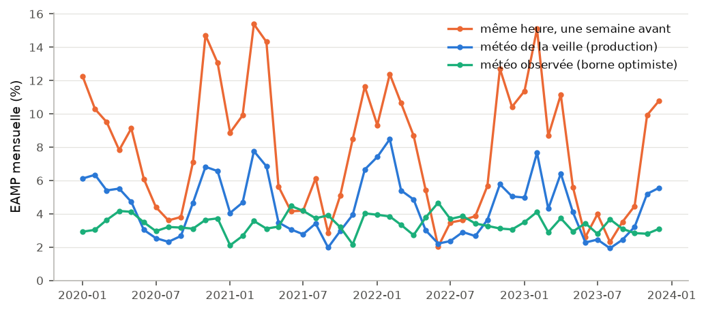
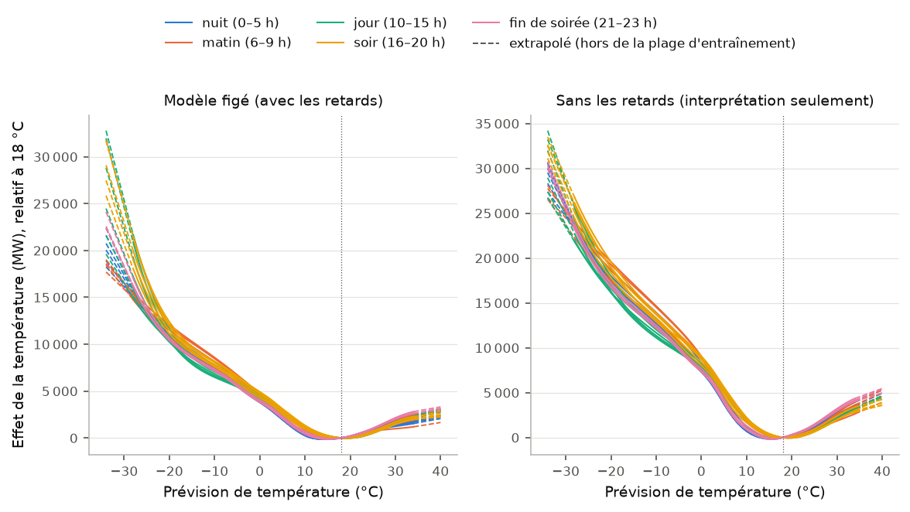
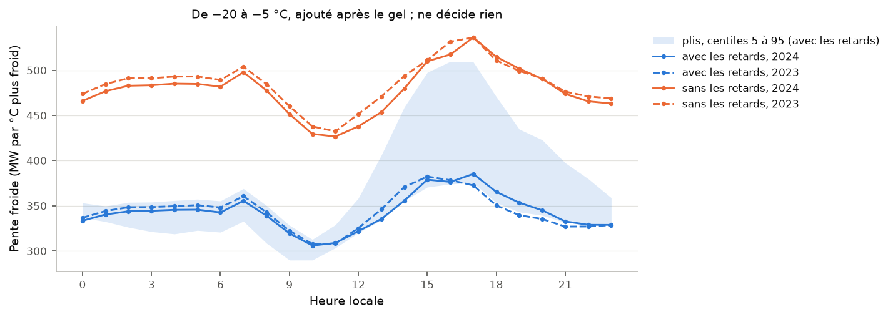
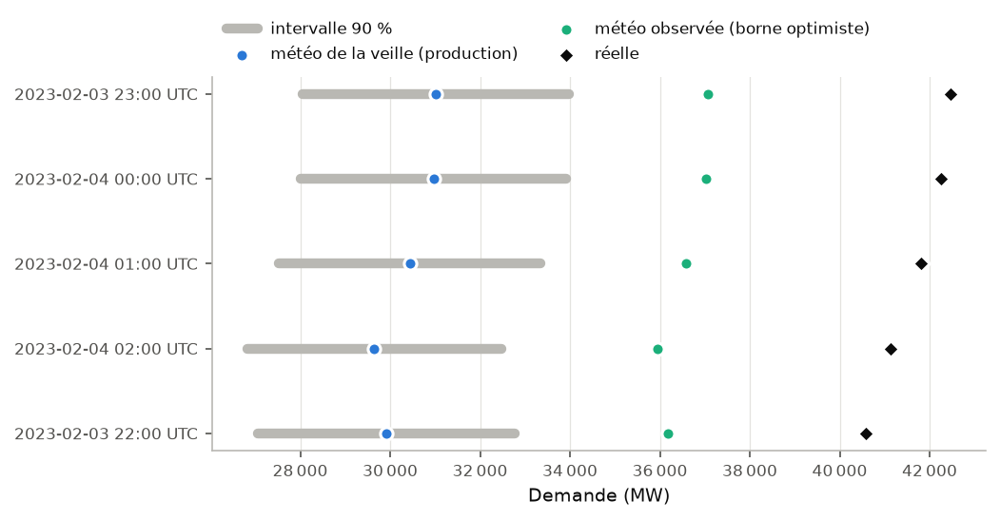
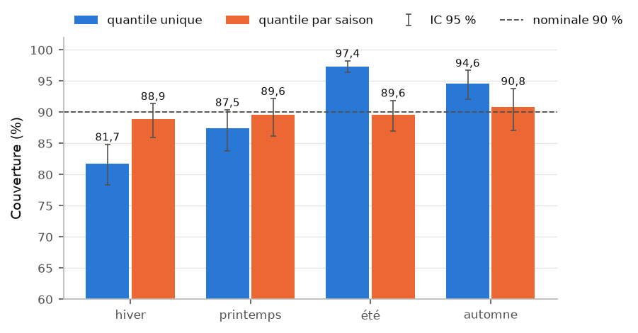
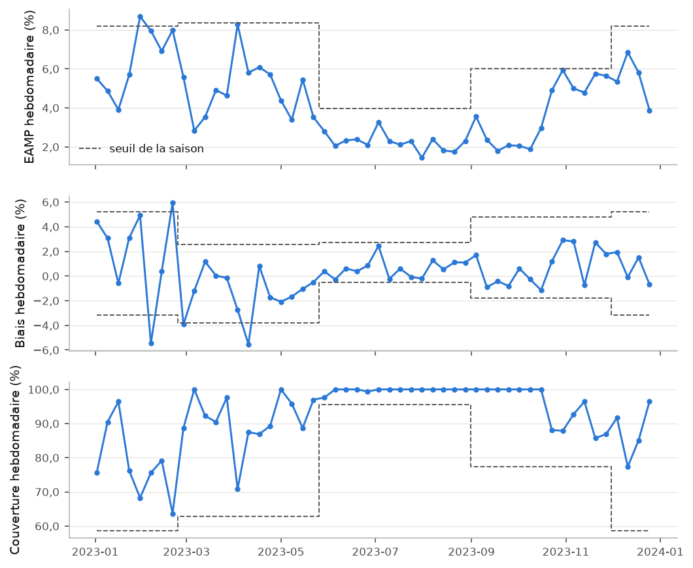
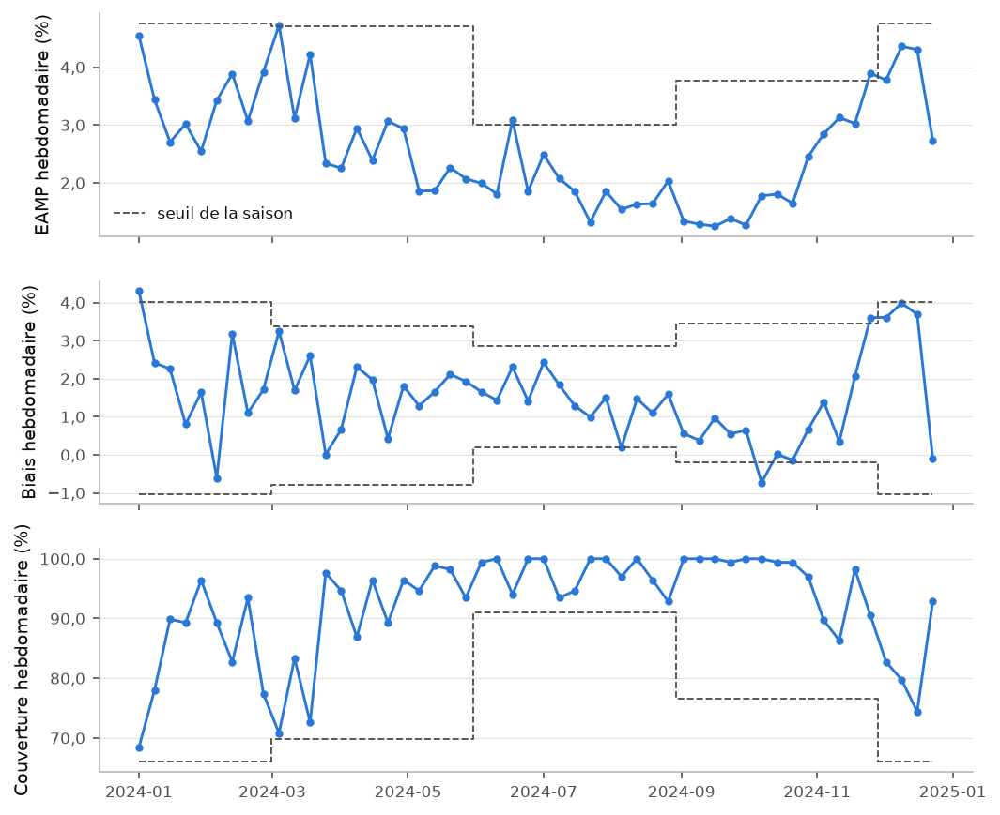
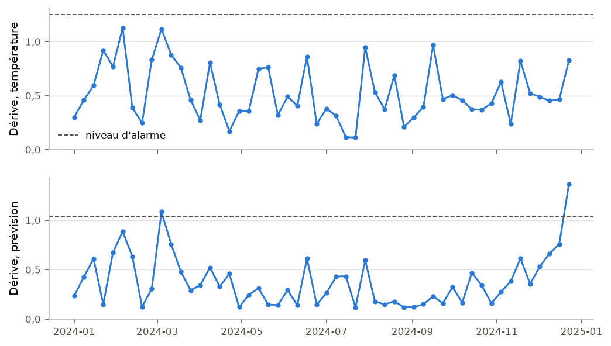

# Validation et surveillance d'une prévision de la demande d'électricité au Québec, v2

_Rapport généré à partir d'une chaîne d'exécutions MLflow suivie depuis le rejeu de 2024 (section 8), code `7843d8a9c190`, empreinte du code `0cbfdfea6191`, règles gelées au commit `825b7bd134a8` (étiquette `rules-frozen-v2`). Chaque valeur mesurée vient de ces exécutions. Les constantes de conception que ses gabarits écrivent en chiffres sont lues des exécutions ou du code qui les a produites. Un test le vérifie. Il lit le texte des gabarits, les chaînes que leur code imprime et les nombres qu'écrivent leurs expressions imprimées. Partout, il n'admet que quelques sortes de chiffres : renvois de section, du plan et des normes, noms de version, dates des décisions du propriétaire, faits du calendrier, constantes d'une formule et numérotation d'une liste. Les libellés des bris de la section 11 sont des descriptions des tests écrites à la main, chiffres compris, et ce test ne les lit pas. « Les développeurs » sont les agents IA qui ont construit ce projet et le propriétaire qui les dirige. Chaque résultat porte son étiquette d'évaluation, lue des exécutions : _dans l'échantillon du choix de la famille et de l'entrée_ pour 2020–2023, _répétition sur une année de conception_ pour 2023, _vu par les développeurs_ pour 2024, et pour 2025 _données réservées_ seulement quand son test de référence est propre. La version anglaise est dérivée de celle-ci._

> Données de demande : Hydro-Québec, « Historique de la demande d'électricité au Québec » (https://donnees.hydroquebec.com/explore/dataset/historique-demande-electricite-quebec/), sous licence CC BY-NC 4.0 (https://creativecommons.org/licenses/by-nc/4.0/). Hydro-Québec offre ces données à titre informatif et sans garantie de qualité ; ce ne sont pas des données officielles. Ce projet les a contrôlées, en a masqué ou corrigé quelques heures (chaque cas est documenté) et les a agrégées ; il ne redistribue pas le jeu de données, et les rapports n'en citent que quelques valeurs horaires, comme preuves.
>
> Données météorologiques : Environnement et Changement climatique Canada, utilisées sous la Licence du gouvernement ouvert – Canada (https://ouvert.canada.ca/fr/licence-du-gouvernement-ouvert-canada).
>
> Données extraites du site Web « Données climatiques historiques » d’Environnement et Changement climatique Canada ( https://climat.meteo.gc.ca/index_f.html ) le 2026-10-14.
>
> Prévisions météorologiques : guidance NBS du National Blend of Models de la NOAA pour la station CYUL (Montréal-Trudeau), téléchargée des archives de l'Iowa Environmental Mesonet de l'Université d'État de l'Iowa (https://mesonet.agron.iastate.edu/). Ce projet a interpolé à l'heure ces prévisions trihoraires et les a converties en degrés Celsius : les valeurs qu'il utilise sont modifiées et ne sont pas des données originales de la NOAA.
>
> Ni Hydro-Québec, ni Environnement et Changement climatique Canada, ni la NOAA, ni l'Iowa Environmental Mesonet n'ont produit, revu ou approuvé ce travail, et ce projet n'est affilié ni à la NOAA ni à l'Iowa Environmental Mesonet.
>
> Construit avec Claude Code sous la direction du propriétaire du dépôt.

## En bref

- **Statut : candidat.** Choisi sur 2020–2023 (dans l'échantillon du choix), montré sur 2024 vue par les développeurs ; le test sur données réservées, 2025, est en attente.
- Sur les 34 997 heures communes de 2020–2023 (_dans l'échantillon du choix de la famille et de l'entrée_), l'erreur absolue moyenne est de 2,83 % pour v2, 3,48 % pour la forme de v1 sur la même prévision et 4,42 % pour v1 tel que livré. Ces années ont servi à choisir la famille et l'entrée : l'avantage de v2 y est biaisé vers le haut par ce choix, et il ne prouve pas que v2 est meilleur (section 3).
- Ses intervalles à 90 % ont contenu la demande 90,3 % du temps de 2021-01 à 2023-12, et l'IC 95 % de cette couverture contient le nominal. Ils la contiennent moins souvent que le nominal dans ces groupes : l'hiver ; le bloc horaire jour (10–15 h) ; les déciles de charge prévue 7, 8, 9 et 10 (section 5). Ce sont les intervalles de v2 ; la couverture n'est jamais un critère de la règle de décision.
- Aux 5 heures les plus chargées de 2019–2023, toutes en 2023-02, la demande est sortie de l'intervalle 3 fois sur 5, toujours par le haut. Rapporté, jamais jugé.
- 2024 (_vu par les développeurs_) : EAMP de 2,58 %, couverture de 92,2 %, aucune recommandation ; verdicts : v2 contre v1 tel que livré, « meilleur » ; v2 contre la forme de v1, « meilleur ». Un succès sur une année déjà vue est une preuve faible : il ne soutient aucune affirmation ; v2 va à 2025 tel que gelé (section 8).
- 2025 : en attente ; le test de référence sera le premier rejeu de 2025 commencé sous `rules-frozen-v2`, sauf si ce départ s'arrête avant de finir et qu'une décision datée du propriétaire nomme le départ qui prend sa place (section 9 ; section 11.3.5 du plan).
- Le rapport mesure aussi ce que le moniteur pouvait manquer : sur 2023, une hausse soutenue de 10 % de la demande a donné « réentraîner » en 10 semaines à 4 des 4 départs, et sur 2024 (vu par les développeurs), à 4 des 4 ; sur 2024, un biais soutenu de ±2 % injecté dans la prévision l'a donné en 8 semaines à 4 des 8 cas (sections 7, 8 et 10).

## Fiche du modèle

| | |
|---|---|
| **Statut** | **Statut : candidat.** Choisi sur 2020–2023 (dans l'échantillon du choix), montré sur 2024 vue par les développeurs ; le test sur données réservées, 2025, est en attente. Couverture des intervalles et heures les plus chargées : à côté du statut, jamais dedans (couverture : sections 4 (les heures de pointe), 5, 7 et 8 ; heures les plus chargées : sections 3, 4, 7 et 8). |
| **Ce qu'il prévoit** | La demande horaire d'électricité du Québec publiée par Hydro-Québec, pour les 24 heures du jour J, émise à la fin du jour J−1 (heure normale de l'Est), avec un intervalle de prévision à 90 %. |
| **Usage prévu** | Démontrer, sur une prévision réelle, une validation et une surveillance du type de celles d'une équipe de gestion du risque de modèle. |
| **Hors champ** | Toute répartition opérationnelle de la production, tout négoce ou tarification, toute décision. Hydro-Québec publie ces données à titre informatif ; ce ne sont pas des données officielles. |
| **Données** | Demande horaire de Hydro-Québec ; prévision de température NBM de la NOAA pour la station CYUL, l'aéroport de Montréal, archivée par l'Iowa Environmental Mesonet (section 2) ; température horaire observée de Montréal (ECCC) pour la qualité des données, v1 tel que livré et la borne optimiste, et de 5 autres stations (Québec, Gatineau, Sherbrooke, Saguenay et Trois-Rivières) pour une analyse de sensibilité seulement. Conception sur 2019–2023. |
| **Modèle** | Un modèle additif de la famille des GAM, ajusté par moindres carrés pénalisés : une courbe de température par heure locale (splines, 10 nœuds aux quantiles des lignes d'entraînement, degré 3, prolongée en ligne droite hors de la plage d'entraînement), les 72 constantes de v1 par heure et type de jour, la demande de la veille et de la semaine précédente ; normalisation puis crête, alpha 1,0. Figé sur les données jusqu'au 2023-12-24 ; empreinte `7aadbc5866c6`, celle du modèle figé de cette chaîne, d'où viennent cette date, l'intervalle ci-dessous et les courbes de la section 3. Comparé à v1 tel que livré et à la forme de v1 sur la même prévision, qui ne recommandent jamais rien. |
| **Intervalle** | Prévision × (1 ± 6,22 %). La demi-largeur est un quantile des 8 729 erreurs relatives hors échantillon de 2023-01 à 2023-12 déjà notées quand le modèle figé est ajusté : la forme d'un intervalle conforme « split », sans sa garantie en échantillon fini. La couverture mesurée en est la preuve (sections 5 et 8). |
| **Erreur en validation** | EAMP de 2,83 % [2,69 % ; 2,95 %] sur ses heures de 2020–2023 (_dans l'échantillon du choix de la famille et de l'entrée_), contre 7,81 % pour la référence naïve (section 3). |
| **Rejeu de 2024** | _vu par les développeurs_ : EAMP de 2,58 %, couverture de 92,2 % ; aucune recommandation. Ce que les règles peuvent manquer cette année-là : un biais soutenu de ±2 % injecté dans la prévision a donné « réentraîner » en 8 semaines à 4 des 8 cas, et des intervalles réduits à × 0,5 de leur demi-largeur ont donné « recalibrer » à 3 des 4 départs, et des réductions moindres à 1 des 4 au plus. Verdicts : « meilleur » contre v1 tel que livré, « meilleur » contre la forme de v1 (section 8). |
| **2025** | En attente (section 9). |
| **Mise en garde météo** | La prévision de température est disponible, par hypothèse, 2 heures après son heure d'émission ; tout résultat qui en dépend repose sur cette hypothèse (section 2). La température observée de l'heure visée n'est qu'une borne optimiste ; elle n'émet aucune recommandation. |
| **Limites** | Section 10. |
| **Auteur** | Construit avec Claude Code sous la direction du propriétaire du dépôt. |

## 1. Les méthodes, en mots simples

- **Validation progressive.** Chaque mois de 2020 à 2023 est prévu par des modèles réajustés sur les heures qui le précèdent seulement, moins les 7 derniers jours (l'embargo). Les trois modèles comparés y sont ajustés aux mêmes plis : v2, la forme de v1 sur la même prévision et v1 tel que livré, refait dans le harnais de v2.
- **L'erreur.** L'erreur absolue moyenne en pourcentage (EAMP) : en moyenne, de combien la prévision s'écarte de la demande réelle. Le biais signé dit dans quel sens : biais = (demande − prévision) / demande, positif quand la prévision est trop basse.
- **L'incertitude d'une moyenne.** Les heures voisines partagent la météo ; on rééchantillonne donc des semaines civiles en blocs (incomplètes comprises), 1 000 fois, pour obtenir un intervalle à 95 % autour de chaque moyenne.
- **La règle de décision, fixée dans le plan avant tout rejeu de v2.** Sur les heures communes (celles où la demande et les trois prévisions existent), on compare l'erreur de v2 à celle de chaque autre modèle, heure par heure, avec un intervalle à 95 % par blocs de semaines civiles. Une comparaison est **meilleure** quand la borne haute de son intervalle est sous zéro, **pire** quand la borne basse est au-dessus, **non séparée** sinon ; les bornes sont jugées telles qu'imprimées, au centième de point. On refait les comparaisons sur les heures froides, celles dont la prévision de température est sous le 5ᵉ centile de celles de 2019–2023 (−12,0 °C) : choisies sur l'entrée connue à l'émission, jamais sur le résultat. Le verdict de chaque comparaison : *meilleur* (la comparaison est meilleure et sa queue froide n'est pas pire) ; *meilleur en moyenne, la queue froide non testable* (moins de 120 heures froides ou moins de 4 semaines) ; *pas montré meilleur* ; *pire*. « v2 est meilleur que v1 » ne se dit que du verdict contre v1 tel que livré, et seulement sur des données réservées ; « le GAM mérite sa place » que du verdict contre la forme de v1. La comparaison de l'entrée (forme de v1 sur la prévision contre v1 tel que livré) est rapportée, jamais jugée.
- **À côté, jamais jugés.** Les 5 heures les plus chargées de chaque période jugée, 2020–2023 comme une seule période puis chaque année rejouée (par la demande réelle, parmi toutes les heures qui en ont une) : l'erreur signée de chaque modèle, ou pourquoi il n'a pas de prévision. La couverture des intervalles de v2, avec la phrase sur ses 90 % (section 5).
- **L'intervalle de prévision.** Sa demi-largeur est un quantile des erreurs relatives |demande − prévision| / prévision. Pour chaque mois de validation, c'est le quantile de rang ⌈(n + 1) × 0,90⌉ des n erreurs hors échantillon des 12 mois précédents déjà notées quand le modèle du mois est ajusté ; pour le modèle figé, le même quantile sur les erreurs des 12 mois qui précèdent l'année rejouée, déjà notées quand il est ajusté. C'est la forme d'un intervalle conforme « split », sans sa garantie de couverture en échantillon fini : ces erreurs horaires sont autocorrélées et viennent d'autres modèles. La seule preuve est la couverture mesurée hors échantillon.
- **Le modèle figé.** En production, le modèle n'est pas réajusté : il est ajusté une fois, figé avec son empreinte, puis rejoué heure par heure.
- **Les seuils.** Pour chaque saison, les seuils hebdomadaires sont des quantiles des semaines de validation de v2 : EAMP au-dessus du 95ᵉ centile, biais hors de l'intervalle 2,5ᵉ–97,5ᵉ centile, couverture sous le 5ᵉ centile.
- **La dérive.** Chaque semaine, la distribution des prévisions de température émises et celle des prévisions de demande de v2 sont comparées aux mêmes semaines (± 2) des années précédentes, avec la distance de Wasserstein normée d'Evidently. Le niveau d'alarme est le 95ᵉ centile de cette distance sur les semaines de validation.
- **La table de décision.** Chaque semaine, au plus une recommandation, avec ses preuves : (1) un échec de qualité des données, y compris un jour qu'aucune prévision de température n'a alimenté → examiner les données ; (2) la même défaillance 2 semaines de suite, étendue à toute la semaine, ou le biais du même côté de sa bande 3 semaines de suite → réentraîner ; (3) couverture sous le seuil 2 semaines de suite, étendue, biais dans sa bande → recalibrer les intervalles ; (4) la même entrée en dérive 2 semaines de suite, performance dans ses seuils → examiner les données. « Étendue » : la semaine reste hors seuil quand on écarte ses 2 jours les plus extrêmes. Un mauvais jour de demande ne gâte, par les retards de 24 h et de 168 h, que lui-même, le lendemain et le même jour la semaine suivante ; une mauvaise prévision de température gâte au plus deux jours consécutifs (section 2). Le moniteur recommande ; il n'agit jamais.

## 2. L'entrée de prévision

**La source.** La température est celle du National Blend of Models (NBM) de la NOAA, son produit NBS pour la station CYUL (Montréal-Trudeau, l'aéroport de la station principale de v1), tel que l'archive l'Iowa Environmental Mesonet : des points toutes les trois heures, en degrés Fahrenheit, que ce projet interpole à l'heure et convertit en degrés Celsius. Les fichiers sont téléchargés par script, jamais versés au dépôt.

**La règle d'alimentation.** Une prévision est **disponible** 2 heures après son heure d'émission : c'est une **hypothèse**, car l'archive ne consigne aucune heure d'arrivée, et tout résultat qui dépend de la prévision repose sur elle. Elle s'appuie sur les heures de livraison qu'affiche le compartiment infonuagique de la NOAA pour un produit apparenté, mesurées hors des exécutions suivies (la section 3.2 du plan en donne les décomptes) ; ces heures couvrent aussi 2024, et la sensibilité à une marge plus longue, plus bas, ne tourne que sur les années de validation, pas sur le rejeu de 2024. Pour le jour J, parmi les 12 prévisions les plus fraîches disponibles à l'origine de J (J 05:00 UTC), on prend la plus fraîche dont les propres points encadrent chacune des 24 heures de J, chacun de ces points étant fini et dans les bornes du contrôle de qualité. On interpole linéairement dans le temps, à l'intérieur d'une seule prévision ; deux prévisions ne sont jamais mélangées. Chaque jour d'entraînement porte la prévision émise pour lui par la même règle, jamais une observation.

**Sur 2019–2023.** 1 826 jours sur 1 826 alimentés ; aucun jour n'est resté sans prévision. Rangs de la prévision utilisée (0 : la plus fraîche) : rang 0, 1 826 jours. Heure de la prévision utilisée, par année : 2019 : 0 h UTC (364 jours), 12 h UTC (1 jours) ; 2020 : 0 h UTC (55 jours), 1 h UTC (310 jours), 7 h UTC (1 jours) ; 2021 : 1 h UTC (364 jours), 19 h UTC (1 jours) ; 2022 : 1 h UTC (365 jours) ; 2023 : 1 h UTC (365 jours).

**L'erreur de la prévision contre l'observation** (prévision moins température observée de Montréal à l'heure visée, par année et saison) :

| Année | Saison | Écart moyen | Écart absolu moyen | Heures |
|---|---|---|---|---|
| 2019 | automne | +0,09 °C | 0,95 °C | 2 184 |
| 2019 | printemps | +0,15 °C | 1,26 °C | 2 208 |
| 2019 | été | +0,07 °C | 0,92 °C | 2 207 |
| 2019 | hiver | +0,04 °C | 1,40 °C | 2 160 |
| 2020 | automne | +0,16 °C | 1,08 °C | 2 184 |
| 2020 | printemps | +0,02 °C | 1,15 °C | 2 208 |
| 2020 | été | +0,30 °C | 0,94 °C | 2 206 |
| 2020 | hiver | −0,18 °C | 1,26 °C | 2 184 |
| 2021 | automne | +0,22 °C | 0,86 °C | 2 184 |
| 2021 | printemps | −0,08 °C | 1,18 °C | 2 208 |
| 2021 | été | +0,16 °C | 0,84 °C | 2 208 |
| 2021 | hiver | −0,12 °C | 1,18 °C | 2 160 |
| 2022 | automne | +0,13 °C | 0,95 °C | 2 183 |
| 2022 | printemps | −0,23 °C | 1,13 °C | 2 187 |
| 2022 | été | +0,06 °C | 0,86 °C | 2 208 |
| 2022 | hiver | −0,01 °C | 1,29 °C | 2 159 |
| 2023 | automne | +0,10 °C | 0,78 °C | 2 178 |
| 2023 | printemps | +0,05 °C | 1,19 °C | 2 206 |
| 2023 | été | +0,14 °C | 0,91 °C | 2 203 |
| 2023 | hiver | −0,09 °C | 1,35 °C | 2 159 |

**La sensibilité à la marge de disponibilité.** Validé aussi avec des prévisions disponibles 6 heures après leur émission, ce qui retire à chaque jour sa propre prévision du début de journée, le GAM change son EAMP de +0,02 pt [+0,01 pt ; +0,02 pt] (6 heures moins 2, sur 35 036 heures) : c'est ce que coûterait une disponibilité à 6 heures au lieu de 2 ; un délai plus long n'est pas mesuré. Cette variante est étiquetée et ne choisit rien.

**Le dernier jour de 2023.** Ses deux dernières heures demandent un point valide tôt le premier jour de 2024, d'une prévision émise ce dernier jour et disponible avant son origine : l'information est celle de 2023, et ce jour est prévu comme les autres. L'essai préliminaire qui a servi au choix coupait sur l'heure de validité et laissait ce jour de côté. Les heures de v2 sur 2020–2023 comprennent celles de ce jour ; celles de l'essai, non.

**Les délais de prévision.** Le plus long délai d'un point de prévision, par année d'émission : 2019, 66 h ; 2020, 72 h ; 2021, 71 h ; 2022, 71 h ; 2023, 71 h ; 2024, 71 h. L'argument de la section 9.2 du plan (une mauvaise prévision gâte au plus deux jours consécutifs) tient tant qu'aucun point n'atteint 75 heures. Aucune année ne l'atteint. Les changements de modèle du NBM au fil des années ne sont pas suivis : la série de prévisions n'est pas homogène, et le moniteur de dérive la surveille.

## 3. Validation sur 2020–2023, _dans l'échantillon du choix de la famille et de l'entrée_

**Le choix, dit simplement.** La famille et l'entrée de v2 ont été choisies par le propriétaire le 2026-10-15, sur un essai préliminaire hors des exécutions suivies, mené sur les plis mensuels de 2020–2023 : six familles de modèles, chacune avec trois entrées de température. Le GAM n'avait pas l'erreur globale la plus basse sur la prévision ; il a été choisi pour son écart plus petit aux heures les plus chargées et les plus froides, et parce qu'il reste explicable, une courbe de température par heure. Cet essai n'est pas une exécution suivie : ses chiffres ne sont pas repris ici. Les valeurs suivies ci-dessous viennent de l'exécution de validation, que chacun peut refaire ; elles sont mesurées sur les années qui ont servi au choix, parmi dix-huit paires famille-entrée : l'avantage de v2 y est biaisé vers le haut par ce choix, et il ne prouve pas que v2 est meilleur. Elles sont montrées, étiquetées, et ne servent jamais à dire que v2 est meilleur.

48 plis mensuels, de 2020-01 à 2023-12, embargo de 7 jours. Chaque modèle sur ses propres heures :

| Prévision (_dans l'échantillon du choix de la famille et de l'entrée_) | EAMP | IC 95 % | Biais signé | Heures |
|---|---|---|---|---|
| v2, le GAM sur la prévision (production) | 2,83 % | [2,69 % ; 2,95 %] | +1,17 % | 35 036 |
| la forme de v1 sur la prévision | 3,48 % | [3,36 % ; 3,59 %] | +1,17 % | 35 036 |
| v1 tel que livré (météo de la veille) | 4,42 % | [4,14 % ; 4,68 %] | +0,22 % | 34 997 |
| le GAM sur la météo observée (borne optimiste) | 2,70 % | [2,59 % ; 2,81 %] | +1,22 % | 34 997 |
| la forme de v1 sur la météo observée (borne optimiste) | 3,40 % | [3,29 % ; 3,51 %] | +1,22 % | 34 997 |
| même heure, une semaine avant (référence naïve) | 7,81 % | [7,14 % ; 8,44 %] | −0,60 % | 35 046 |
| v1 tel que livré, moyenne des 6 stations (sensibilité) | 4,45 % | [4,17 % ; 4,73 %] | −0,01 % | 35 013 |

**Les valeurs suivies du choix**, sur les 34 997 heures communes (209 semaines ; _dans l'échantillon du choix de la famille et de l'entrée_) : EAMP de 2,83 % pour v2, 3,48 % pour la forme de v1 sur la prévision, 4,42 % pour v1 tel que livré. Erreur signée aux 5 heures les plus chargées de 2020–2023, parmi toutes les heures qui ont une demande (demande moins prévision, sur la demande ; positive quand la prévision est trop basse) : v2, le GAM sur la prévision (production), +5,7 % en moyenne ; la forme de v1 sur la prévision, +12,8 % en moyenne ; v1 tel que livré (météo de la veille), +27,0 % en moyenne. Les heures que chaque modèle n'a pas, par raison : v2, le GAM sur la prévision (production) : demande de la semaine précédente indisponible (9), demande de la veille indisponible (10) ; la forme de v1 sur la prévision : demande de la semaine précédente indisponible (9), demande de la veille indisponible (10) ; v1 tel que livré (météo de la veille) : demande de la semaine précédente indisponible (9), demande de la veille indisponible (10), température de la veille absente (39) ; sans demande utilisable : 9.

| Comparaison (_dans l'échantillon du choix de la famille et de l'entrée_) | Différence d'EAMP | IC 95 % | État |
|---|---|---|---|
| v2 contre v1 tel que livré | −1,59 pt | [−1,78 pt ; −1,41 pt] | meilleur |
| v2 contre la forme de v1 sur la même prévision | −0,65 pt | [−0,76 pt ; −0,55 pt] | meilleur |
| la forme de v1 sur la prévision contre v1 tel que livré (rapportée, jamais jugée) | −0,94 pt | [−1,17 pt ; −0,69 pt] | meilleur |

Sur un même ensemble d'heures, les trois comparaisons s'additionnent : v2 contre v1 tel que livré = v2 contre la forme de v1 + l'entrée. Verdicts (_dans l'échantillon du choix de la famille et de l'entrée_) : v2 contre v1 tel que livré, « meilleur » ; v2 contre la forme de v1, « meilleur ». Ils sont dans l'échantillon du choix : ils ne décident rien.

Queue froide (_dans l'échantillon du choix de la famille et de l'entrée_) : 1 468 heures communes sous le seuil de −12,0 °C, réparties sur 37 semaines du lundi au dimanche ; elle est testable (au moins 120 heures et 4 semaines) : v2 contre v1 tel que livré, −5,32 pt [−6,38 pt ; −4,43 pt] (meilleur) ; v2 contre la forme de v1, −0,77 pt [−1,14 pt ; −0,42 pt] (meilleur).

| Heure finissant à (UTC) (_dans l'échantillon du choix de la famille et de l'entrée_) | Demande | Prévision de température | v2 | Forme de v1 sur la prévision | v1 tel que livré |
|---|---|---|---|---|---|
| 2023-02-03 23:00 UTC | 42 473 MW | −25,2 °C | +4,4 % | +13,4 % | +27,0 % | 
| 2023-02-04 00:00 UTC | 42 254 MW | −25,6 °C | +6,5 % | +12,9 % | +26,7 % | 
| 2023-02-04 01:00 UTC | 41 799 MW | −25,7 °C | +8,2 % | +12,9 % | +27,2 % | 
| 2023-02-04 02:00 UTC | 41 141 MW | −25,9 °C | +9,3 % | +13,1 % | +27,9 % | 
| 2023-02-03 22:00 UTC | 40 585 MW | −24,8 °C | +0,4 % | +11,8 % | +26,3 % | 

- Moyenne des 6 stations contre la station principale, sur le modèle de v1 tel que livré (analyse de sensibilité, jamais utilisée pour choisir) : +0,04 pt [+0,01 pt ; +0,07 pt].

**v2 par saison et par année** (_dans l'échantillon du choix de la famille et de l'entrée_) :

| Groupe | EAMP | IC 95 % | Biais | IC 95 % du biais |
|---|---|---|---|---|
| automne | 2,42 % | [2,21 % ; 2,63 %] | +1,18 % | [+0,90 % ; +1,48 %] |
| printemps | 3,21 % | [2,97 % ; 3,43 %] | +0,69 % | [+0,17 % ; +1,15 %] |
| été | 2,13 % | [1,98 % ; 2,28 %] | +1,33 % | [+0,99 % ; +1,62 %] |
| hiver | 3,56 % | [3,31 % ; 3,80 %] | +1,47 % | [+1,03 % ; +1,88 %] |
| 2020 | 2,87 % | [2,57 % ; 3,17 %] | +0,10 % | [−0,34 % ; +0,57 %] |
| 2021 | 2,80 % | [2,58 % ; 3,07 %] | +1,46 % | [+1,08 % ; +1,81 %] |
| 2022 | 2,91 % | [2,66 % ; 3,14 %] | +1,75 % | [+1,45 % ; +2,06 %] |
| 2023 | 2,72 % | [2,44 % ; 3,04 %] | +1,35 % | [+1,06 % ; +1,67 %] |

**Par décile de charge prévue par v2** (les déciles sont pris sur la prévision, jamais sur la demande réelle) :

| Décile | EAMP | IC 95 % | Biais | IC 95 % du biais |
|---|---|---|---|---|
| 1 | 1,98 % | [1,82 % ; 2,15 %] | +1,23 % | [+0,88 % ; +1,55 %] |
| 2 | 2,16 % | [2,03 % ; 2,30 %] | +1,07 % | [+0,79 % ; +1,34 %] |
| 3 | 2,21 % | [2,09 % ; 2,34 %] | +1,06 % | [+0,82 % ; +1,32 %] |
| 4 | 2,23 % | [2,11 % ; 2,37 %] | +1,12 % | [+0,89 % ; +1,35 %] |
| 5 | 2,45 % | [2,29 % ; 2,64 %] | +1,13 % | [+0,88 % ; +1,40 %] |
| 6 | 3,03 % | [2,79 % ; 3,29 %] | +1,24 % | [+0,77 % ; +1,65 %] |
| 7 | 3,54 % | [3,33 % ; 3,75 %] | +1,37 % | [+0,86 % ; +1,88 %] |
| 8 | 3,62 % | [3,39 % ; 3,85 %] | +1,15 % | [+0,70 % ; +1,54 %] |
| 9 | 3,72 % | [3,46 % ; 4,01 %] | +1,35 % | [+0,90 % ; +1,83 %] |
| 10 | 3,32 % | [3,00 % ; 3,63 %] | +0,94 % | [+0,44 % ; +1,42 %] |

**Par heure de la journée** (heure locale où commence l'heure de demande) :

| Heure | EAMP | IC 95 % | Biais | IC 95 % du biais |
|---|---|---|---|---|
| 0 h | 2,61 % | [2,46 % ; 2,76 %] | +1,27 % | [+1,04 % ; +1,49 %] |
| 1 h | 2,61 % | [2,46 % ; 2,75 %] | +1,28 % | [+1,04 % ; +1,50 %] |
| 2 h | 2,63 % | [2,48 % ; 2,77 %] | +1,30 % | [+1,06 % ; +1,53 %] |
| 3 h | 2,64 % | [2,49 % ; 2,78 %] | +1,31 % | [+1,07 % ; +1,53 %] |
| 4 h | 2,68 % | [2,52 % ; 2,82 %] | +1,30 % | [+1,05 % ; +1,53 %] |
| 5 h | 2,66 % | [2,52 % ; 2,80 %] | +1,27 % | [+1,04 % ; +1,51 %] |
| 6 h | 2,78 % | [2,65 % ; 2,90 %] | +1,13 % | [+0,87 % ; +1,39 %] |
| 7 h | 2,79 % | [2,66 % ; 2,92 %] | +1,14 % | [+0,88 % ; +1,40 %] |
| 8 h | 2,70 % | [2,56 % ; 2,84 %] | +1,15 % | [+0,90 % ; +1,39 %] |
| 9 h | 2,72 % | [2,55 % ; 2,89 %] | +1,09 % | [+0,87 % ; +1,31 %] |
| 10 h | 2,84 % | [2,65 % ; 3,04 %] | +1,06 % | [+0,84 % ; +1,27 %] |
| 11 h | 2,99 % | [2,78 % ; 3,20 %] | +1,07 % | [+0,85 % ; +1,28 %] |
| 12 h | 3,14 % | [2,91 % ; 3,37 %] | +1,15 % | [+0,94 % ; +1,36 %] |
| 13 h | 3,26 % | [3,03 % ; 3,50 %] | +1,13 % | [+0,89 % ; +1,34 %] |
| 14 h | 3,35 % | [3,11 % ; 3,58 %] | +1,13 % | [+0,90 % ; +1,36 %] |
| 15 h | 3,35 % | [3,12 % ; 3,57 %] | +1,16 % | [+0,91 % ; +1,41 %] |
| 16 h | 3,25 % | [3,05 % ; 3,45 %] | +1,20 % | [+0,94 % ; +1,46 %] |
| 17 h | 3,06 % | [2,89 % ; 3,22 %] | +1,25 % | [+1,02 % ; +1,48 %] |
| 18 h | 2,88 % | [2,73 % ; 3,02 %] | +1,21 % | [+1,00 % ; +1,42 %] |
| 19 h | 2,75 % | [2,62 % ; 2,89 %] | +1,11 % | [+0,91 % ; +1,32 %] |
| 20 h | 2,62 % | [2,50 % ; 2,75 %] | +1,01 % | [+0,80 % ; +1,23 %] |
| 21 h | 2,54 % | [2,41 % ; 2,67 %] | +0,97 % | [+0,75 % ; +1,20 %] |
| 22 h | 2,48 % | [2,34 % ; 2,62 %] | +1,06 % | [+0,84 % ; +1,29 %] |
| 23 h | 2,51 % | [2,36 % ; 2,65 %] | +1,22 % | [+1,00 % ; +1,43 %] |

**Hors de la plage d'entraînement.** Au-delà des températures d'entraînement de chaque pli, chaque courbe continue en ligne droite. Sur les 48 plis, 88 heures prévues par v2 avaient une prévision de température hors de la plage de leur pli (73 en dessous, 15 au-dessus).

**Les courbes du GAM figé pour 2024**, celui de cette chaîne (empreinte `7aadbc5866c6`). Chaque courbe dit ce que la prévision de température ajoute à son heure *compte tenu* de la demande de la veille et de la semaine précédente, relativement à sa valeur à 18 °C : en trait plein sur la plage d'entraînement, en tirets là où elle est extrapolée. À côté, les mêmes courbes d'un GAM ajusté sans les retards, pour l'interprétation seulement. Ces courbes remplacent le tableau des coefficients de v1. Les deux coefficients des retards, en MW par MW, du modèle du rejeu de 2024 dont la section 8 montre les chiffres : demande de la veille 0,389, demande de la semaine précédente 0,065 ; tous deux sont positifs, ce que la règle de l'écho suppose et que le gel vérifie. Aucune erreur type n'est donnée : les erreurs sont autocorrélées et l'ajustement est pénalisé.

| Heure | Température d'entraînement la plus froide | Effet (modèle figé) | Effet (sans les retards) |
|---|---|---|---|
| 0 h | −28 °C | +16 191 MW | +23 578 MW |
| 1 h | −28 °C | +15 989 MW | +23 736 MW |
| 2 h | −28 °C | +15 716 MW | +23 693 MW |
| 3 h | −28 °C | +15 468 MW | +23 590 MW |
| 4 h | −28 °C | +15 072 MW | +23 263 MW |
| 5 h | −28 °C | +15 027 MW | +23 286 MW |
| 6 h | −28 °C | +14 954 MW | +23 359 MW |
| 7 h | −28 °C | +15 523 MW | +24 039 MW |
| 8 h | −28 °C | +15 365 MW | +23 600 MW |
| 9 h | −28 °C | +14 746 MW | +22 240 MW |
| 10 h | −28 °C | +14 980 MW | +21 787 MW |
| 11 h | −28 °C | +15 840 MW | +21 924 MW |
| 12 h | −28 °C | +17 212 MW | +22 675 MW |
| 13 h | −28 °C | +19 205 MW | +24 143 MW |
| 14 h | −28 °C | +20 887 MW | +25 564 MW |
| 15 h | −28 °C | +21 690 MW | +25 852 MW |
| 16 h | −28 °C | +21 416 MW | +26 068 MW |
| 17 h | −28 °C | +21 464 MW | +26 725 MW |
| 18 h | −28 °C | +19 978 MW | +25 849 MW |
| 19 h | −28 °C | +18 996 MW | +25 089 MW |
| 20 h | −28 °C | +18 048 MW | +24 381 MW |
| 21 h | −28 °C | +17 029 MW | +23 803 MW |
| 22 h | −28 °C | +16 237 MW | +23 214 MW |
| 23 h | −28 °C | +16 137 MW | +23 318 MW |

### 3.1 Solidité conceptuelle, ajoutée après le gel

_Ajoutée après le gel des règles de v2, à la décision du propriétaire du 2026-10-17, cette section ne décide rien : elle interprète et vérifie les facteurs du modèle, à partir des modèles figés pour 2023 et pour 2024 et des plis de la validation, sans réajuster aucun modèle figé ni changer aucune règle. Une vérification qui échoue est un constat que le rapport énonce, jamais une porte : aucun nombre de cette section n'entre dans un seuil, un statut, un verdict ou une recommandation, et le verdict de 2025 reste celui que le plan préenregistre. Exécution `292a554d18354cb4b0c34704830a879c`._

Les réglages ont été fixés avant que ces mesures soient calculées sur les exécutions réelles : la base de chauffage, 18 °C, est celle de v1, fixée avant toute courbe de v2 et température à laquelle chaque courbe vaut zéro (une base lue sur ces courbes ajusterait la vérification à ce qu'elle vérifie) ; la tolérance est de 1 MW par pas de 1 °C, une unité des MW entiers dans lesquels le rapport imprime les courbes, pour que la vérification ne soit pas plus fine que la page qui l'énonce ; un pli est signalé quand sa pente sort de la bande du 5ᵉ au 95ᵉ centile des plis de plus de 0,5 fois sa largeur (10 % des plis sont hors de la bande par construction : un signalement demande donc une distance au-delà de son bord, et une distance mesurée en largeurs de la bande vaut à chaque heure, quel que soit son étalement). Les développeurs avaient toutefois déjà regardé, avant de les fixer, la table des courbes du modèle figé pour 2024.

**La lecture.** Compte tenu de la demande de la veille et de la semaine précédente, la pente moyenne de la courbe de −20 à −5 °C est de 306 à 385 MW par °C plus froid, selon l'heure (343 en médiane). Elle est la plus forte à 17 h et la plus faible à 10 h. Les courbes ne sont pas des droites : un degré dans cet intervalle peut ajouter plus ou moins que cette moyenne. Sans les retards, la même pente moyenne va de 427 à 536 MW par °C (481 en médiane). De −5 à 10 °C, la pente moyenne avec les retards va de 280 à 388 MW par °C. Côté chaud, la pente moyenne de 18 à 28 °C est de 91 à 171 MW par °C plus chaud avec les retards : la climatisation. Selon l'heure, la courbe avec les retards est au plus bas entre 14 et 19 °C. La somme des deux coefficients des retards est de 0,454. Elle est sous 1 : un déplacement durable de la demande observée ne passe qu'en partie dans la prévision (les retards, plus bas).
#### Forme (ajouté après le gel ; ne décide rien)

Sur la plage d'entraînement de chaque modèle figé, par pas de 1 °C : sous 18 °C, un pas plus froid ne doit pas baisser la courbe de plus de 1 MW (le chauffage) ; au-dessus, un pas plus chaud ne doit pas la baisser de plus de 1 MW (la climatisation). Chaque pas en défaut, avec sa variation :

| Heure | Avec les retards, 2024 | Sans les retards, 2024 | Avec les retards, 2023 | Sans les retards, 2023 |
|---|---|---|---|---|
| 0 h | 16→15 °C : −25 MW ; 17→16 °C : −46 MW ; 18→17 °C : −66 MW | 16→15 °C : −7 MW ; 17→16 °C : −65 MW ; 18→17 °C : −108 MW | 15→14 °C : −4 MW ; 16→15 °C : −27 MW ; 17→16 °C : −45 MW ; 18→17 °C : −65 MW | 16→15 °C : −10 MW ; 17→16 °C : −79 MW ; 18→17 °C : −126 MW |
| 1 h | 15→14 °C : −12 MW ; 16→15 °C : −25 MW ; 17→16 °C : −33 MW ; 18→17 °C : −50 MW | 16→15 °C : −5 MW ; 17→16 °C : −41 MW ; 18→17 °C : −77 MW | 15→14 °C : −17 MW ; 16→15 °C : −28 MW ; 17→16 °C : −34 MW ; 18→17 °C : −50 MW | 16→15 °C : −11 MW ; 17→16 °C : −50 MW ; 18→17 °C : −86 MW |
| 2 h | 15→14 °C : −14 MW ; 16→15 °C : −25 MW ; 17→16 °C : −30 MW ; 18→17 °C : −46 MW | 16→15 °C : −2 MW ; 17→16 °C : −35 MW ; 18→17 °C : −70 MW | 15→14 °C : −19 MW ; 16→15 °C : −29 MW ; 17→16 °C : −35 MW ; 18→17 °C : −50 MW | 16→15 °C : −11 MW ; 17→16 °C : −46 MW ; 18→17 °C : −79 MW |
| 3 h | 15→14 °C : −17 MW ; 16→15 °C : −24 MW ; 17→16 °C : −27 MW ; 18→17 °C : −41 MW | 16→15 °C : −1 MW ; 17→16 °C : −30 MW ; 18→17 °C : −62 MW | 15→14 °C : −25 MW ; 16→15 °C : −30 MW ; 17→16 °C : −30 MW ; 18→17 °C : −43 MW | 16→15 °C : −12 MW ; 17→16 °C : −38 MW ; 18→17 °C : −65 MW |
| 4 h | 15→14 °C : −17 MW ; 16→15 °C : −24 MW ; 17→16 °C : −27 MW ; 18→17 °C : −41 MW | 17→16 °C : −26 MW ; 18→17 °C : −57 MW | 14→13 °C : −3 MW ; 15→14 °C : −27 MW ; 16→15 °C : −29 MW ; 17→16 °C : −26 MW ; 18→17 °C : −37 MW | 16→15 °C : −8 MW ; 17→16 °C : −27 MW ; 18→17 °C : −53 MW |
| 5 h | 17→16 °C : −4 MW ; 18→17 °C : −22 MW | 18→17 °C : −19 MW | 16→15 °C : −3 MW ; 17→16 °C : −9 MW ; 18→17 °C : −26 MW | 18→17 °C : −25 MW |
| 6 h | — | — | — | — |
| 7 h | — | — | 18→17 °C : −11 MW | — |
| 8 h | 18→17 °C : −5 MW | — | 18→17 °C : −18 MW | 18→17 °C : −21 MW |
| 9 h | 18→17 °C : −11 MW | — | 18→17 °C : −18 MW | 18→17 °C : −12 MW |
| 10 h | — | — | — | — |
| 11 h | — | 18→19 °C : −7 MW | — | 18→19 °C : −8 MW |
| 12 h | — | 18→19 °C : −14 MW | 18→19 °C : −11 MW | 18→19 °C : −24 MW |
| 13 h | 18→19 °C : −20 MW | 18→19 °C : −37 MW | 18→19 °C : −34 MW | 18→19 °C : −51 MW |
| 14 h | 18→19 °C : −16 MW | 18→19 °C : −30 MW | 18→19 °C : −29 MW | 18→19 °C : −42 MW |
| 15 h | 18→19 °C : −17 MW | 18→19 °C : −31 MW | 18→19 °C : −29 MW | 18→19 °C : −42 MW |
| 16 h | 18→19 °C : −26 MW | 18→19 °C : −54 MW | 18→19 °C : −38 MW | 18→19 °C : −65 MW ; 19→20 °C : −9 MW |
| 17 h | 18→19 °C : −10 MW | 18→19 °C : −39 MW | 18→19 °C : −22 MW | 18→19 °C : −49 MW |
| 18 h | — | 18→19 °C : −20 MW | 18→19 °C : −11 MW | 18→19 °C : −33 MW |
| 19 h | — | — | — | 18→19 °C : −6 MW |
| 20 h | 18→17 °C : −33 MW | 18→17 °C : −32 MW | 18→17 °C : −24 MW | 18→17 °C : −31 MW |
| 21 h | 17→16 °C : −25 MW ; 18→17 °C : −61 MW | 17→16 °C : −25 MW ; 18→17 °C : −91 MW | 17→16 °C : −29 MW ; 18→17 °C : −65 MW | 17→16 °C : −37 MW ; 18→17 °C : −106 MW |
| 22 h | 16→15 °C : −3 MW ; 17→16 °C : −43 MW ; 18→17 °C : −75 MW | 17→16 °C : −60 MW ; 18→17 °C : −122 MW | 16→15 °C : −7 MW ; 17→16 °C : −44 MW ; 18→17 °C : −74 MW | 17→16 °C : −70 MW ; 18→17 °C : −135 MW |
| 23 h | 16→15 °C : −16 MW ; 17→16 °C : −45 MW ; 18→17 °C : −71 MW | 17→16 °C : −69 MW ; 18→17 °C : −124 MW | 16→15 °C : −17 MW ; 17→16 °C : −41 MW ; 18→17 °C : −66 MW | 17→16 °C : −77 MW ; 18→17 °C : −134 MW |

#### Taille (ajouté après le gel ; ne décide rien)

La pente froide de −20 à −5 °C, en MW par °C plus froid, par heure, et la bande des 48 plis réajustés (avec les retards) :

| Heure | Avec les retards, 2024 | Sans les retards, 2024 | Avec les retards, 2023 | Sans les retards, 2023 | Plis, 5ᵉ à 95ᵉ centile |
|---|---|---|---|---|---|
| 0 h | 334 | 466 | 337 | 474 | 337 à 353 |
| 1 h | 340 | 477 | 344 | 485 | 332 à 350 |
| 2 h | 344 | 483 | 348 | 491 | 326 à 354 |
| 3 h | 345 | 483 | 349 | 491 | 321 à 354 |
| 4 h | 346 | 485 | 350 | 493 | 319 à 356 |
| 5 h | 346 | 485 | 351 | 493 | 323 à 357 |
| 6 h | 343 | 482 | 348 | 489 | 321 à 355 |
| 7 h | 356 | 498 | 361 | 504 | 333 à 369 |
| 8 h | 339 | 478 | 343 | 485 | 309 à 350 |
| 9 h | 320 | 451 | 322 | 460 | 290 à 328 |
| 10 h | 306 | 429 | 308 | 438 | 290 à 313 |
| 11 h | 309 | 427 | 308 | 432 | 303 à 329 |
| 12 h | 322 | 438 | 325 | 451 | 320 à 358 |
| 13 h | 335 | 454 | 346 | 471 | 334 à 406 |
| 14 h | 356 | 480 | 371 | 494 | 355 à 459 |
| 15 h | 379 | 510 | 382 | 511 | 371 à 498 |
| 16 h | 376 | 517 | 378 | 532 | 374 à 510 |
| 17 h | 385 | 536 | 373 | 536 | 375 à 509 |
| 18 h | 365 | 515 | 350 | 511 | 353 à 471 |
| 19 h | 353 | 502 | 340 | 499 | 343 à 435 |
| 20 h | 345 | 490 | 335 | 491 | 339 à 423 |
| 21 h | 333 | 474 | 327 | 476 | 331 à 397 |
| 22 h | 329 | 466 | 327 | 471 | 331 à 380 |
| 23 h | 329 | 463 | 329 | 469 | 331 à 359 |

Modèle figé pour 2024 : plage d'entraînement de −28,3 à 34,4 °C. Modèle figé pour 2023 : plage d'entraînement de −27,8 à 34,4 °C. Sur toutes les heures, pentes de −5 à 10 °C du modèle figé pour 2024 : avec les retards, de 280 à 388 MW ; sans, de 492 à 685 MW. Pente chaude de 18 à 28 °C : avec les retards, de 91 à 171 MW par °C plus chaud ; sans, de 141 à 251 MW. Une pente froide qui n'est pas positive serait un constat.

**Un chiffre public, indépendant.** Radio-Canada (Thomas Gerbet, « Grand froid : le jour où Hydro-Québec a atteint sa pointe de frayeur », publié le 2025-01-20, lu le 2026-10-17, <https://ici.radio-canada.ca/nouvelle/2133488/froid-pointe-hydro-quebec-frayeur-record-postes-documents>) : « Une variation d’un degré Celsius représente 500 MW d’impact sur la charge à alimenter, dit la porte-parole de la société d'État, Caroline Des Rosiers. » Ce chiffre ne dit ni la température dont il est la variation, ni les heures, ni l'année, ni s'il tient compte de la demande de la veille : la comparaison avec les pentes ci-dessus n'est pas à l'identique. La pente sans les retards de −20 à −5 °C, la plus proche d'une sensibilité de la demande elle-même, a une médiane de 481 MW par °C, à côté de ses 500 MW par degré : ce rapprochement ne valide rien.

#### Stabilité (ajouté après le gel ; ne décide rien)

**Entre les deux gels.** La plage d'entraînement commune des deux modèles va de −27,8 à 34,4 °C. Leurs courbes ne sont comparées que sur ses degrés entiers : la grille de 1 °C de −27 à 34 °C. Sur cette grille, les courbes avec les retards du modèle figé pour 2024 s'écartent de celles du modèle figé pour 2023 d'au plus 3 030 MW. Leur pente froide de −20 à −5 °C varie de −4,1 % à +4,3 % selon l'heure. Sans les retards, sur la même grille, les courbes s'écartent d'au plus 3 073 MW, et la pente froide varie de −3,7 % à +0,8 %. Entre les bouts de la grille et ceux de la plage, aucun écart n'est calculé. Les courbes valent zéro à 18 °C, et leur écart y est donc nul aussi.

| Heure | Écart le plus grand sur la grille (MW) | À (°C) | Pente froide, 2023 | Pente froide, 2024 | Variation |
|---|---|---|---|---|---|
| 0 h | 1 588 | −27 | 337 | 334 | −1,0 % |
| 1 h | 1 555 | −27 | 344 | 340 | −1,1 % |
| 2 h | 1 457 | −27 | 348 | 344 | −1,3 % |
| 3 h | 1 367 | −27 | 349 | 345 | −1,2 % |
| 4 h | 1 164 | −27 | 350 | 346 | −1,1 % |
| 5 h | 754 | −27 | 351 | 346 | −1,4 % |
| 6 h | 384 | −27 | 348 | 343 | −1,6 % |
| 7 h | 179 | −3 | 361 | 356 | −1,4 % |
| 8 h | 301 | −27 | 343 | 339 | −1,1 % |
| 9 h | 703 | −27 | 322 | 320 | −0,9 % |
| 10 h | 707 | −27 | 308 | 306 | −0,6 % |
| 11 h | 531 | −27 | 308 | 309 | +0,2 % |
| 12 h | 1 073 | −27 | 325 | 322 | −1,1 % |
| 13 h | 1 713 | −27 | 346 | 335 | −3,1 % |
| 14 h | 1 870 | −27 | 371 | 356 | −4,1 % |
| 15 h | 265 | −27 | 382 | 379 | −0,9 % |
| 16 h | 504 | −27 | 378 | 376 | −0,5 % |
| 17 h | 2 270 | −27 | 373 | 385 | +3,4 % |
| 18 h | 2 790 | −27 | 350 | 365 | +4,3 % |
| 19 h | 3 030 | −27 | 340 | 353 | +4,1 % |
| 20 h | 2 845 | −27 | 335 | 345 | +2,9 % |
| 21 h | 2 682 | −27 | 327 | 333 | +1,8 % |
| 22 h | 1 989 | −27 | 327 | 329 | +0,6 % |
| 23 h | 1 724 | −27 | 329 | 329 | +0,1 % |

**Entre les plis.** Le GAM réajusté aux réglages fixés sur chacun des 48 plis de la validation reproduit ses prévisions hors échantillon exactement sur ses 35 045 heures (le témoin : au-delà de 1 × 10⁻⁶ MW, l'exécution s'arrête). La bande de chaque heure est dans le tableau de la taille. Plis dont la pente sort de la bande de plus de 0,5 fois sa largeur : 2020-01 à 0 h (364 MW par °C) ; 2020-02 à 3 h (305 MW par °C) ; 2020-01 à 4 h (300 MW par °C) ; 2020-02 à 4 h (300 MW par °C) ; 2020-01 à 5 h (303 MW par °C) ; 2020-01 à 6 h (298 MW par °C) ; 2020-01 à 7 h (314 MW par °C). Aucun des deux modèles figés n'en sort ainsi.

#### Les retards (ajouté après le gel ; ne décide rien)

| Coefficient, en MW par MW | 2023 | 2024 | Plis : 5ᵉ, 50ᵉ, 95ᵉ centile |
|---|---|---|---|
| Demande de la veille | 0,384 | 0,389 | 0,371, 0,385, 0,392 |
| Demande de la semaine précédente | 0,071 | 0,065 | 0,065, 0,073, 0,090 |
| Somme | 0,455 | 0,454 | 0,443, 0,457, 0,481 |

Chaque prévision lit la demande observée de la même heure la veille et la semaine précédente, jamais une prévision antérieure. Une hausse de 1 000 MW de la demande observée d'une heure ne déplace donc que deux prévisions : celle de la même heure le lendemain, d'environ 389 MW, et celle de la même heure la semaine suivante, d'environ 65 MW. Une hausse durable de 1 000 MW, une fois lue par les deux retards, déplace la prévision d'environ 454 MW et ajoute environ 546 MW à l'écart entre la demande et la prévision, les autres entrées restant fixes. C'est ce que dit ici la somme sous 1 : les retards ne font passer qu'en partie un déplacement durable dans la prévision. Dans chaque pli, les deux coefficients sont positifs et leur somme est sous 1. Mesuré sur le modèle figé pour 2024 : sans les retards, la pente froide de −20 à −5 °C de chaque heure est plus forte de 116 à 151 MW par °C ; la courbe avec les retards en garde de 70 à 74 %. Ce sont des différences mesurées, données sans théorie : à chaque heure, la courbe avec les retards est la plus plate des deux.

#### Sensibilité au sens de SR 11-7 (ajouté après le gel ; ne décide rien)

**L'entrée** (_dans l'échantillon : les propres lignes d'entraînement du modèle figé_). Le modèle figé pour 2024, sur ses propres lignes d'entraînement de 2023 (8 588 heures), avec la prévision de température déplacée de ±1 °C :

| Déplacement | Variation moyenne | En % | Hiver | Printemps | Été | Automne | MW par °C plus chaud |
|---|---|---|---|---|---|---|---|
| +1 °C | −148 MW | −0,58 % | −332 MW (−1,22 %) | −234 MW (−1,05 %) | +102 MW (+0,57 %) | −147 MW (−0,66 %) | −148 |
| −1 °C | +163 MW | +0,66 % | +331 MW (+1,21 %) | +250 MW (+1,15 %) | −79 MW (−0,44 %) | +165 MW (+0,78 %) | −163 |

Chaque variation est la différence de la courbe de son heure sur le déplacement, à 1,1 × 10⁻¹¹ MW près : c'est une identité d'un modèle additif, que le calcul vérifie ; elle tiendrait quelles que soient les données.

**Les réglages** (_dans l'échantillon du choix de la famille et de l'entrée_). L'EAMP sur les plis et les heures de la validation, chaque réglage changé seul, à côté des réglages fixés (10 nœuds, alpha 1,0 : 2,827 % sur 35 036 heures). Ces variantes ne changent pas le modèle : elles disent combien le résultat dépend de chaque réglage.

| Réglage (_dans l'échantillon du choix de la famille et de l'entrée_) | Valeur | EAMP | Différence | IC 95 % |
|---|---|---|---|---|
| Nombre de nœuds | 8 | 2,822 % | −0,004 pt | [−0,010 pt ; 0,000 pt] |
| Nombre de nœuds | 12 | 2,832 % | +0,005 pt | [+0,001 pt ; +0,009 pt] |
| Alpha de la crête | 0,5 | 2,827 % | 0,000 pt | [0,000 pt ; 0,000 pt] |
| Alpha de la crête | 2,0 | 2,826 % | 0,000 pt | [0,000 pt ; 0,000 pt] |

#### Constats (ajouté après le gel ; ne décide rien)

- Constat (ajouté après le gel ; ne décide rien) : la courbe avec les retards du modèle figé pour 2023 a des pas en défaut (nombre : 43 ; des deux côtés de 18 °C), le plus grand de −74 MW à 22 h.
- Constat (ajouté après le gel ; ne décide rien) : la courbe sans les retards du modèle figé pour 2023 a des pas en défaut (nombre : 35 ; des deux côtés de 18 °C), le plus grand de −135 MW à 22 h.
- Constat (ajouté après le gel ; ne décide rien) : la courbe avec les retards du modèle figé pour 2024 a des pas en défaut (nombre : 37 ; des deux côtés de 18 °C), le plus grand de −75 MW à 22 h.
- Constat (ajouté après le gel ; ne décide rien) : la courbe sans les retards du modèle figé pour 2024 a des pas en défaut (nombre : 30 ; des deux côtés de 18 °C), le plus grand de −124 MW à 23 h.
- Constat (ajouté après le gel ; ne décide rien) : des pentes de plis sortent de la bande (nombre : 7 ; plis 2020-01, 2020-02).

Les courbes avec les retards du modèle figé pour 2024 atteignent leur plus bas entre 14 et 19 °C selon l'heure ; la base de v1 fixée d'avance est de 18 °C ; leurs pas en défaut sont tous entre 14 et 19 °C. Ces constats ne changent ni le modèle, ni ses règles, ni le verdict de 2025.

## 4. Cas tests

Aucun des deux cas tests n'a de critère d'acceptation qui pourrait échouer : ce sont des mesures, sur des années qui ont servi au choix (_dans l'échantillon du choix de la famille et de l'entrée_).

**Printemps 2020.** Mois de mars, avril, mai et juin, pour v2 : biais de −1,16 % [−1,79 % ; −0,43 %] en 2020, contre +1,53 % [+1,20 % ; +1,84 %] les autres années ; écart confirmé par des intervalles disjoints ; l'intervalle de la différence confirme l'écart. L'intervalle de la différence donne −2,68 pt [−3,41 pt ; −1,89 pt] : selon la règle de la section 1, l'écart est confirmé (400 000 tirages par côté, en 20 lots indépendants de 20 000 ; erreur type de Monte-Carlo des bornes, mesurée par leur dispersion d'un lot à l'autre : 0,0015 pt et 0,0015 pt ; bornes à cette précision : −3,4126 pt et −1,8868 pt, chacune à plus de 3 de ses erreurs types de zéro). Pour v1 tel que livré : −1,86 % [−3,06 % ; −0,71 %] contre −0,60 % [−1,12 % ; −0,11 %] ; différence −1,27 pt [−2,51 pt ; −0,02 pt] : selon la règle de la section 1, l'écart est confirmé (400 000 tirages par côté, en 20 lots indépendants de 20 000 ; erreur type de Monte-Carlo des bornes, mesurée par leur dispersion d'un lot à l'autre : 0,0026 pt et 0,0032 pt ; bornes à cette précision : −2,5092 pt et −0,0188 pt, chacune à plus de 3 de ses erreurs types de zéro). Avec la météo observée (forme de v1) : −1,39 % contre +1,28 % ; différence −2,66 pt [−3,71 pt ; −1,59 pt] : selon la règle de la section 1, l'écart est confirmé (400 000 tirages par côté, en 20 lots indépendants de 20 000 ; erreur type de Monte-Carlo des bornes, mesurée par leur dispersion d'un lot à l'autre : 0,0020 pt et 0,0025 pt ; bornes à cette précision : −3,7121 pt et −1,5938 pt, chacune à plus de 3 de ses erreurs types de zéro). Les intervalles de prévision ne couvrent pas 2020 : ils demandent 12 mois de calibration.

| Mois (v2) | EAMP | Biais |
|---|---|---|
| 2020-03 | 4,17 % | +0,02 % |
| 2020-04 | 3,71 % | −2,31 % |
| 2020-05 | 2,64 % | −1,73 % |
| 2020-06 | 2,00 % | −0,63 % |
| 2021-03 | 3,97 % | +0,85 % |
| 2021-04 | 2,88 % | +1,40 % |
| 2021-05 | 2,31 % | +1,76 % |
| 2021-06 | 2,84 % | +2,55 % |
| 2022-03 | 4,07 % | +1,45 % |
| 2022-04 | 3,00 % | +1,74 % |
| 2022-05 | 2,47 % | +1,85 % |
| 2022-06 | 2,69 % | +2,59 % |
| 2023-03 | 3,42 % | +0,50 % |
| 2023-04 | 3,59 % | +1,45 % |
| 2023-05 | 2,23 % | +1,23 % |
| 2023-06 | 1,99 % | +0,98 % |

**Pointe de froid de 2023-02.** Les 5 heures les plus chargées de 2019–2023 tombent toutes en 2023-02. 2 sur 5 sont dans l'intervalle à 90 % de v2. Une seule pointe est étudiée ici.

| Heure finissant à (UTC) | Demande | Prévision de température | v2 | Intervalle de v2 | Forme de v1 sur la prévision | v1 tel que livré |
|---|---|---|---|---|---|---|
| 2023-02-03 23:00 UTC | 42 473 MW | −25,2 °C | 40 618 MW | 38 003–43 234 | 36 761 MW | 31 016 MW |
| 2023-02-04 00:00 UTC | 42 254 MW | −25,6 °C | 39 505 MW | 36 961–42 049 | 36 807 MW | 30 964 MW |
| 2023-02-04 01:00 UTC | 41 799 MW | −25,7 °C | 38 388 MW | 35 916–40 860 | 36 392 MW | 30 435 MW |
| 2023-02-04 02:00 UTC | 41 141 MW | −25,9 °C | 37 328 MW | 34 924–39 732 | 35 760 MW | 29 650 MW |
| 2023-02-03 22:00 UTC | 40 585 MW | −24,8 °C | 40 409 MW | 37 806–43 011 | 35 788 MW | 29 910 MW |

— : pas de prévision pour cette heure.

## 5. Intervalles de prévision

Nominal 90 %, de 2021-01 à 2023-12 (_dans l'échantillon du choix de la famille et de l'entrée_). Les intervalles de v2 seuls alimentent le moniteur ; ceux de v1 tel que livré sont montrés pour comparaison.

| Forme | Couverture | IC 95 % | Demi-largeur moyenne |
|---|---|---|---|
| v2, relative, un quantile (production) | 90,3 % | [88,6 % ; 92,0 %] | 6,35 % |
| v2, relative, un quantile par saison (sensibilité) | 89,7 % | [88,2 % ; 91,2 %] | 6,19 % |
| v2, absolue (sensibilité) | 90,2 % | [88,1 % ; 92,3 %] | 7,49 % |
| v1 tel que livré, relative | 90,6 % | [88,7 % ; 92,5 %] | 9,99 % |

L'IC 95 % de la couverture globale de v2 contient le nominal de 90 %. La couverture est rapportée, jamais jugée par la règle de décision. La couverture conditionnelle se lit sur les IC 95 % des tableaux ci-dessous, tels qu'imprimés. Sous-couverts, leur IC 95 % entièrement sous le nominal de 90 % : l'hiver ; le bloc horaire jour (10–15 h) ; les déciles de charge prévue 7, 8, 9 et 10. Sur-couverts, l'IC entièrement au-dessus : l'été et l'automne ; les blocs horaires nuit (0–5 h) et fin de soirée (21–23 h) ; les déciles de charge prévue 1, 2, 3, 4 et 5. Un quantile par saison est une analyse de sensibilité. Avec un quantile par saison, l'IC 95 % de la couverture contient le nominal de 90 % dans chaque saison. Les IC des deux formes ne se chevauchent pas en hiver et en été ; ils se chevauchent au printemps et en automne. Aucun intervalle n'est calculé sur l'écart entre les deux formes : la comparaison s'arrête au chevauchement des IC.

| Saison | Un quantile | IC 95 % | Un quantile par saison | IC 95 % |
|---|---|---|---|---|
| hiver | 81,7 % | [78,3 % ; 84,8 %] | 88,9 % | [86,0 % ; 91,4 %] |
| printemps | 87,5 % | [83,8 % ; 90,4 %] | 89,6 % | [86,2 % ; 92,2 %] |
| été | 97,4 % | [96,4 % ; 98,3 %] | 89,6 % | [87,0 % ; 91,9 %] |
| automne | 94,6 % | [92,1 % ; 96,7 %] | 90,8 % | [87,1 % ; 93,8 %] |

| Bloc horaire | Couverture (un quantile) | IC 95 % |
|---|---|---|
| nuit (0–5 h) | 92,5 % | [90,5 % ; 94,3 %] |
| matin (6–9 h) | 90,4 % | [88,7 % ; 92,1 %] |
| jour (10–15 h) | 86,9 % | [84,4 % ; 89,5 %] |
| soir (16–20 h) | 90,3 % | [88,5 % ; 92,1 %] |
| fin de soirée (21–23 h) | 92,9 % | [91,0 % ; 94,5 %] |

| Décile de charge prévue | Couverture (un quantile) | IC 95 % | Un quantile par saison | IC 95 % |
|---|---|---|---|---|
| 1 | 98,6 % | [97,7 % ; 99,4 %] | 95,6 % | [93,8 % ; 97,2 %] |
| 2 | 96,5 % | [95,0 % ; 97,7 %] | 94,1 % | [92,2 % ; 95,5 %] |
| 3 | 96,5 % | [95,3 % ; 97,7 %] | 93,2 % | [91,3 % ; 95,0 %] |
| 4 | 97,3 % | [96,1 % ; 98,3 %] | 92,4 % | [90,4 % ; 94,4 %] |
| 5 | 94,2 % | [92,0 % ; 96,2 %] | 89,4 % | [86,6 % ; 92,0 %] |
| 6 | 88,4 % | [84,5 % ; 91,8 %] | 85,5 % | [81,5 % ; 88,8 %] |
| 7 | 83,1 % | [79,8 % ; 86,5 %] | 84,0 % | [80,8 % ; 87,3 %] |
| 8 | 83,2 % | [79,7 % ; 86,6 %] | 86,0 % | [82,1 % ; 89,7 %] |
| 9 | 81,1 % | [76,9 % ; 85,0 %] | 86,5 % | [83,0 % ; 89,6 %] |
| 10 | 84,6 % | [80,8 % ; 88,1 %] | 90,2 % | [87,4 % ; 92,8 %] |

## 6. Seuils de surveillance

Tirés des semaines de validation de v2, 2021–2023 (le rejeu de 2023 n'utilise que 2021–2022). Saisons : hiver de décembre à février, printemps de mars à mai, été de juin à août, automne de septembre à novembre. Semaines de lundi à dimanche, heure normale. Une semaine n'est jugée par le rejeu, et n'entre dans les seuils, que si ses 7 jours sont tous dans la période, qu'aucun n'échoue au contrôle de qualité des données du jour du rejeu et qu'elle compte au moins 120 heures notées : les deux appliquent le même test. Pour ces raisons, 4 semaines de 2021–2023 ont été écartées (4 de 2021–2022 pour le rejeu de 2023) ; l'exécution de validation consigne chacune avec sa raison.

| Saison | EAMP au-dessus de | Biais hors de | Couverture sous | Semaines |
|---|---|---|---|---|
| hiver | 4,75 % | −1,03 % à +4,01 % | 66,1 % | 36 |
| printemps | 4,70 % | −0,79 % à +3,37 % | 69,9 % | 38 |
| été | 3,01 % | +0,19 % à +2,87 % | 91,0 % | 40 |
| automne | 3,77 % | −0,19 % à +3,44 % | 76,6 % | 39 |

Dérive : alarme au-dessus de 1,280 pour la prévision de température et de 1,071 pour la prévision de demande.

**Seuils du rejeu de 2023**, tirés des semaines 2021–2022 :

| Saison | EAMP au-dessus de | Biais hors de | Couverture sous | Semaines |
|---|---|---|---|---|
| hiver | 4,90 % | −1,15 % à +3,90 % | 64,6 % | 24 |
| printemps | 4,30 % | −0,88 % à +3,48 % | 74,5 % | 25 |
| été | 3,06 % | +0,60 % à +2,92 % | 89,7 % | 26 |
| automne | 3,63 % | −0,48 % à +3,29 % | 82,4 % | 26 |

Chaque seuil est un quantile extrême des semaines d'une saison (colonne « Semaines ») : avec si peu de semaines, il tient à quelques semaines extrêmes et il bouge quand on ajoute une année. La fréquence réelle des semaines signalées à tort est donc incertaine.

## 7. Le modèle figé, répété sur 2023 (_répétition sur une année de conception_)

Avant de rejouer 2024, la même procédure est répétée sur les années de conception : modèle figé sur les données jusqu'au 2022-12-24, seuils tirés de 2021–2022, 2023 rejouée heure par heure. 2023 est une année de validation : rien de cette répétition ne compte pour le choix. Les prévisions de température émises par le rejeu égalent celles de la validation à chacune des 8 760 heures (écart maximal 0,0 °C), et chacun des 365 jours a été alimenté par la même prévision ou laissé sans prévision pour la même raison (0 différence) : la conception et le rejeu lisent la même entrée.

| | Modèle figé | Plis réajustés chaque mois |
|---|---|---|
| EAMP | 2,76 % | 2,72 % |
| Biais | +1,48 % | +1,35 % |
| Couverture | 90,5 % | 90,6 % |
| Semaines EAMP hors seuil | 4 | 3 |
| Semaines biais au-dessus de sa bande | 2 | 2 |
| Semaines biais au-dessous de sa bande | 5 | 6 |
| Semaines couverture basse | 4 | 4 |
| Recommandations | 0 | 0 |

Différence d'EAMP (figé moins réajusté), sur les mêmes 8 753 heures : +0,04 pt [+0,03 pt ; +0,06 pt], écart confirmé.

| Comparaison (_répétition sur une année de conception_) | Différence d'EAMP | IC 95 % | État |
|---|---|---|---|
| v2 contre v1 tel que livré | −1,41 pt | [−1,73 pt ; −1,12 pt] | meilleur |
| v2 contre la forme de v1 sur la même prévision | −0,59 pt | [−0,82 pt ; −0,36 pt] | meilleur |
| la forme de v1 sur la prévision contre v1 tel que livré (rapportée, jamais jugée) | −0,83 pt | [−1,27 pt ; −0,40 pt] | meilleur |

Verdicts (_répétition sur une année de conception_) : « meilleur » contre v1 tel que livré, « meilleur » contre la forme de v1 ; ils ne décident rien. Queue froide (_répétition sur une année de conception_) : 181 heures communes sous le seuil de −12,0 °C, réparties sur 9 semaines du lundi au dimanche ; elle est testable (au moins 120 heures et 4 semaines) : v2 contre v1 tel que livré, −6,78 pt [−8,50 pt ; −4,40 pt] (meilleur) ; v2 contre la forme de v1, −1,65 pt [−2,42 pt ; −0,63 pt] (meilleur).

| Heure finissant à (UTC) (_répétition sur une année de conception_) | Demande | Prévision de température | v2 | Forme de v1 sur la prévision | v1 tel que livré |
|---|---|---|---|---|---|
| 2023-02-03 23:00 UTC | 42 473 MW | −25,2 °C | +4,6 % | +13,5 % | +27,0 % | 
| 2023-02-04 00:00 UTC | 42 254 MW | −25,6 °C | +6,8 % | +13,0 % | +26,8 % | 
| 2023-02-04 01:00 UTC | 41 799 MW | −25,7 °C | +8,5 % | +13,0 % | +27,2 % | 
| 2023-02-04 02:00 UTC | 41 141 MW | −25,9 °C | +9,6 % | +13,1 % | +28,0 % | 
| 2023-02-03 22:00 UTC | 40 585 MW | −24,8 °C | +0,5 % | +11,9 % | +26,3 % | 

**L'erreur hebdomadaire de la prévision de température en 2023** (_répétition sur une année de conception_) : la prévision émise moins la température observée de Montréal (ECCC) à l'heure visée, sur les heures qui ont les deux, par semaine du rejeu (du lundi au dimanche, heure normale). Le rapport la dérive du cadre horaire du rejeu (`frames/hourly.parquet`), tenu à ce que le rejeu consigne : les erreurs par mois et par saison qu'il donne sont celles que le rejeu a consignées, heures, moyennes et erreurs absolues moyennes. Une preuve jointe au rejeu, sans seuil : elle ne décide rien.

| Semaine du (_répétition sur une année de conception_) | Écart moyen | Écart absolu moyen | Heures |
|---|---|---|---|
| 2022-12-26 | −0,16 °C | 0,36 °C | 24 |
| 2023-01-02 | +0,31 °C | 1,27 °C | 168 |
| 2023-01-09 | +0,29 °C | 1,38 °C | 168 |
| 2023-01-16 | −1,23 °C | 1,54 °C | 168 |
| 2023-01-23 | −0,73 °C | 1,72 °C | 168 |
| 2023-01-30 | +1,03 °C | 2,19 °C | 167 |
| 2023-02-06 | −0,32 °C | 1,26 °C | 168 |
| 2023-02-13 | −1,17 °C | 1,37 °C | 168 |
| 2023-02-20 | +0,44 °C | 1,19 °C | 168 |
| 2023-02-27 | −0,05 °C | 1,00 °C | 168 |
| 2023-03-06 | +0,19 °C | 1,42 °C | 168 |
| 2023-03-13 | −0,24 °C | 0,87 °C | 168 |
| 2023-03-20 | +0,05 °C | 1,05 °C | 168 |
| 2023-03-27 | +0,22 °C | 1,18 °C | 168 |
| 2023-04-03 | 0,00 °C | 1,39 °C | 168 |
| 2023-04-10 | −1,20 °C | 1,86 °C | 168 |
| 2023-04-17 | +1,22 °C | 1,44 °C | 168 |
| 2023-04-24 | +0,68 °C | 1,24 °C | 168 |
| 2023-05-01 | −0,19 °C | 1,06 °C | 168 |
| 2023-05-08 | −0,41 °C | 0,82 °C | 168 |
| 2023-05-15 | +0,30 °C | 1,24 °C | 168 |
| 2023-05-22 | +0,11 °C | 1,00 °C | 166 |
| 2023-05-29 | +0,48 °C | 1,09 °C | 168 |
| 2023-06-05 | −0,13 °C | 0,70 °C | 168 |
| 2023-06-12 | +0,54 °C | 1,24 °C | 168 |
| 2023-06-19 | −0,01 °C | 0,88 °C | 168 |
| 2023-06-26 | +0,73 °C | 1,26 °C | 166 |
| 2023-07-03 | +0,12 °C | 0,71 °C | 168 |
| 2023-07-10 | +0,06 °C | 0,88 °C | 168 |
| 2023-07-17 | −0,32 °C | 0,79 °C | 167 |
| 2023-07-24 | +0,80 °C | 1,16 °C | 167 |
| 2023-07-31 | −0,34 °C | 0,79 °C | 168 |
| 2023-08-07 | −0,12 °C | 0,78 °C | 168 |
| 2023-08-14 | +0,02 °C | 0,72 °C | 168 |
| 2023-08-21 | +0,03 °C | 0,89 °C | 168 |
| 2023-08-28 | 0,00 °C | 0,61 °C | 166 |
| 2023-09-04 | +0,42 °C | 0,78 °C | 168 |
| 2023-09-11 | −0,02 °C | 0,75 °C | 168 |
| 2023-09-18 | +0,17 °C | 0,66 °C | 164 |
| 2023-09-25 | +0,50 °C | 0,74 °C | 168 |
| 2023-10-02 | +0,21 °C | 0,93 °C | 167 |
| 2023-10-09 | −0,10 °C | 0,61 °C | 168 |
| 2023-10-16 | −0,06 °C | 0,80 °C | 168 |
| 2023-10-23 | −0,09 °C | 0,68 °C | 168 |
| 2023-10-30 | +0,10 °C | 0,83 °C | 168 |
| 2023-11-06 | +0,10 °C | 1,01 °C | 168 |
| 2023-11-13 | −0,20 °C | 1,07 °C | 168 |
| 2023-11-20 | −0,01 °C | 0,72 °C | 168 |
| 2023-11-27 | +0,35 °C | 0,88 °C | 168 |
| 2023-12-04 | +0,03 °C | 1,57 °C | 168 |
| 2023-12-11 | −0,92 °C | 1,09 °C | 168 |
| 2023-12-18 | +0,47 °C | 0,82 °C | 168 |
| 2023-12-25 | +0,56 °C | 1,19 °C | 168 |

**La règle 2 sur 2023.** Sa première formulation (EAMP ou biais hors seuil 2 semaines de suite, dans n'importe quelle combinaison) dit « réentraîner » la semaine du 2023-06-26 (la semaine d'avant : EAMP 2,52 %, biais +0,41 % hors bande ; celle-ci : EAMP 1,83 %, biais +0,52 % hors bande), puis la semaine du 2023-07-31 (la semaine d'avant : EAMP 1,34 %, biais −0,07 % hors bande ; celle-ci : EAMP 1,40 %, biais +0,31 % hors bande). Semaine du 2023-06-26 : le biais, côté bas est au-delà de son seuil les deux semaines, mais, sans les 2 jours les plus extrêmes de chaque semaine, vaut +1,84 % puis +1,43 % pour un seuil de +0,60 % : aucune des deux semaines n'est hors seuil, étendue ; la règle retenue n'y voit donc rien. Semaine du 2023-07-31 : le biais, côté bas est au-delà de son seuil les deux semaines, mais, sans les 2 jours les plus extrêmes de chaque semaine, vaut +0,34 % puis +0,82 % pour un seuil de +0,60 % : l'une des deux semaines n'est pas hors seuil, étendue ; la règle retenue n'y voit donc rien.

**Puissance des règles sur 2023.** À partir de la première semaine jugée de janvier, avril, juillet et octobre, on impose un changement soutenu et on rejoue les règles hebdomadaires : un biais injecté dans la prévision (de ±2 % à ±8 % : la prévision et son intervalle sont réduits du biais, si bien que la demande passe d'autant au-dessus d'eux, en plus des erreurs propres de la prévision), compté en semaines avant « réentraîner », ou des intervalles rétrécis (demi-largeur × 0,9 à × 0,5), comptés en semaines avant « recalibrer » (— : rien en 8 semaines). Une mesure, jamais une recommandation.

| Début | −8 % | −6 % | −4 % | −2 % | +2 % | +4 % | +6 % | +8 % | 
|---|---|---|---|---|---|---|---|---|
| 2023-01-02 (hiver) | 2 | 3 | 4 | — | — | 2 | 2 | 2 | 
| 2023-04-03 (printemps) | 2 | 2 | 2 | — | 5 | 3 | 2 | 2 | 
| 2023-07-03 (été) | 1 | 1 | 1 | 1 | — | 2 | 2 | 2 | 
| 2023-10-02 (automne) | 2 | 2 | 2 | 2 | 6 | 2 | 2 | 2 | 

| Début | × 0,9 | × 0,8 | × 0,7 | × 0,6 | × 0,5 | 
|---|---|---|---|---|---|
| 2023-01-02 (hiver) | — | — | — | — | 8 | 
| 2023-04-03 (printemps) | — | — | — | — | — | 
| 2023-07-03 (été) | — | — | — | — | — | 
| 2023-10-02 (automne) | — | — | 7 | 6 | 5 | 

Sur 2023, un biais soutenu injecté dans la prévision, à chaque taille essayée de ±4 % à ±8 %, a donné « réentraîner » en 8 semaines au plus à chacun des 4 départs ; un biais de +2 %, à 2 des 4 départs, et de −2 %, à 2 des 4. Sur 2023, des intervalles réduits à × 0,5 de leur demi-largeur ont donné « recalibrer » à 2 des 4 départs ; des réductions moindres (jusqu'à × 0,9), à 1 des 4 départs au plus.

**Fausses alertes, changements de niveau et coût de l'écho sur 2023**, mesurés dans l'exécution de diagnostic du rejeu, après lui. Un épisode n'est pas une défaillance du modèle : on multiplie la demande par un facteur pendant 1, 3, 5 ou 7 jours, à partir de chaque jour de l'année (dès le 2023-01-02, tant que l'épisode finit au moins 14 jours avant le dernier jour jugé de l'année, pour que son écho soit jugé), et chaque cas est rejoué heure par heure par le vrai moniteur. Toute recommandation « réentraîner » ou « recalibrer » qui en sort est une fausse alerte ; elle est *sans aide* quand aucune des semaines sur lesquelles elle s'appuie n'avait déjà dépassé l'un de ses seuils de performance dans l'année telle quelle. La dernière colonne compte les départs que l'exclusion de l'écho garde de « réentraîner ». Les changements de niveau multiplient la demande pendant 10 semaines ; l'exclusion de l'écho est mesurée par une erreur aléatoire quotidienne.

| Durée | Facteur | Départs | « Réentraîner » | dont sans aide | « Recalibrer » | Gardés par l'exclusion de l'écho |
|---|---|---|---|---|---|---|
| 1 j | × 0,70 | 350 | 20 (5,7 %) | 0 | 0 | 0 |
| 1 j | × 0,85 | 350 | 20 (5,7 %) | 0 | 0 | 0 |
| 1 j | × 1,15 | 350 | 1 (0,3 %) | 0 | 0 | 0 |
| 1 j | × 1,30 | 350 | 2 (0,6 %) | 0 | 0 | 0 |
| 3 j | × 0,70 | 348 | 31 (8,9 %) | 2 | 0 | 8 |
| 3 j | × 0,85 | 348 | 30 (8,6 %) | 0 | 0 | 4 |
| 3 j | × 1,15 | 348 | 2 (0,6 %) | 0 | 0 | 1 |
| 3 j | × 1,30 | 348 | 10 (2,9 %) | 0 | 0 | 3 |
| 5 j | × 0,70 | 346 | 102 (29,5 %) | 46 | 0 | 18 |
| 5 j | × 0,85 | 346 | 48 (13,9 %) | 9 | 0 | 7 |
| 5 j | × 1,15 | 346 | 17 (4,9 %) | 2 | 0 | 2 |
| 5 j | × 1,30 | 346 | 47 (13,6 %) | 14 | 0 | 5 |
| 7 j | × 0,70 | 344 | 195 (56,7 %) | 110 | 0 | 18 |
| 7 j | × 0,85 | 344 | 120 (34,9 %) | 57 | 0 | 6 |
| 7 j | × 1,15 | 344 | 81 (23,5 %) | 32 | 0 | 1 |
| 7 j | × 1,30 | 344 | 153 (44,5 %) | 83 | 0 | 5 |

**Alertes des chocs d'un seul jour** : sur 2023, 43 « réentraîner » (dont 0 sans aide) et 0 « recalibrer », sur 1 400 cas (départs × facteurs). Un mauvais jour ne peut en donner qu'en complétant des jours en échec que les semaines contenaient déjà et que la coupe écartait jusque-là ; la part sans aide n'est mesurée que pour « réentraîner », et les semaines en cause sont dans l'exécution. Un épisode de plusieurs jours en fait plus : par le retard d'un jour, il gâte un jour de plus que sa durée, et par le retard d'une semaine autant de jours la semaine suivante ; dès 3 jours, les deux semaines peuvent être hors seuil, étendues, sur la même défaillance, sans aucun jour en échec à elles. Quand le biais de l'une des deux reste dans sa bande (une bande large de ce côté, ou une semaine qui contient aussi des jours de l'épisode, comme lorsqu'il chevauche un lundi), l'exclusion de l'écho ne joue pas. Les statistiques hebdomadaires ne distinguent pas un tel épisode de deux semaines de défaillance du modèle ; les règles restent telles quelles, et ces tableaux en donnent le prix.

**Changement de niveau de la demande**, à partir de la première semaine jugée de janvier, avril, juillet et octobre, pendant 10 semaines (semaines avant « réentraîner » ; — : rien en 10 semaines). La prévision suit la demande par ses retards. L'écart qu'un changement de niveau ouvre entre la prévision et la demande est donc plus petit que ce changement, puisque les retards en font passer une partie dans la prévision (section 3). Le tableau de puissance injecte un biais dans la prévision ; celui-ci déplace la demande elle-même, et la prévision en suit une partie.

| Début | −10 % | −5 % | +5 % | +10 % | 
|---|---|---|---|---|
| 2023-01-02 (hiver) | 3 | 10 | — | 2 | 
| 2023-04-03 (printemps) | 2 | 7 | 5 | 2 | 
| 2023-07-03 (été) | 1 | 1 | 3 | 2 | 
| 2023-10-02 (automne) | 2 | 2 | 5 | 2 | 

**Ce que coûte l'exclusion de l'écho** (une erreur aléatoire quotidienne sur 8 semaines) :

| Écart-type quotidien | Essais | « Réentraîner » avec l'exclusion | sans l'exclusion | Supprimés par l'exclusion | Retardés |
|---|---|---|---|---|---|
| 6 % | 80 | 53 | 57 | 4 | 3 |
| 10 % | 80 | 78 | 79 | 1 | 11 |
| 15 % | 80 | 80 | 80 | 0 | 18 |

**Une prévision qui alimente deux jours** (section 9.2 du plan ; étiquetée, ne choisit rien). Dans chaque saison, une prévision dont les propres points couvrent deux jours consécutifs est décalée dans les bornes et amenée à alimenter les deux, dans une même semaine et à cheval sur deux semaines. Les statistiques de chaque semaine touchée, ses 2 jours les plus extrêmes écartés, sont mises face à la moyenne de ses jours intacts ; l'argument dit qu'aucune ne la dépasse (compté par semaine et par défaillance : EAMP haute, biais haut ou bas, couverture basse).

| Saison | Disposition | Jours | Décalage | Statistiques au-delà de la moyenne des jours intacts | Décisions changées | Règle 4 |
|---|---|---|---|---|---|---|
| hiver | dans une semaine | 2023-01-02 et 2023-01-03 | +5 °C | 0 | 0 | non déclenchée |
| hiver | dans une semaine | 2023-01-02 et 2023-01-03 | −5 °C | 0 | 0 | non déclenchée |
| hiver | à cheval sur deux semaines | 2023-01-08 et 2023-01-09 | +5 °C | 0 | 0 | non déclenchée |
| hiver | à cheval sur deux semaines | 2023-01-08 et 2023-01-09 | −5 °C | 0 | 0 | non déclenchée |
| printemps | dans une semaine | 2023-04-03 et 2023-04-04 | +5 °C | 0 | 0 | non déclenchée |
| printemps | dans une semaine | 2023-04-03 et 2023-04-04 | −5 °C | 0 | 0 | non déclenchée |
| printemps | à cheval sur deux semaines | 2023-04-09 et 2023-04-10 | +5 °C | 0 | 0 | non déclenchée |
| printemps | à cheval sur deux semaines | 2023-04-09 et 2023-04-10 | −5 °C | 0 | 0 | non déclenchée |
| été | dans une semaine | 2023-07-03 et 2023-07-04 | +5 °C | 0 | 0 | non déclenchée |
| été | dans une semaine | 2023-07-03 et 2023-07-04 | −5 °C | 0 | 0 | non déclenchée |
| été | à cheval sur deux semaines | 2023-07-09 et 2023-07-10 | +5 °C | 0 | 0 | non déclenchée |
| été | à cheval sur deux semaines | 2023-07-09 et 2023-07-10 | −5 °C | 0 | 0 | non déclenchée |
| automne | dans une semaine | 2023-10-02 et 2023-10-03 | +5 °C | 0 | 0 | non déclenchée |
| automne | dans une semaine | 2023-10-02 et 2023-10-03 | −5 °C | 0 | 0 | non déclenchée |
| automne | à cheval sur deux semaines | 2023-10-08 et 2023-10-09 | +5 °C | 0 | 0 | non déclenchée |
| automne | à cheval sur deux semaines | 2023-10-08 et 2023-10-09 | −5 °C | 0 | 0 | non déclenchée |

Aucune statistique d'une semaine touchée ne dépasse la moyenne de ses jours intacts, comme l'argument le dit. Plus long délai d'un point de prévision en 2023 : 71 h.

## 8. 2024 rejouée, _vu par les développeurs_

_Chaque nombre de cette section est de 2024, vu par les développeurs : vue à travers v1 et sa dérogation avant le choix de v2, elle ne prouve rien. Un succès y est une preuve faible ; un verdict qui n'est pas « meilleur » y est un constat contre v2. Quoi qu'elle montre, v2 va à 2025 tel que gelé._

Les règles de surveillance que ce rejeu applique gardent la logique de celles de v1 (section 9.1 du plan) : v1 les a réglées sur sa répétition de 2023, et la dérogation de v1, qui a changé le calibrage des seuils et la façon dont le code de conception voit chaque moment de décision, est venue après que les résultats de v1 sur 2024 eurent été vus. v2 a redérivé ce que son nouveau modèle et sa nouvelle entrée touchent (section 9.3 du plan) : chaque seuil et chaque niveau d'alarme, et la demi-largeur des intervalles, à partir des semaines de validation propres à v2 ; la dérive de température, qui lit la prévision météo émise là où v1 lisait l'observation de la station ; la dérive de la prévision, qui lit les prévisions de v2 ; et le contrôle de qualité des jours, qui met aussi en échec un jour sans prévision disponible. Les règles que v2 a gelées avant son rejeu de 2024 contiennent donc des changements faits après que 2024 eut été vue à travers v1. L'ordre du gel et du rejeu repose sur l'étiquette annotée `rules-frozen-v2`, non signée et datée par les outils des développeurs eux-mêmes, et sur les heures de début que consigne le registre des rejeux. Rien hors du dépôt n'ancre cet ordre.

**Le premier rejeu de 2024 de v2** est `18daf1fc40a24300aeaba5e4f14d4107`. Il a commencé le 2026-10-17T23:11:15.047Z (code `521febded2db`, règles `998b1e492ebc`, gel `825b7bd134a8`), et le rapport le nomme d'après son entrée du registre des rejeux. Ses artefacts figés, d'empreinte `eb412529206f`, sont ceux sur lesquels 2025 sera jugée. Les chiffres de cette section viennent du rejeu de cette chaîne, `69298e9f4bb04edb8363139bed160f4e`, commencé le 2026-10-19T09:02:47.706Z (code `0cbfdfea6191`). C'est un **rejeu refait** du premier, qui ne le remplace pas : 2025 sera jugée sur les artefacts figés du premier. Ses résultats imprimés sont identiques à ceux du premier : EAMP, couverture, recommandations, verdicts, empreinte du modèle figé et empreinte des artefacts figés qui l'ont jugé. Le registre des rejeux contient aussi d'autres rejeux refaits de v2 sur 2024, montrés dans le tableau ci-dessous. `fac1d0f3813b4499b10e4622c8fc4997` a commencé le 2026-10-18T07:53:18.050Z (code `53b698330073`). Ses résultats imprimés sont identiques à ceux du premier, de même que l'empreinte de son modèle figé et celle de ses artefacts figés. `4284bb3d13dd43d0a600882142f448bd` a commencé le 2026-10-19T00:56:55.805Z (code `dd449fab8c3c`). Ses résultats imprimés sont identiques à ceux du premier, de même que l'empreinte de son modèle figé et celle de ses artefacts figés. `b1dca448e0fc436ca2e270c8e3c28a3f` a commencé le 2026-10-19T04:58:57.354Z (code `20879b72f3a6`). Ses résultats imprimés sont identiques à ceux du premier, de même que l'empreinte de son modèle figé et celle de ses artefacts figés. `5ae065d3334a4a698f69f646f12c5706` a commencé le 2026-10-19T07:17:02.345Z (code `4e3642ca90ec`). Ses résultats imprimés sont identiques à ceux du premier, de même que l'empreinte de son modèle figé et celle de ses artefacts figés.

**2024 côte à côte.** Les rejeux de v1 viennent de leurs entrées du registre des rejeux : consignés, non rejoués ici.

| Rejeu | Étiquette | EAMP | Couverture | Recommandations |
|---|---|---|---|---|
| v1, `91f7e3faecee4a899381edd47b4ffc3f` (gelé d’abord), consigné dans le registre | — | 4,23 % | 89,4 % | aucune |
| v1, `9f87c124e34344a8a65e4a7679c3c458` (après sa dérogation), consigné dans le registre | — | 4,23 % | 89,4 % | aucune |
| v2, premier, `18daf1fc40a24300aeaba5e4f14d4107`, consigné dans le registre | _vu par les développeurs_ | 2,58 % | 92,2 % | aucune |
| v2, refait, `fac1d0f3813b4499b10e4622c8fc4997`, consigné dans le registre | _vu par les développeurs_ | 2,58 % | 92,2 % | aucune |
| v2, refait, `4284bb3d13dd43d0a600882142f448bd`, consigné dans le registre | _vu par les développeurs_ | 2,58 % | 92,2 % | aucune |
| v2, refait, `b1dca448e0fc436ca2e270c8e3c28a3f`, consigné dans le registre | _vu par les développeurs_ | 2,58 % | 92,2 % | aucune |
| v2, refait, `5ae065d3334a4a698f69f646f12c5706`, consigné dans le registre | _vu par les développeurs_ | 2,58 % | 92,2 % | aucune |
| v2, refait, `69298e9f4bb04edb8363139bed160f4e`, celui de cette chaîne | _vu par les développeurs_ | 2,58 % | 92,2 % | aucune |

**Le modèle de v1 dans le harnais de v2**, rapproché du dernier rejeu de v1 du registre, `9f87c124e34344a8a65e4a7679c3c458` : EAMP de 4,23 % contre 4,23 % (écart relatif 0,0e+00), couverture de 89,39 % contre 89,43 % (−0,04 pt), l'écart que fait la correction de la veille de l'année rejouée (section 6.3 du plan).

| Modèle (_vu par les développeurs_) | EAMP | IC 95 % | Couverture | Heures |
|---|---|---|---|---|
| v2, le GAM sur la prévision (production) | 2,58 % | [2,33 % ; 2,85 %] | 92,2 % | 8 778 |
| la forme de v1 sur la prévision (comparaison, n'émet rien) | 3,19 % | [3,02 % ; 3,38 %] | 91,1 % | 8 778 |
| v1 tel que livré (météo de la veille) (comparaison, n'émet rien) | 4,23 % | [3,70 % ; 4,84 %] | 89,4 % | 8 758 |

| Comparaison (_vu par les développeurs_) | Différence d'EAMP | IC 95 % | État |
|---|---|---|---|
| v2 contre v1 tel que livré | −1,65 pt | [−2,13 pt ; −1,22 pt] | meilleur |
| v2 contre la forme de v1 sur la même prévision | −0,61 pt | [−0,83 pt ; −0,40 pt] | meilleur |
| la forme de v1 sur la prévision contre v1 tel que livré (rapportée, jamais jugée) | −1,04 pt | [−1,59 pt ; −0,52 pt] | meilleur |

Verdicts (_vu par les développeurs_) : v2 contre v1 tel que livré, « meilleur » ; v2 contre la forme de v1, « meilleur ». Queue froide (_vu par les développeurs_) : 139 heures communes sous le seuil de −12,0 °C, réparties sur 5 semaines du lundi au dimanche ; elle est testable (au moins 120 heures et 4 semaines) : v2 contre v1 tel que livré, −4,10 pt [−5,63 pt ; −3,51 pt] (meilleur) ; v2 contre la forme de v1, −0,68 pt [−1,20 pt ; −0,38 pt] (meilleur).

| Heure finissant à (UTC) (_vu par les développeurs_) | Demande | Prévision de température | v2 | Forme de v1 sur la prévision | v1 tel que livré |
|---|---|---|---|---|---|
| 2024-01-19 13:00 UTC | 36 348 MW | −17,8 °C | −0,5 % | +1,5 % | +7,7 % | 
| 2024-01-19 14:00 UTC | 35 967 MW | −17,2 °C | +0,3 % | +1,2 % | +7,6 % | 
| 2024-01-19 23:00 UTC | 35 717 MW | −14,6 °C | +2,1 % | +3,3 % | +8,2 % | 
| 2024-12-23 14:00 UTC | 35 711 MW | −12,6 °C | +3,1 % | +3,5 % | +3,6 % | 
| 2024-01-20 00:00 UTC | 35 668 MW | −15,0 °C | +2,3 % | +3,2 % | +8,7 % | 

**L'erreur de la prévision de température en 2024** (prévision moins observation aux heures rejouées qui ont les deux ; _vu par les développeurs_), par saison : hiver, −0,02 °C en moyenne et 1,19 °C en absolu (2 178 heures) ; printemps, +0,07 °C en moyenne et 1,06 °C en absolu (2 202 heures) ; été, +0,13 °C en moyenne et 0,87 °C en absolu (2 201 heures) ; automne, +0,11 °C en moyenne et 0,82 °C en absolu (2 183 heures). Une preuve jointe au rejeu, sans seuil.

**L'erreur hebdomadaire de la prévision de température en 2024** (_vu par les développeurs_) : la prévision émise moins la température observée de Montréal (ECCC) à l'heure visée, sur les heures qui ont les deux, par semaine du rejeu (du lundi au dimanche, heure normale). Le rapport la dérive du cadre horaire du rejeu (`frames/hourly.parquet`), tenu à ce que le rejeu consigne : les erreurs par mois et par saison qu'il donne sont celles que le rejeu a consignées, heures, moyennes et erreurs absolues moyennes. Une preuve jointe au rejeu, sans seuil : elle ne décide rien.

| Semaine du (_vu par les développeurs_) | Écart moyen | Écart absolu moyen | Heures |
|---|---|---|---|
| 2024-01-01 | +0,93 °C | 1,24 °C | 168 |
| 2024-01-08 | −0,58 °C | 1,31 °C | 165 |
| 2024-01-15 | −0,57 °C | 1,03 °C | 167 |
| 2024-01-22 | −0,28 °C | 1,16 °C | 168 |
| 2024-01-29 | −0,88 °C | 1,03 °C | 168 |
| 2024-02-05 | −1,44 °C | 1,83 °C | 166 |
| 2024-02-12 | +0,57 °C | 1,05 °C | 168 |
| 2024-02-19 | +0,19 °C | 1,02 °C | 168 |
| 2024-02-26 | +0,47 °C | 1,39 °C | 168 |
| 2024-03-04 | +0,58 °C | 1,19 °C | 166 |
| 2024-03-11 | −0,40 °C | 1,07 °C | 168 |
| 2024-03-18 | +0,83 °C | 0,99 °C | 168 |
| 2024-03-25 | −0,53 °C | 0,95 °C | 167 |
| 2024-04-01 | +0,17 °C | 0,96 °C | 168 |
| 2024-04-08 | +0,41 °C | 1,33 °C | 168 |
| 2024-04-15 | +0,40 °C | 0,84 °C | 168 |
| 2024-04-22 | −0,02 °C | 1,10 °C | 168 |
| 2024-04-29 | +0,35 °C | 1,12 °C | 167 |
| 2024-05-06 | −0,55 °C | 1,09 °C | 168 |
| 2024-05-13 | −0,63 °C | 1,07 °C | 167 |
| 2024-05-20 | +0,09 °C | 0,89 °C | 167 |
| 2024-05-27 | −0,26 °C | 1,02 °C | 167 |
| 2024-06-03 | +0,25 °C | 1,00 °C | 168 |
| 2024-06-10 | +0,56 °C | 1,03 °C | 168 |
| 2024-06-17 | −0,01 °C | 0,93 °C | 168 |
| 2024-06-24 | −0,23 °C | 1,07 °C | 166 |
| 2024-07-01 | −0,09 °C | 0,77 °C | 167 |
| 2024-07-08 | +0,50 °C | 0,86 °C | 166 |
| 2024-07-15 | +0,01 °C | 0,73 °C | 168 |
| 2024-07-22 | +0,21 °C | 0,72 °C | 168 |
| 2024-07-29 | +0,06 °C | 0,60 °C | 167 |
| 2024-08-05 | +0,41 °C | 1,24 °C | 168 |
| 2024-08-12 | −0,02 °C | 0,77 °C | 168 |
| 2024-08-19 | +0,22 °C | 0,79 °C | 168 |
| 2024-08-26 | −0,10 °C | 0,86 °C | 168 |
| 2024-09-02 | −0,14 °C | 0,69 °C | 168 |
| 2024-09-09 | −0,06 °C | 0,92 °C | 168 |
| 2024-09-16 | +0,31 °C | 0,62 °C | 168 |
| 2024-09-23 | +0,50 °C | 0,91 °C | 168 |
| 2024-09-30 | +0,29 °C | 0,78 °C | 168 |
| 2024-10-07 | −0,22 °C | 0,73 °C | 168 |
| 2024-10-14 | +0,02 °C | 0,73 °C | 168 |
| 2024-10-21 | +0,08 °C | 0,87 °C | 168 |
| 2024-10-28 | 0,00 °C | 1,09 °C | 168 |
| 2024-11-04 | −0,17 °C | 0,85 °C | 168 |
| 2024-11-11 | +0,04 °C | 0,85 °C | 168 |
| 2024-11-18 | +0,32 °C | 0,71 °C | 168 |
| 2024-11-25 | +0,55 °C | 0,96 °C | 167 |
| 2024-12-02 | +0,34 °C | 0,61 °C | 168 |
| 2024-12-09 | +0,62 °C | 1,43 °C | 168 |
| 2024-12-16 | +0,50 °C | 1,04 °C | 168 |
| 2024-12-23 | +0,54 °C | 1,44 °C | 168 |
| 2024-12-30 | −1,03 °C | 1,12 °C | 48 |

L'horloge avance d'heure en heure du 2024-01-01 au 2024-12-31 ; chaque lecture, prévisions de température comprises, passe par un accès qui refuse toute donnée postérieure à l'horloge, chaque prévision n'étant visible qu'à partir de sa disponibilité. Le modèle et les deux modèles de comparaison sont vérifiés par empreinte avant et après, inchangées : v2 `7aadbc5866c6`, la forme de v1 sur la prévision `4e9433077a9a`, v1 tel que livré `7469cd232977`.

| | |
|---|---|
| EAMP | 2,58 % [2,33 % ; 2,85 %] |
| Biais | +1,50 % [+1,20 % ; +1,82 %] |
| Couverture (nominale 90 %) | 92,2 % [89,8 % ; 94,3 %] |
| Heures de l'année / prévues / notées | 8 784 / 8 780 / 8 778 |
| Jours en échec de qualité | 0 sur 366 |
| Semaines jugées | 52 sur 53 |

**La couverture en 2024.** Seule la couverture globale est mesurée avec un intervalle en 2024 : aucune couverture par saison, par bloc horaire ni par décile de charge n'y est calculée, comme la section 5 le fait sur 2020–2023. Par semaine jugée de 2024, la couverture est passée sous le nominal de 90 % dans 17 des 52 semaines : l'hiver, 10 des 13 ; le printemps, 5 des 13 ; l'été, 0 des 13 ; l'automne, 2 des 13 (figure hebdomadaire ci-dessous) ; ces parts hebdomadaires n'ont pas d'intervalle et ne décident rien.

Heures non prévues, par donnée absente (une heure peut en manquer plusieurs) : demande de la semaine précédente indisponible (2), demande de la veille indisponible (2).

**Recommandations.**

Aucune semaine de 2024 n'a déclenché de recommandation.

**Avec la première formulation de la règle 2.** Aucune recommandation de plus.

**Puissance des règles sur 2024**, mesurée de la même façon (semaines avant « réentraîner », puis avant « recalibrer » ; — : rien en 8 semaines) :

| Début | −8 % | −6 % | −4 % | −2 % | +2 % | +4 % | +6 % | +8 % | 
|---|---|---|---|---|---|---|---|---|
| 2024-01-01 (hiver) | 2 | 3 | 4 | — | 3 | 2 | 2 | 2 | 
| 2024-04-01 (printemps) | 2 | 2 | 2 | — | — | 2 | 2 | 2 | 
| 2024-07-01 (été) | 2 | 2 | 2 | 4 | 2 | 2 | 2 | 2 | 
| 2024-10-07 (automne) | 2 | 2 | 2 | 2 | — | 4 | 2 | 2 | 

| Début | × 0,9 | × 0,8 | × 0,7 | × 0,6 | × 0,5 | 
|---|---|---|---|---|---|
| 2024-01-01 (hiver) | — | — | — | — | 7 | 
| 2024-04-01 (printemps) | — | — | — | — | 5 | 
| 2024-07-01 (été) | — | — | — | — | — | 
| 2024-10-07 (automne) | — | — | — | 7 | 5 | 

Sur 2024, un biais soutenu injecté dans la prévision, à chaque taille essayée de ±4 % à ±8 %, a donné « réentraîner » en 8 semaines au plus à chacun des 4 départs ; un biais de +2 %, à 2 des 4 départs, et de −2 %, à 2 des 4. Sur 2024, des intervalles réduits à × 0,5 de leur demi-largeur ont donné « recalibrer » à 3 des 4 départs ; des réductions moindres (jusqu'à × 0,9), à 1 des 4 départs au plus.

**Fausses alertes, changements de niveau et coût de l'écho sur 2024**, de l'exécution de diagnostic du rejeu, après lui. Mêmes épisodes et mêmes changements qu'en section 7.

| Durée | Facteur | Départs | « Réentraîner » | dont sans aide | « Recalibrer » | Gardés par l'exclusion de l'écho |
|---|---|---|---|---|---|---|
| 1 j | × 0,70 | 350 | 0 (0,0 %) | 0 | 0 | 0 |
| 1 j | × 0,85 | 350 | 0 (0,0 %) | 0 | 0 | 0 |
| 1 j | × 1,15 | 350 | 0 (0,0 %) | 0 | 0 | 0 |
| 1 j | × 1,30 | 350 | 0 (0,0 %) | 0 | 0 | 0 |
| 3 j | × 0,70 | 348 | 9 (2,6 %) | 0 | 0 | 9 |
| 3 j | × 0,85 | 348 | 8 (2,3 %) | 0 | 0 | 0 |
| 3 j | × 1,15 | 348 | 1 (0,3 %) | 0 | 0 | 0 |
| 3 j | × 1,30 | 348 | 3 (0,9 %) | 0 | 0 | 0 |
| 5 j | × 0,70 | 346 | 72 (20,8 %) | 50 | 0 | 18 |
| 5 j | × 0,85 | 346 | 19 (5,5 %) | 3 | 0 | 2 |
| 5 j | × 1,15 | 346 | 6 (1,7 %) | 0 | 0 | 0 |
| 5 j | × 1,30 | 346 | 26 (7,5 %) | 14 | 0 | 0 |
| 7 j | × 0,70 | 344 | 176 (51,2 %) | 136 | 0 | 23 |
| 7 j | × 0,85 | 344 | 96 (27,9 %) | 67 | 0 | 4 |
| 7 j | × 1,15 | 344 | 55 (16,0 %) | 31 | 0 | 0 |
| 7 j | × 1,30 | 344 | 136 (39,5 %) | 99 | 0 | 0 |

Aucun choc d'un seul jour n'a donné d'alerte sur 2024 : un mauvais jour gâte au plus deux jours d'une semaine, que la coupe écarte ; il ne peut que compléter des jours en échec que les semaines contenaient déjà.

**Changement de niveau de la demande sur 2024**, à partir de la première semaine jugée de janvier, avril, juillet et octobre, pendant 10 semaines (semaines avant « réentraîner » ; — : rien en 10 semaines), mesuré comme en section 7 :

| Début | −10 % | −5 % | +5 % | +10 % | 
|---|---|---|---|---|
| 2024-01-01 (hiver) | 3 | 6 | 3 | 2 | 
| 2024-04-01 (printemps) | 2 | 5 | 3 | 2 | 
| 2024-07-01 (été) | 2 | 2 | 2 | 2 | 
| 2024-10-07 (automne) | 2 | 2 | 8 | 2 | 

**Ce que coûte l'exclusion de l'écho sur 2024** (une erreur aléatoire quotidienne sur 8 semaines), mesuré comme en section 7 :

| Écart-type quotidien | Essais | « Réentraîner » avec l'exclusion | sans l'exclusion | Supprimés par l'exclusion | Retardés |
|---|---|---|---|---|---|
| 6 % | 80 | 48 | 50 | 2 | 2 |
| 10 % | 80 | 74 | 76 | 2 | 11 |
| 15 % | 80 | 80 | 80 | 0 | 17 |

**Une prévision qui alimente deux jours** (section 9.2 du plan ; étiquetée, ne choisit rien). Dans chaque saison, une prévision dont les propres points couvrent deux jours consécutifs est décalée dans les bornes et amenée à alimenter les deux, dans une même semaine et à cheval sur deux semaines. Les statistiques de chaque semaine touchée, ses 2 jours les plus extrêmes écartés, sont mises face à la moyenne de ses jours intacts ; l'argument dit qu'aucune ne la dépasse (compté par semaine et par défaillance : EAMP haute, biais haut ou bas, couverture basse).

| Saison | Disposition | Jours | Décalage | Statistiques au-delà de la moyenne des jours intacts | Décisions changées | Règle 4 |
|---|---|---|---|---|---|---|
| hiver | dans une semaine | 2024-01-01 et 2024-01-02 | +5 °C | 0 | 0 | non déclenchée |
| hiver | dans une semaine | 2024-01-01 et 2024-01-02 | −5 °C | 0 | 0 | non déclenchée |
| hiver | à cheval sur deux semaines | 2024-01-07 et 2024-01-08 | +5 °C | 0 | 0 | non déclenchée |
| hiver | à cheval sur deux semaines | 2024-01-07 et 2024-01-08 | −5 °C | 0 | 0 | non déclenchée |
| printemps | dans une semaine | 2024-04-01 et 2024-04-02 | +5 °C | 0 | 0 | non déclenchée |
| printemps | dans une semaine | 2024-04-01 et 2024-04-02 | −5 °C | 0 | 0 | non déclenchée |
| printemps | à cheval sur deux semaines | 2024-04-07 et 2024-04-08 | +5 °C | 0 | 0 | non déclenchée |
| printemps | à cheval sur deux semaines | 2024-04-07 et 2024-04-08 | −5 °C | 0 | 0 | non déclenchée |
| été | dans une semaine | 2024-07-01 et 2024-07-02 | +5 °C | 0 | 0 | non déclenchée |
| été | dans une semaine | 2024-07-01 et 2024-07-02 | −5 °C | 0 | 0 | non déclenchée |
| été | à cheval sur deux semaines | 2024-07-07 et 2024-07-08 | +5 °C | 0 | 0 | non déclenchée |
| été | à cheval sur deux semaines | 2024-07-07 et 2024-07-08 | −5 °C | 0 | 0 | non déclenchée |
| automne | dans une semaine | 2024-10-07 et 2024-10-08 | +5 °C | 0 | 0 | non déclenchée |
| automne | dans une semaine | 2024-10-07 et 2024-10-08 | −5 °C | 0 | 0 | non déclenchée |
| automne | à cheval sur deux semaines | 2024-10-13 et 2024-10-14 | +5 °C | 0 | 0 | non déclenchée |
| automne | à cheval sur deux semaines | 2024-10-13 et 2024-10-14 | −5 °C | 0 | 0 | non déclenchée |

Aucune statistique d'une semaine touchée ne dépasse la moyenne de ses jours intacts, comme l'argument le dit. Plus long délai d'un point de prévision en 2024 : 71 h.

Pour chaque semaine en alarme de dérive, le rapport Evidently est conservé dans l'exécution, et la valeur d'Evidently est comparée à celle du moniteur : 4 comparaisons, toutes égales.

## 9. 2025, le test de référence

**En attente.** Aucun rejeu de 2025 n'a commencé. Le test de référence sera le premier rejeu de 2025 commencé sous `rules-frozen-v2`, sur exactement les artefacts figés pour le premier rejeu de 2024 de v2, `18daf1fc40a24300aeaba5e4f14d4107`, derrière une barrière qui le dit propre ou le refuse ; seule une décision datée du propriétaire lève un refus (section 11.3 du plan). Ce sera ce premier départ, sauf s'il s'arrête avant de finir et qu'une décision datée du propriétaire nomme le départ qui prend sa place (section 11.3.5 du plan). Ce que 2025 jugera : les verdicts de la section 1 contre v1 tel que livré et contre la forme de v1 sur la même prévision ; ce sont les critères qui pourraient encore montrer que v2 a tort. Rien de l'année 2025 n'est rendu avant ce premier départ.

**Ce que la barrière de 2025 ne peut pas faire respecter** (section 11.3 du plan) : que personne ne regarde la demande de 2025 sur le portail d'Hydro-Québec avant le test de référence, ni en diagnostiquant une récupération refusée, une exécution de qualité des données en échec ou un départ arrêté ; que personne ne calcule sur des enregistrements de 2025 hors de la commande de rejeu, dans un interpréteur par exemple, ce qui ne laisse aucun départ ; qu'une entrée de décision ne soit versée que sur la décision du propriétaire lui-même, car la barrière ne peut pas dire qui l'a écrite ; et que le magasin d'exécutions, qui liste les départs qui n'ont pas fini, soit gardé jusqu'au rendu, puisqu'il n'est pas versé au dépôt. Cela repose sur la conduite des développeurs, pas sur le code.

**L'âge du modèle.** 2025 est jugée par le modèle figé sur les données jusqu'au 2023-12-24, jamais réajusté sur 2024 : par construction, une dérive de niveau de la demande acceptée depuis apparaît en 2025 comme un biais (section 16 du plan). Les comparaisons restent équitables, v1 tel que livré et la forme de v1 étant figés sur les mêmes données.

## 10. Limites

- **Le choix et 2024.** La famille et l'entrée de v2 ont été choisies sur 2020–2023 ; 2024 avait été vue à travers v1. Ni l'une ni l'autre ne prouve que v2 est meilleur : seul un test de référence propre de 2025 le peut (section 9).
- **L'hypothèse de disponibilité.** L'archive ne consigne aucune heure d'arrivée des prévisions : leur disponibilité est supposée (2 heures après l'émission), et la sensibilité de la section 2 mesure ce que coûterait une disponibilité à 6 heures au lieu de 2 ; un délai plus long n'est pas mesuré. L'hypothèse repose sur les heures de livraison d'un produit apparenté de la NOAA, mesurées hors des exécutions suivies (section 2), et la sensibilité n'a tourné que sur les années de validation. Le modèle du NBM change au fil des années sans être suivi : la série des prévisions n'est donc pas homogène (section 2).
- **Une seule prévision pour une province.** Un seul point de prévision tient lieu de la météo du Québec, comme une seule station en v1.
- **Couverture conditionnelle.** L'intervalle de v2 sous-couvre l'hiver ; le bloc horaire jour (10–15 h) ; les déciles de charge prévue 7, 8, 9 et 10 (section 5). Les seuils de couverture de l'hiver sont tirés de semaines qui avaient déjà cette sous-couverture : le moniteur ne la signale pas comme une dégradation. À l'inverse, le seuil de couverture de l'été (91,0 %) dépasse le nominal de 90 % : une semaine couverte au-delà du nominal peut y être signalée basse.
- **Puissance de détection** (mesurée sur 2023, l'année de répétition, et sur 2024, vue par les développeurs, à quelques départs fixés). Sur 2023, un biais soutenu injecté dans la prévision, à chaque taille essayée de ±4 % à ±8 %, a donné « réentraîner » en 8 semaines au plus à chacun des 4 départs ; un biais de +2 %, à 2 des 4 départs, et de −2 %, à 2 des 4. Sur 2023, des intervalles réduits à × 0,5 de leur demi-largeur ont donné « recalibrer » à 2 des 4 départs ; des réductions moindres (jusqu'à × 0,9), à 1 des 4 départs au plus. Sur 2024, un biais soutenu injecté dans la prévision, à chaque taille essayée de ±4 % à ±8 %, a donné « réentraîner » en 8 semaines au plus à chacun des 4 départs ; un biais de +2 %, à 2 des 4 départs, et de −2 %, à 2 des 4. Sur 2024, des intervalles réduits à × 0,5 de leur demi-largeur ont donné « recalibrer » à 3 des 4 départs ; des réductions moindres (jusqu'à × 0,9), à 1 des 4 départs au plus. Un rejeu sans recommandation n'est donc pas la preuve que rien n'a changé (sections 7 et 8).
- **La couverture en 2024.** Seule la couverture globale est mesurée avec un intervalle en 2024 ; que la couverture conditionnelle de la section 5 y ait tenu n'est pas mesuré. Par semaine jugée de 2024, la couverture est passée sous le nominal de 90 % dans 17 des 52 semaines : l'hiver, 10 des 13 ; le printemps, 5 des 13 ; l'été, 0 des 13 ; l'automne, 2 des 13 (section 8).
- **Extrapolation.** Sous la plage d'entraînement, les courbes sont des droites ; la queue froide de la règle de décision et le décompte des heures hors plage de la section 3 mesurent ce que cela coûte.
- **Épisodes de plusieurs jours** (mesuré sur 2023, l'année de répétition, et sur 2024, vue par les développeurs). Un épisode de plusieurs jours peut donner une fausse alerte sans que le modèle soit en cause : sur 2023, « réentraîner » jusqu'à 56,7 % des départs (7 jours à × 0,70) et au plus 34,9 % pour un épisode de ±15 %, aucun « recalibrer » ; sur 2024, « réentraîner » jusqu'à 51,2 % des départs (7 jours à × 0,70) et au plus 27,9 % pour un épisode de ±15 %, aucun « recalibrer » (sections 7 et 8).
- **Changement de niveau** (mesuré sur 2023, l'année de répétition, et sur 2024, vue par les développeurs). Sur 2023, une hausse soutenue de 10 % de la demande a donné « réentraîner » en 10 semaines à chaque départ. Sur 2024, une hausse soutenue de 10 % de la demande a donné « réentraîner » en 10 semaines à chaque départ. Les tableaux de puissance injectent un biais dans la prévision ; ils ne déplacent pas la demande.
- **Exclusion de l'écho** (mesuré sur 2023, l'année de répétition, et sur 2024, vue par les développeurs). Sur un modèle dégradé dont le biais change de côté, elle supprime « réentraîner » sur 2023 dans 5 essais sur 240 et le retarde dans 32, et sur 2024 dans 4 essais sur 240 et le retarde dans 30 ; c'est le prix d'éviter les fausses alertes d'un épisode suivi de son écho.
- **Fausses alertes de dérive en 2024.** Les niveaux d'alarme sont le 95ᵉ centile des semaines de validation 2021–2023, dont les références couvraient de 2 à 4 années antérieures pour la prévision de température et de 1 à 3 pour la prévision de demande ; en 2024, elles en couvrent 5 et 4. Le taux de fausses alertes de dérive en 2024 n'est pas mesuré.
- **Règle 4 et un vrai changement de température.** Une dérive réelle et soutenue de la prévision de température, que le modèle suit, performance dans ses seuils, peut donner « examiner les données » : la règle ne distingue pas un vrai changement de la météo d'une erreur de données. La règle reste telle quelle.
- **Données en temps réel.** Les valeurs sont celles téléchargées le 2026-10-14 (demande), à partir du 2026-10-14 (météo observée) et à partir du 2026-10-17 (prévisions NBM) ; aucune révision n'est modélisée, et l'arrivée d'une prévision est déduite de son heure d'émission. La demande de la veille est tenue pour connue à l'émission de la prévision, avec la valeur que contient le téléchargement et sans délai de publication.
- **Indépendance.** Le modèle, les contrôles et ce rapport viennent d'agents IA travaillant sous la direction d'un seul propriétaire, sans revue humaine indépendante du code. Les revues ont été faites par des agents à contexte neuf et par un modèle d'IA d'un autre fournisseur, ce qui n'est pas une validation indépendante au sens de SR 11-7.

## 11. Les bris, sur des données synthétiques

Chaque porte et chaque moniteur a un test qui injecte la faute qu'il doit attraper ; un témoin n'injecte rien et doit rester silencieux. Chaque libellé dit ce que son test vérifie : la plupart disent ce que le contrôle fait de la faute qu'on lui donne, et certains ce qu'il ne doit pas faire d'une entrée qu'il doit laisser sans suite (un choc d'un jour, un écho, une semaine trop courte pour être jugée). Le résultat est « réussi » quand le test a constaté ce que dit son libellé, « resté silencieux » pour un témoin, et « ÉCHEC » sinon. L'exécution `breaks` les lance tous ; le rapport refuse d'être généré si l'un d'eux a échoué. Aucun bris ne lit les vraies données : les portes de qualité, les gardes et le rendu sont testés sur de petites données fabriquées, et l'horloge et les moniteurs dans un monde synthétique (`tests/replay_world.py`), avec un niveau d'alarme de dérive fixé à la main à 1,0. Qu'un bris se déclenche dans ce monde montre que le contrôle peut se déclencher, pas qu'il verrait la même faute dans la vraie demande.

| Contrôle | Bris | Résultat |
|---|---|---|
| Portes de qualité des données | Un doublon de forme inconnue fait échouer la porte | réussi |
| Portes de qualité des données | Un enregistrement mal placé mais ambigu n'est pas déplacé et fait échouer la porte | réussi |
| Portes de qualité des données | Un enregistrement hors de la fenêtre fait échouer la porte | réussi |
| Portes de qualité des données | Une demande hors bornes fait échouer la porte | réussi |
| Portes de qualité des données | Une couverture insuffisante fait échouer la porte | réussi |
| Portes de qualité des données | Des lignes météo en double font échouer la porte d'index | réussi |
| Portes de qualité des données | Une température impossible fait échouer la porte des bornes | réussi |
| Portes de qualité des données | Une panne de capteur fait échouer la porte de couverture | réussi |
| Portes de qualité des données | Une panne commune à plusieurs stations fait échouer la porte du panel | réussi |
| Portes de qualité des données | Une porte en échec arrête la chaîne : aucune donnée canonique n'est écrite | réussi |
| Portes de qualité des données | Des fichiers bruts qui ne correspondent plus à leur manifeste sont refusés | réussi |
| Portes de qualité des données | Un mois de la fenêtre absent du manifeste d'une station est refusé avant qu'aucun fichier de cette station ne soit haché | réussi |
| Portes de qualité des données | Témoin : un manifeste qui liste chaque mois de la fenêtre passe, et ses mois hors de la fenêtre sont écartés | resté silencieux |
| Portes de qualité des données | Un enregistrement hors de la grille horaire fait échouer la porte, avec son horodatage | réussi |
| Portes de qualité des données | Une valeur hors bornes cachée dans une paire du retour à l'heure normale fait quand même échouer la porte | réussi |
| Portes de qualité des données | Une valeur hors bornes est écartée avant qu'une réparation ne la lise | réussi |
| Portes de qualité des données | Un enregistrement mal placé qui irait aussi bien dans deux heures vides n'est pas déplacé et fait échouer la porte | réussi |
| Portes de qualité des données | Un doublon hors bornes n'est jamais déplacé dans une heure utilisable, ni dans le rejeu | réussi |
| Portes de qualité des données | Une valeur hors bornes qui atteint une heure utilisable est marquée hors bornes | réussi |
| Portes de qualité des données | Une valeur hors bornes ne crée pas de pic chez ses voisines | réussi |
| Pas d'information future | Une entrée postérieure à l'origine de la prévision est refusée | réussi |
| Pas d'information future | Une ligne d'entraînement dans l'embargo est refusée | réussi |
| Pas d'information future | Une ligne de 2024 est refusée par le code de conception | réussi |
| Pas d'information future | La validation refuse une ligne de 2024 | réussi |
| Pas d'information future | Une référence de dérive contenant des jours rejoués est refusée | réussi |
| Pas d'information future | Des seuils tirés de l'année rejouée sont refusés | réussi |
| Pas d'information future | Les seuils de dérive d'un rejeu ignorent l'année rejouée | réussi |
| Pas d'information future | Le modèle figé refuse des lignes d'entraînement dans son embargo | réussi |
| Pas d'information future | Le verdict de qualité des jours qui sert au calibrage ne lit aucun enregistrement postérieur au dernier jour | réussi |
| Pas d'information future | Une origine avancée au-delà de ce que permet le retard de 24 heures est refusée | réussi |
| Pas d'information future | Une valeur réparée avec un enregistrement arrivé plus tard n'entre ni dans les retards ni dans l'entraînement avant son arrivée | réussi |
| Pas d'information future | Une demi-largeur fixée à l'ajustement d'un modèle n'est calibrée que sur les jours déjà notés à ce moment, pas sur une valeur réparée une heure plus tard | réussi |
| Pas d'information future | Des erreurs hors échantillon qui ne disent pas quand elles ont été notées ne calibrent aucune demi-largeur | réussi |
| Horloge du rejeu | Des données corrompues après un instant ne changent rien de ce qui a été jugé avant | réussi |
| Horloge du rejeu | Un enregistrement arrivé une semaine en retard n'est pas utilisé avant son arrivée | réussi |
| Horloge du rejeu | Lire au-delà de l'horloge, ou la faire reculer, est refusé | réussi |
| Horloge du rejeu | Une prévision émise après son origine est refusée | réussi |
| Horloge du rejeu | Un jour noté avant l'heure qui suit sa dernière heure est refusé | réussi |
| Horloge du rejeu | Une prévision bâtie sur une ligne d'une autre origine est refusée | réussi |
| Horloge du rejeu | Une prévision bâtie sur une ligne d'un autre jour est refusée | réussi |
| Moniteurs et table de décision | Témoin : des données propres ne donnent aucune recommandation | resté silencieux |
| Moniteurs et table de décision | La référence saisonnière reste calme sur des données propres et réagit à un décalage | réussi |
| Moniteurs et table de décision | Une dérive de température, performance dans les seuils : examiner les données | réussi |
| Moniteurs et table de décision | Un trou de capteur fait échouer la qualité du jour et suspend les règles de performance | réussi |
| Moniteurs et table de décision | Un enregistrement manquant et un doublon font échouer leur jour | réussi |
| Moniteurs et table de décision | Une semaine basse (−30 %) et son écho par le retard d'une semaine ne donnent pas « réentraîner » | réussi |
| Moniteurs et table de décision | Une semaine haute (+30 %) et son écho, EAMP haute les deux semaines, ne donnent pas « réentraîner » | réussi |
| Moniteurs et table de décision | Une EAMP haute deux semaines avec un biais de signes opposés est un écho ; sans inversion, elle déclenche | réussi |
| Moniteurs et table de décision | Un biais du même côté trois semaines de suite donne « réentraîner » ; un écho ou une semaine non jugée l'interrompt | réussi |
| Moniteurs et table de décision | La mesure de puissance trouve un biais soutenu de 8 % injecté dans la prévision ou des intervalles réduits à 20 %, et rien sans changement | réussi |
| Moniteurs et table de décision | La mesure des changements de niveau trouve une hausse de 12 % de la demande, et rien sans changement | réussi |
| Moniteurs et table de décision | La mesure des épisodes : un jour de choc ne donne aucune fausse alerte, et chaque départ est compté | réussi |
| Moniteurs et table de décision | La mesure des épisodes trouve la fausse alerte de cinq jours qui chevauchent un lundi, et l'écho que l'exclusion écarte | réussi |
| Moniteurs et table de décision | Une fausse alerte appuyée sur une semaine déjà hors bande est dite aidée ; une alerte d'origine n'est pas comptée | réussi |
| Moniteurs et table de décision | L'exclusion de l'écho ne fait jamais qu'enlever ou retarder « réentraîner » | réussi |
| Moniteurs et table de décision | Deux jours altérés ne portent jamais la statistique tronquée au-delà des jours intacts (2 000 tirages) | réussi |
| Moniteurs et table de décision | Les semaines incomplètes n'ont pas de statistique de dérive | réussi |
| Moniteurs et table de décision | Le dernier jour est jugé à la fin des données, et le dit | réussi |
| Moniteurs et table de décision | Des températures en double et un enregistrement de demande hors grille font échouer leur jour | réussi |
| Moniteurs et table de décision | Un changement de niveau de la demande : réentraîner | réussi |
| Moniteurs et table de décision | Des intervalles trop étroits : recalibrer | réussi |
| Moniteurs et table de décision | Deux règles à la fois : une recommandation, les deux preuves | réussi |
| Moniteurs et table de décision | Un choc d'un jour (samedi) ne donne pas « réentraîner » | réussi |
| Moniteurs et table de décision | Un choc d'un jour (dimanche) ne donne pas « réentraîner » | réussi |
| Moniteurs et table de décision | Une semaine de trop peu d'heures notées n'est pas jugée | réussi |
| Moniteurs et table de décision | Une semaine de trop peu de jours complets n'a pas de statistique tronquée et n'est jamais hors bande étendue | réussi |
| Moniteurs et table de décision | Une semaine incomplète, une semaine avec un jour en échec et une semaine de trop peu d'heures ne sont pas jugées, chaque condition à elle seule | réussi |
| Moniteurs et table de décision | Une semaine coupée par la fin de la période n'est pas jugée, même avec assez d'heures | réussi |
| Moniteurs et table de décision | Le verdict de qualité des jours lu par le calibrage est, jour par jour, celui du rejeu, sur sept défauts injectés et les jours propres | réussi |
| Moniteurs et table de décision | Une semaine contenant un jour que le rejeu ferait échouer ne sert pas au calcul des seuils, et la raison est consignée | réussi |
| Moniteurs et table de décision | Une semaine coupée par les années de calibrage est écartée ; un jour sans verdict de qualité fait refuser le calcul des seuils | réussi |
| Le moniteur n'agit jamais | Un rejeu qui modifie le modèle ou ses intervalles échoue | réussi |
| Règles gelées | Sans l'étiquette de gel, le rejeu de 2024 est refusé | réussi |
| Règles gelées | Un fichier de règles modifié après le gel est refusé et nommé | réussi |
| Règles gelées | Un fichier de règles ajouté après le gel est refusé | réussi |
| Règles gelées | Une étiquette de gel déplacée est refusée sauf écart déclaré | réussi |
| Règles gelées | Le rejeu appelé directement sur l'année réservée passe la porte du gel : sans étiquette, avec un fichier de règles modifié ou sous une étiquette déplacée, il est refusé | réussi |
| Règles gelées | Le registre versionné des rejeux révèle une étiquette déplacée même sans dépôt MLflow : refus sauf dérogation consignée | réussi |
| Règles gelées | Un registre des rejeux illisible est refusé | réussi |
| Règles gelées | Un registre des rejeux sans liste de rejeux est refusé | réussi |
| Règles gelées | Une entrée du registre sans commit de gel est refusée | réussi |
| Règles gelées | Les rejeux antérieurs sont retrouvés même supprimés | réussi |
| Règles gelées | Des fichiers bruts autres que ceux contrôlés sont refusés | réussi |
| Règles gelées | La conception refuse un fichier de demande brut autre que celui contrôlé | réussi |
| Règles gelées | Un modèle enregistré qui change pendant le rejeu le fait échouer | réussi |
| Règles gelées | Un modèle figé d'une autre validation, d'une autre année ou d'autres règles est refusé | réussi |
| Règles gelées | Une validation, ou un contrôle de qualité, fait sur d'autres données ou d'autres règles est refusé | réussi |
| Règles gelées | Un fichier de modèle figé qui ne correspond plus à son empreinte est refusé | réussi |
| Règles gelées | Le modèle enregistré est refusé si son exécution porte une autre empreinte | réussi |
| Règles gelées | Sans l'étiquette de gel, le rejeu de 2024 s'arrête avant de lire la moindre donnée | réussi |
| Règles gelées | Sous une étiquette de gel déplacée, le rejeu de 2024 s'arrête avant de lire la moindre donnée, même avec --departure sans dérogation consignée | réussi |
| Règles gelées | Le rejeu de 2024 refuse un modèle figé construit sur une autre validation | réussi |
| Règles gelées | Le rejeu de 2024 échoue si le modèle enregistré change pendant qu'il tourne | réussi |
| Règles gelées | Un alias qui pointe vers le modèle figé d'une autre année est refusé | réussi |
| Rendu des rapports | Un rapport dont le code a changé depuis l'exécution est refusé | réussi |
| Rendu des rapports | L'analyse de sécurité publique réagit à un contenu privé | réussi |
| Rendu des rapports | Une figure dont les métadonnées portent un chemin privé, ou suivie d'octets cachés, est refusée | réussi |
| Rendu des rapports | Un fichier retiré plus tard de l'arbre, un chemin interdit ou une référence oubliée reste repéré dans l'historique | réussi |
| Rendu des rapports | Le message d'une étiquette annotée portant un chemin privé est repéré | réussi |
| Rendu des rapports | Les raccourcis du répertoire personnel réagissent, pas la prose ordinaire | réussi |
| Rendu des rapports | Une figure portant un bloc hors liste ou une somme de contrôle fausse est refusée | réussi |
| Rendu des rapports | Une figure dont la structure enfreint les règles du PNG est refusée : octets dans le bloc de fin, bloc de taille fixe trop long, en-tête absent, bloc en double, données d'image absentes, coupées ou qui ne se décompressent pas exactement à la taille que l'en-tête annonce | réussi |
| Rendu des rapports | Un chemin privé caché dans un bloc de taille fixe d'une figure est repéré | réussi |
| Rendu des rapports | Témoin : une chaîne d'exécutions intacte est suivie jusqu'au bout | resté silencieux |
| Rendu des rapports | Une exécution des bris marquée en échec rompt la chaîne du rapport | réussi |
| Rendu des rapports | Une exécution faite avec un autre code rompt la chaîne du rapport | réussi |
| Rendu des rapports | Un modèle figé pour une autre année rompt la chaîne du rapport | réussi |
| Rendu des rapports | Un rejeu fait sous un autre commit de gel rompt la chaîne du rapport | réussi |
| Rendu des rapports | Une validation qui désigne un autre contrôle de qualité rompt la chaîne du rapport | réussi |
| Rendu des rapports | Un rejeu fait après une dérogation apporte les rejeux qu'il remplace ; s'il n'en nomme aucun, il est refusé | réussi |
| Rendu des rapports | Une dérogation consignée dans `AGENTS.md` que le rejeu de 2024 ne porte pas rompt la chaîne du rapport, de même qu'un rejeu après une dérogation dont `AGENTS.md` ne nomme pas le commit de gel | réussi |
| Rendu des rapports | Témoin : sans dérogation consignée, une chaîne intacte passe ; avec une dérogation, le rejeu qui la porte passe | resté silencieux |
| Rendu des rapports | Une dérogation consignée par un hachage de moins de 12 caractères rompt la chaîne du rapport | réussi |
| Rendu des rapports | Une section des dérogations introuvable dans `AGENTS.md` rompt la chaîne du rapport | réussi |
| Rendu des rapports | Un bloc horaire absent de la couverture du run de validation, ou un bloc en trop, fait refuser le rapport | réussi |
| Rendu des rapports | Une saison absente de la couverture du run de validation fait refuser le rapport | réussi |
| Rendu des rapports | Une semaine de la première formulation de la règle 2 absente des semaines jugées du rejeu fait refuser le rapport | réussi |
| Rendu des rapports | Une défaillance étendue aux deux semaines sans « réentraîner » dans le rejeu fait refuser le rapport | réussi |
| Rendu des rapports | Une exécution des bris qui ne marque pas ses témoins fait refuser le rapport | réussi |
| Rendu des rapports | Un cas du printemps 2020 sans heures de printemps fait refuser le rapport | réussi |
| Rendu des rapports | Un tableau de puissance vide fait refuser le rapport | réussi |
| Rendu des rapports | Un tableau de puissance sans lignes d'intervalles réduits fait refuser le rapport | réussi |
| Rendu des rapports | Un intervalle de la différence du printemps 2020 dont deux tirages partagent une graine, ou fait d'un seul lot, fait refuser le rapport | réussi |
| Rendu des rapports | Une borne de l'intervalle de la différence que l'erreur de Monte-Carlo ou l'arrondi ne sépare pas de zéro laisse le verdict indéterminé | réussi |
| Rendu des rapports | L'adresse d'une session d'agent dans un message de commit, un message d'étiquette ou un fichier indexé est repérée | réussi |
| Rendu des rapports | Une entrée du registre des rejeux réécrite à la main fait refuser la mise à jour du registre | réussi |
| Rendu des rapports | Un registre des rejeux portant un nom privé, ou un champ hors de sa forme fixe, n'est pas écrit | réussi |
| Rendu des rapports | Un rejeu de 2024 qui ne concorde pas avec son entrée du registre rompt la chaîne du rapport | réussi |
| Rendu des rapports | Un rejeu d'avant une dérogation absent du magasin et du registre, ou consigné comme incomplet, rompt la chaîne du rapport | réussi |
| Rendu des rapports | Témoin : un rejeu d'avant une dérogation absent du magasin est montré d'après le registre, avec la mention « consigné dans le registre, non rejoué ici » | resté silencieux |
| Rendu des rapports | Un rejeu d'avant une dérogation qui ne concorde pas avec son entrée du registre rompt la chaîne du rapport | réussi |
| Rendu des rapports | Un registre des rejeux modifié ou supprimé après le rendu fait échouer le test de l'estampille du rapport | réussi |
| Rendu des rapports | Un bris qui ne s'est pas déclenché met l'exécution des bris en échec | réussi |
| Rendu des rapports | Une borne de l'intervalle de la différence imprimée à au plus k erreurs types imprimées de zéro laisse le verdict indéterminé, et une borne imprimée plus loin ne le laisse jamais : le verdict ne contredit pas ses nombres, rapport français | réussi |
| Rendu des rapports | Une borne de l'intervalle de la différence imprimée à au plus k erreurs types imprimées de zéro laisse le verdict indéterminé, et une borne imprimée plus loin ne le laisse jamais : le verdict ne contredit pas ses nombres, rapport anglais | réussi |
| Pas d'information future | Une ligne notée une heure après l'horloge d'ajustement ne calibre pas la demi-largeur, une ligne notée à l'horloge même la calibre ; le dernier jour des données, noté à la fin des données, ne calibre pas une demi-largeur fixée à ce moment | réussi |
| Rendu des rapports | Un rejeu de 2024 sans ses mesures de fausses alertes et d'angles morts fait refuser le rapport | réussi |
| Rendu des rapports | Des mesures de 2024 faites avec d'autres durées, facteurs, changements de niveau ou bruits que celles de 2023 font refuser le rapport | réussi |
| Rendu des rapports | Un rejeu de 2024 qui déroge à des rejeux faits sous deux commits de gel, une dérogation que le rapport ne décrit pas, fait refuser le rapport | réussi |
| Portes de qualité des données | Une réponse de prévisions pour une autre station ou un autre modèle est refusée | réussi |
| Portes de qualité des données | Une température prévue qui n'est ni un nombre ni vide est refusée | réussi |
| Portes de qualité des données | Une réponse de prévisions vide est refusée | réussi |
| Portes de qualité des données | Une prévision émise hors de l'année demandée est refusée | réussi |
| Portes de qualité des données | Une réponse de prévisions refusée n'écrit rien | réussi |
| Portes de qualité des données | Témoin : une année de prévisions propre est vérifiée, et la première prévision de l'année suivante est dans sa requête | resté silencieux |
| Portes de qualité des données | Un point de prévision sans heure d'émission ou sans heure de validité est refusé à la vérification et au chargement, avec ses lignes | réussi |
| Portes de qualité des données | Deux valeurs pour un même point de prévision font refuser le chargement | réussi |
| Portes de qualité des données | Témoin : des points de prévision en double identiques sont écartés et comptés, sans refus | resté silencieux |
| Portes de qualité des données | Une station principale autre que celle de Montréal-Trudeau fait refuser l'appariement de la prévision | réussi |
| Portes de qualité des données | Un fichier de prévisions qui ne correspond plus à son manifeste est refusé | réussi |
| Portes de qualité des données | Témoin : une prévision propre passe ses portes | resté silencieux |
| Portes de qualité des données | Une température prévue impossible fait échouer la porte des bornes de la prévision | réussi |
| Portes de qualité des données | Trop peu de jours alimentés par une prévision font échouer la porte de couverture de la prévision ; un jour sans prévision à lui, alimenté par celle de la veille, ne la fait pas échouer | réussi |
| Portes de qualité des données | 49 jours alimentés sur 50 (98 %) passent la porte de couverture de la prévision ; 48 sur 50, ou 48 sur 49, la font échouer | réussi |
| Portes de qualité des données | La station et la prévision passent par un seul filtre de bornes | réussi |
| Portes de qualité des données | L'erreur de la prévision contre la station ne lit que les heures de la fenêtre de conception, et jamais une observation hors bornes | réussi |
| Portes de qualité des données | Une prévision à laquelle manque un point d'encadrement cède la place à la suivante | réussi |
| Portes de qualité des données | Une prévision dont un point d'encadrement est hors bornes ne couvre pas le jour | réussi |
| Portes de qualité des données | Une prévision dont un point d'encadrement est vide ne couvre pas le jour | réussi |
| Portes de qualité des données | Sans prévision couvrante parmi les douze plus récentes, le jour reste sans prévision, avec sa raison | réussi |
| Portes de qualité des données | Témoin : les valeurs horaires sont linéaires dans le temps entre les points d'une même prévision, en degrés Celsius | resté silencieux |
| Portes de qualité des données | Les points de deux prévisions ne sont jamais mélangés | réussi |
| Portes de qualité des données | Une porte de la prévision qui échoue arrête la chaîne | réussi |
| Portes de qualité des données | La qualité des données vérifie exactement les prévisions que le chargement remet ensuite, et refuse un point sans heure d'émission au lieu de l'écarter en silence | réussi |
| Portes de qualité des données | Des fichiers de prévisions autres que ceux qu'a vérifiés l'exécution de qualité des données sont refusés | réussi |
| Portes de qualité des données | Témoin : les enregistrements d'Hydro-Québec après la fenêtre sont écartés au chargement et comptés | resté silencieux |
| Portes de qualité des données | Témoin : les enregistrements de 2019 à 2024 révisés sont listés par l'exécution de qualité des données jusqu'à 2025 | resté silencieux |
| Portes de qualité des données | Témoin : l'exécution de qualité des données jusqu'à 2025 consigne la liste des révisions, vide ou non | resté silencieux |
| Portes de qualité des données | Témoin : une échéance de 75 heures ou plus est signalée contre l'argument des deux jours | resté silencieux |
| Portes de qualité des données | Chaque requête à Hydro-Québec, jusqu'à 2024 ou 2025, est bornée par le portail à la fin de l'année de sa fenêtre, et son compte est demandé sous la même borne | réussi |
| Portes de qualité des données | Une réponse contenant un enregistrement au-delà de sa borne est refusée et rien n'est écrit | réussi |
| Portes de qualité des données | Témoin : la borne de chaque requête est la dernière heure de la fenêtre | resté silencieux |
| Portes de qualité des données | Témoin : un export de 2024 qui finit à la dernière heure de la fenêtre est écrit | resté silencieux |
| Portes de qualité des données | Témoin : un téléchargement simple ne redemande jamais au portail un fichier déjà vérifié | resté silencieux |
| Portes de qualité des données | Un téléchargement forcé de 2025 des fichiers météo est refusé avant toute requête | réussi |
| Portes de qualité des données | La commande « fetch » jusqu'à 2025 passe par la porte de chaque source avant toute requête, et refuse, avant qu'aucune source ne s'exécute, de forcer une autre source qu'Hydro-Québec | réussi |
| Portes de qualité des données | Un jour qu'aucune prévision météo n'alimente n'est pas prévu et échoue (prévision manquante) : examiner les données | réussi |
| Portes de qualité des données | Une température de conception hors des bornes est vide, comme dans le rejeu | réussi |
| Pas d'information future | Seuls les fichiers de prévisions des années nommées sont lus | réussi |
| Pas d'information future | Témoin : la prévision la plus récente disponible à l'origine alimente le jour | resté silencieux |
| Pas d'information future | Une prévision disponible après l'origine n'est jamais utilisée, même absurde, et la suivante l'est | réussi |
| Pas d'information future | La règle du choix de la prévision refuse une prévision sans heure d'émission : sa disponibilité ne peut être établie | réussi |
| Pas d'information future | Témoin : le 31 décembre 2023 est prévu par sa propre prévision de 01 h UTC, qui lit son point du 1er janvier 2024 à 06 h UTC | resté silencieux |
| Pas d'information future | Témoin : sans prévision, la table de v1 garde chaque colonne et chaque valeur | resté silencieux |
| Pas d'information future | La table des variables refuse une prévision météo finie dont la prévision n'a pas d'heure de disponibilité, ou une heure postérieure à l'origine de sa ligne | réussi |
| Pas d'information future | Une ligne dont la prévision est devenue disponible après son origine est refusée | réussi |
| Pas d'information future | Témoin : une prévision disponible à l'origine même est acceptée | resté silencieux |
| Pas d'information future | Une ligne dont la prévision météo n'a pas d'heure de disponibilité est refusée | réussi |
| Pas d'information future | Une ligne sans origine est refusée, même avec une prévision disponible 24 heures après son heure cible, et même sans aucune entrée de prévision | réussi |
| Pas d'information future | La validation glissante refuse, avant tout ajustement, une ligne d'entraînement d'un pli, même fournie à part, dont la prévision n'a pas de disponibilité, est disponible après son origine, ou qui n'a pas d'origine | réussi |
| Pas d'information future | La validation glissante refuse, avant tout ajustement, une ligne de test d'un pli dont la prévision n'a pas de disponibilité, est disponible après son origine, ou qui n'a pas d'origine : elle n'atteint jamais l'étalonnage des intervalles | réussi |
| Pas d'information future | Un ajustement sur la prévision météo, le GAM ou les moindres carrés, refuse avant de placer ses nœuds une ligne dont la prévision n'a pas de disponibilité, est disponible après son origine, ou qui n'a pas d'origine | réussi |
| Pas d'information future | Des nœuds de spline placés aussi sur des heures de test font refuser l'ajustement, même pour une seule heure de test qui ne déplace aucun nœud d'un centième de degré ; des nœuds décalés de 1,1e-12 °C de la règle sont refusés | réussi |
| Pas d'information future | Témoin : un ajustement sur ses seules heures utilisables passe la vérification des nœuds, à sa tolérance de 1e-12 °C près, et prévoit encore les heures sans cible | resté silencieux |
| Pas d'information future | Un gel dont les nœuds ne suivent pas la règle sur ses propres lignes d'entraînement est refusé | réussi |
| Pas d'information future | La veille de l'année rejouée ne calibre jamais une demi-largeur, ni au gel de 2024 ni à celui de 2023 | réussi |
| Pas d'information future | Des erreurs hors échantillon qui ne disent pas leur jour ne calibrent aucune demi-largeur | réussi |
| Pas d'information future | La demi-largeur du gel de 2024 laisse de côté la veille de l'année rejouée | réussi |
| Pas d'information future | Une alimentation de conception contenant une prévision disponible après la fenêtre de conception est refusée | réussi |
| Pas d'information future | Le code de conception ne lit que les fichiers de prévisions des années de conception | réussi |
| Pas d'information future | Témoin : la prévision de 01 h UTC du 1er janvier 2024, dans le fichier de 2023 et disponible à temps, est gardée | resté silencieux |
| Pas d'information future | Le seuil de froid vient des seules températures prévues de la période de conception | réussi |
| Pas d'information future | La validation reçoit chaque entrée qu'elle prépare et ne demande que les années de conception | réussi |
| Pas d'information future | Témoin : le registre de la prévision est consigné pour chaque jour de conception | resté silencieux |
| Pas d'information future | La température prévue à chaque origine de conception n'utilise que les prévisions disponibles à ce moment | réussi |
| Pas d'information future | Sur une archive lacunaire, le rejeu et la validation retiennent la même prévision pour chaque jour | réussi |
| Pas d'information future | Une référence de dérive de température contenant des jours rejoués est refusée | réussi |
| Pas d'information future | Les modèles de comparaison sont notés sur les entrées enregistrées à l'émission | réussi |
| Pas d'information future | Une répétition dont la prévision émise diffère de celle de la validation est refusée | réussi |
| Pas d'information future | La répétition de 2023 s'exécute de bout en bout et refuse une entrée que la validation n'a pas émise | réussi |
| Pas d'information future | Le rejeu de 2024 ne lit aucun enregistrement de 2025 | réussi |
| Pas d'information future | Le rejeu de la preuve ne reçoit aucun enregistrement de 2025 | réussi |
| Horloge du rejeu | Le rejeu ne voit une prévision qu'une fois disponible, et le verdict des jours non plus | réussi |
| Moniteurs et table de décision | Les seuils de dérive de température lisent la prévision émise, pas l'observation | réussi |
| Moniteurs et table de décision | Un jour qu'aucune prévision n'a alimenté échoue au critère « prévision manquante » dans les verdicts du jour que lit le calibrage de la validation, comme dans le rejeu | réussi |
| Moniteurs et table de décision | Une dérive de la température prévue, performance dans les bornes, donne « examiner les données » | réussi |
| Moniteurs et table de décision | Témoin : la mesure de réutilisation fait alimenter deux jours par une même prévision faussée | resté silencieux |
| Moniteurs et table de décision | La mesure de réutilisation ne présente jamais comme deux jours une prévision qui en manque un | réussi |
| Moniteurs et table de décision | Témoin : sans prévisions météo, le rejeu est celui de la v1 | resté silencieux |
| Moniteurs et table de décision | Témoin : la règle de décision s'applique à l'année rejouée, avec son étiquette d'évaluation | resté silencieux |
| Moniteurs et table de décision | Témoin : les mesures de sensibilité de v2 s'exécutent avec le flux de prévisions | resté silencieux |
| Moniteurs et table de décision | Un contraste dont l'intervalle est sous zéro est meilleur | réussi |
| Moniteurs et table de décision | Un contraste dont l'intervalle est au-dessus de zéro est moins bon | réussi |
| Moniteurs et table de décision | Un contraste dont l'intervalle contient zéro n'est pas départagé | réussi |
| Moniteurs et table de décision | Une borne qui s'imprime 0,00 point ne départage pas et une borne qui s'imprime 0,01 point départage, des deux côtés : l'état suit les bornes imprimées | réussi |
| Moniteurs et table de décision | Un contraste meilleur dont la queue froide n'est pas moins bonne reçoit le verdict meilleur, contre v1 tel que livré | réussi |
| Moniteurs et table de décision | Un contraste meilleur dont la queue froide n'est pas moins bonne reçoit le verdict meilleur, contre la forme de v1 sur la prévision | réussi |
| Moniteurs et table de décision | Un contraste meilleur dont la queue froide n'est pas testable reçoit le verdict meilleur en moyenne, queue froide non testable, contre v1 tel que livré | réussi |
| Moniteurs et table de décision | Un contraste meilleur dont la queue froide n'est pas testable reçoit le verdict meilleur en moyenne, queue froide non testable, contre la forme de v1 sur la prévision | réussi |
| Moniteurs et table de décision | Un contraste non départagé, ou meilleur avec une queue froide moins bonne, reçoit le verdict pas montré meilleur, contre v1 tel que livré | réussi |
| Moniteurs et table de décision | Un contraste non départagé, ou meilleur avec une queue froide moins bonne, reçoit le verdict pas montré meilleur, contre la forme de v1 sur la prévision | réussi |
| Moniteurs et table de décision | Un contraste moins bon reçoit le verdict moins bon, contre v1 tel que livré | réussi |
| Moniteurs et table de décision | Un contraste moins bon reçoit le verdict moins bon, contre la forme de v1 sur la prévision | réussi |
| Moniteurs et table de décision | Un verdict sur un état inconnu est refusé | réussi |
| Moniteurs et table de décision | Témoin : un v2 plus proche à chaque heure est meilleur sur les deux comparaisons | resté silencieux |
| Moniteurs et table de décision | Des heures où un modèle a une prévision et un autre non, loin de la cible et froides, ne changent ni les contrastes ni la queue froide : tout est mesuré sur les heures communes | réussi |
| Moniteurs et table de décision | Les contrastes qui décident des verdicts, ceux de la queue froide compris, sont la différence appariée de l'erreur absolue horaire rapportée à la demande observée, sur les heures communes, à mille rééchantillonnages par semaines et graine 0 : une autre métrique, une autre graine ou un autre nombre de rééchantillonnages échoue | réussi |
| Moniteurs et table de décision | Sur les mêmes heures, les trois contrastes s'additionnent : changement entier = famille + entrée | réussi |
| Moniteurs et table de décision | Les cinq heures les plus chargées sont prises sur toute l'année selon la demande, une prévision manquante gardée avec sa raison, et des heures plus calmes ne les remplacent pas | réussi |
| Moniteurs et table de décision | La queue froide n'est pas testable à 119 heures en 6 semaines, ni à 120 heures en 3 semaines, ni à 119 heures sous le seuil plus une au seuil ; elle l'est à 120 heures en 4 semaines | réussi |
| Moniteurs et table de décision | La queue froide n'est pas testable à 119 heures froides et l'est à 120, et le verdict le dit | réussi |
| Moniteurs et table de décision | Un v2 meilleur en moyenne mais moins bon sur les heures froides n'est pas montré meilleur | réussi |
| Moniteurs et table de décision | Le seuil froid ne lit que les températures prévues : changer toutes les demandes ne le change pas | réussi |
| Moniteurs et table de décision | Le statut de la fiche du modèle suit le test de référence : candidat sans départ de 2025, inachevé tant qu'il n'a pas fini, quelle que soit sa position, même avant qu'elle soit consignée, a posteriori s'il l'est, un statut sur données réservées seulement sur un 2025 propre et fini ; un test fini dont la position n'est ni propre ni a posteriori est refusé | réussi |
| Moniteurs et table de décision | Seul un test de référence propre est étiqueté « données réservées » : un test de référence a posteriori est étiqueté a posteriori, un départ qui suit un départ fini est vu par les développeurs, et un départ qui suit un départ arrêté sans la décision du propriétaire qui le nomme est refusé | réussi |
| Le moniteur n'agit jamais | Témoin : des modèles de comparaison hors de leurs seuils ne déclenchent aucune recommandation | resté silencieux |
| Le moniteur n'agit jamais | Un modèle de comparaison modifié pendant le rejeu le fait échouer | réussi |
| Règles gelées | Le GAM prévoit ce que prévoit le pipeline scikit-learn tranché par le propriétaire, mêmes colonnes, même normalisation et même ridge, extrapolation sous et au-dessus de la plage d'entraînement comprise | réussi |
| Règles gelées | Témoin : sans les modèles de v2, la validation glissante reste exactement celle de v1 | resté silencieux |
| Règles gelées | Témoin : sans les modèles de v2, la validation est exactement celle de v1 | resté silencieux |
| Règles gelées | Témoin : le GAM figé, relu de son fichier, prévoit ce que prévoient le GAM ajusté et le pipeline scikit-learn tranché, construit à part, au-delà de la plage d'entraînement compris | resté silencieux |
| Règles gelées | Un GAM figé dont un nœud, une échelle, un coefficient ou tout autre champ de son empreinte a changé est refusé | réussi |
| Règles gelées | Un GAM figé d'un autre degré, d'une autre extrapolation ou d'un autre réglage de biais est refusé, et chacun de ces réglages change l'empreinte | réussi |
| Règles gelées | Un GAM figé dont les nœuds ne sont pas dix valeurs finies strictement croissantes est refusé | réussi |
| Règles gelées | Le GAM figé prévoit à partir de son seul fichier : l'extrapolation du module changée après le gel ne change ni sa prévision ni ses courbes, et son fichier relu est refusé | réussi |
| Règles gelées | Le GAM figé prévoit à partir de son seul fichier : le degré du module changé après le gel ne change ni sa prévision ni ses courbes, et son fichier relu est refusé | réussi |
| Règles gelées | Le GAM figé prévoit à partir de son seul fichier : la colonne de biais du module changée après le gel ne change ni sa prévision ni ses courbes, et son fichier relu est refusé | réussi |
| Règles gelées | Le GAM figé prévoit à partir de son seul fichier : le nombre de nœuds du module changé après le gel ne change ni sa prévision ni ses courbes, et son fichier relu est refusé | réussi |
| Règles gelées | Le GAM figé prévoit à partir de son seul fichier : les types de jour du module remis dans un autre ordre après le gel, son fichier se relit sous la même empreinte et prévoit exactement la même chose | réussi |
| Règles gelées | Le GAM figé prévoit à partir de son seul fichier : un type de jour ajouté au module après le gel, son fichier se relit sous la même empreinte et prévoit exactement la même chose | réussi |
| Règles gelées | Les moindres carrés figés prévoient à partir de leur seul fichier : les blocs horaires du module changés après le gel (l'heure 6 passée de la matinée à la nuit) ne changent ni leur prévision ni leurs courbes | réussi |
| Règles gelées | Les moindres carrés figés prévoient à partir de leur seul fichier : la température de base du module changée après le gel, et les degrés-heures de la table calculés avec elle, ne changent ni leur prévision ni leurs courbes | réussi |
| Règles gelées | Les blocs horaires et la température de base des moindres carrés figés sont dans leur fichier et leur empreinte : une autre prévision vient avec une autre empreinte, et un fichier modifié est refusé | réussi |
| Règles gelées | Des moindres carrés figés dont les blocs ne partagent pas les heures 0 à 23, dont la base n'est pas un nombre fini, ou dont les colonnes ne sont pas celles que leurs blocs engendrent, sont refusés | réussi |
| Règles gelées | Une ligne sans type de jour ou d'une heure hors de 0 à 23 n'est jamais prévue, et un type de jour que les cellules stockées ne couvrent pas est refusé, pour les deux familles | réussi |
| Règles gelées | Une heure donnée en texte (« 6 ») est l'heure 6 partout : ses cellules, ses blocs et ses courbes sont ceux de l'heure entière, jamais une ligne tenue pour connue et prévue de ses seuls retards, pour les deux familles | réussi |
| Règles gelées | Témoin : sur les lignes que produit la chaîne, les moindres carrés figés prévoient exactement ce que prévoyait la formule précédente (0 MW d'écart) | resté silencieux |
| Règles gelées | Témoin : les modèles de comparaison notent chaque heure rejouée exactement comme la formule précédente (0 MW d'écart) | resté silencieux |
| Règles gelées | Un GAM figé dont les colonnes ne sont pas celles que ses nœuds, ses réglages et ses types de jour engendrent, nom pour nom et dans l'ordre, est refusé à la prévision ; écrit avec ses types de jour dans un autre ordre, il prévoit la même chose | réussi |
| Règles gelées | Un modèle de production dont un coefficient de retard n'est pas positif est refusé | réussi |
| Règles gelées | Le gel refuse, avant toute consignation, un modèle de production dont un coefficient de retard n'est pas positif | réussi |
| Règles gelées | Témoin : les moindres carrés figés gardent la prévision de v1 | resté silencieux |
| Règles gelées | Un modèle de comparaison modifié, remplacé par un autre modèle, figé pour une autre année ou manquant est refusé | réussi |
| Règles gelées | Un calcul sur données réelles hors de la descendance de l'étiquette v2-first-run est refusé | réussi |
| Règles gelées | Témoin : un calcul sur données réelles depuis un descendant de l'étiquette v2-first-run passe | resté silencieux |
| Règles gelées | Un téléchargement de 2025 avant le gel est refusé | réussi |
| Règles gelées | Un téléchargement de 2025 depuis un arbre de travail aux changements non validés est refusé | réussi |
| Règles gelées | Un export de 2025 incomplet est refusé et rien n'est écrit | réussi |
| Règles gelées | Une dépendance modifiée après l'étiquette de gel de v2 est refusée et nommée | réussi |
| Règles gelées | Témoin : les rejeux de v1 ne comptent jamais comme un déplacement de l'étiquette de gel de v2 | resté silencieux |
| Règles gelées | Un rejeu de v2 sous une étiquette de gel de v2 déplacée est refusé sauf dérogation consignée | réussi |
| Règles gelées | Un rejeu de 2025 lancé seul voit une étiquette déplacée depuis le rejeu de 2024 de v2 : la vérification suit le gel, pas l'année | réussi |
| Règles gelées | Un départ inachevé compte pour la vérification de l'étiquette déplacée | réussi |
| Règles gelées | Un rejeu stocké sans étiquette de gel compte comme un rejeu de v1 | réussi |
| Règles gelées | Une étiquette nommée comme un gel que la configuration ne liste pas est refusée | réussi |
| Règles gelées | Témoin : les dérogations consignées sont lues dans la section de leur étiquette de gel | resté silencieux |
| Règles gelées | Une entrée de dérogation de v2 qui ne nomme que le nouveau commit de gel est refusée : ni le commit d'où l'étiquette est partie ni le changement de règle entre les deux ne sont consignés | réussi |
| Règles gelées | Une entrée de dérogation de v2 qui ne nomme pas le commit de gel d'où l'étiquette est partie, celui d'un rejeu antérieur, est refusée | réussi |
| Règles gelées | Une entrée de dérogation de v2 qui omet un commit de règle entre ses deux commits de gel, lu commit par commit, est refusée et le commit est nommé | réussi |
| Règles gelées | Une entrée de dérogation de v2 qui nomme un commit de son déplacement ne touchant ni une règle ni une dépendance est refusée | réussi |
| Règles gelées | Un registre de dérogations de v2 dont le second déplacement ne part pas du commit où le premier a mené l'étiquette est refusé | réussi |
| Règles gelées | Une étiquette de gel de v2 ramenée sur un commit d'arrivée antérieur, sans entrée qui consigne ce déplacement, est refusée ; sur le dernier commit d'arrivée, elle passe | réussi |
| Règles gelées | La porte de 2025 refuse un registre de dérogations incomplet avant l'ouverture de l'exécution, et rien ne s'ouvre | réussi |
| Règles gelées | Avant l'étiquette de gel de v2, une entrée du registre sous elle, une section de v2 qui nomme un commit, une section absente ou une tête qui ne descend pas de v1 font échouer l'historique | réussi |
| Règles gelées | Témoin : une dérogation de v2 qui nomme le commit de gel d'où l'étiquette est partie passe l'historique de v2 | resté silencieux |
| Règles gelées | Témoin : un changement de dépendance consigné comme dérogation passe l'historique de v2 | resté silencieux |
| Règles gelées | Un commit de règle après l'étiquette de gel de v2, non consigné, fait échouer l'historique | réussi |
| Règles gelées | Un changement de pyproject.toml après l'étiquette de gel de v2, non consigné, fait échouer l'historique | réussi |
| Règles gelées | Un changement de uv.lock après l'étiquette de gel de v2, non consigné, fait échouer l'historique | réussi |
| Règles gelées | Un changement de règle annulé ensuite, l'étiquette restée en place, fait échouer l'historique lu commit par commit | réussi |
| Règles gelées | Une dérogation de v2 qui ne nomme pas un commit de changement de son déplacement fait échouer l'historique | réussi |
| Règles gelées | Une dérogation de v2 qui nomme un commit ni changement de son déplacement ni commit de gel fait échouer l'historique | réussi |
| Règles gelées | Une dérogation de v2 qui ne nomme pas le commit d'où l'étiquette est partie, ou celui où elle est arrivée, fait échouer l'historique | réussi |
| Règles gelées | Un déplacement de l'étiquette de gel de v2 sans entrée de dérogation, ou une entrée sans déplacement, fait échouer l'historique | réussi |
| Règles gelées | Une entrée de la section de v2 qui nomme un commit sans être une dérogation ni la décision du propriétaire sur 2025 avec son issue fait échouer l'historique | réussi |
| Règles gelées | Une étiquette de gel de v2 déplacée sans que son épingle soit validée fait échouer l'historique dès le commit suivant | réussi |
| Règles gelées | Une étiquette déplacée hors du commit de son épingle fait échouer le test des étiquettes | réussi |
| Règles gelées | Un changement de fichier de règles après v2-first-run que la section 18 du plan ne nomme pas fait échouer l'historique du plan | réussi |
| Règles gelées | Un changement de pyproject.toml après v2-first-run que la section 18 du plan ne nomme pas fait échouer l'historique du plan | réussi |
| Règles gelées | Un changement de uv.lock après v2-first-run que la section 18 du plan ne nomme pas fait échouer l'historique du plan | réussi |
| Règles gelées | Une modification du plan de v2 après plan-v2, hors de sa section 18 et non nommée par elle, fait échouer l'historique du plan | réussi |
| Règles gelées | Une entrée de la section 18 du plan réécrite sans être nommée fait échouer l'historique du plan | réussi |
| Règles gelées | Témoin : un départ de 2025 propre, rien n'ayant changé, passe la porte | resté silencieux |
| Règles gelées | La porte de 2025 parcourt chaque commit après le premier commit de gel et refuse un changement de règle ou de dépendance, même annulé ensuite, en nommant les commits et les fichiers ; un commit vide passe | réussi |
| Règles gelées | La porte de 2025 refuse une fusion, un clone superficiel et une tête qui ne descend pas du commit de gel | réussi |
| Règles gelées | Un correctif après l'échec du premier départ de 2024 fait refuser la porte de 2025, qui le nomme | réussi |
| Règles gelées | La décision du propriétaire, avec sa preuve, lève un refus avec son issue : propre, étiqueté « données réservées » | réussi |
| Règles gelées | La décision du propriétaire, avec sa preuve, lève un refus avec son issue : a posteriori, étiqueté a posteriori | réussi |
| Règles gelées | Une décision du propriétaire qui ne s'applique pas laisse le refus : suivie d'un changement de règle, sur un commit dont un départ antérieur descend, introuvable, ou sans exécution de preuve finie faite d'un arbre propre | réussi |
| Règles gelées | Un départ de 2025 dont un artefact figé diffère de la première entrée de 2024 de v2 est refusé | réussi |
| Règles gelées | Un départ de 2025 dont les exécutions manquent au magasin, comme dans une copie fraîche, est refusé | réussi |
| Règles gelées | La porte de 2025 refuse un contrôle de qualité des données qui n'est pas un contrôle réussi jusqu'à 2025 | réussi |
| Règles gelées | La porte de 2025 refuse un fichier brut que le contrôle de qualité des données n'a pas vérifié, sans lire aucune demande | réussi |
| Règles gelées | Un départ de 2025 pendant qu'un autre est en cours est refusé | réussi |
| Règles gelées | Deux départs de 2025 simultanés n'ouvrent qu'une exécution ; l'autre est refusé | réussi |
| Règles gelées | Une exécution de diagnostic de 2025 sans son rejeu fini et complet fait refuser la porte | réussi |
| Règles gelées | Un rejeu de 2025 sans entrée de 2024 de v2 au registre des rejeux est refusé | réussi |
| Règles gelées | Après un test de référence inachevé, un départ suivant est refusé, en disant si l'exécution arrêtée tient un résultat, jusqu'à une décision du propriétaire qui nomme le départ arrêté | réussi |
| Règles gelées | Un départ de 2025 ultérieur à un test de référence fini est étiqueté « vu par les développeurs » | réussi |
| Règles gelées | La fonction de rejeu, appelée seule, refuse 2025 | réussi |
| Règles gelées | Le rejeu de 2025 est refusé tant que la fenêtre des données n'atteint pas la fin de 2025 | réussi |
| Règles gelées | Le rejeu de 2025 refuse un arbre de travail aux changements non validés | réussi |
| Règles gelées | Le rejeu de 2025 lit les artefacts figés pour 2024, jamais les plus récents | réussi |
| Règles gelées | Un rejeu de 2025 arrêté en cours laisse son exécution démarrée, avec l'étape atteinte et la classe de son erreur ; arrêté par un contrôle, il ne tient aucune métrique ni aucun résultat | réussi |
| Règles gelées | Un départ de 2025 arrêté pendant qu'il enregistre la fiche de sa porte garde la classe de son erreur, et le refus du départ suivant la nomme | réussi |
| Règles gelées | Une exécution de 2025 n'existe qu'avec ses étiquettes : leur calcul en échec n'en crée aucune, et un arrêt juste après sa création laisse un départ arrêté que la porte suivante voit | réussi |
| Règles gelées | Un départ de 2025 sous une variable d'environnement MLflow non permise (MLFLOW_RUN_ID) est refusé avant qu'aucune exécution n'existe : ce n'est pas un départ | réussi |
| Règles gelées | Un départ de 2025 sous une variable d'environnement MLflow non permise (MLFLOW_RUN_CONTEXT) est refusé avant qu'aucune exécution n'existe : ce n'est pas un départ | réussi |
| Règles gelées | Un départ de 2025 sous une variable d'environnement MLflow non permise (MLFLOW_EXPERIMENT_NAME) est refusé avant qu'aucune exécution n'existe : ce n'est pas un départ | réussi |
| Règles gelées | Un départ de 2025 sous une variable d'environnement MLflow non permise (MLFLOW_ENABLE_SYSTEM_METRICS_LOGGING) est refusé avant qu'aucune exécution n'existe : ce n'est pas un départ | réussi |
| Règles gelées | Un départ de 2025 est toujours une exécution neuve de l'expérience de suivi, même quand l'environnement nomme une exécution plus ancienne d'une autre expérience (MLFLOW_RUN_ID) : la porte suivante le voit | réussi |
| Règles gelées | Une exécution qui ne pourrait pas être ouverte (une autre déjà active, une autre expérience choisie) est refusée avant d'exister ; si l'ouverture échoue quand même, elle finit en échec avec la classe de son erreur, jamais « en cours » : un départ de 2025 ainsi arrêté est un départ arrêté | réussi |
| Règles gelées | Témoin : un refus de la porte n'ouvre aucune exécution | resté silencieux |
| Règles gelées | La fonction de rejeu refuse 2025 sans son exécution ouverte et démarrée, de ce code et de ce genre | réussi |
| Règles gelées | Les diagnostics s'exécutent après la fin du rejeu, dans leur propre exécution ; leur échec laisse le rejeu fini | réussi |
| Règles gelées | Deux processus rejouent 2025 sous l'exécution de diagnostic, chacun la cherchant dans le magasin ; un identifiant que le magasin n'a pas est refusé dans le processus | réussi |
| Règles gelées | La preuve compare chaque colonne de chaque heure et ne décide rien | réussi |
| Règles gelées | La preuve refuse un arbre de travail aux changements non validés | réussi |
| Règles gelées | La preuve refuse un contrôle de qualité des données qui n'est pas un contrôle réussi jusqu'à 2025 | réussi |
| Règles gelées | La commande « all » ne rejoue jamais 2025 ni ne lance la preuve, quels que soient ses drapeaux, et refuse --through | réussi |
| Règles gelées | Aucun drapeau autre que --departure n'atteint le rejeu de 2025 | réussi |
| Règles gelées | La commande « freeze » refuse 2025 : 2025 est jugé par les artefacts figés pour 2024 | réussi |
| Rendu des rapports | Une entrée de v1 du registre des rejeux modifiée depuis l'étiquette v1 est repérée | réussi |
| Rendu des rapports | Une entrée de v2 d'une année que son gel ne rejoue pas est refusée | réussi |
| Rendu des rapports | Une entrée du registre sous une étiquette de gel inconnue est refusée | réussi |
| Rendu des rapports | Une entrée de v1 qui porte les champs de v2 est refusée | réussi |
| Rendu des rapports | Une entrée de v2 sans son étiquette d'évaluation est refusée | réussi |
| Rendu des rapports | Une étiquette d'évaluation autre que celle que donnent les départs de 2025 est refusée | réussi |
| Rendu des rapports | Un test de référence a posteriori étiqueté « données réservées » est refusé | réussi |
| Rendu des rapports | Témoin : après un départ arrêté, le départ que la décision du propriétaire nomme devient le test de référence, propre et étiqueté « données réservées » | resté silencieux |
| Rendu des rapports | Témoin : après un départ arrêté, le départ que la décision du propriétaire nomme devient le test de référence, a posteriori et étiqueté a posteriori | resté silencieux |
| Rendu des rapports | Témoin : un rejeu de 2025 refait, étiqueté « vu par les développeurs », passe | resté silencieux |
| Rendu des rapports | Une entrée de 2024 qui porte une position, ou de 2025 qui n'en porte pas, est refusée | réussi |
| Rendu des rapports | Une entrée de v2 qui n'est pas une dérogation, sous un autre commit de gel que la première entrée de 2024 de v2, est refusée | réussi |
| Rendu des rapports | Une entrée de 2025 antérieure à toute entrée de 2024 de v2 est refusée | réussi |
| Rendu des rapports | Un rejeu du magasin qui diffère de son entrée de v2 par l'étiquette d'évaluation est refusé | réussi |
| Rendu des rapports | Un rejeu du magasin qui diffère de son entrée de v2 par l'empreinte du modèle de production est refusé | réussi |
| Rendu des rapports | Un rejeu du magasin qui diffère de son entrée de v2 par les verdicts de la règle de décision est refusé | réussi |
| Rendu des rapports | Un rejeu du magasin qui diffère de son entrée de v2 par l'empreinte des artefacts figés est refusé | réussi |
| Rendu des rapports | Un rejeu du magasin qui diffère de son entrée de v2 par la position est refusé | réussi |
| Rendu des rapports | Un départ de 2025 plus tardif présenté comme test de référence est refusé | réussi |
| Rendu des rapports | Après un départ arrêté, un départ sans la décision du propriétaire qui le nomme ne devient pas le test de référence | réussi |
| Rendu des rapports | Un rejeu que MLflow dit fini mais qui ne s'est pas marqué complet n'entre pas au registre des rejeux | réussi |
| Rendu des rapports | Témoin : la chaîne suit le rejeu de 2024 de v2, pas un rejeu de v1 ni un rejeu de 2025 | resté silencieux |
| Rendu des rapports | Témoin : un 2025 propre, sans changement, est rendu à côté du rejeu de 2024 de référence, le rejeu refait à côté, rapport français | resté silencieux |
| Rendu des rapports | Témoin : un 2025 propre, sans changement, est rendu à côté du rejeu de 2024 de référence, le rejeu refait à côté, rapport anglais | resté silencieux |
| Rendu des rapports | Un rejeu de 2025 jugé par des artefacts figés d'autres empreintes que ceux du rejeu de 2024 de référence rompt la chaîne du rapport | réussi |
| Rendu des rapports | Un rejeu de 2025 refait, jugé par des artefacts figés dont une empreinte diffère de celles du rejeu de 2024 de référence, rompt la chaîne du rapport | réussi |
| Rendu des rapports | Un rejeu de 2025, le test de référence ou un rejeu refait, dont l'exécution de qualité des données ne va pas jusqu'à la fin de 2025 rompt la chaîne du rapport | réussi |
| Rendu des rapports | Un test de référence de 2025 inachevé dont le registre de la porte nomme d'autres artefacts figés que ceux du rejeu de 2024 de référence rompt la chaîne du rapport | réussi |
| Rendu des rapports | Un rejeu de 2024 étiqueté autrement que « vu par les développeurs », ou sans étiquette, fait refuser le rapport | réussi |
| Rendu des rapports | Témoin : un rejeu de référence fait sur un code plus ancien est rendu avec son code, pas refusé, rapport français | resté silencieux |
| Rendu des rapports | Témoin : un rejeu de référence fait sur un code plus ancien est rendu avec son code, pas refusé, rapport anglais | resté silencieux |
| Rendu des rapports | Un modèle de comparaison dont l'empreinte diffère de celle que le rejeu a consignée rompt la chaîne du rapport | réussi |
| Rendu des rapports | Une dérogation de v2 dont un rejeu d'avant n'est ni dans le magasin ni dans le registre, ou dont un commit de gel n'est nommé par aucune dérogation, rompt la chaîne ; un départ inachevé est montré comme tel, rapport français | réussi |
| Rendu des rapports | Une dérogation de v2 dont un rejeu d'avant n'est ni dans le magasin ni dans le registre, ou dont un commit de gel n'est nommé par aucune dérogation, rompt la chaîne ; un départ inachevé est montré comme tel, rapport anglais | réussi |
| Rendu des rapports | L'historique de v1 ne vient que de ses entrées « rules-frozen » ; sans son entrée simple, la chaîne est rompue | réussi |
| Rendu des rapports | Une étiquette de gel ramenée à un commit d'avant, ou posée sur un commit de changement nommé, est refusée ; une décision du propriétaire sur 2025 n'est pas une dérogation | réussi |
| Rendu des rapports | Le rapport refuse un registre de dérogations de v2 incomplet, par la règle même de la porte du rejeu | réussi |
| Rendu des rapports | Un rejeu d'avant une dérogation fait sous un commit de changement que l'entrée nomme, ni commit de départ ni commit d'arrivée de l'étiquette, rompt la chaîne du rapport | réussi |
| Rendu des rapports | Une position que le registre de la porte n'a pas consignée, ou un statut tiré d'autre chose que le test de référence, fait refuser le rapport | réussi |
| Rendu des rapports | Un rejeu de 2025 fini sans sa position ou sans le registre de sa porte rompt la chaîne du rapport | réussi |
| Rendu des rapports | Témoin : la décision du propriétaire que la porte a lue est imprimée, avec le départ arrêté qu'elle nomme, rapport français | resté silencieux |
| Rendu des rapports | Témoin : la décision du propriétaire que la porte a lue est imprimée, avec le départ arrêté qu'elle nomme, rapport anglais | resté silencieux |
| Rendu des rapports | Un rapport ou une histoire qui n'ouvre pas sur sa phrase de statut, quel que soit le statut, est refusé, rapport français | réussi |
| Rendu des rapports | Un rapport ou une histoire qui n'ouvre pas sur sa phrase de statut, quel que soit le statut, est refusé, rapport anglais | réussi |
| Rendu des rapports | Un rejeu de 2024 dont les contrastes ou les verdicts ne portent pas l'étiquette « vu par les développeurs » fait refuser le rapport | réussi |
| Rendu des rapports | Une affirmation « meilleur » sans l'étiquette des données réservées, dans la phrase ou sur la page, fait refuser le rapport, rapport français | réussi |
| Rendu des rapports | Une affirmation « meilleur » sans l'étiquette des données réservées, dans la phrase ou sur la page, fait refuser le rapport, rapport anglais | réussi |
| Rendu des rapports | « Meilleur » tiré d'un 2025 qui n'est pas propre fait refuser le rapport, rapport français | réussi |
| Rendu des rapports | « Meilleur » tiré d'un 2025 qui n'est pas propre fait refuser le rapport, rapport anglais | réussi |
| Rendu des rapports | Un verdict de 2025 sans rejeu de 2025 fait refuser le rapport, rapport français | réussi |
| Rendu des rapports | Un verdict de 2025 sans rejeu de 2025 fait refuser le rapport, rapport anglais | réussi |
| Rendu des rapports | Un nombre de v1 sur 2024 tiré d'ailleurs que de ses entrées du registre fait refuser le rapport, rapport français | réussi |
| Rendu des rapports | Un nombre de v1 sur 2024 tiré d'ailleurs que de ses entrées du registre fait refuser le rapport, rapport anglais | réussi |
| Rendu des rapports | Un départ de 2025 inachevé qui n'est pas listé à la section 9 fait refuser le rapport, rapport français | réussi |
| Rendu des rapports | Un départ de 2025 inachevé qui n'est pas listé à la section 9 fait refuser le rapport, rapport anglais | réussi |
| Rendu des rapports | Un rejeu de 2025 refait et meilleur ne remplace jamais le test de référence : statut, affirmations retirées et recommandation restent les siens, rapport français | réussi |
| Rendu des rapports | Un rejeu de 2025 refait et meilleur ne remplace jamais le test de référence : statut, affirmations retirées et recommandation restent les siens, rapport anglais | réussi |
| Rendu des rapports | Un 2025 propre qui ne confirme pas v2, sans sa recommandation ou sans ouvrir « En bref » et le récit, fait refuser le rapport (non confirmé), rapport français | réussi |
| Rendu des rapports | Un 2025 propre qui ne confirme pas v2, sans sa recommandation ou sans ouvrir « En bref » et le récit, fait refuser le rapport (non confirmé), rapport anglais | réussi |
| Rendu des rapports | Un 2025 propre qui ne confirme pas v2, sans sa recommandation ou sans ouvrir « En bref » et le récit, fait refuser le rapport (meilleur que v1 tel que livré seulement), rapport français | réussi |
| Rendu des rapports | Un 2025 propre qui ne confirme pas v2, sans sa recommandation ou sans ouvrir « En bref » et le récit, fait refuser le rapport (meilleur que v1 tel que livré seulement), rapport anglais | réussi |
| Rendu des rapports | Un test de référence inachevé rendu avec une affirmation sur 2025, ou avec le verdict d'un autre départ, fait refuser le rapport, rapport français | réussi |
| Rendu des rapports | Un test de référence inachevé rendu avec une affirmation sur 2025, ou avec le verdict d'un autre départ, fait refuser le rapport, rapport anglais | réussi |
| Rendu des rapports | Un départ arrêté omis, ou listé après le test de référence, fait refuser le rapport ; listé d'abord, le rapport est rendu, rapport français | réussi |
| Rendu des rapports | Un départ arrêté omis, ou listé après le test de référence, fait refuser le rapport ; listé d'abord, le rapport est rendu, rapport anglais | réussi |
| Rendu des rapports | Un délai de 75 heures ou plus en 2025 dans l'exécution de qualité des données du test de référence, non énoncé à la section 9, fait refuser le rapport, même quand la section 2 énonce celui d'une autre année ; et inversement, rapport français | réussi |
| Rendu des rapports | Un délai de 75 heures ou plus en 2025 dans l'exécution de qualité des données du test de référence, non énoncé à la section 9, fait refuser le rapport, même quand la section 2 énonce celui d'une autre année ; et inversement, rapport anglais | réussi |
| Rendu des rapports | Un jour de 2024 sans prévision, que liste l'exécution de qualité des données jusqu'à 2025, n'est pas compté parmi les jours de 2025 | réussi |
| Rendu des rapports | Les enregistrements de 2019 à 2024 révisés sont listés à la section 9, chacun avec ses valeurs (deux enregistrements d'une même heure montrés tous deux), quelle que soit la position de 2025 ; une page qui en omet un, imprime une autre valeur ou le liste ailleurs est refusée (2025 propre), rapport français | réussi |
| Rendu des rapports | Les enregistrements de 2019 à 2024 révisés sont listés à la section 9, chacun avec ses valeurs (deux enregistrements d'une même heure montrés tous deux), quelle que soit la position de 2025 ; une page qui en omet un, imprime une autre valeur ou le liste ailleurs est refusée (2025 propre), rapport anglais | réussi |
| Rendu des rapports | Les enregistrements de 2019 à 2024 révisés sont listés à la section 9, chacun avec ses valeurs (deux enregistrements d'une même heure montrés tous deux), quelle que soit la position de 2025 ; une page qui en omet un, imprime une autre valeur ou le liste ailleurs est refusée (2025 a posteriori), rapport français | réussi |
| Rendu des rapports | Les enregistrements de 2019 à 2024 révisés sont listés à la section 9, chacun avec ses valeurs (deux enregistrements d'une même heure montrés tous deux), quelle que soit la position de 2025 ; une page qui en omet un, imprime une autre valeur ou le liste ailleurs est refusée (2025 a posteriori), rapport anglais | réussi |
| Rendu des rapports | Le tableau des normes ne dit « données réservées : fait » que d'un test de référence de 2025 fini et propre ; a posteriori, il dit que ce n'est pas un contrôle sur des données réservées, rapport français | réussi |
| Rendu des rapports | Le tableau des normes ne dit « données réservées : fait » que d'un test de référence de 2025 fini et propre ; a posteriori, il dit que ce n'est pas un contrôle sur des données réservées, rapport anglais | réussi |
| Rendu des rapports | La couverture de 2025 est donnée avec son intervalle à 95 % et s'il contient le nominal de 90 %, jugé sur les bornes imprimées, rapport français | réussi |
| Rendu des rapports | La couverture de 2025 est donnée avec son intervalle à 95 % et s'il contient le nominal de 90 %, jugé sur les bornes imprimées, rapport anglais | réussi |
| Rendu des rapports | La phrase de la mesure de réutilisation suit ses placements : une semaine au-delà de ses jours intacts, à un seul décalage, est un constat contre l'argument des deux jours ; sans placement constructible, l'argument n'est pas mis à l'épreuve, rapport français | réussi |
| Rendu des rapports | La phrase de la mesure de réutilisation suit ses placements : une semaine au-delà de ses jours intacts, à un seul décalage, est un constat contre l'argument des deux jours ; sans placement constructible, l'argument n'est pas mis à l'épreuve, rapport anglais | réussi |
| Rendu des rapports | Un délai de 75 heures ou plus de 2019 à 2024 non dit, comme constat contre l'argument des deux jours, fait refuser le rapport, rapport français | réussi |
| Rendu des rapports | Un délai de 75 heures ou plus de 2019 à 2024 non dit, comme constat contre l'argument des deux jours, fait refuser le rapport, rapport anglais | réussi |
| Rendu des rapports | Un délai de 75 heures ou plus non énoncé à la section 4.1 du rapport de qualité des données le fait refuser, même si « En bref » l'énonce | réussi |
| Rendu des rapports | Le rapport de qualité des données d'une exécution jusqu'à 2025 ne liste aucun jour de 2025 sans prévision, ni l'heure de la prévision de 2025, ni un délai de 2025 de 75 heures ou plus, et dit quels comptes comprennent 2025 | réussi |
| Rendu des rapports | Avant tout départ de 2025, une exécution de qualité des données qui atteint 2025, nommée ou la plus récente, fait refuser le rendu, qui nomme cette exécution | réussi |
| Rendu des rapports | Par la commande, avant tout départ de 2025, le rapport sur une exécution de qualité des données jusqu'à 2025 nommée par son identifiant est refusé, en nommant l'exécution, et le dossier du rapport reste vide | réussi |
| Rendu des rapports | Une copie fraîche montre chaque rejeu de référence d'après le registre, étiqueté ; sans l'étiquette ou sans la phrase sur le magasin, le rapport est refusé, rapport français | réussi |
| Rendu des rapports | Une copie fraîche montre chaque rejeu de référence d'après le registre, étiqueté ; sans l'étiquette ou sans la phrase sur le magasin, le rapport est refusé, rapport anglais | réussi |
| Rendu des rapports | Témoin : un magasin sans le test de référence de 2025 le montre d'après son entrée, avec le départ arrêté dont il dérive, rapport français | resté silencieux |
| Rendu des rapports | Témoin : un magasin sans le test de référence de 2025 le montre d'après son entrée, avec le départ arrêté dont il dérive, rapport anglais | resté silencieux |
| Rendu des rapports | Témoin : avec tout dans le magasin, chaque rejeu de référence est rendu d'après son exécution, sans mention du registre, rapport français | resté silencieux |
| Rendu des rapports | Témoin : avec tout dans le magasin, chaque rejeu de référence est rendu d'après son exécution, sans mention du registre, rapport anglais | resté silencieux |
| Rendu des rapports | Un rapport, de validation ou de qualité des données, sans la ligne de la NOAA et de l'IEM, ou sans la ligne élargie de non-approbation, est refusé, rapport français | réussi |
| Rendu des rapports | Un rapport, de validation ou de qualité des données, sans la ligne de la NOAA et de l'IEM, ou sans la ligne élargie de non-approbation, est refusé, rapport anglais | réussi |
| Rendu des rapports | Des lignes d'attribution qui diffèrent du libellé que le propriétaire a fixé dans `AGENTS.md` font échouer le test | réussi |
| Rendu des rapports | Un mot changé dans `attribution.py` fait échouer la comparaison avec `AGENTS.md` | réussi |
| Rendu des rapports | Témoin : des diagnostics qui n'ont pas fini sont dits tels, à la place de leurs mesures, rapport français | resté silencieux |
| Rendu des rapports | Témoin : des diagnostics qui n'ont pas fini sont dits tels, à la place de leurs mesures, rapport anglais | resté silencieux |
| Rendu des rapports | Des mesures de 2025 faites avec une autre conception que celles de 2023 et 2024 font refuser le rapport | réussi |
| Rendu des rapports | Un rejeu dont les coefficients des retards ne sont pas tous deux positifs fait refuser le rapport, qui les dit positifs | réussi |
| Rendu des rapports | Un plus long délai de diagnostic qui diffère de celui de l'exécution de qualité des données fait refuser le rapport | réussi |
| Rendu des rapports | Des valeurs du choix qui ne concordent pas avec l'exécution de validation font refuser le rapport | réussi |
| Rendu des rapports | Témoin : les deux pages, dans les deux langues, sont rendues d'après ce qu'écrivent le rejeu, ses diagnostics, la porte de 2025 et le registre, et les lignes d'épisodes du rapport ont les clés de celles que la mesure construit | resté silencieux |
| Rendu des rapports | Témoin : l'estampille porte la position de 2025 du test de référence, jamais celle d'un rejeu refait | resté silencieux |
| Rendu des rapports | Témoin : les figures et les gabarits de v2 passent l'analyse de sécurité publique | resté silencieux |
| Solidité conceptuelle, ajoutée après le gel (ne décide rien) | Une courbe qui baisse d'un pas plus froid sous la base de chauffage est un constat, avec son heure, son pas et sa taille | réussi |
| Solidité conceptuelle, ajoutée après le gel (ne décide rien) | Une courbe qui baisse d'un pas plus chaud au-dessus de la base est un constat | réussi |
| Solidité conceptuelle, ajoutée après le gel (ne décide rien) | Témoin : une courbe saine, et un retour en arrière dans la tolérance, ne donnent aucun constat de forme | resté silencieux |
| Solidité conceptuelle, ajoutée après le gel (ne décide rien) | Une pente froide qui n'est pas positive est un constat ; une pente positive n'en est pas un | réussi |
| Solidité conceptuelle, ajoutée après le gel (ne décide rien) | Un pli, ou un modèle figé, dont la pente sort de la bande des plis de plus du facteur fixé est signalé ; sans écart, rien ne l'est | réussi |
| Solidité conceptuelle, ajoutée après le gel (ne décide rien) | Des retards qui ne sont pas positifs, ou dont la somme n'est pas sous 1, sont des constats, d'un modèle figé ou d'un pli | réussi |
| Solidité conceptuelle, ajoutée après le gel (ne décide rien) | Témoin : le GAM réajusté par la mesure de solidité aux réglages fixés reproduit les prévisions hors échantillon de la validation à chaque heure | resté silencieux |
| Solidité conceptuelle, ajoutée après le gel (ne décide rien) | Une variante réajustée qui ne reproduit pas la validation, ou pas sur les mêmes heures, arrête l'exécution | réussi |
| Solidité conceptuelle, ajoutée après le gel (ne décide rien) | La mesure de solidité refuse une ligne postérieure à la fenêtre de conception | réussi |
| Solidité conceptuelle, ajoutée après le gel (ne décide rien) | Des courbes qui ne sont pas celles qui prévoient font de la sensibilité de l'entrée un constat | réussi |
| Solidité conceptuelle, ajoutée après le gel (ne décide rien) | Une table des courbes qui n'est pas celle du modèle figé est refusée | réussi |
| Solidité conceptuelle, ajoutée après le gel (ne décide rien) | Une exécution de solidité qui ne nomme pas les modèles figés, la validation, les empreintes ou le code de la chaîne fait refuser le rapport | réussi |
| Solidité conceptuelle, ajoutée après le gel (ne décide rien) | Des résultats de solidité qui nomment une autre exécution que la leur font refuser le rapport | réussi |
| Solidité conceptuelle, ajoutée après le gel (ne décide rien) | Une section de solidité qui ne nomme pas son exécution, ou en nomme une autre que celle de la provenance, fait refuser le rapport, rapport français | réussi |
| Solidité conceptuelle, ajoutée après le gel (ne décide rien) | Une vérification de solidité qui échoue sans être énoncée comme constat, ou un constat dont la vérification a réussi, fait refuser le rapport, rapport français | réussi |
| Solidité conceptuelle, ajoutée après le gel (ne décide rien) | Le récit, ou la section 12, qui énonce la solidité sans la mention « ajoutée après le gel, sans rien décider » fait refuser le rapport, rapport français | réussi |
| Solidité conceptuelle, ajoutée après le gel (ne décide rien) | Une section de solidité qui ne nomme pas son exécution, ou en nomme une autre que celle de la provenance, fait refuser le rapport, rapport anglais | réussi |
| Solidité conceptuelle, ajoutée après le gel (ne décide rien) | Une vérification de solidité qui échoue sans être énoncée comme constat, ou un constat dont la vérification a réussi, fait refuser le rapport, rapport anglais | réussi |
| Solidité conceptuelle, ajoutée après le gel (ne décide rien) | Le récit, ou la section 12, qui énonce la solidité sans la mention « ajoutée après le gel, sans rien décider » fait refuser le rapport, rapport anglais | réussi |
| Solidité conceptuelle, ajoutée après le gel (ne décide rien) | Une section de solidité dont les nombres ne sont pas ceux de son exécution fait refuser le rapport, rapport français | réussi |
| Solidité conceptuelle, ajoutée après le gel (ne décide rien) | Une section de solidité dont les nombres ne sont pas ceux de son exécution fait refuser le rapport, rapport anglais | réussi |
| Solidité conceptuelle, ajoutée après le gel (ne décide rien) | Un constat ou une mesure de solidité sans la mention « ajouté après le gel ; ne décide rien », ou un constat de l'exécution omis, fait refuser le rapport, rapport français | réussi |
| Solidité conceptuelle, ajoutée après le gel (ne décide rien) | Un constat ou une mesure de solidité sans la mention « ajouté après le gel ; ne décide rien », ou un constat de l'exécution omis, fait refuser le rapport, rapport anglais | réussi |

Le bris « Un changement de niveau de la demande : réentraîner » multiplie la demande du monde synthétique par 1,12, une hausse de 12 %. Sur les vraies heures de 2023, une hausse de 10 % a donné « réentraîner » en 10 semaines à chaque départ (section 10). Sur les vraies heures de 2024 (vu par les développeurs), la même hausse a donné « réentraîner » en 10 semaines à chaque départ (section 10).

## 12. Correspondance avec SR 11-7 et le NIST AI RMF

Les citations, avec leurs sections et pages, sont dans `docs/standards.md` (en anglais, langue des documents). Le tableau dit ce que les contrôles couvrent, rien de plus.

| Attente | Ce que fait valiwatt | Où c'est vérifié |
|---|---|---|
| SR 11-7, solidité conceptuelle, y compris l'analyse de sensibilité | Modèle, entrée et règle de décision fixés dans le plan avant tout rejeu de v2 ; courbes du GAM montrées à côté d'un ajustement sans retards. Des spécifications de rechange : forme de v1 sur la prévision, borne de la météo observée, marge de disponibilité de 6 heures, moyenne des 6 stations, intervalle absolu, quantile par saison. Ce ne sont pas les petites variations des entrées et des paramètres que SR 11-7 appelle analyse de sensibilité. Ajoutées après le gel, sans rien décider : la forme et la taille de chaque courbe horaire, leur stabilité entre les plis et entre les gels, les retards lus, et une analyse de sensibilité au sens de SR 11-7, l'entrée déplacée de ±1 °C et le nombre de nœuds et l'alpha de la crête changés un à un ; les autres réglages ne sont pas variés. | Plan de v2, sections 4 et 8 ; exécutions de validation et des modèles figés ; section 3.1 et son exécution de solidité |
| SR 11-7, qualité et pertinence des données | 25 portes de qualité sur toute la fenêtre, chaque réparation documentée ; en production, un moniteur de qualité quotidien sur les enregistrements bruts, y compris un jour sans prévision. | Rapport de qualité des données ; rejeux |
| SR 11-7, données et modèles de tiers : l'entrée de prévision de la NOAA | Couverts : ses portes de qualité, sa règle de disponibilité, son erreur contre les observations, sa dérive et la sensibilité à la disponibilité. Non couverts : la solidité et la gestion des changements du modèle de la NOAA lui-même. | Sections 2 et 8 ; rapport de qualité des données |
| SR 11-7, surveillance continue : vérification du processus | Gardes contre l'information future ; horloge qui refuse les données postérieures, prévisions comprises ; empreintes des trois modèles vérifiées avant et après ; le rejeu refuse de tourner si les règles ou les dépendances diffèrent de l'étiquette `rules-frozen-v2`. Chaque garde a son bris. | Section 11 |
| SR 11-7, surveillance continue : étalonnage comparatif | Deux modèles de comparaison (v1 tel que livré et la forme de v1 sur la même prévision), référence naïve, borne de la météo observée ; modèle figé contre plis réajustés sur 2023. | Sections 3, 7 et 8 |
| SR 11-7, analyse des résultats et contrôle a posteriori, avec intervalles | Plis mensuels avec embargo ; intervalles de forme conforme dont la couverture est mesurée. Ils n'ont aucune garantie à échantillon fini (section 1). Le contrôle a posteriori au sens de SR 11-7 est 2025, données réservées : en attente. 2020–2023 a servi au choix, 2024 a été vue par les développeurs. | Sections 3, 5, 8 et 9 |
| SR 11-7, seuils d'acceptabilité, puis recalibrage ou refonte | Seuils par saison tirés des semaines antérieures ; table de décision ordonnée, avec preuves ; règle de décision de v2 contre v1 fixée d'avance ; recommande sans agir. | Sections 1, 6, 8 et 9 |
| SR 11-7, documentation et rapports de validation | Ce rapport et sa fiche du modèle, générés depuis les exécutions et estampillés de leurs identifiants et de l'empreinte du code. | Ce rapport |
| NIST MAP 2.2, 2.3 | Usage prévu, hors champ, mise en garde météo, limites ; plan de validation et constats de qualité documentés. | Fiche du modèle ; plan |
| NIST MEASURE 1.1, 2.1, 2.3, 2.5, 2.13 | Exécutions MLflow (jeux de test, métriques, paramètres, versions) ; rejeux dans des conditions de production ; bris ; la liste « non couvert » ci-dessous. | Exécutions ; section 11 |
| NIST MANAGE 2.2 | Recommandations hebdomadaires avec preuves ; qui agit, et comment, est hors champ. | Section 8 |

**Non couvert.** Validation indépendante et remise en question effective (SR 11-7, V ; NIST MEASURE 1.3) ; gouvernance, politiques et contrôles, audit interne, inventaire des modèles (SR 11-7, VI ; NIST GOVERN pour l'essentiel) ; revue périodique ; analyse des forçages (overrides) des résultats du modèle ; usage dans des décisions et matérialité ; revue indépendante d'un recalibrage ; l'analyse de sensibilité au sens de SR 11-7 au-delà de l'entrée et de deux réglages (section 3.1), et sur des données réservées ; la solidité et la gestion des changements du modèle de la NOAA ; NIST MANAGE 2.4 (qui remplace, désengage ou désactive le modèle) ; NIST MANAGE 4.1 et 1.4 au-delà des limites de la fiche ; NIST MEASURE 2.4 (surveillance en production : simulée par le rejeu seulement) ; données en temps réel.

## 13. Provenance

| Exécution | Identifiant | Date |
|---|---|---|
| qualité des données | `48a8fb57277d49b0af3c0f0def2c526d` | 2026-10-19 08:33 UTC |
| validation | `06d81f714f094c3bafa8eeadd5f51d9c` | 2026-10-19 08:35 UTC |
| modèles figés pour 2023 | `71ac4ea9527843deb22537a819992325` | 2026-10-19 08:35 UTC |
| modèles figés pour 2024 | `82f8663973d0471fae6e0c841a9b65fd` | 2026-10-19 09:02 UTC |
| répétition de 2023 | `b7114a39a360423fb484f8de02cb72d8` | 2026-10-19 08:35 UTC |
| diagnostics de la répétition de 2023 (section 7) | `320e53527f5d4699bde110f5e53839ca` | 2026-10-19 08:36 UTC |
| rejeu de 2024 de cette chaîne | `69298e9f4bb04edb8363139bed160f4e` | 2026-10-19 09:02 UTC |
| diagnostics du rejeu de 2024 dont la section 8 montre les chiffres | `e6aab00474694226ad1bad1052524551` | 2026-10-19 09:03 UTC |
| solidité conceptuelle, ajoutée après le gel (section 3.1) | `292a554d18354cb4b0c34704830a879c` | 2026-10-19 09:36 UTC |
| bris | `9dc5b75d0acf42eaac95ba8f4e9ebda4` | 2026-10-19 09:57 UTC |

Empreinte du code : `0cbfdfea61910eae9418f90958d0342ad139e9b232f8032d40149b65331cc21e`. Empreinte des règles : `998b1e492ebc12674ce192bf0e7c43fc3916b918b20faac8064e304b7a697e38`. `tests/test_report_stamp.py` échoue si le code du dépôt ne correspond plus à cette empreinte. Le rapport de v1 tel que publié reste dans l'historique, à l'étiquette `v1`.
